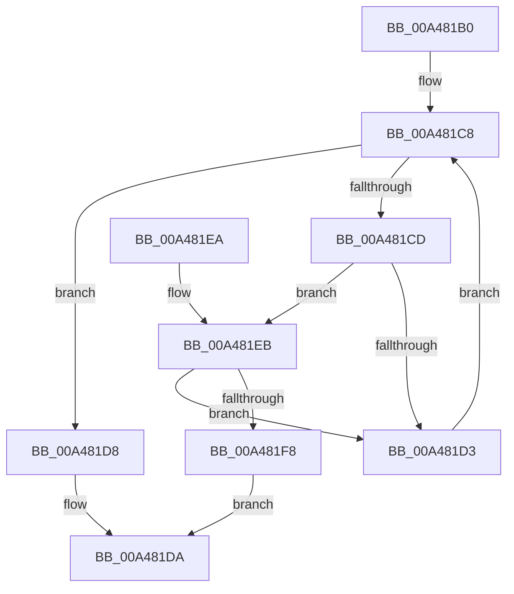

# AlpcpReferenceMessageByWaitingThreadPortQueue

- RVA: `0x00A481B0`–`0x00A481FD` (길이 `77` bytes)
- VA: `0x0000000140A481B0`
- 실행 섹션: `PAGE`
- PDB 이름 있음: `예`; PDB Function 태그: `아니요`
- unwind 정보 RVA: `0x0009A3D0`
- 디코드: `26`개 명령, `77/77` bytes 표시
- 미해석 바이트: `0` (있으면 어셈블리에 `.byte`로 보존)

> 이 문서는 커널 이미지의 기계어와 PDB 기호를 분석해 생성했습니다. 4번과 5번은 함수 원형과 자료형을 바이너리 사용 방식에서 추정한 C 해석이며 원본 소스 복구 결과는 아닙니다.

## 1. Dependencies

- 직접 호출 지점: **1**; 고유 호출 대상: **1**
- 직접 호출자로 확인된 함수: **1**
- RIP 상대 이미지 참조: **0**

### Outgoing calls
- `0x00A481EE` → [AlpcpReferenceBlob](../89/AlpcpReferenceBlob_function_00890110.md) (function, `0x00890110`)

### Direct callers
- [AlpcpReferenceMessageByWaitingThreadPort](AlpcpReferenceMessageByWaitingThreadPort_function_00A47F7C.md) at `0x00A48030`
- [AlpcpReferenceMessageByWaitingThreadPort](AlpcpReferenceMessageByWaitingThreadPort_function_00A47F7C.md) at `0x00A4804B`
- [AlpcpReferenceMessageByWaitingThreadPort](AlpcpReferenceMessageByWaitingThreadPort_function_00A47F7C.md) at `0x00A480BA`
- [AlpcpReferenceMessageByWaitingThreadPort](AlpcpReferenceMessageByWaitingThreadPort_function_00A47F7C.md) at `0x00A48121`

### Static image references
- 디코드된 RIP-relative 메모리 참조가 없습니다.

## 2. Other-region calls and transfers

- 다른 실행 섹션으로 향하는 call: **0**
- 별도 외부 분기/꼬리 이동을 확인하지 못했습니다.

## 3. Assembly (complete function range)

```asm
00A481B0  48 89 5C 24 08                  mov qword ptr [rsp + 8], rbx
00A481B5  48 89 74 24 10                  mov qword ptr [rsp + 0x10], rsi
00A481BA  57                              push rdi
00A481BB  48 83 EC 20                     sub rsp, 0x20
00A481BF  48 8B 1A                        mov rbx, qword ptr [rdx]
00A481C2  48 8B FA                        mov rdi, rdx
00A481C5  48 8B F1                        mov rsi, rcx
00A481C8  48 3B DF                        cmp rbx, rdi
00A481CB  74 0B                           je 0x140a481d8
00A481CD  48 39 73 20                     cmp qword ptr [rbx + 0x20], rsi
00A481D1  74 18                           je 0x140a481eb
00A481D3  48 8B 1B                        mov rbx, qword ptr [rbx]
00A481D6  EB F0                           jmp 0x140a481c8
00A481D8  33 C0                           xor eax, eax
00A481DA  48 8B 5C 24 30                  mov rbx, qword ptr [rsp + 0x30]
00A481DF  48 8B 74 24 38                  mov rsi, qword ptr [rsp + 0x38]
00A481E4  48 83 C4 20                     add rsp, 0x20
00A481E8  5F                              pop rdi
00A481E9  C3                              ret
00A481EA  CC                              int3
00A481EB  48 8B CB                        mov rcx, rbx
00A481EE  E8 1D 7F E4 FF                  call 0x140890110
00A481F3  48 85 C0                        test rax, rax
00A481F6  74 DB                           je 0x140a481d3
00A481F8  48 8B C3                        mov rax, rbx
00A481FB  EB DD                           jmp 0x140a481da
```

## 4. C-style interpretation (structured pseudocode)

```c
__int64 __fastcall AlpcpReferenceMessageByWaitingThreadPortQueue(__int64 a1, __int64 a2)
{
    __int64 result;
    __int64 v_rsp;
    unsigned __int64 v_stack_p10;
    unsigned __int64 v_stack_p8;

    v_stack_p8 = v_rbx;
    v_stack_p10 = v_rsi;
    v_rsp = (v_rsp) - (32);
loc_00A481C8:
    if ((*(unsigned __int64 *)(a2)) == a2) goto loc_00A481D8;
    if ((*(unsigned __int64 *)(*(unsigned __int64 *)(a2) + 32)) == a1) goto loc_00A481EB;
loc_00A481D3:
    goto loc_00A481C8;
loc_00A481D8:
    result = 0;
loc_00A481DA:
    v_rsp = (v_rsp) + (32);
    return result;
loc_00A481EB:
    result = AlpcpReferenceBlob(v_stack_p8, a2, a3, a4);
    if (result == 0) goto loc_00A481D3;
    goto loc_00A481DA;
}
```

## 5. (Beta) C Style

```c
int64_t AlpcpReferenceMessageByWaitingThreadPortQueue(int64_t Arg1, void *Arg2)
{
    uint8_t *arg2 = (uint8_t *)Arg2;

    int64_t result;
    int64_t local_rsp;
    uint64_t v_stack_p10;
    uint64_t v_stack_p8;

    v_stack_p8 = local_rbx;
    v_stack_p10 = local_rsi;
    local_rsp = (local_rsp) - (32);
loc_00A481C8:
    if ((*(uint64_t *)(arg2)) == Arg2) goto loc_00A481D8;
    if ((*(uint64_t *)(*(uint64_t *)(arg2) + 0x20)) == Arg1) goto loc_00A481EB;
loc_00A481D3:
    goto loc_00A481C8;
loc_00A481D8:
    result = 0;
loc_00A481DA:
    local_rsp = (local_rsp) + (32);
    return result;
loc_00A481EB:
    result = AlpcpReferenceBlob(v_stack_p8, Arg2, a3, a4);
    if (result == 0) goto loc_00A481D3;
    goto loc_00A481DA;
}
```

### 관측된 메모리 오프셋

구조체 형식이 확인되지 않은 접근은 인자 기준의 오프셋으로만 기록했습니다.

| 기준 인자 | 오프셋 표현 | 폭 (bit) | 접근 |
|---|---:|---:|---|
| `Arg2` | `+ 0x0` | `64` | `R` |

## 6. Execution-region graph

[열기: 2D/3D 그래프와 함수 탐색 컨트롤 패널](../../../control-panel.html?section=page&rva=0x00A481B0&view=graph)

- 2D 그래프는 위에서 아래로 흐르고, 3D 그래프는 빈 공간을 드래그해 회전합니다. Shift+드래그는 이동, 휠은 확대·축소, 함수 노드 선택은 대상 보고서 이동입니다.

### Static fallback


