# AlpcpReferenceMessageByWaitingThreadPort

- RVA: `0x00A47F7C`–`0x00A481A9` (길이 `557` bytes)
- VA: `0x0000000140A47F7C`
- 실행 섹션: `PAGE`
- PDB 이름 있음: `예`; PDB Function 태그: `아니요`
- unwind 정보 RVA: `0x000AFA00`
- 디코드: `154`개 명령, `557/557` bytes 표시
- 미해석 바이트: `0` (있으면 어셈블리에 `.byte`로 보존)

> 이 문서는 커널 이미지의 기계어와 PDB 기호를 분석해 생성했습니다. 4번과 5번은 함수 원형과 자료형을 바이너리 사용 방식에서 추정한 C 해석이며 원본 소스 복구 결과는 아닙니다.

## 1. Dependencies

- 직접 호출 지점: **20**; 고유 호출 대상: **7**
- 직접 호출자로 확인된 함수: **1**
- RIP 상대 이미지 참조: **0**

### Outgoing calls
- `0x00A47FAD` → [KeAbPreAcquire](../../text/21/KeAbPreAcquire_function_00210230.md) (function, `0x00210230`)
- `0x00A47FCE` → [ExfAcquirePushLockSharedEx](../../text/21/ExfAcquirePushLockSharedEx_function_0021044C.md) (function, `0x0021044C`)
- `0x00A47FFF` → [KeAbPreAcquire](../../text/21/KeAbPreAcquire_function_00210230.md) (function, `0x00210230`)
- `0x00A48018` → [ExfAcquirePushLockExclusiveEx](../../text/20/ExfAcquirePushLockExclusiveEx_function_0020FC90.md) (function, `0x0020FC90`)
- `0x00A48030` → [AlpcpReferenceMessageByWaitingThreadPortQueue](AlpcpReferenceMessageByWaitingThreadPortQueue_function_00A481B0.md) (function, `0x00A481B0`)
- `0x00A4804B` → [AlpcpReferenceMessageByWaitingThreadPortQueue](AlpcpReferenceMessageByWaitingThreadPortQueue_function_00A481B0.md) (function, `0x00A481B0`)
- `0x00A4806C` → [KeAbPostRelease](../../text/2E/KeAbPostRelease_function_002E1600.md) (function, `0x002E1600`)
- `0x00A48089` → [KeAbPreAcquire](../../text/21/KeAbPreAcquire_function_00210230.md) (function, `0x00210230`)
- `0x00A480A2` → [ExfAcquirePushLockExclusiveEx](../../text/20/ExfAcquirePushLockExclusiveEx_function_0020FC90.md) (function, `0x0020FC90`)
- `0x00A480BA` → [AlpcpReferenceMessageByWaitingThreadPortQueue](AlpcpReferenceMessageByWaitingThreadPortQueue_function_00A481B0.md) (function, `0x00A481B0`)
- `0x00A480D7` → [KeAbPostRelease](../../text/2E/KeAbPostRelease_function_002E1600.md) (function, `0x002E1600`)
- `0x00A480F0` → [KeAbPreAcquire](../../text/21/KeAbPreAcquire_function_00210230.md) (function, `0x00210230`)
- `0x00A48109` → [ExfAcquirePushLockExclusiveEx](../../text/20/ExfAcquirePushLockExclusiveEx_function_0020FC90.md) (function, `0x0020FC90`)
- `0x00A48121` → [AlpcpReferenceMessageByWaitingThreadPortQueue](AlpcpReferenceMessageByWaitingThreadPortQueue_function_00A481B0.md) (function, `0x00A481B0`)
- `0x00A48139` → [KeAbPostRelease](../../text/2E/KeAbPostRelease_function_002E1600.md) (function, `0x002E1600`)
- `0x00A48151` → [ExfReleasePushLockShared](../../text/26/ExfReleasePushLockShared_function_00263440.md) (function, `0x00263440`)
- `0x00A48159` → [KeAbPostRelease](../../text/2E/KeAbPostRelease_function_002E1600.md) (function, `0x002E1600`)
- `0x00A48182` → [ExfTryToWakePushLock](../../text/26/ExfTryToWakePushLock_function_00265DD0.md) (function, `0x00265DD0`)
- `0x00A4818F` → [ExfTryToWakePushLock](../../text/26/ExfTryToWakePushLock_function_00265DD0.md) (function, `0x00265DD0`)
- `0x00A4819C` → [ExfTryToWakePushLock](../../text/26/ExfTryToWakePushLock_function_00265DD0.md) (function, `0x00265DD0`)

### Direct callers
- [AlpcpReferenceMessageByWaitingThread](AlpcpReferenceMessageByWaitingThread_function_00A47DFC.md) at `0x00A47EB7`

### Static image references
- 디코드된 RIP-relative 메모리 참조가 없습니다.

## 2. Other-region calls and transfers

- 다른 실행 섹션으로 향하는 call: **16**
  - `0x00A47FAD` → [KeAbPreAcquire](../../text/21/KeAbPreAcquire_function_00210230.md) (`PAGE` → `.text`)
  - `0x00A47FCE` → [ExfAcquirePushLockSharedEx](../../text/21/ExfAcquirePushLockSharedEx_function_0021044C.md) (`PAGE` → `.text`)
  - `0x00A47FFF` → [KeAbPreAcquire](../../text/21/KeAbPreAcquire_function_00210230.md) (`PAGE` → `.text`)
  - `0x00A48018` → [ExfAcquirePushLockExclusiveEx](../../text/20/ExfAcquirePushLockExclusiveEx_function_0020FC90.md) (`PAGE` → `.text`)
  - `0x00A4806C` → [KeAbPostRelease](../../text/2E/KeAbPostRelease_function_002E1600.md) (`PAGE` → `.text`)
  - `0x00A48089` → [KeAbPreAcquire](../../text/21/KeAbPreAcquire_function_00210230.md) (`PAGE` → `.text`)
  - `0x00A480A2` → [ExfAcquirePushLockExclusiveEx](../../text/20/ExfAcquirePushLockExclusiveEx_function_0020FC90.md) (`PAGE` → `.text`)
  - `0x00A480D7` → [KeAbPostRelease](../../text/2E/KeAbPostRelease_function_002E1600.md) (`PAGE` → `.text`)
  - `0x00A480F0` → [KeAbPreAcquire](../../text/21/KeAbPreAcquire_function_00210230.md) (`PAGE` → `.text`)
  - `0x00A48109` → [ExfAcquirePushLockExclusiveEx](../../text/20/ExfAcquirePushLockExclusiveEx_function_0020FC90.md) (`PAGE` → `.text`)
  - `0x00A48139` → [KeAbPostRelease](../../text/2E/KeAbPostRelease_function_002E1600.md) (`PAGE` → `.text`)
  - `0x00A48151` → [ExfReleasePushLockShared](../../text/26/ExfReleasePushLockShared_function_00263440.md) (`PAGE` → `.text`)
  - `0x00A48159` → [KeAbPostRelease](../../text/2E/KeAbPostRelease_function_002E1600.md) (`PAGE` → `.text`)
  - `0x00A48182` → [ExfTryToWakePushLock](../../text/26/ExfTryToWakePushLock_function_00265DD0.md) (`PAGE` → `.text`)
  - `0x00A4818F` → [ExfTryToWakePushLock](../../text/26/ExfTryToWakePushLock_function_00265DD0.md) (`PAGE` → `.text`)
  - `0x00A4819C` → [ExfTryToWakePushLock](../../text/26/ExfTryToWakePushLock_function_00265DD0.md) (`PAGE` → `.text`)
- 별도 외부 분기/꼬리 이동을 확인하지 못했습니다.

## 3. Assembly (complete function range)

```asm
00A47F7C  48 89 5C 24 08                  mov qword ptr [rsp + 8], rbx
00A47F81  48 89 6C 24 18                  mov qword ptr [rsp + 0x18], rbp
00A47F86  48 89 74 24 20                  mov qword ptr [rsp + 0x20], rsi
00A47F8B  57                              push rdi
00A47F8C  41 54                           push r12
00A47F8E  41 55                           push r13
00A47F90  41 56                           push r14
00A47F92  41 57                           push r15
00A47F94  48 83 EC 20                     sub rsp, 0x20
00A47F98  48 8D AA 60 01 00 00            lea rbp, [rdx + 0x160]
00A47F9F  4C 8B F2                        mov r14, rdx
00A47FA2  4C 8B F9                        mov r15, rcx
00A47FA5  45 33 C0                        xor r8d, r8d
00A47FA8  48 8B CD                        mov rcx, rbp
00A47FAB  33 D2                           xor edx, edx
00A47FAD  E8 7E 82 7C FF                  call 0x140210230
00A47FB2  48 8B D8                        mov rbx, rax
00A47FB5  33 C0                           xor eax, eax
00A47FB7  44 8D 68 11                     lea r13d, [rax + 0x11]
00A47FBB  F0 4C 0F B1 6D 00               lock cmpxchg qword ptr [rbp], r13
00A47FC1  74 10                           je 0x140a47fd3
00A47FC3  4C 8B CD                        mov r9, rbp
00A47FC6  4C 8B C3                        mov r8, rbx
00A47FC9  33 D2                           xor edx, edx
00A47FCB  48 8B CD                        mov rcx, rbp
00A47FCE  E8 79 84 7C FF                  call 0x14021044c
00A47FD3  45 33 E4                        xor r12d, r12d
00A47FD6  48 85 DB                        test rbx, rbx
00A47FD9  74 04                           je 0x140a47fdf
00A47FDB  C6 43 0A 01                     mov byte ptr [rbx + 0xa], 1
00A47FDF  41 8B 86 A0 01 00 00            mov eax, dword ptr [r14 + 0x1a0]
00A47FE6  24 41                           and al, 0x41
00A47FE8  3C 01                           cmp al, 1
00A47FEA  0F 85 50 01 00 00               jne 0x140a48140
00A47FF0  49 8D BE 88 00 00 00            lea rdi, [r14 + 0x88]
00A47FF7  45 33 C0                        xor r8d, r8d
00A47FFA  48 8B CF                        mov rcx, rdi
00A47FFD  33 D2                           xor edx, edx
00A47FFF  E8 2C 82 7C FF                  call 0x140210230
00A48004  F0 48 0F BA 2F 00               lock bts qword ptr [rdi], 0
00A4800A  48 8B D8                        mov rbx, rax
00A4800D  73 0E                           jae 0x140a4801d
00A4800F  4C 8B C7                        mov r8, rdi
00A48012  48 8B D0                        mov rdx, rax
00A48015  48 8B CF                        mov rcx, rdi
00A48018  E8 73 7C 7C FF                  call 0x14020fc90
00A4801D  48 85 DB                        test rbx, rbx
00A48020  74 04                           je 0x140a48026
00A48022  C6 43 0A 01                     mov byte ptr [rbx + 0xa], 1
00A48026  49 8D 96 90 00 00 00            lea rdx, [r14 + 0x90]
00A4802D  49 8B CF                        mov rcx, r15
00A48030  E8 7B 01 00 00                  call 0x140a481b0
00A48035  48 8B F0                        mov rsi, rax
00A48038  48 85 C0                        test rax, rax
00A4803B  0F 85 62 01 00 00               jne 0x140a481a3
00A48041  49 8D 96 A0 00 00 00            lea rdx, [r14 + 0xa0]
00A48048  49 8B CF                        mov rcx, r15
00A4804B  E8 60 01 00 00                  call 0x140a481b0
00A48050  48 83 CB FF                     or rbx, 0xffffffffffffffff
00A48054  48 8B F0                        mov rsi, rax
00A48057  48 8B C3                        mov rax, rbx
00A4805A  F0 48 0F C1 07                  lock xadd qword ptr [rdi], rax
00A4805F  24 06                           and al, 6
00A48061  3C 02                           cmp al, 2
00A48063  0F 84 16 01 00 00               je 0x140a4817f
00A48069  48 8B CF                        mov rcx, rdi
00A4806C  E8 8F 95 89 FF                  call 0x1402e1600
00A48071  48 85 F6                        test rsi, rsi
00A48074  0F 85 C9 00 00 00               jne 0x140a48143
00A4807A  49 8D BE B0 00 00 00            lea rdi, [r14 + 0xb0]
00A48081  45 33 C0                        xor r8d, r8d
00A48084  48 8B CF                        mov rcx, rdi
00A48087  33 D2                           xor edx, edx
00A48089  E8 A2 81 7C FF                  call 0x140210230
00A4808E  F0 48 0F BA 2F 00               lock bts qword ptr [rdi], 0
00A48094  48 8B F0                        mov rsi, rax
00A48097  73 0E                           jae 0x140a480a7
00A48099  4C 8B C7                        mov r8, rdi
00A4809C  48 8B D0                        mov rdx, rax
00A4809F  48 8B CF                        mov rcx, rdi
00A480A2  E8 E9 7B 7C FF                  call 0x14020fc90
00A480A7  48 85 F6                        test rsi, rsi
00A480AA  74 04                           je 0x140a480b0
00A480AC  C6 46 0A 01                     mov byte ptr [rsi + 0xa], 1
00A480B0  49 8D 96 B8 00 00 00            lea rdx, [r14 + 0xb8]
00A480B7  49 8B CF                        mov rcx, r15
00A480BA  E8 F1 00 00 00                  call 0x140a481b0
00A480BF  48 8B F0                        mov rsi, rax
00A480C2  48 8B C3                        mov rax, rbx
00A480C5  F0 48 0F C1 07                  lock xadd qword ptr [rdi], rax
00A480CA  24 06                           and al, 6
00A480CC  3C 02                           cmp al, 2
00A480CE  0F 84 B8 00 00 00               je 0x140a4818c
00A480D4  48 8B CF                        mov rcx, rdi
00A480D7  E8 24 95 89 FF                  call 0x1402e1600
00A480DC  48 85 F6                        test rsi, rsi
00A480DF  75 62                           jne 0x140a48143
00A480E1  49 8D BE C8 00 00 00            lea rdi, [r14 + 0xc8]
00A480E8  45 33 C0                        xor r8d, r8d
00A480EB  48 8B CF                        mov rcx, rdi
00A480EE  33 D2                           xor edx, edx
00A480F0  E8 3B 81 7C FF                  call 0x140210230
00A480F5  F0 48 0F BA 2F 00               lock bts qword ptr [rdi], 0
00A480FB  48 8B F0                        mov rsi, rax
00A480FE  73 0E                           jae 0x140a4810e
00A48100  4C 8B C7                        mov r8, rdi
00A48103  48 8B D0                        mov rdx, rax
00A48106  48 8B CF                        mov rcx, rdi
00A48109  E8 82 7B 7C FF                  call 0x14020fc90
00A4810E  48 85 F6                        test rsi, rsi
00A48111  74 04                           je 0x140a48117
00A48113  C6 46 0A 01                     mov byte ptr [rsi + 0xa], 1
00A48117  49 8D 96 D0 00 00 00            lea rdx, [r14 + 0xd0]
00A4811E  49 8B CF                        mov rcx, r15
00A48121  E8 8A 00 00 00                  call 0x140a481b0
00A48126  48 8B F0                        mov rsi, rax
00A48129  F0 48 0F C1 1F                  lock xadd qword ptr [rdi], rbx
00A4812E  80 E3 06                        and bl, 6
00A48131  80 FB 02                        cmp bl, 2
00A48134  74 63                           je 0x140a48199
00A48136  48 8B CF                        mov rcx, rdi
00A48139  E8 C2 94 89 FF                  call 0x1402e1600
00A4813E  EB 03                           jmp 0x140a48143
00A48140  49 8B F4                        mov rsi, r12
00A48143  49 8B C5                        mov rax, r13
00A48146  F0 4C 0F B1 65 00               lock cmpxchg qword ptr [rbp], r12
00A4814C  74 08                           je 0x140a48156
00A4814E  48 8B CD                        mov rcx, rbp
00A48151  E8 EA B2 81 FF                  call 0x140263440
00A48156  48 8B CD                        mov rcx, rbp
00A48159  E8 A2 94 89 FF                  call 0x1402e1600
00A4815E  48 8B 5C 24 50                  mov rbx, qword ptr [rsp + 0x50]
00A48163  48 8B C6                        mov rax, rsi
00A48166  48 8B 74 24 68                  mov rsi, qword ptr [rsp + 0x68]
00A4816B  48 8B 6C 24 60                  mov rbp, qword ptr [rsp + 0x60]
00A48170  48 83 C4 20                     add rsp, 0x20
00A48174  41 5F                           pop r15
00A48176  41 5E                           pop r14
00A48178  41 5D                           pop r13
00A4817A  41 5C                           pop r12
00A4817C  5F                              pop rdi
00A4817D  C3                              ret
00A4817E  CC                              int3
00A4817F  48 8B CF                        mov rcx, rdi
00A48182  E8 49 DC 81 FF                  call 0x140265dd0
00A48187  E9 DD FE FF FF                  jmp 0x140a48069
00A4818C  48 8B CF                        mov rcx, rdi
00A4818F  E8 3C DC 81 FF                  call 0x140265dd0
00A48194  E9 3B FF FF FF                  jmp 0x140a480d4
00A48199  48 8B CF                        mov rcx, rdi
00A4819C  E8 2F DC 81 FF                  call 0x140265dd0
00A481A1  EB 93                           jmp 0x140a48136
00A481A3  48 83 CB FF                     or rbx, 0xffffffffffffffff
00A481A7  EB 80                           jmp 0x140a48129
```

## 4. C-style interpretation (structured pseudocode)

```c
__int64 __fastcall AlpcpReferenceMessageByWaitingThreadPort(__int64 a1, __int64 a2, int a3)
{
    __int64 result;
    __int64 v_r12;
    __int64 v_rbx;
    __int64 v_rsp;
    unsigned __int64 v_stack_p18;
    unsigned __int64 v_stack_p20;
    unsigned __int64 v_stack_p8;

    v_stack_p8 = v_rbx;
    v_stack_p18 = v_rbp;
    v_stack_p20 = v_rsi;
    v_rsp = (v_rsp) - (32);
    a3 = 0;
    a2 = 0;
    result = KeAbPreAcquire(a2 + 352, a2, a3, a4);
    result = 0;
    if (!(condition_is_equal)) {
        a4 = a2 + 352;
        a3 = 0;
        a2 = 0;
        a1 = a2 + 352;
        result = ExfAcquirePushLockSharedEx(a1, a2, a3, a4);
    }
    v_r12 = 0;
    if (result != 0) {
        *(unsigned __int8 *)(result + 10) = 1;
    }
    result = (unsigned __int8)(((unsigned int)(*(unsigned int *)(a2 + 416))) & (65));
    if (((unsigned __int8)(result)) != 1) goto loc_00A48140;
    a3 = 0;
    a2 = 0;
    result = KeAbPreAcquire(a2 + 136, a2, a3, a4);
    if (!(condition_is_above_or_equal)) {
        a3 = a2 + 136;
        a2 = result;
        a1 = a2 + 136;
        result = ExfAcquirePushLockExclusiveEx(a1, a2, a3, a4);
    }
    if (result != 0) {
        *(unsigned __int8 *)(result + 10) = 1;
    }
    result = AlpcpReferenceMessageByWaitingThreadPortQueue(a1, a2 + 144, a3, a4);
    if (result != 0) goto loc_00A481A3;
    result = AlpcpReferenceMessageByWaitingThreadPortQueue(a1, a2 + 160, a3, a4);
    v_rbx = (result) | (-1);
    result = (unsigned __int8)((v_rbx) & (6));
    if (((unsigned __int8)(result)) == 2) goto loc_00A4817F;
loc_00A48069:
    result = KeAbPostRelease(a2 + 136, a2 + 160, a3, a4);
    if (result != 0) goto loc_00A48143;
    a3 = 0;
    a2 = 0;
    result = KeAbPreAcquire(a2 + 176, a2, a3, a4);
    if (!(condition_is_above_or_equal)) {
        a3 = a2 + 176;
        a2 = result;
        a1 = a2 + 176;
        result = ExfAcquirePushLockExclusiveEx(a1, a2, a3, a4);
    }
    if (result != 0) {
        *(unsigned __int8 *)(result + 10) = 1;
    }
    result = AlpcpReferenceMessageByWaitingThreadPortQueue(a1, a2 + 184, a3, a4);
    result = (unsigned __int8)((v_rbx) & (6));
    if (((unsigned __int8)(result)) == 2) goto loc_00A4818C;
loc_00A480D4:
    result = KeAbPostRelease(a2 + 176, a2 + 184, a3, a4);
    if (result != 0) goto loc_00A48143;
    a3 = 0;
    a2 = 0;
    result = KeAbPreAcquire(a2 + 200, a2, a3, a4);
    if (!(condition_is_above_or_equal)) {
        a3 = a2 + 200;
        a2 = result;
        a1 = a2 + 200;
        result = ExfAcquirePushLockExclusiveEx(a1, a2, a3, a4);
    }
    if (result != 0) {
        *(unsigned __int8 *)(result + 10) = 1;
    }
    result = AlpcpReferenceMessageByWaitingThreadPortQueue(a1, a2 + 208, a3, a4);
loc_00A48129:
    v_rbx = (unsigned __int8)((v_rbx) & (6));
    if (((unsigned __int8)(v_rbx)) == 2) goto loc_00A48199;
loc_00A48136:
    result = KeAbPostRelease(a2 + 200, a2 + 208, a3, a4);
    goto loc_00A48143;
loc_00A48140:
loc_00A48143:
    result = result + 17;
    if (((unsigned __int8)(v_rbx)) != 2) {
        a1 = a2 + 352;
        result = ExfReleasePushLockShared(a1, a2 + 208, a3, a4);
    }
    result = KeAbPostRelease(a2 + 352, a2 + 208, a3, a4);
    v_rsp = (v_rsp) + (32);
    return 0;
loc_00A4817F:
    result = ExfTryToWakePushLock(a2 + 200, a2 + 208, a3, a4);
    goto loc_00A48069;
loc_00A4818C:
    result = ExfTryToWakePushLock(a2 + 200, a2 + 208, a3, a4);
    goto loc_00A480D4;
loc_00A48199:
    result = ExfTryToWakePushLock(a2 + 200, a2 + 208, a3, a4);
    goto loc_00A48136;
loc_00A481A3:
    v_rbx = (v_stack_p8) | (-1);
    goto loc_00A48129;
}
```

## 5. (Beta) C Style

```c
int64_t AlpcpReferenceMessageByWaitingThreadPort(int64_t Arg1, void *Arg2, int32_t Arg3)
{
    uint8_t *arg2 = (uint8_t *)Arg2;

    int64_t result;
    int64_t local_r12;
    int64_t local_rbx;
    int64_t local_rsp;
    uint64_t v_stack_p18;
    uint64_t v_stack_p20;
    uint64_t v_stack_p8;

    v_stack_p8 = local_rbx;
    v_stack_p18 = local_rbp;
    v_stack_p20 = local_rsi;
    local_rsp = (local_rsp) - (32);
    Arg3 = 0;
    Arg2 = 0;
    result = KeAbPreAcquire(Arg2 + 352, Arg2, Arg3, a4);
    result = 0;
    if (!(condition_is_equal)) {
        a4 = Arg2 + 352;
        Arg3 = 0;
        Arg2 = 0;
        Arg1 = Arg2 + 352;
        result = ExfAcquirePushLockSharedEx(Arg1, Arg2, Arg3, a4);
    }
    local_r12 = 0;
    if (result != 0) {
        *(uint8_t *)(result + 0xA) = 1;
    }
    result = (uint8_t)(((uint32_t)(*(uint32_t *)(arg2 + 0x1A0))) & (65));
    if (((uint8_t)(result)) != 1) goto loc_00A48140;
    Arg3 = 0;
    Arg2 = 0;
    result = KeAbPreAcquire(Arg2 + 136, Arg2, Arg3, a4);
    if (!(condition_is_above_or_equal)) {
        Arg3 = Arg2 + 136;
        Arg2 = result;
        Arg1 = Arg2 + 136;
        result = ExfAcquirePushLockExclusiveEx(Arg1, Arg2, Arg3, a4);
    }
    if (result != 0) {
        *(uint8_t *)(result + 0xA) = 1;
    }
    result = AlpcpReferenceMessageByWaitingThreadPortQueue(Arg1, Arg2 + 144, Arg3, a4);
    if (result != 0) goto loc_00A481A3;
    result = AlpcpReferenceMessageByWaitingThreadPortQueue(Arg1, Arg2 + 160, Arg3, a4);
    local_rbx = (result) | (-1);
    result = (uint8_t)((local_rbx) & (6));
    if (((uint8_t)(result)) == 2) goto loc_00A4817F;
loc_00A48069:
    result = KeAbPostRelease(Arg2 + 136, Arg2 + 160, Arg3, a4);
    if (result != 0) goto loc_00A48143;
    Arg3 = 0;
    Arg2 = 0;
    result = KeAbPreAcquire(Arg2 + 176, Arg2, Arg3, a4);
    if (!(condition_is_above_or_equal)) {
        Arg3 = Arg2 + 176;
        Arg2 = result;
        Arg1 = Arg2 + 176;
        result = ExfAcquirePushLockExclusiveEx(Arg1, Arg2, Arg3, a4);
    }
    if (result != 0) {
        *(uint8_t *)(result + 0xA) = 1;
    }
    result = AlpcpReferenceMessageByWaitingThreadPortQueue(Arg1, Arg2 + 184, Arg3, a4);
    result = (uint8_t)((local_rbx) & (6));
    if (((uint8_t)(result)) == 2) goto loc_00A4818C;
loc_00A480D4:
    result = KeAbPostRelease(Arg2 + 176, Arg2 + 184, Arg3, a4);
    if (result != 0) goto loc_00A48143;
    Arg3 = 0;
    Arg2 = 0;
    result = KeAbPreAcquire(Arg2 + 200, Arg2, Arg3, a4);
    if (!(condition_is_above_or_equal)) {
        Arg3 = Arg2 + 200;
        Arg2 = result;
        Arg1 = Arg2 + 200;
        result = ExfAcquirePushLockExclusiveEx(Arg1, Arg2, Arg3, a4);
    }
    if (result != 0) {
        *(uint8_t *)(result + 0xA) = 1;
    }
    result = AlpcpReferenceMessageByWaitingThreadPortQueue(Arg1, Arg2 + 208, Arg3, a4);
loc_00A48129:
    local_rbx = (uint8_t)((local_rbx) & (6));
    if (((uint8_t)(local_rbx)) == 2) goto loc_00A48199;
loc_00A48136:
    result = KeAbPostRelease(Arg2 + 200, Arg2 + 208, Arg3, a4);
    goto loc_00A48143;
loc_00A48140:
loc_00A48143:
    result = result + 17;
    if (((uint8_t)(local_rbx)) != 2) {
        Arg1 = Arg2 + 352;
        result = ExfReleasePushLockShared(Arg1, Arg2 + 208, Arg3, a4);
    }
    result = KeAbPostRelease(Arg2 + 352, Arg2 + 208, Arg3, a4);
    local_rsp = (local_rsp) + (32);
    return 0;
loc_00A4817F:
    result = ExfTryToWakePushLock(Arg2 + 200, Arg2 + 208, Arg3, a4);
    goto loc_00A48069;
loc_00A4818C:
    result = ExfTryToWakePushLock(Arg2 + 200, Arg2 + 208, Arg3, a4);
    goto loc_00A480D4;
loc_00A48199:
    result = ExfTryToWakePushLock(Arg2 + 200, Arg2 + 208, Arg3, a4);
    goto loc_00A48136;
loc_00A481A3:
    local_rbx = (v_stack_p8) | (-1);
    goto loc_00A48129;
}
```

### 관측된 메모리 오프셋

구조체 형식이 확인되지 않은 접근은 인자 기준의 오프셋으로만 기록했습니다.

| 기준 인자 | 오프셋 표현 | 폭 (bit) | 접근 |
|---|---:|---:|---|
| `Arg2` | `+ 0x0` | `64` | `R` |
| `Arg2` | `+ 0x0` | `64` | `R/W` |
| `Arg2` | `+ 0x88` | `64` | `R` |
| `Arg2` | `+ 0x90` | `64` | `R` |
| `Arg2` | `+ 0xA0` | `64` | `R` |
| `Arg2` | `+ 0xB0` | `64` | `R` |
| `Arg2` | `+ 0xB8` | `64` | `R` |
| `Arg2` | `+ 0xC8` | `64` | `R` |
| `Arg2` | `+ 0xD0` | `64` | `R` |
| `Arg2` | `+ 0x160` | `64` | `R` |
| `Arg2` | `+ 0x1A0` | `32` | `R` |

## 6. Execution-region graph

[열기: 2D/3D 그래프와 함수 탐색 컨트롤 패널](../../../control-panel.html?section=page&rva=0x00A47F7C&view=graph)

- 2D 그래프는 위에서 아래로 흐르고, 3D 그래프는 빈 공간을 드래그해 회전합니다. Shift+드래그는 이동, 휠은 확대·축소, 함수 노드 선택은 대상 보고서 이동입니다.

### Static fallback

```mermaid
flowchart TD
  bb_00A47F7C[BB_00A47F7C]
  bb_00A47FC3[BB_00A47FC3]
  bb_00A47FD3[BB_00A47FD3]
  bb_00A47FDB[BB_00A47FDB]
  bb_00A47FDF[BB_00A47FDF]
  bb_00A47FF0[BB_00A47FF0]
  bb_00A4800F[BB_00A4800F]
  bb_00A4801D[BB_00A4801D]
  bb_00A48022[BB_00A48022]
  bb_00A48026[BB_00A48026]
  bb_00A48041[BB_00A48041]
  bb_00A48069[BB_00A48069]
  bb_00A4807A[BB_00A4807A]
  bb_00A48099[BB_00A48099]
  bb_00A480A7[BB_00A480A7]
  bb_00A480AC[BB_00A480AC]
  bb_00A480B0[BB_00A480B0]
  bb_00A480D4[BB_00A480D4]
  bb_00A480E1[BB_00A480E1]
  bb_00A48100[BB_00A48100]
  bb_00A4810E[BB_00A4810E]
  bb_00A48113[BB_00A48113]
  bb_00A48117[BB_00A48117]
  bb_00A48129[BB_00A48129]
  bb_00A48136[BB_00A48136]
  bb_00A48140[BB_00A48140]
  bb_00A48143[BB_00A48143]
  bb_00A4814E[BB_00A4814E]
  bb_00A48156[BB_00A48156]
  bb_00A4817E[BB_00A4817E]
  bb_00A4817F[BB_00A4817F]
  bb_00A4818C[BB_00A4818C]
  bb_00A48199[BB_00A48199]
  bb_00A481A3[BB_00A481A3]
  bb_00A47F7C -->|branch| bb_00A47FD3
  bb_00A47F7C -->|fallthrough| bb_00A47FC3
  bb_00A47FC3 -->|flow| bb_00A47FD3
  bb_00A47FD3 -->|branch| bb_00A47FDF
  bb_00A47FD3 -->|fallthrough| bb_00A47FDB
  bb_00A47FDB -->|flow| bb_00A47FDF
  bb_00A47FDF -->|branch| bb_00A48140
  bb_00A47FDF -->|fallthrough| bb_00A47FF0
  bb_00A47FF0 -->|branch| bb_00A4801D
  bb_00A47FF0 -->|fallthrough| bb_00A4800F
  bb_00A4800F -->|flow| bb_00A4801D
  bb_00A4801D -->|branch| bb_00A48026
  bb_00A4801D -->|fallthrough| bb_00A48022
  bb_00A48022 -->|flow| bb_00A48026
  bb_00A48026 -->|branch| bb_00A481A3
  bb_00A48026 -->|fallthrough| bb_00A48041
  bb_00A48041 -->|branch| bb_00A4817F
  bb_00A48041 -->|fallthrough| bb_00A48069
  bb_00A48069 -->|branch| bb_00A48143
  bb_00A48069 -->|fallthrough| bb_00A4807A
  bb_00A4807A -->|branch| bb_00A480A7
  bb_00A4807A -->|fallthrough| bb_00A48099
  bb_00A48099 -->|flow| bb_00A480A7
  bb_00A480A7 -->|branch| bb_00A480B0
  bb_00A480A7 -->|fallthrough| bb_00A480AC
  bb_00A480AC -->|flow| bb_00A480B0
  bb_00A480B0 -->|branch| bb_00A4818C
  bb_00A480B0 -->|fallthrough| bb_00A480D4
  bb_00A480D4 -->|branch| bb_00A48143
  bb_00A480D4 -->|fallthrough| bb_00A480E1
  bb_00A480E1 -->|branch| bb_00A4810E
  bb_00A480E1 -->|fallthrough| bb_00A48100
  bb_00A48100 -->|flow| bb_00A4810E
  bb_00A4810E -->|branch| bb_00A48117
  bb_00A4810E -->|fallthrough| bb_00A48113
  bb_00A48113 -->|flow| bb_00A48117
  bb_00A48117 -->|flow| bb_00A48129
  bb_00A48129 -->|branch| bb_00A48199
  bb_00A48129 -->|fallthrough| bb_00A48136
  bb_00A48136 -->|branch| bb_00A48143
  bb_00A48140 -->|flow| bb_00A48143
  bb_00A48143 -->|branch| bb_00A48156
  bb_00A48143 -->|fallthrough| bb_00A4814E
  bb_00A4814E -->|flow| bb_00A48156
  bb_00A4817E -->|flow| bb_00A4817F
  bb_00A4817F -->|branch| bb_00A48069
  bb_00A4818C -->|branch| bb_00A480D4
  bb_00A48199 -->|branch| bb_00A48136
  bb_00A481A3 -->|branch| bb_00A48129
```


