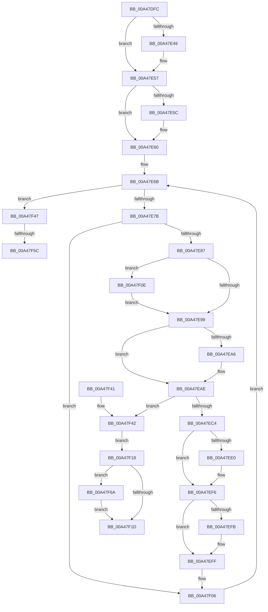

# AlpcpReferenceMessageByWaitingThread

- RVA: `0x00A47DFC`–`0x00A47F74` (길이 `376` bytes)
- VA: `0x0000000140A47DFC`
- 실행 섹션: `PAGE`
- PDB 이름 있음: `예`; PDB Function 태그: `예`
- unwind 정보 RVA: `0x000AF9D0`
- 디코드: `104`개 명령, `376/376` bytes 표시
- 미해석 바이트: `0` (있으면 어셈블리에 `.byte`로 보존)

> 이 문서는 커널 이미지의 기계어와 PDB 기호를 분석해 생성했습니다. 4번과 5번은 함수 원형과 자료형을 바이너리 사용 방식에서 추정한 C 해석이며 원본 소스 복구 결과는 아닙니다.

## 1. Dependencies

- 직접 호출 지점: **11**; 고유 호출 대상: **7**
- 직접 호출자로 확인된 함수: **1**
- RIP 상대 이미지 참조: **3**

### Outgoing calls
- `0x00A47E38` → [KeAbPreAcquire](../../text/21/KeAbPreAcquire_function_00210230.md) (function, `0x00210230`)
- `0x00A47E52` → [ExfAcquirePushLockExclusiveEx](../../text/20/ExfAcquirePushLockExclusiveEx_function_0020FC90.md) (function, `0x0020FC90`)
- `0x00A47E7E` → [ObReferenceObjectSafe](../../text/41/ObReferenceObjectSafe_function_0041DAE0.md) (function, `0x0041DAE0`)
- `0x00A47E9C` → [KeAbPostRelease](../../text/2E/KeAbPostRelease_function_002E1600.md) (function, `0x002E1600`)
- `0x00A47EA9` → [ObfDereferenceObject](../../text/2F/ObfDereferenceObject_function_002F9350.md) (function, `0x002F9350`)
- `0x00A47EB7` → [AlpcpReferenceMessageByWaitingThreadPort](AlpcpReferenceMessageByWaitingThreadPort_function_00A47F7C.md) (function, `0x00A47F7C`)
- `0x00A47ECC` → [KeAbPreAcquire](../../text/21/KeAbPreAcquire_function_00210230.md) (function, `0x00210230`)
- `0x00A47EF1` → [ExfAcquirePushLockExclusiveEx](../../text/20/ExfAcquirePushLockExclusiveEx_function_0020FC90.md) (function, `0x0020FC90`)
- `0x00A47F11` → [ExfTryToWakePushLock](../../text/26/ExfTryToWakePushLock_function_00265DD0.md) (function, `0x00265DD0`)
- `0x00A47F5F` → [ExfTryToWakePushLock](../../text/26/ExfTryToWakePushLock_function_00265DD0.md) (function, `0x00265DD0`)
- `0x00A47F6D` → [ObfDereferenceObject](../../text/2F/ObfDereferenceObject_function_002F9350.md) (function, `0x002F9350`)

### Direct callers
- [AlpcpPortQueryServerInfo](../74/AlpcpPortQueryServerInfo_function_0074C784.md) at `0x0074C850`

### Static image references
- `0x00A47E1B` → RVA `0x00F10100` (`.data`; read)
- `0x00A47E60` → RVA `0x00F100F0` (`.data`; read)
- `0x00A47E8A` → RVA `0x00F10100` (`.data`; read/write)

## 2. Other-region calls and transfers

- 다른 실행 섹션으로 향하는 call: **10**
  - `0x00A47E38` → [KeAbPreAcquire](../../text/21/KeAbPreAcquire_function_00210230.md) (`PAGE` → `.text`)
  - `0x00A47E52` → [ExfAcquirePushLockExclusiveEx](../../text/20/ExfAcquirePushLockExclusiveEx_function_0020FC90.md) (`PAGE` → `.text`)
  - `0x00A47E7E` → [ObReferenceObjectSafe](../../text/41/ObReferenceObjectSafe_function_0041DAE0.md) (`PAGE` → `.text`)
  - `0x00A47E9C` → [KeAbPostRelease](../../text/2E/KeAbPostRelease_function_002E1600.md) (`PAGE` → `.text`)
  - `0x00A47EA9` → [ObfDereferenceObject](../../text/2F/ObfDereferenceObject_function_002F9350.md) (`PAGE` → `.text`)
  - `0x00A47ECC` → [KeAbPreAcquire](../../text/21/KeAbPreAcquire_function_00210230.md) (`PAGE` → `.text`)
  - `0x00A47EF1` → [ExfAcquirePushLockExclusiveEx](../../text/20/ExfAcquirePushLockExclusiveEx_function_0020FC90.md) (`PAGE` → `.text`)
  - `0x00A47F11` → [ExfTryToWakePushLock](../../text/26/ExfTryToWakePushLock_function_00265DD0.md) (`PAGE` → `.text`)
  - `0x00A47F5F` → [ExfTryToWakePushLock](../../text/26/ExfTryToWakePushLock_function_00265DD0.md) (`PAGE` → `.text`)
  - `0x00A47F6D` → [ObfDereferenceObject](../../text/2F/ObfDereferenceObject_function_002F9350.md) (`PAGE` → `.text`)
- call이 아닌 외부 분기/꼬리 이동: **2**
  - `0x00A47F56` → [sub_00B3B736](../B3/Unknown_function_00B3B736.md) (`tail-transfer`)
  - `0x00A47F65` → [sub_00B3B736](../B3/Unknown_function_00B3B736.md) (`tail-transfer`)

## 3. Assembly (complete function range)

```asm
00A47DFC  48 89 5C 24 08                  mov qword ptr [rsp + 8], rbx
00A47E01  48 89 6C 24 10                  mov qword ptr [rsp + 0x10], rbp
00A47E06  48 89 74 24 18                  mov qword ptr [rsp + 0x18], rsi
00A47E0B  57                              push rdi
00A47E0C  41 54                           push r12
00A47E0E  41 55                           push r13
00A47E10  41 56                           push r14
00A47E12  41 57                           push r15
00A47E14  48 83 EC 20                     sub rsp, 0x20
00A47E18  4C 8B E2                        mov r12, rdx
00A47E1B  48 8D 2D DE 82 4C 00            lea rbp, [rip + 0x4c82de]
00A47E22  4C 8B E9                        mov r13, rcx
00A47E25  45 33 C0                        xor r8d, r8d
00A47E28  48 8B CD                        mov rcx, rbp
00A47E2B  33 D2                           xor edx, edx
00A47E2D  45 33 F6                        xor r14d, r14d
00A47E30  33 F6                           xor esi, esi
00A47E32  41 BF 25 02 00 C0               mov r15d, 0xc0000225
00A47E38  E8 F3 83 7C FF                  call 0x140210230
00A47E3D  F0 48 0F BA 6D 00 00            lock bts qword ptr [rbp], 0
00A47E44  48 8B D8                        mov rbx, rax
00A47E47  73 0E                           jae 0x140a47e57
00A47E49  4C 8B C5                        mov r8, rbp
00A47E4C  48 8B D0                        mov rdx, rax
00A47E4F  48 8B CD                        mov rcx, rbp
00A47E52  E8 39 7E 7C FF                  call 0x14020fc90
00A47E57  48 85 DB                        test rbx, rbx
00A47E5A  74 04                           je 0x140a47e60
00A47E5C  C6 43 0A 01                     mov byte ptr [rbx + 0xa], 1
00A47E60  48 8B 3D 89 82 4C 00            mov rdi, qword ptr [rip + 0x4c8289]
00A47E67  48 83 CB FF                     or rbx, 0xffffffffffffffff
00A47E6B  48 8D 05 7E 82 4C 00            lea rax, [rip + 0x4c827e]
00A47E72  48 3B F8                        cmp rdi, rax
00A47E75  0F 84 CC 00 00 00               je 0x140a47f47
00A47E7B  48 8B CF                        mov rcx, rdi
00A47E7E  E8 5D 5C 9D FF                  call 0x14041dae0
00A47E83  84 C0                           test al, al
00A47E85  74 7F                           je 0x140a47f06
00A47E87  48 8B C3                        mov rax, rbx
00A47E8A  F0 48 0F C1 05 6D 82 4C 00      lock xadd qword ptr [rip + 0x4c826d], rax
00A47E93  24 06                           and al, 6
00A47E95  3C 02                           cmp al, 2
00A47E97  74 75                           je 0x140a47f0e
00A47E99  48 8B CD                        mov rcx, rbp
00A47E9C  E8 5F 97 89 FF                  call 0x1402e1600
00A47EA1  48 85 F6                        test rsi, rsi
00A47EA4  74 08                           je 0x140a47eae
00A47EA6  48 8B CE                        mov rcx, rsi
00A47EA9  E8 A2 14 8B FF                  call 0x1402f9350
00A47EAE  48 8B D7                        mov rdx, rdi
00A47EB1  49 8B CD                        mov rcx, r13
00A47EB4  48 8B F7                        mov rsi, rdi
00A47EB7  E8 C0 00 00 00                  call 0x140a47f7c
00A47EBC  4C 8B F0                        mov r14, rax
00A47EBF  48 85 C0                        test rax, rax
00A47EC2  75 7E                           jne 0x140a47f42
00A47EC4  45 33 C0                        xor r8d, r8d
00A47EC7  33 D2                           xor edx, edx
00A47EC9  48 8B CD                        mov rcx, rbp
00A47ECC  E8 5F 83 7C FF                  call 0x140210230
00A47ED1  F0 48 0F BA 2D 25 82 4C 00 00   lock bts qword ptr [rip + 0x4c8225], 0
00A47EDB  48 8B E8                        mov rbp, rax
00A47EDE  73 16                           jae 0x140a47ef6
00A47EE0  4C 8D 05 19 82 4C 00            lea r8, [rip + 0x4c8219]
00A47EE7  48 8B D0                        mov rdx, rax
00A47EEA  48 8D 0D 0F 82 4C 00            lea rcx, [rip + 0x4c820f]
00A47EF1  E8 9A 7D 7C FF                  call 0x14020fc90
00A47EF6  48 85 ED                        test rbp, rbp
00A47EF9  74 04                           je 0x140a47eff
00A47EFB  C6 45 0A 01                     mov byte ptr [rbp + 0xa], 1
00A47EFF  48 8D 2D FA 81 4C 00            lea rbp, [rip + 0x4c81fa]
00A47F06  48 8B 3F                        mov rdi, qword ptr [rdi]
00A47F09  E9 5D FF FF FF                  jmp 0x140a47e6b
00A47F0E  48 8B CD                        mov rcx, rbp
00A47F11  E8 BA DE 81 FF                  call 0x140265dd0
00A47F16  EB 81                           jmp 0x140a47e99
00A47F18  48 85 F6                        test rsi, rsi
00A47F1B  75 4D                           jne 0x140a47f6a
00A47F1D  48 8B 5C 24 50                  mov rbx, qword ptr [rsp + 0x50]
00A47F22  41 8B C7                        mov eax, r15d
00A47F25  48 8B 6C 24 58                  mov rbp, qword ptr [rsp + 0x58]
00A47F2A  48 8B 74 24 60                  mov rsi, qword ptr [rsp + 0x60]
00A47F2F  4D 89 34 24                     mov qword ptr [r12], r14
00A47F33  48 83 C4 20                     add rsp, 0x20
00A47F37  41 5F                           pop r15
00A47F39  41 5E                           pop r14
00A47F3B  41 5D                           pop r13
00A47F3D  41 5C                           pop r12
00A47F3F  5F                              pop rdi
00A47F40  C3                              ret
00A47F41  CC                              int3
00A47F42  45 33 FF                        xor r15d, r15d
00A47F45  EB D1                           jmp 0x140a47f18
00A47F47  F0 48 0F C1 1D B0 81 4C 00      lock xadd qword ptr [rip + 0x4c81b0], rbx
00A47F50  80 E3 06                        and bl, 6
00A47F53  80 FB 02                        cmp bl, 2
00A47F56  0F 85 DA 37 0F 00               jne 0x140b3b736
00A47F5C  48 8B CD                        mov rcx, rbp
00A47F5F  E8 6C DE 81 FF                  call 0x140265dd0
00A47F64  90                              nop
00A47F65  E9 CC 37 0F 00                  jmp 0x140b3b736
00A47F6A  48 8B CE                        mov rcx, rsi
00A47F6D  E8 DE 13 8B FF                  call 0x1402f9350
00A47F72  EB A9                           jmp 0x140a47f1d
```

## 4. C-style interpretation (structured pseudocode)

```c
__int64 __fastcall AlpcpReferenceMessageByWaitingThread(__int64 a1, __int64 a2, int a3)
{
    __int64 result;
    __int64 v_r14;
    __int64 v_r15;
    __int64 v_rbx;
    __int64 v_rsi;
    __int64 v_rsp;
    unsigned __int64 v_stack_p10;
    unsigned __int64 v_stack_p18;
    unsigned __int64 v_stack_p8;

    v_stack_p8 = v_rbx;
    v_stack_p10 = v_rbp;
    v_stack_p18 = v_rsi;
    v_rsp = (v_rsp) - (32);
    a3 = 0;
    a2 = 0;
    v_r14 = 0;
    v_rsi = 0;
    result = KeAbPreAcquire(v_rip + 5014238, a2, a3, a4);
    if (!(condition_is_above_or_equal)) {
        a3 = v_rip + 5014238;
        a2 = result;
        a1 = v_rip + 5014238;
        result = ExfAcquirePushLockExclusiveEx(a1, a2, a3, a4);
    }
    if (result != 0) {
        *(unsigned __int8 *)(result + 10) = 1;
    }
    v_rbx = (result) | (-1);
loc_00A47E6B:
    if ((*(unsigned __int64 *)(v_rip + 5014153)) == (v_rip + 5014142)) goto loc_00A47F47;
    result = ObReferenceObjectSafe(*(unsigned __int64 *)(v_rip + 5014153), a2, a3, a4);
    if ((unsigned __int8)(result) == 0) goto loc_00A47F06;
    result = (unsigned __int8)((v_rbx) & (6));
    if (((unsigned __int8)(result)) == 2) goto loc_00A47F0E;
loc_00A47E99:
    result = KeAbPostRelease(v_rip + 5014238, a2, a3, a4);
    if (0 != 0) {
        a1 = 0;
        result = ObfDereferenceObject(a1, a2, a3, a4);
    }
    result = AlpcpReferenceMessageByWaitingThreadPort(a1, *(unsigned __int64 *)(v_rip + 5014153), a3, a4);
    if (result != 0) goto loc_00A47F42;
    a3 = 0;
    a2 = 0;
    result = KeAbPreAcquire(v_rip + 5014238, a2, a3, a4);
    if (!(condition_is_above_or_equal)) {
        a3 = v_rip + 5014041;
        a2 = result;
        a1 = v_rip + 5014031;
        result = ExfAcquirePushLockExclusiveEx(a1, a2, a3, a4);
    }
    if (result != 0) {
        *(unsigned __int8 *)(result + 10) = 1;
    }
loc_00A47F06:
    goto loc_00A47E6B;
loc_00A47F0E:
    result = ExfTryToWakePushLock(v_rip + 5014010, a2, a3, a4);
    goto loc_00A47E99;
loc_00A47F18:
    if (*(unsigned __int64 *)(v_rip + 5014153) != 0) goto loc_00A47F6A;
loc_00A47F1D:
    *(unsigned __int64 *)(a2) = result;
    v_rsp = (v_rsp) + (32);
    return (unsigned int)((unsigned int)((unsigned int)(0xC0000225ULL)));
loc_00A47F42:
    v_r15 = 0;
    goto loc_00A47F18;
loc_00A47F47:
    v_rbx = (unsigned __int8)((v_stack_p8) & (6));
    result = ExfTryToWakePushLock(v_stack_p10, a2, a3, a4);
loc_00A47F6A:
    result = ObfDereferenceObject(v_stack_p18, a2, a3, a4);
    goto loc_00A47F1D;
}
```

## 5. (Beta) C Style

```c
int64_t AlpcpReferenceMessageByWaitingThread(int64_t Arg1, void *Arg2, int32_t Arg3)
{
    uint8_t *arg2 = (uint8_t *)Arg2;

    int64_t result;
    int64_t local_r14;
    int64_t local_r15;
    int64_t local_rbx;
    int64_t local_rsi;
    int64_t local_rsp;
    uint64_t v_stack_p10;
    uint64_t v_stack_p18;
    uint64_t v_stack_p8;

    v_stack_p8 = local_rbx;
    v_stack_p10 = local_rbp;
    v_stack_p18 = local_rsi;
    local_rsp = (local_rsp) - (32);
    Arg3 = 0;
    Arg2 = 0;
    local_r14 = 0;
    local_rsi = 0;
    result = KeAbPreAcquire(v_rip + 5014238, Arg2, Arg3, a4);
    if (!(condition_is_above_or_equal)) {
        Arg3 = v_rip + 5014238;
        Arg2 = result;
        Arg1 = v_rip + 5014238;
        result = ExfAcquirePushLockExclusiveEx(Arg1, Arg2, Arg3, a4);
    }
    if (result != 0) {
        *(uint8_t *)(result + 0xA) = 1;
    }
    local_rbx = (result) | (-1);
loc_00A47E6B:
    if ((*(uint64_t *)(v_rip + 0x4C8289)) == (v_rip + 5014142)) goto loc_00A47F47;
    result = ObReferenceObjectSafe(*(uint64_t *)(v_rip + 0x4C8289), Arg2, Arg3, a4);
    if ((uint8_t)(result) == 0) goto loc_00A47F06;
    result = (uint8_t)((local_rbx) & (6));
    if (((uint8_t)(result)) == 2) goto loc_00A47F0E;
loc_00A47E99:
    result = KeAbPostRelease(v_rip + 5014238, Arg2, Arg3, a4);
    if (0 != 0) {
        Arg1 = 0;
        result = ObfDereferenceObject(Arg1, Arg2, Arg3, a4);
    }
    result = AlpcpReferenceMessageByWaitingThreadPort(Arg1, *(uint64_t *)(v_rip + 0x4C8289), Arg3, a4);
    if (result != 0) goto loc_00A47F42;
    Arg3 = 0;
    Arg2 = 0;
    result = KeAbPreAcquire(v_rip + 5014238, Arg2, Arg3, a4);
    if (!(condition_is_above_or_equal)) {
        Arg3 = v_rip + 5014041;
        Arg2 = result;
        Arg1 = v_rip + 5014031;
        result = ExfAcquirePushLockExclusiveEx(Arg1, Arg2, Arg3, a4);
    }
    if (result != 0) {
        *(uint8_t *)(result + 0xA) = 1;
    }
loc_00A47F06:
    goto loc_00A47E6B;
loc_00A47F0E:
    result = ExfTryToWakePushLock(v_rip + 5014010, Arg2, Arg3, a4);
    goto loc_00A47E99;
loc_00A47F18:
    if (*(uint64_t *)(v_rip + 0x4C8289) != 0) goto loc_00A47F6A;
loc_00A47F1D:
    *(uint64_t *)(arg2) = result;
    local_rsp = (local_rsp) + (32);
    return (uint32_t)((uint32_t)((uint32_t)(0xC0000225ULL)));
loc_00A47F42:
    local_r15 = 0;
    goto loc_00A47F18;
loc_00A47F47:
    local_rbx = (uint8_t)((v_stack_p8) & (6));
    result = ExfTryToWakePushLock(v_stack_p10, Arg2, Arg3, a4);
loc_00A47F6A:
    result = ObfDereferenceObject(v_stack_p18, Arg2, Arg3, a4);
    goto loc_00A47F1D;
}
```

### 관측된 메모리 오프셋

구조체 형식이 확인되지 않은 접근은 인자 기준의 오프셋으로만 기록했습니다.

| 기준 인자 | 오프셋 표현 | 폭 (bit) | 접근 |
|---|---:|---:|---|
| `Arg2` | `+ 0x0` | `64` | `W` |

## 6. Execution-region graph

[열기: 2D/3D 그래프와 함수 탐색 컨트롤 패널](../../../control-panel.html?section=page&rva=0x00A47DFC&view=graph)

- 2D 그래프는 위에서 아래로 흐르고, 3D 그래프는 빈 공간을 드래그해 회전합니다. Shift+드래그는 이동, 휠은 확대·축소, 함수 노드 선택은 대상 보고서 이동입니다.

### Static fallback


