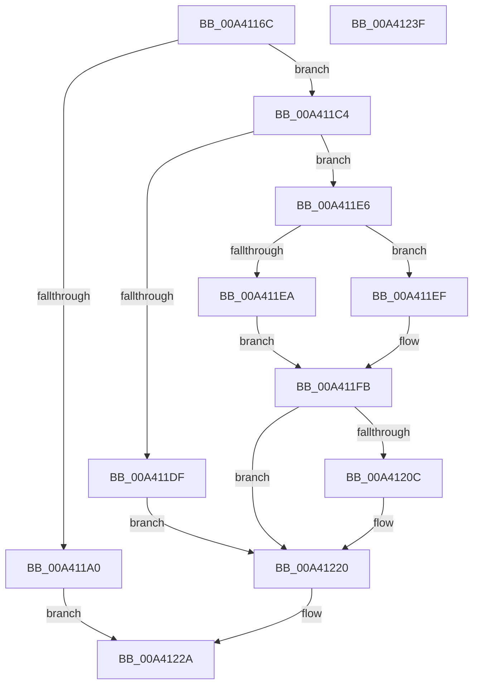

# BcdOpenStore

- RVA: `0x00A4116C`–`0x00A41240` (길이 `212` bytes)
- VA: `0x0000000140A4116C`
- 실행 섹션: `PAGE`
- PDB 이름 있음: `예`; PDB Function 태그: `아니요`
- unwind 정보 RVA: `0x00066400`
- 디코드: `59`개 명령, `212/212` bytes 표시
- 미해석 바이트: `0` (있으면 어셈블리에 `.byte`로 보존)

> 이 문서는 커널 이미지의 기계어와 PDB 기호를 분석해 생성했습니다. 4번과 5번은 함수 원형과 자료형을 바이너리 사용 방식에서 추정한 C 해석이며 원본 소스 복구 결과는 아닙니다.

## 1. Dependencies

- 직접 호출 지점: **7**; 고유 호출 대상: **4**
- 직접 호출자로 확인된 함수: **7**
- RIP 상대 이미지 참조: **5**

### Outgoing calls
- `0x00A41194` → [BiAcquireBcdSyncMutant](../91/BiAcquireBcdSyncMutant_function_00916898.md) (function, `0x00916898`)
- `0x00A411BA` → [BiLogMessage](../A3/BiLogMessage_function_00A3D3A8.md) (function, `0x00A3D3A8`)
- `0x00A411D5` → [BiLogMessage](../A3/BiLogMessage_function_00A3D3A8.md) (function, `0x00A3D3A8`)
- `0x00A411F6` → [BiLogMessage](../A3/BiLogMessage_function_00A3D3A8.md) (function, `0x00A3D3A8`)
- `0x00A41201` → [BiOpenSystemStore](BiOpenSystemStore_function_00A40844.md) (function, `0x00A40844`)
- `0x00A4121B` → [BiLogMessage](../A3/BiLogMessage_function_00A3D3A8.md) (function, `0x00A3D3A8`)
- `0x00A41223` → [BiReleaseBcdSyncMutant](../91/BiReleaseBcdSyncMutant_function_0091695C.md) (function, `0x0091695C`)

### Direct callers
- [WheaPersistBadPageToBcd](../../text/65/WheaPersistBadPageToBcd_function_0065F3D0.md) at `0x0065F3FD`
- [PopFreeHiberContext](../70/PopFreeHiberContext_function_00704F1C.md) at `0x00704F49`
- [PoInitHiberServices](../75/PoInitHiberServices_function_007537C4.md) at `0x0075386C`
- [PopValidateWinresume](../75/PopValidateWinresume_function_0075DFF4.md) at `0x0075E15C`
- [PopAdaptiveClearInitialSystemPowerState](../76/PopAdaptiveClearInitialSystemPowerState_function_0076B55C.md) at `0x0076B57F`
- [PopBcdOpen](PopBcdOpen_function_00A412D4.md) at `0x00A412E0`
- [PopAllocateHiberContext](../AD/PopAllocateHiberContext_function_00ADC05C.md) at `0x00ADC2DD`

### Static image references
- `0x00A411A7` → RVA `0x00B0A170` (` ?? ::NNGAKEGL::`string'`; read)
- `0x00A411B3` → RVA `0x00B0A180` (` ?? ::NNGAKEGL::`string'`; read)
- `0x00A411C7` → RVA `0x00B0A230` (` ?? ::NNGAKEGL::`string'`; read)
- `0x00A411EF` → RVA `0x00B0A270` (` ?? ::NNGAKEGL::`string'`; read)
- `0x00A4120F` → RVA `0x00B0A2D0` (` ?? ::NNGAKEGL::`string'`; read)

## 2. Other-region calls and transfers

- 다른 실행 섹션으로 향하는 call: **0**
- 별도 외부 분기/꼬리 이동을 확인하지 못했습니다.

## 3. Assembly (complete function range)

```asm
00A4116C  48 89 5C 24 08                  mov qword ptr [rsp + 8], rbx
00A41171  48 89 6C 24 10                  mov qword ptr [rsp + 0x10], rbp
00A41176  48 89 74 24 18                  mov qword ptr [rsp + 0x18], rsi
00A4117B  57                              push rdi
00A4117C  48 83 EC 30                     sub rsp, 0x30
00A41180  40 8A FA                        mov dil, dl
00A41183  8B F2                           mov esi, edx
00A41185  40 80 E7 01                     and dil, 1
00A41189  49 8B E8                        mov rbp, r8
00A4118C  40 8A CF                        mov cl, dil
00A4118F  8B DA                           mov ebx, edx
00A41191  83 E6 02                        and esi, 2
00A41194  E8 FF 56 ED FF                  call 0x140916898
00A41199  44 8B D0                        mov r10d, eax
00A4119C  85 C0                           test eax, eax
00A4119E  79 24                           jns 0x140a411c4
00A411A0  44 8B CB                        mov r9d, ebx
00A411A3  89 44 24 20                     mov dword ptr [rsp + 0x20], eax
00A411A7  4C 8D 05 C2 8F 0C 00            lea r8, [rip + 0xc8fc2]
00A411AE  B9 04 00 00 00                  mov ecx, 4
00A411B3  48 8D 15 C6 8F 0C 00            lea rdx, [rip + 0xc8fc6]
00A411BA  E8 E9 C1 FF FF                  call 0x140a3d3a8
00A411BF  41 8B C2                        mov eax, r10d
00A411C2  EB 66                           jmp 0x140a4122a
00A411C4  45 33 C9                        xor r9d, r9d
00A411C7  48 8D 15 62 90 0C 00            lea rdx, [rip + 0xc9062]
00A411CE  44 8B C3                        mov r8d, ebx
00A411D1  41 8D 49 02                     lea ecx, [r9 + 2]
00A411D5  E8 CE C1 FF FF                  call 0x140a3d3a8
00A411DA  40 84 FF                        test dil, dil
00A411DD  74 07                           je 0x140a411e6
00A411DF  BB 0D 00 00 C0                  mov ebx, 0xc000000d
00A411E4  EB 3A                           jmp 0x140a41220
00A411E6  85 F6                           test esi, esi
00A411E8  75 05                           jne 0x140a411ef
00A411EA  44 8B C9                        mov r9d, ecx
00A411ED  EB 0C                           jmp 0x140a411fb
00A411EF  48 8D 15 7A 90 0C 00            lea rdx, [rip + 0xc907a]
00A411F6  E8 AD C1 FF FF                  call 0x140a3d3a8
00A411FB  41 8B D1                        mov edx, r9d
00A411FE  48 8B CD                        mov rcx, rbp
00A41201  E8 3E F6 FF FF                  call 0x140a40844
00A41206  8B D8                           mov ebx, eax
00A41208  85 C0                           test eax, eax
00A4120A  79 14                           jns 0x140a41220
00A4120C  44 8B C0                        mov r8d, eax
00A4120F  48 8D 15 BA 90 0C 00            lea rdx, [rip + 0xc90ba]
00A41216  B9 04 00 00 00                  mov ecx, 4
00A4121B  E8 88 C1 FF FF                  call 0x140a3d3a8
00A41220  40 8A CF                        mov cl, dil
00A41223  E8 34 57 ED FF                  call 0x14091695c
00A41228  8B C3                           mov eax, ebx
00A4122A  48 8B 5C 24 40                  mov rbx, qword ptr [rsp + 0x40]
00A4122F  48 8B 6C 24 48                  mov rbp, qword ptr [rsp + 0x48]
00A41234  48 8B 74 24 50                  mov rsi, qword ptr [rsp + 0x50]
00A41239  48 83 C4 30                     add rsp, 0x30
00A4123D  5F                              pop rdi
00A4123E  C3                              ret
00A4123F  CC                              int3
```

## 4. C-style interpretation (structured pseudocode)

```c
__int64 __fastcall BcdOpenStore(__int64 a1, int a2, __int64 a3)
{
    __int64 result;
    __int64 v_rdi;
    __int64 v_rsi;
    __int64 v_rsp;
    unsigned int v_stack_m18;
    unsigned __int64 v_stack_p10;
    unsigned __int64 v_stack_p18;
    unsigned __int64 v_stack_p8;

    v_stack_p8 = v_rbx;
    v_stack_p10 = v_rbp;
    v_stack_p18 = v_rsi;
    v_rsp = (v_rsp) - (48);
    v_rdi = (unsigned __int8)(((unsigned __int8)(a2)) & (1));
    v_rsi = (unsigned int)(((unsigned int)(a2)) & (2));
    result = BiAcquireBcdSyncMutant((unsigned __int8)(v_rdi), a2, a3, a4);
    if (!sign_flag) goto loc_00A411C4;
    v_stack_m18 = (unsigned int)(result);
    result = BiLogMessage(4, v_rip + 823238, v_rip + 823234, (unsigned int)((unsigned int)((unsigned int)(a2))));
    goto loc_00A4122A;
loc_00A411C4:
    a4 = 0;
    result = BiLogMessage(a4 + 2, v_rip + 823394, (unsigned int)((unsigned int)((unsigned int)(a2))), a4);
    if ((unsigned __int8)(v_rdi) == 0) goto loc_00A411E6;
    goto loc_00A41220;
loc_00A411E6:
    if ((unsigned int)(v_rsi) != 0) goto loc_00A411EF;
    goto loc_00A411FB;
loc_00A411EF:
    result = BiLogMessage(a4 + 2, v_rip + 823418, (unsigned int)((unsigned int)((unsigned int)(a2))), (unsigned int)((unsigned int)(a4 + 2)));
loc_00A411FB:
    result = BiOpenSystemStore(a3, (unsigned int)((unsigned int)((unsigned int)((unsigned int)(a4 + 2)))), (unsigned int)((unsigned int)((unsigned int)(a2))), (unsigned int)((unsigned int)(a4 + 2)));
    if (sign_flag) {
        a3 = (unsigned int)(result);
        a2 = v_rip + 823482;
        a1 = 4;
        result = BiLogMessage(a1, a2, a3, (unsigned int)((unsigned int)(a4 + 2)));
    }
    result = BiReleaseBcdSyncMutant((unsigned __int8)(v_rdi), a2, a3, (unsigned int)((unsigned int)(a4 + 2)));
loc_00A4122A:
    v_rsp = (v_rsp) + (48);
    return (unsigned int)((unsigned int)((unsigned int)((unsigned int)(result))));
}
```

## 5. (Beta) C Style

```c
int64_t BcdOpenStore(int64_t Arg1, int32_t Arg2, int64_t Arg3)
{
    int64_t result;
    int64_t local_rdi;
    int64_t local_rsi;
    int64_t local_rsp;
    uint32_t v_stack_m18;
    uint64_t v_stack_p10;
    uint64_t v_stack_p18;
    uint64_t v_stack_p8;

    v_stack_p8 = local_rbx;
    v_stack_p10 = local_rbp;
    v_stack_p18 = local_rsi;
    local_rsp = (local_rsp) - (48);
    local_rdi = (uint8_t)(((uint8_t)(Arg2)) & (1));
    local_rsi = (uint32_t)(((uint32_t)(Arg2)) & (2));
    result = BiAcquireBcdSyncMutant((uint8_t)(local_rdi), Arg2, Arg3, a4);
    if (!sign_flag) goto loc_00A411C4;
    v_stack_m18 = (uint32_t)(result);
    result = BiLogMessage(4, v_rip + 823238, v_rip + 823234, (uint32_t)((uint32_t)((uint32_t)(Arg2))));
    goto loc_00A4122A;
loc_00A411C4:
    a4 = 0;
    result = BiLogMessage(a4 + 2, v_rip + 823394, (uint32_t)((uint32_t)((uint32_t)(Arg2))), a4);
    if ((uint8_t)(local_rdi) == 0) goto loc_00A411E6;
    goto loc_00A41220;
loc_00A411E6:
    if ((uint32_t)(local_rsi) != 0) goto loc_00A411EF;
    goto loc_00A411FB;
loc_00A411EF:
    result = BiLogMessage(a4 + 2, v_rip + 823418, (uint32_t)((uint32_t)((uint32_t)(Arg2))), (uint32_t)((uint32_t)(a4 + 2)));
loc_00A411FB:
    result = BiOpenSystemStore(Arg3, (uint32_t)((uint32_t)((uint32_t)((uint32_t)(a4 + 2)))), (uint32_t)((uint32_t)((uint32_t)(Arg2))), (uint32_t)((uint32_t)(a4 + 2)));
    if (sign_flag) {
        Arg3 = (uint32_t)(result);
        Arg2 = v_rip + 823482;
        Arg1 = 4;
        result = BiLogMessage(Arg1, Arg2, Arg3, (uint32_t)((uint32_t)(a4 + 2)));
    }
    result = BiReleaseBcdSyncMutant((uint8_t)(local_rdi), Arg2, Arg3, (uint32_t)((uint32_t)(a4 + 2)));
loc_00A4122A:
    local_rsp = (local_rsp) + (48);
    return (uint32_t)((uint32_t)((uint32_t)((uint32_t)(result))));
}
```

## 6. Execution-region graph

[열기: 2D/3D 그래프와 함수 탐색 컨트롤 패널](../../../control-panel.html?section=page&rva=0x00A4116C&view=graph)

- 2D 그래프는 위에서 아래로 흐르고, 3D 그래프는 빈 공간을 드래그해 회전합니다. Shift+드래그는 이동, 휠은 확대·축소, 함수 노드 선택은 대상 보고서 이동입니다.

### Static fallback


