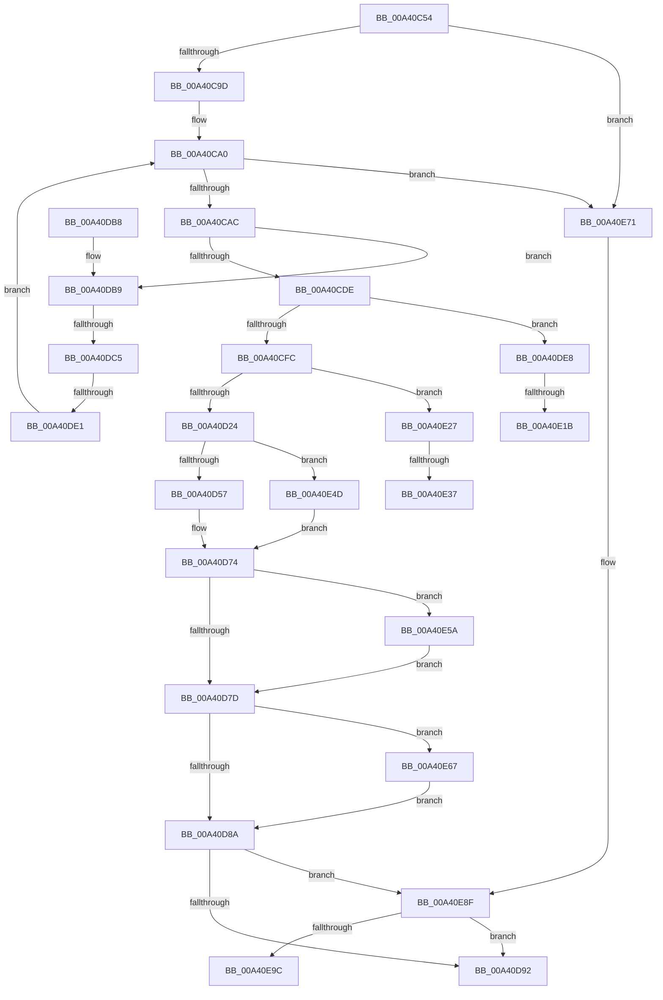

# BiAddStoreFromFile

- RVA: `0x00A40C54`–`0x00A40EAE` (길이 `602` bytes)
- VA: `0x0000000140A40C54`
- 실행 섹션: `PAGE`
- PDB 이름 있음: `예`; PDB Function 태그: `예`
- unwind 정보 RVA: `0x000AE9F4`
- 디코드: `145`개 명령, `602/602` bytes 표시
- 미해석 바이트: `0` (있으면 어셈블리에 `.byte`로 보존)

> 이 문서는 커널 이미지의 기계어와 PDB 기호를 분석해 생성했습니다. 4번과 5번은 함수 원형과 자료형을 바이너리 사용 방식에서 추정한 C 해석이며 원본 소스 복구 결과는 아닙니다.

## 1. Dependencies

- 직접 호출 지점: **14**; 고유 호출 대상: **9**
- 직접 호출자로 확인된 함수: **1**
- RIP 상대 이미지 참조: **10**

### Outgoing calls
- `0x00A40CBF` → [swprintf_s](../../text/50/swprintf_s_function_00504B20.md) (function, `0x00504B20`)
- `0x00A40CCF` → [BiLoadHive](BiLoadHive_function_00A412F4.md) (function, `0x00A412F4`)
- `0x00A40CED` → [BiLogMessage](../A3/BiLogMessage_function_00A3D3A8.md) (function, `0x00A3D3A8`)
- `0x00A40D11` → [BiOpenKey](../A3/BiOpenKey_function_00A3F60C.md) (function, `0x00A3F60C`)
- `0x00A40D48` → [BiSetRegistryValue](../A3/BiSetRegistryValue_function_00A3E3B0.md) (function, `0x00A3E3B0`)
- `0x00A40D6F` → [BiLogMessage](../A3/BiLogMessage_function_00A3D3A8.md) (function, `0x00A3D3A8`)
- `0x00A40D9B` → [_security_check_cookie](../../text/6A/_security_check_cookie_function_006AC640.md) (function, `0x006AC640`)
- `0x00A40DC9` → [BiDoesHiveKeyExist](../82/BiDoesHiveKeyExist_function_00826114.md) (function, `0x00826114`)
- `0x00A40E0C` → [BiCreateKey](BiCreateKey_function_00A404DC.md) (function, `0x00A404DC`)
- `0x00A40E3E` → [BiLogMessage](../A3/BiLogMessage_function_00A3D3A8.md) (function, `0x00A3D3A8`)
- `0x00A40E5D` → [BiCloseKey](../91/BiCloseKey_function_00916A00.md) (function, `0x00916A00`)
- `0x00A40E67` → [BiCloseKey](../91/BiCloseKey_function_00916A00.md) (function, `0x00916A00`)
- `0x00A40E85` → [BiLogMessage](../A3/BiLogMessage_function_00A3D3A8.md) (function, `0x00A3D3A8`)
- `0x00A40E9C` → [BiCloseKey](../91/BiCloseKey_function_00916A00.md) (function, `0x00916A00`)

### Direct callers
- [BiLoadSystemStore](../A3/BiLoadSystemStore_function_00A3C198.md) at `0x00A3C24A`

### Static image references
- `0x00A40C6B` → RVA `0x00E0A740` (`.data`; read)
- `0x00A40CAF` → RVA `0x00B0A3A0` (` ?? ::NNGAKEGL::`string'`; read)
- `0x00A40CE1` → RVA `0x00B0A3B0` (` ?? ::NNGAKEGL::`string'`; read)
- `0x00A40D0A` → RVA `0x00AFF1D0` (` ?? ::NNGAKEGL::`string'`; read)
- `0x00A40D3E` → RVA `0x00B0AC30` (` ?? ::NNGAKEGL::`string'`; read)
- `0x00A40D5B` → RVA `0x00B0A7A0` (` ?? ::NNGAKEGL::`string'`; read)
- `0x00A40E05` → RVA `0x00B0A540` (` ?? ::NNGAKEGL::`string'`; read)
- `0x00A40E1B` → RVA `0x00B0A550` (` ?? ::NNGAKEGL::`string'`; read)
- `0x00A40E37` → RVA `0x00B0A6A0` (` ?? ::NNGAKEGL::`string'`; read)
- `0x00A40E7E` → RVA `0x00B0A4C0` (` ?? ::NNGAKEGL::`string'`; read)

## 2. Other-region calls and transfers

- 다른 실행 섹션으로 향하는 call: **2**
  - `0x00A40CBF` → [swprintf_s](../../text/50/swprintf_s_function_00504B20.md) (`PAGE` → `.text`)
  - `0x00A40D9B` → [_security_check_cookie](../../text/6A/_security_check_cookie_function_006AC640.md) (`PAGE` → `.text`)
- call이 아닌 외부 분기/꼬리 이동: **7**
  - `0x00A40DBF` → [sub_00B3AA4C + 0x21](../B3/Unknown_function_00B3AA4C.md) (`tail-transfer`)
  - `0x00A40DDB` → [sub_00B3AA4C](../B3/Unknown_function_00B3AA4C.md) (`tail-transfer`)
  - `0x00A40E15` → [sub_00B3AA4C + 0x75](../B3/Unknown_function_00B3AA4C.md) (`tail-transfer`)
  - `0x00A40E22` → [sub_00B3AA4C + 0x59](../B3/Unknown_function_00B3AA4C.md) (`tail-transfer`)
  - `0x00A40E31` → [sub_00B3AA4C + 0xB2](../B3/Unknown_function_00B3AA4C.md) (`tail-transfer`)
  - `0x00A40E48` → [sub_00B3AA4C + 0xB2](../B3/Unknown_function_00B3AA4C.md) (`tail-transfer`)
  - `0x00A40EA9` → [sub_00B3AA4C + 0xC2](../B3/Unknown_function_00B3AA4C.md) (`tail-transfer`)

## 3. Assembly (complete function range)

```asm
00A40C54  48 89 5C 24 10                  mov qword ptr [rsp + 0x10], rbx
00A40C59  55                              push rbp
00A40C5A  56                              push rsi
00A40C5B  57                              push rdi
00A40C5C  41 54                           push r12
00A40C5E  41 55                           push r13
00A40C60  41 56                           push r14
00A40C62  41 57                           push r15
00A40C64  48 8B EC                        mov rbp, rsp
00A40C67  48 83 EC 70                     sub rsp, 0x70
00A40C6B  48 8B 05 CE 9A 3C 00            mov rax, qword ptr [rip + 0x3c9ace]
00A40C72  48 33 C4                        xor rax, rsp
00A40C75  48 89 45 F0                     mov qword ptr [rbp - 0x10], rax
00A40C79  45 33 ED                        xor r13d, r13d
00A40C7C  4D 8B E0                        mov r12, r8
00A40C7F  4C 89 6D D0                     mov qword ptr [rbp - 0x30], r13
00A40C83  44 8B FA                        mov r15d, edx
00A40C86  4C 89 6D C0                     mov qword ptr [rbp - 0x40], r13
00A40C8A  48 8B F9                        mov rdi, rcx
00A40C8D  4C 89 6D C8                     mov qword ptr [rbp - 0x38], r13
00A40C91  45 8B F5                        mov r14d, r13d
00A40C94  F6 C2 20                        test dl, 0x20
00A40C97  0F 85 D4 01 00 00               jne 0x140a40e71
00A40C9D  41 8B F5                        mov esi, r13d
00A40CA0  81 FE FF E0 F5 05               cmp esi, 0x5f5e0ff
00A40CA6  0F 87 C5 01 00 00               ja 0x140a40e71
00A40CAC  44 8B CE                        mov r9d, esi
00A40CAF  4C 8D 05 EA 96 0C 00            lea r8, [rip + 0xc96ea]
00A40CB6  BA 0C 00 00 00                  mov edx, 0xc
00A40CBB  48 8D 4D D8                     lea rcx, [rbp - 0x28]
00A40CBF  E8 5C 3E AC FF                  call 0x140504b20
00A40CC4  4C 8D 45 C0                     lea r8, [rbp - 0x40]
00A40CC8  48 8B D7                        mov rdx, rdi
00A40CCB  48 8D 4D D8                     lea rcx, [rbp - 0x28]
00A40CCF  E8 20 06 00 00                  call 0x140a412f4
00A40CD4  8B D8                           mov ebx, eax
00A40CD6  85 C0                           test eax, eax
00A40CD8  0F 88 DB 00 00 00               js 0x140a40db9
00A40CDE  44 8B C6                        mov r8d, esi
00A40CE1  48 8D 15 C8 96 0C 00            lea rdx, [rip + 0xc96c8]
00A40CE8  B9 02 00 00 00                  mov ecx, 2
00A40CED  E8 B6 C6 FF FF                  call 0x140a3d3a8
00A40CF2  41 F6 C7 01                     test r15b, 1
00A40CF6  0F 85 EC 00 00 00               jne 0x140a40de8
00A40CFC  48 8B 4D C0                     mov rcx, qword ptr [rbp - 0x40]
00A40D00  4C 8D 4D D0                     lea r9, [rbp - 0x30]
00A40D04  41 B8 1F 00 02 00               mov r8d, 0x2001f
00A40D0A  48 8D 15 BF E4 0B 00            lea rdx, [rip + 0xbe4bf]
00A40D11  E8 F6 E8 FF FF                  call 0x140a3f60c
00A40D16  48 8B 75 D0                     mov rsi, qword ptr [rbp - 0x30]
00A40D1A  8B D8                           mov ebx, eax
00A40D1C  85 C0                           test eax, eax
00A40D1E  0F 88 03 01 00 00               js 0x140a40e27
00A40D24  48 8D 45 D8                     lea rax, [rbp - 0x28]
00A40D28  C7 44 24 28 18 00 00 00         mov dword ptr [rsp + 0x28], 0x18
00A40D30  41 B9 01 00 00 00               mov r9d, 1
00A40D36  48 89 44 24 20                  mov qword ptr [rsp + 0x20], rax
00A40D3B  45 33 C0                        xor r8d, r8d
00A40D3E  48 8D 15 EB 9E 0C 00            lea rdx, [rip + 0xc9eeb]
00A40D45  48 8B CE                        mov rcx, rsi
00A40D48  E8 63 D6 FF FF                  call 0x140a3e3b0
00A40D4D  8B D8                           mov ebx, eax
00A40D4F  85 C0                           test eax, eax
00A40D51  0F 89 F6 00 00 00               jns 0x140a40e4d
00A40D57  89 44 24 20                     mov dword ptr [rsp + 0x20], eax
00A40D5B  48 8D 15 3E 9A 0C 00            lea rdx, [rip + 0xc9a3e]
00A40D62  B9 04 00 00 00                  mov ecx, 4
00A40D67  4C 8D 4D D8                     lea r9, [rbp - 0x28]
00A40D6B  4C 8D 47 0C                     lea r8, [rdi + 0xc]
00A40D6F  E8 34 C6 FF FF                  call 0x140a3d3a8
00A40D74  48 85 F6                        test rsi, rsi
00A40D77  0F 85 DD 00 00 00               jne 0x140a40e5a
00A40D7D  48 8B 4D C8                     mov rcx, qword ptr [rbp - 0x38]
00A40D81  48 85 C9                        test rcx, rcx
00A40D84  0F 85 DD 00 00 00               jne 0x140a40e67
00A40D8A  85 DB                           test ebx, ebx
00A40D8C  0F 88 FD 00 00 00               js 0x140a40e8f
00A40D92  8B C3                           mov eax, ebx
00A40D94  48 8B 4D F0                     mov rcx, qword ptr [rbp - 0x10]
00A40D98  48 33 CC                        xor rcx, rsp
00A40D9B  E8 A0 B8 C6 FF                  call 0x1406ac640
00A40DA0  48 8B 9C 24 B8 00 00 00         mov rbx, qword ptr [rsp + 0xb8]
00A40DA8  48 83 C4 70                     add rsp, 0x70
00A40DAC  41 5F                           pop r15
00A40DAE  41 5E                           pop r14
00A40DB0  41 5D                           pop r13
00A40DB2  41 5C                           pop r12
00A40DB4  5F                              pop rdi
00A40DB5  5E                              pop rsi
00A40DB6  5D                              pop rbp
00A40DB7  C3                              ret
00A40DB8  CC                              int3
00A40DB9  81 FB 22 00 00 C0               cmp ebx, 0xc0000022
00A40DBF  0F 85 A8 9C 0F 00               jne 0x140b3aa6d
00A40DC5  48 8D 4D D8                     lea rcx, [rbp - 0x28]
00A40DC9  E8 46 53 DE FF                  call 0x140826114
00A40DCE  41 FF C6                        inc r14d
00A40DD1  84 C0                           test al, al
00A40DD3  45 0F 45 F5                     cmovne r14d, r13d
00A40DD7  41 83 FE 0A                     cmp r14d, 0xa
00A40DDB  0F 83 6B 9C 0F 00               jae 0x140b3aa4c
00A40DE1  FF C6                           inc esi
00A40DE3  E9 B8 FE FF FF                  jmp 0x140a40ca0
00A40DE8  48 8B 4D C0                     mov rcx, qword ptr [rbp - 0x40]
00A40DEC  48 8D 45 C8                     lea rax, [rbp - 0x38]
00A40DF0  BE 19 00 02 00                  mov esi, 0x20019
00A40DF5  4C 89 6C 24 28                  mov qword ptr [rsp + 0x28], r13
00A40DFA  44 8B C6                        mov r8d, esi
00A40DFD  48 89 44 24 20                  mov qword ptr [rsp + 0x20], rax
00A40E02  45 33 C9                        xor r9d, r9d
00A40E05  48 8D 15 34 97 0C 00            lea rdx, [rip + 0xc9734]
00A40E0C  E8 CB F6 FF FF                  call 0x140a404dc
00A40E11  8B D8                           mov ebx, eax
00A40E13  85 C0                           test eax, eax
00A40E15  0F 89 A6 9C 0F 00               jns 0x140b3aac1
00A40E1B  48 8D 15 2E 97 0C 00            lea rdx, [rip + 0xc972e]
00A40E22  E9 7E 9C 0F 00                  jmp 0x140b3aaa5
00A40E27  B9 04 00 00 00                  mov ecx, 4
00A40E2C  3D 34 00 00 C0                  cmp eax, 0xc0000034
00A40E31  0F 85 C7 9C 0F 00               jne 0x140b3aafe
00A40E37  48 8D 15 62 98 0C 00            lea rdx, [rip + 0xc9862]
00A40E3E  E8 65 C5 FF FF                  call 0x140a3d3a8
00A40E43  BB 5C 01 00 C0                  mov ebx, 0xc000015c
00A40E48  E9 B1 9C 0F 00                  jmp 0x140b3aafe
00A40E4D  48 8B 45 C0                     mov rax, qword ptr [rbp - 0x40]
00A40E51  49 89 04 24                     mov qword ptr [r12], rax
00A40E55  E9 1A FF FF FF                  jmp 0x140a40d74
00A40E5A  48 8B CE                        mov rcx, rsi
00A40E5D  E8 9E 5B ED FF                  call 0x140916a00
00A40E62  E9 16 FF FF FF                  jmp 0x140a40d7d
00A40E67  E8 94 5B ED FF                  call 0x140916a00
00A40E6C  E9 19 FF FF FF                  jmp 0x140a40d8a
00A40E71  4C 8D 47 0C                     lea r8, [rdi + 0xc]
00A40E75  B9 04 00 00 00                  mov ecx, 4
00A40E7A  4C 8D 4D D8                     lea r9, [rbp - 0x28]
00A40E7E  48 8D 15 3B 96 0C 00            lea rdx, [rip + 0xc963b]
00A40E85  E8 1E C5 FF FF                  call 0x140a3d3a8
00A40E8A  BB 01 00 00 C0                  mov ebx, 0xc0000001
00A40E8F  48 8B 4D C0                     mov rcx, qword ptr [rbp - 0x40]
00A40E93  48 85 C9                        test rcx, rcx
00A40E96  0F 84 F6 FE FF FF               je 0x140a40d92
00A40E9C  E8 5F 5B ED FF                  call 0x140916a00
00A40EA1  48 8D 45 D8                     lea rax, [rbp - 0x28]
00A40EA5  48 83 CA FF                     or rdx, 0xffffffffffffffff
00A40EA9  E9 60 9C 0F 00                  jmp 0x140b3ab0e
```

## 4. C-style interpretation (structured pseudocode)

```c
__int64 __fastcall BiAddStoreFromFile(__int64 a1, int a2, __int64 a3)
{
    __int64 result;
    __int64 v_r13;
    __int64 v_r14;
    __int64 v_rsi;
    __int64 v_rsp;
    unsigned __int64 v_stack_m48;
    unsigned __int64 v_stack_m60;
    unsigned __int64 v_stack_m68;
    unsigned __int64 v_stack_m70;
    unsigned __int64 v_stack_m78;
    unsigned int v_stack_m80;
    unsigned __int64 v_stack_m88;
    unsigned __int64 v_stack_p10;
    unsigned __int64 v_stack_p20;
    unsigned __int64 v_stack_p28;

    v_stack_p10 = v_rbx;
    v_rsp = (v_rsp) - (112);
    result = (*(unsigned __int64 *)(v_rip + 3971790)) ^ (v_rsp);
    v_stack_m48 = result;
    v_r13 = 0;
    v_stack_m68 = 0;
    v_stack_m78 = 0;
    v_stack_m70 = 0;
    if ((((unsigned __int8)(a2)) & (32)) != 0) goto loc_00A40E71;
loc_00A40CA0:
    if (0 > 0x5F5E0FFULL) goto loc_00A40E71;
    result = swprintf_s(v_stack_m60, 12, v_rip + 825066, 0);
    result = BiLoadHive(v_stack_m60, a1, v_stack_m78, 0);
    if (sign_flag) goto loc_00A40DB9;
    result = BiLogMessage(2, v_rip + 825032, 0, 0);
    if ((((unsigned __int8)((unsigned int)(a2))) & (1)) != 0) goto loc_00A40DE8;
    result = BiOpenKey(v_stack_m78, v_rip + 779455, (unsigned int)(0x2001FULL), v_stack_m68);
    if (sign_flag) goto loc_00A40E27;
    v_stack_m80 = 24;
    v_stack_m88 = v_stack_m60;
    a3 = 0;
    result = BiSetRegistryValue(v_stack_m68, v_rip + 827115, a3, 1);
    if (!sign_flag) goto loc_00A40E4D;
    v_stack_m88 = (unsigned int)(result);
    result = BiLogMessage(4, v_rip + 825918, a1 + 12, v_stack_m60);
loc_00A40D74:
    if (v_stack_m68 != 0) goto loc_00A40E5A;
loc_00A40D7D:
    if (v_stack_m70 != 0) goto loc_00A40E67;
loc_00A40D8A:
    if (sign_flag) goto loc_00A40E8F;
loc_00A40D92:
    a1 = (v_stack_m48) ^ (v_rsp);
    result = _security_check_cookie(a1, v_rip + 825918, a1 + 12, v_stack_m60);
    v_rsp = (v_rsp) + (112);
    return result;
loc_00A40DB9:
    result = BiDoesHiveKeyExist(v_stack_m60, v_rip + 825918, a1 + 12, v_stack_m60);
    v_r14 = (unsigned int)((0) + 1);
    if ((unsigned __int8)(result) != 0) { v_r14 = 0; }
    v_rsi = (unsigned int)((v_stack_m68) + 1);
    goto loc_00A40CA0;
loc_00A40DE8:
    v_stack_p28 = 0;
    v_stack_p20 = v_stack_m70;
    a4 = 0;
    result = BiCreateKey(v_stack_m78, v_rip + 825140, (unsigned int)((unsigned int)((unsigned int)(0x20019ULL))), a4);
loc_00A40E27:
    result = BiLogMessage(4, v_rip + 825442, (unsigned int)((unsigned int)((unsigned int)(0x20019ULL))), a4);
loc_00A40E4D:
    *(unsigned __int64 *)(a3) = v_stack_m78;
    goto loc_00A40D74;
loc_00A40E5A:
    result = BiCloseKey((unsigned int)(0x20019ULL), v_rip + 825442, (unsigned int)((unsigned int)((unsigned int)(0x20019ULL))), a4);
    goto loc_00A40D7D;
loc_00A40E67:
    result = BiCloseKey((unsigned int)(0x20019ULL), v_rip + 825442, (unsigned int)((unsigned int)((unsigned int)(0x20019ULL))), a4);
    goto loc_00A40D8A;
loc_00A40E71:
    result = BiLogMessage(4, v_rip + 824891, a1 + 12, v_stack_m60);
loc_00A40E8F:
    if (v_stack_m78 == 0) goto loc_00A40D92;
    result = BiCloseKey(v_stack_m78, v_rip + 824891, a1 + 12, v_stack_m60);
    a2 = (v_rip + 824891) | (-1);
}
```

## 5. (Beta) C Style

```c
int64_t BiAddStoreFromFile(void *Arg1, int32_t Arg2, void *Arg3)
{
    uint8_t *arg1 = (uint8_t *)Arg1;
    uint8_t *arg3 = (uint8_t *)Arg3;

    int64_t result;
    int64_t local_r13;
    int64_t local_r14;
    int64_t local_rsi;
    int64_t local_rsp;
    uint64_t v_stack_m48;
    uint64_t v_stack_m60;
    uint64_t v_stack_m68;
    uint64_t v_stack_m70;
    uint64_t v_stack_m78;
    uint32_t v_stack_m80;
    uint64_t v_stack_m88;
    uint64_t v_stack_p10;
    uint64_t v_stack_p20;
    uint64_t v_stack_p28;

    v_stack_p10 = local_rbx;
    local_rsp = (local_rsp) - (112);
    result = (*(uint64_t *)(v_rip + 0x3C9ACE)) ^ (local_rsp);
    v_stack_m48 = result;
    local_r13 = 0;
    v_stack_m68 = 0;
    v_stack_m78 = 0;
    v_stack_m70 = 0;
    if ((((uint8_t)(Arg2)) & (32)) != 0) goto loc_00A40E71;
loc_00A40CA0:
    if (0 > 0x5F5E0FFULL) goto loc_00A40E71;
    result = swprintf_s(v_stack_m60, 12, v_rip + 825066, 0);
    result = BiLoadHive(v_stack_m60, Arg1, v_stack_m78, 0);
    if (sign_flag) goto loc_00A40DB9;
    result = BiLogMessage(2, v_rip + 825032, 0, 0);
    if ((((uint8_t)((uint32_t)(Arg2))) & (1)) != 0) goto loc_00A40DE8;
    result = BiOpenKey(v_stack_m78, v_rip + 779455, (uint32_t)(0x2001FULL), v_stack_m68);
    if (sign_flag) goto loc_00A40E27;
    v_stack_m80 = 24;
    v_stack_m88 = v_stack_m60;
    Arg3 = 0;
    result = BiSetRegistryValue(v_stack_m68, v_rip + 827115, Arg3, 1);
    if (!sign_flag) goto loc_00A40E4D;
    v_stack_m88 = (uint32_t)(result);
    result = BiLogMessage(4, v_rip + 825918, Arg1 + 12, v_stack_m60);
loc_00A40D74:
    if (v_stack_m68 != 0) goto loc_00A40E5A;
loc_00A40D7D:
    if (v_stack_m70 != 0) goto loc_00A40E67;
loc_00A40D8A:
    if (sign_flag) goto loc_00A40E8F;
loc_00A40D92:
    Arg1 = (v_stack_m48) ^ (local_rsp);
    result = _security_check_cookie(Arg1, v_rip + 825918, Arg1 + 12, v_stack_m60);
    local_rsp = (local_rsp) + (112);
    return result;
loc_00A40DB9:
    result = BiDoesHiveKeyExist(v_stack_m60, v_rip + 825918, Arg1 + 12, v_stack_m60);
    local_r14 = (uint32_t)((0) + 1);
    if ((uint8_t)(result) != 0) { local_r14 = 0; }
    local_rsi = (uint32_t)((v_stack_m68) + 1);
    goto loc_00A40CA0;
loc_00A40DE8:
    v_stack_p28 = 0;
    v_stack_p20 = v_stack_m70;
    a4 = 0;
    result = BiCreateKey(v_stack_m78, v_rip + 825140, (uint32_t)((uint32_t)((uint32_t)(0x20019ULL))), a4);
loc_00A40E27:
    result = BiLogMessage(4, v_rip + 825442, (uint32_t)((uint32_t)((uint32_t)(0x20019ULL))), a4);
loc_00A40E4D:
    *(uint64_t *)(arg3) = v_stack_m78;
    goto loc_00A40D74;
loc_00A40E5A:
    result = BiCloseKey((uint32_t)(0x20019ULL), v_rip + 825442, (uint32_t)((uint32_t)((uint32_t)(0x20019ULL))), a4);
    goto loc_00A40D7D;
loc_00A40E67:
    result = BiCloseKey((uint32_t)(0x20019ULL), v_rip + 825442, (uint32_t)((uint32_t)((uint32_t)(0x20019ULL))), a4);
    goto loc_00A40D8A;
loc_00A40E71:
    result = BiLogMessage(4, v_rip + 824891, Arg1 + 12, v_stack_m60);
loc_00A40E8F:
    if (v_stack_m78 == 0) goto loc_00A40D92;
    result = BiCloseKey(v_stack_m78, v_rip + 824891, Arg1 + 12, v_stack_m60);
    Arg2 = (v_rip + 824891) | (-1);
}
```

### 관측된 메모리 오프셋

구조체 형식이 확인되지 않은 접근은 인자 기준의 오프셋으로만 기록했습니다.

| 기준 인자 | 오프셋 표현 | 폭 (bit) | 접근 |
|---|---:|---:|---|
| `Arg1` | `+ 0xC` | `64` | `R` |
| `Arg3` | `+ 0x0` | `64` | `W` |

## 6. Execution-region graph

[열기: 2D/3D 그래프와 함수 탐색 컨트롤 패널](../../../control-panel.html?section=page&rva=0x00A40C54&view=graph)

- 2D 그래프는 위에서 아래로 흐르고, 3D 그래프는 빈 공간을 드래그해 회전합니다. Shift+드래그는 이동, 휠은 확대·축소, 함수 노드 선택은 대상 보고서 이동입니다.

### Static fallback


