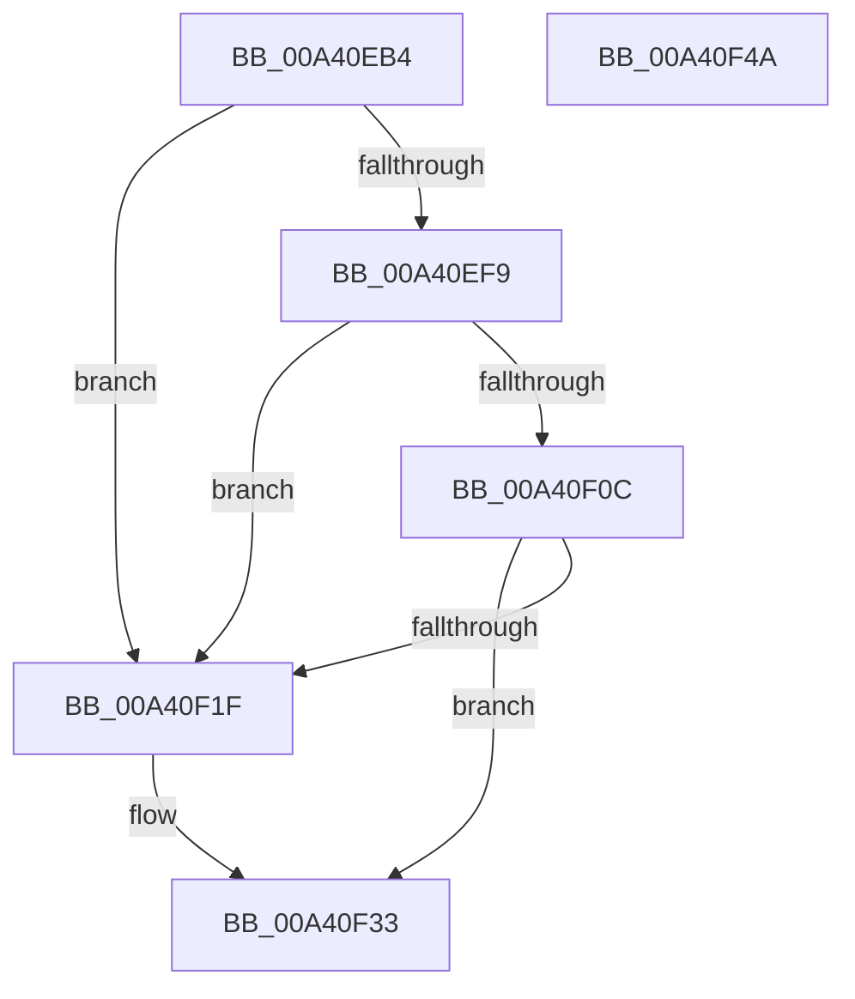

# BiBindEfiNamespaceObjects

- RVA: `0x00A40EB4`–`0x00A40F4B` (길이 `151` bytes)
- VA: `0x0000000140A40EB4`
- 실행 섹션: `PAGE`
- PDB 이름 있음: `예`; PDB Function 태그: `아니요`
- unwind 정보 RVA: `0x0006E5F8`
- 디코드: `41`개 명령, `151/151` bytes 표시
- 미해석 바이트: `0` (있으면 어셈블리에 `.byte`로 보존)

> 이 문서는 커널 이미지의 기계어와 PDB 기호를 분석해 생성했습니다. 4번과 5번은 함수 원형과 자료형을 바이너리 사용 방식에서 추정한 C 해석이며 원본 소스 복구 결과는 아닙니다.

## 1. Dependencies

- 직접 호출 지점: **6**; 고유 호출 대상: **5**
- 직접 호출자로 확인된 함수: **1**
- RIP 상대 이미지 참조: **2**

### Outgoing calls
- `0x00A40ECD` → [BiLogMessage](../A3/BiLogMessage_function_00A3D3A8.md) (function, `0x00A3D3A8`)
- `0x00A40EEE` → [BiBuildIdentifierList](../A3/BiBuildIdentifierList_function_00A3E584.md) (function, `0x00A3E584`)
- `0x00A40F01` → [BiBindEfiEntries](../AB/BiBindEfiEntries_function_00AB09C4.md) (function, `0x00AB09C4`)
- `0x00A40F14` → [BiBindEfiBootManager](../A3/BiBindEfiBootManager_function_00A3DCB0.md) (function, `0x00A3DCB0`)
- `0x00A40F2E` → [BiLogMessage](../A3/BiLogMessage_function_00A3D3A8.md) (function, `0x00A3D3A8`)
- `0x00A40F38` → [BiFreeIdentifierList](BiFreeIdentifierList_function_00A40FD8.md) (function, `0x00A40FD8`)

### Direct callers
- [BiOpenSystemStore](BiOpenSystemStore_function_00A40844.md) at `0x00A40A20`

### Static image references
- `0x00A40EC1` → RVA `0x00B0C300` (` ?? ::NNGAKEGL::`string'`; read)
- `0x00A40F22` → RVA `0x00B0C340` (` ?? ::NNGAKEGL::`string'`; read)

## 2. Other-region calls and transfers

- 다른 실행 섹션으로 향하는 call: **0**
- 별도 외부 분기/꼬리 이동을 확인하지 못했습니다.

## 3. Assembly (complete function range)

```asm
00A40EB4  48 89 5C 24 08                  mov qword ptr [rsp + 8], rbx
00A40EB9  57                              push rdi
00A40EBA  48 83 EC 30                     sub rsp, 0x30
00A40EBE  48 8B F9                        mov rdi, rcx
00A40EC1  48 8D 15 38 B4 0C 00            lea rdx, [rip + 0xcb438]
00A40EC8  B9 02 00 00 00                  mov ecx, 2
00A40ECD  E8 D6 C4 FF FF                  call 0x140a3d3a8
00A40ED2  48 8D 4C 24 20                  lea rcx, [rsp + 0x20]
00A40ED7  48 89 4C 24 28                  mov qword ptr [rsp + 0x28], rcx
00A40EDC  48 8D 44 24 20                  lea rax, [rsp + 0x20]
00A40EE1  48 8B CF                        mov rcx, rdi
00A40EE4  48 89 44 24 20                  mov qword ptr [rsp + 0x20], rax
00A40EE9  4C 8D 44 24 20                  lea r8, [rsp + 0x20]
00A40EEE  E8 91 D6 FF FF                  call 0x140a3e584
00A40EF3  8B D8                           mov ebx, eax
00A40EF5  85 C0                           test eax, eax
00A40EF7  78 26                           js 0x140a40f1f
00A40EF9  48 8D 54 24 20                  lea rdx, [rsp + 0x20]
00A40EFE  48 8B CF                        mov rcx, rdi
00A40F01  E8 BE FA 06 00                  call 0x140ab09c4
00A40F06  8B D8                           mov ebx, eax
00A40F08  85 C0                           test eax, eax
00A40F0A  78 13                           js 0x140a40f1f
00A40F0C  48 8D 54 24 20                  lea rdx, [rsp + 0x20]
00A40F11  48 8B CF                        mov rcx, rdi
00A40F14  E8 97 CD FF FF                  call 0x140a3dcb0
00A40F19  8B D8                           mov ebx, eax
00A40F1B  85 C0                           test eax, eax
00A40F1D  79 14                           jns 0x140a40f33
00A40F1F  44 8B C3                        mov r8d, ebx
00A40F22  48 8D 15 17 B4 0C 00            lea rdx, [rip + 0xcb417]
00A40F29  B9 04 00 00 00                  mov ecx, 4
00A40F2E  E8 75 C4 FF FF                  call 0x140a3d3a8
00A40F33  48 8D 4C 24 20                  lea rcx, [rsp + 0x20]
00A40F38  E8 9B 00 00 00                  call 0x140a40fd8
00A40F3D  8B C3                           mov eax, ebx
00A40F3F  48 8B 5C 24 40                  mov rbx, qword ptr [rsp + 0x40]
00A40F44  48 83 C4 30                     add rsp, 0x30
00A40F48  5F                              pop rdi
00A40F49  C3                              ret
00A40F4A  CC                              int3
```

## 4. C-style interpretation (structured pseudocode)

```c
__int64 __fastcall BiBindEfiNamespaceObjects(__int64 a1)
{
    __int64 result;
    __int64 v_rsp;
    unsigned __int64 v_stack_m10;
    unsigned __int64 v_stack_m18;
    unsigned __int64 v_stack_p8;

    v_stack_p8 = v_rbx;
    v_rsp = (v_rsp) - (48);
    result = BiLogMessage(2, v_rip + 832568, a3, a4);
    v_stack_m10 = v_stack_m18;
    v_stack_m18 = v_stack_m18;
    result = BiBuildIdentifierList(a1, v_rip + 832568, v_stack_m18, a4);
    if (sign_flag) goto loc_00A40F1F;
    result = BiBindEfiEntries(a1, v_stack_m18, v_stack_m18, a4);
    if (sign_flag) goto loc_00A40F1F;
    result = BiBindEfiBootManager(a1, v_stack_m18, v_stack_m18, a4);
    if (sign_flag) {
        a3 = (unsigned int)((unsigned int)((unsigned int)(result)));
        a2 = v_rip + 832535;
        a1 = 4;
        result = BiLogMessage(a1, a2, a3, a4);
    }
    result = BiFreeIdentifierList(v_stack_m18, a2, a3, a4);
    v_rsp = (v_rsp) + (48);
    return (unsigned int)((unsigned int)((unsigned int)((unsigned int)(result))));
}
```

## 5. (Beta) C Style

```c
int64_t BiBindEfiNamespaceObjects(int64_t Arg1)
{
    int64_t result;
    int64_t local_rsp;
    uint64_t v_stack_m10;
    uint64_t v_stack_m18;
    uint64_t v_stack_p8;

    v_stack_p8 = local_rbx;
    local_rsp = (local_rsp) - (48);
    result = BiLogMessage(2, v_rip + 832568, a3, a4);
    v_stack_m10 = v_stack_m18;
    v_stack_m18 = v_stack_m18;
    result = BiBuildIdentifierList(Arg1, v_rip + 832568, v_stack_m18, a4);
    if (sign_flag) goto loc_00A40F1F;
    result = BiBindEfiEntries(Arg1, v_stack_m18, v_stack_m18, a4);
    if (sign_flag) goto loc_00A40F1F;
    result = BiBindEfiBootManager(Arg1, v_stack_m18, v_stack_m18, a4);
    if (sign_flag) {
        a3 = (uint32_t)((uint32_t)((uint32_t)(result)));
        a2 = v_rip + 832535;
        Arg1 = 4;
        result = BiLogMessage(Arg1, a2, a3, a4);
    }
    result = BiFreeIdentifierList(v_stack_m18, a2, a3, a4);
    local_rsp = (local_rsp) + (48);
    return (uint32_t)((uint32_t)((uint32_t)((uint32_t)(result))));
}
```

## 6. Execution-region graph

[열기: 2D/3D 그래프와 함수 탐색 컨트롤 패널](../../../control-panel.html?section=page&rva=0x00A40EB4&view=graph)

- 2D 그래프는 위에서 아래로 흐르고, 3D 그래프는 빈 공간을 드래그해 회전합니다. Shift+드래그는 이동, 휠은 확대·축소, 함수 노드 선택은 대상 보고서 이동입니다.

### Static fallback


