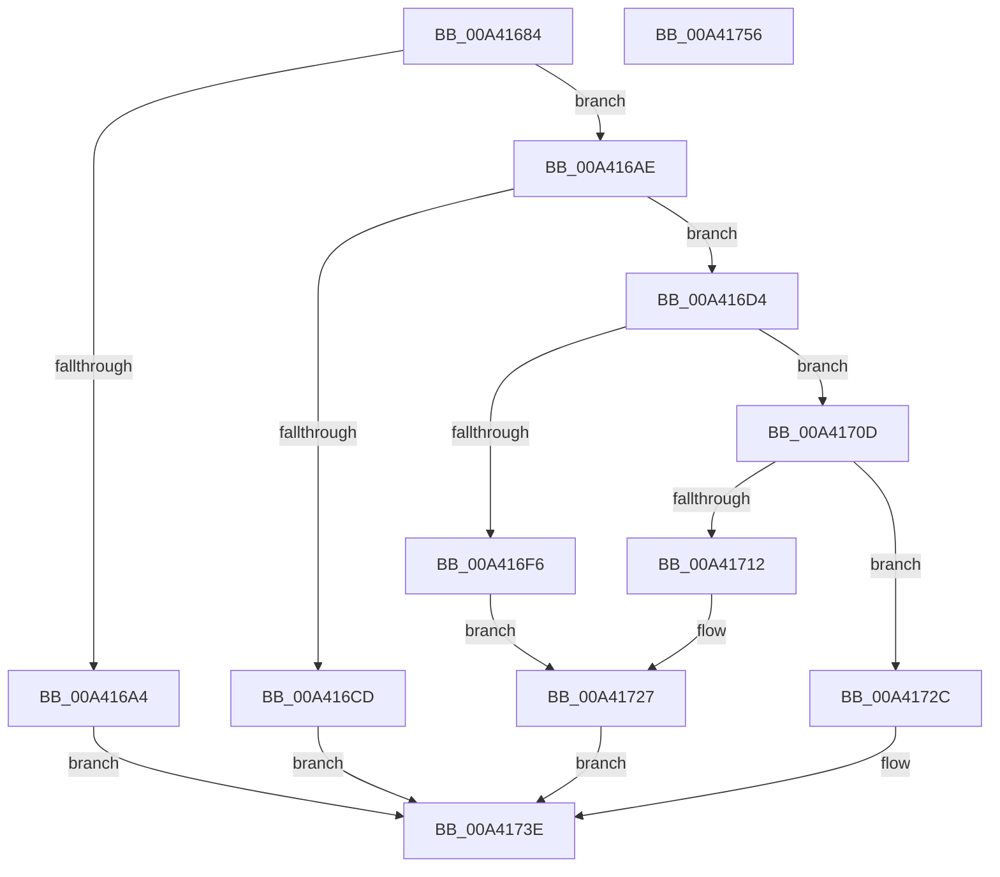

# BiConvertQualifiedPartitionToBootEnvironment

- RVA: `0x00A41684`–`0x00A41757` (길이 `211` bytes)
- VA: `0x0000000140A41684`
- 실행 섹션: `PAGE`
- PDB 이름 있음: `예`; PDB Function 태그: `아니요`
- unwind 정보 RVA: `0x0006F978`
- 디코드: `57`개 명령, `211/211` bytes 표시
- 미해석 바이트: `0` (있으면 어셈블리에 `.byte`로 보존)

> 이 문서는 커널 이미지의 기계어와 PDB 기호를 분석해 생성했습니다. 4번과 5번은 함수 원형과 자료형을 바이너리 사용 방식에서 추정한 C 해석이며 원본 소스 복구 결과는 아닙니다.

## 1. Dependencies

- 직접 호출 지점: **3**; 고유 호출 대상: **3**
- 직접 호출자로 확인된 함수: **1**
- RIP 상대 이미지 참조: **0**

### Outgoing calls
- `0x00A416BE` → [ExAllocatePool2](../../poolcode/B8/ExAllocatePool2_function_00B820F0.md) (function, `0x00B820F0`)
- `0x00A416DD` → [memset](../../text/6C/memset_function_006C6C40.md) (function, `0x006C6C40`)
- `0x00A41739` → [ExFreePoolWithTag](../../poolcode/B8/ExFreePoolWithTag_function_00B82870.md) (function, `0x00B82870`)

### Direct callers
- [BiConvertElementToRegistryData](BiConvertElementToRegistryData_function_00A400A8.md) at `0x00A40369`

### Static image references
- 디코드된 RIP-relative 메모리 참조가 없습니다.

## 2. Other-region calls and transfers

- 다른 실행 섹션으로 향하는 call: **3**
  - `0x00A416BE` → [ExAllocatePool2](../../poolcode/B8/ExAllocatePool2_function_00B820F0.md) (`PAGE` → `POOLCODE`)
  - `0x00A416DD` → [memset](../../text/6C/memset_function_006C6C40.md) (`PAGE` → `.text`)
  - `0x00A41739` → [ExFreePoolWithTag](../../poolcode/B8/ExFreePoolWithTag_function_00B82870.md) (`PAGE` → `POOLCODE`)
- 별도 외부 분기/꼬리 이동을 확인하지 못했습니다.

## 3. Assembly (complete function range)

```asm
00A41684  48 89 5C 24 08                  mov qword ptr [rsp + 8], rbx
00A41689  48 89 74 24 10                  mov qword ptr [rsp + 0x10], rsi
00A4168E  48 89 7C 24 18                  mov qword ptr [rsp + 0x18], rdi
00A41693  41 56                           push r14
00A41695  48 83 EC 20                     sub rsp, 0x20
00A41699  4D 8B F0                        mov r14, r8
00A4169C  48 8B F1                        mov rsi, rcx
00A4169F  83 FA 3C                        cmp edx, 0x3c
00A416A2  73 0A                           jae 0x140a416ae
00A416A4  BB 0D 00 00 C0                  mov ebx, 0xc000000d
00A416A9  E9 90 00 00 00                  jmp 0x140a4173e
00A416AE  BA 48 00 00 00                  mov edx, 0x48
00A416B3  B9 02 01 00 00                  mov ecx, 0x102
00A416B8  41 B8 42 43 44 4B               mov r8d, 0x4b444342
00A416BE  E8 2D 0A 14 00                  call 0x140b820f0
00A416C3  33 DB                           xor ebx, ebx
00A416C5  48 8B F8                        mov rdi, rax
00A416C8  48 85 C0                        test rax, rax
00A416CB  75 07                           jne 0x140a416d4
00A416CD  BB 9A 00 00 C0                  mov ebx, 0xc000009a
00A416D2  EB 6A                           jmp 0x140a4173e
00A416D4  33 D2                           xor edx, edx
00A416D6  48 8B CF                        mov rcx, rdi
00A416D9  44 8D 42 48                     lea r8d, [rdx + 0x48]
00A416DD  E8 5E 55 C8 FF                  call 0x1406c6c40
00A416E2  C7 07 06 00 00 00               mov dword ptr [rdi], 6
00A416E8  C7 47 08 48 00 00 00            mov dword ptr [rdi + 8], 0x48
00A416EF  8B 46 14                        mov eax, dword ptr [rsi + 0x14]
00A416F2  85 C0                           test eax, eax
00A416F4  75 17                           jne 0x140a4170d
00A416F6  C7 47 24 01 00 00 00            mov dword ptr [rdi + 0x24], 1
00A416FD  8B 46 1C                        mov eax, dword ptr [rsi + 0x1c]
00A41700  89 47 28                        mov dword ptr [rdi + 0x28], eax
00A41703  48 8B 46 20                     mov rax, qword ptr [rsi + 0x20]
00A41707  48 89 47 10                     mov qword ptr [rdi + 0x10], rax
00A4170B  EB 1A                           jmp 0x140a41727
00A4170D  83 F8 01                        cmp eax, 1
00A41710  75 1A                           jne 0x140a4172c
00A41712  89 5F 24                        mov dword ptr [rdi + 0x24], ebx
00A41715  0F 10 46 1C                     movups xmm0, xmmword ptr [rsi + 0x1c]
00A41719  F3 0F 7F 47 28                  movdqu xmmword ptr [rdi + 0x28], xmm0
00A4171E  0F 10 4E 2C                     movups xmm1, xmmword ptr [rsi + 0x2c]
00A41722  F3 0F 7F 4F 10                  movdqu xmmword ptr [rdi + 0x10], xmm1
00A41727  49 89 3E                        mov qword ptr [r14], rdi
00A4172A  EB 12                           jmp 0x140a4173e
00A4172C  BB 0D 00 00 C0                  mov ebx, 0xc000000d
00A41731  BA 42 43 44 4B                  mov edx, 0x4b444342
00A41736  48 8B CF                        mov rcx, rdi
00A41739  E8 32 11 14 00                  call 0x140b82870
00A4173E  48 8B 74 24 38                  mov rsi, qword ptr [rsp + 0x38]
00A41743  8B C3                           mov eax, ebx
00A41745  48 8B 5C 24 30                  mov rbx, qword ptr [rsp + 0x30]
00A4174A  48 8B 7C 24 40                  mov rdi, qword ptr [rsp + 0x40]
00A4174F  48 83 C4 20                     add rsp, 0x20
00A41753  41 5E                           pop r14
00A41755  C3                              ret
00A41756  CC                              int3
```

## 4. C-style interpretation (structured pseudocode)

```c
__int64 __fastcall BiConvertQualifiedPartitionToBootEnvironment(__int64 a1, int a2, __int64 a3)
{
    __int64 result;
    __int64 v_rbx;
    __int64 v_rsp;
    unsigned __int64 v_stack_p10;
    unsigned __int64 v_stack_p18;
    unsigned __int64 v_stack_p8;

    v_stack_p8 = v_rbx;
    v_stack_p10 = v_rsi;
    v_stack_p18 = v_rdi;
    v_rsp = (v_rsp) - (32);
    if (a2 >= 60) goto loc_00A416AE;
    goto loc_00A4173E;
loc_00A416AE:
    result = ExAllocatePool2(258, 72, (unsigned int)(0x4B444342ULL), a4);
    v_rbx = 0;
    if (result != 0) goto loc_00A416D4;
    goto loc_00A4173E;
loc_00A416D4:
    a2 = 0;
    result = memset(result, a2, a2 + 72, a4);
    *(unsigned int *)(result) = 6;
    *(unsigned int *)(result + 8) = 72;
    if ((unsigned int)((unsigned int)(*(unsigned int *)(a1 + 20))) != 0) goto loc_00A4170D;
    *(unsigned int *)(result + 36) = 1;
    *(unsigned int *)(result + 40) = (unsigned int)((unsigned int)(*(unsigned int *)(a1 + 28)));
    *(unsigned __int64 *)(result + 16) = *(unsigned __int64 *)(a1 + 32);
    goto loc_00A41727;
loc_00A4170D:
    if (((unsigned int)(*(unsigned __int64 *)(a1 + 32))) != 1) goto loc_00A4172C;
    *(unsigned int *)(result + 36) = (unsigned int)((unsigned int)(0xC000009AULL));
    *(unsigned __int64 *)(result + 40) = v_xmm0;
    *(unsigned __int64 *)(result + 16) = v_xmm1;
loc_00A41727:
    *(unsigned __int64 *)(a3) = result;
    goto loc_00A4173E;
loc_00A4172C:
    result = ExFreePoolWithTag(result, (unsigned int)(0x4B444342ULL), a2 + 72, a4);
loc_00A4173E:
    v_rsp = (v_rsp) + (32);
    return (unsigned int)((unsigned int)((unsigned int)(0xC000000DULL)));
}
```

## 5. (Beta) C Style

```c
int64_t BiConvertQualifiedPartitionToBootEnvironment(void *Arg1, int32_t Arg2, void *Arg3)
{
    uint8_t *arg1 = (uint8_t *)Arg1;
    uint8_t *arg3 = (uint8_t *)Arg3;

    int64_t result;
    int64_t local_rbx;
    int64_t local_rsp;
    uint64_t v_stack_p10;
    uint64_t v_stack_p18;
    uint64_t v_stack_p8;

    v_stack_p8 = local_rbx;
    v_stack_p10 = local_rsi;
    v_stack_p18 = local_rdi;
    local_rsp = (local_rsp) - (32);
    if (Arg2 >= 60) goto loc_00A416AE;
    goto loc_00A4173E;
loc_00A416AE:
    result = ExAllocatePool2(258, 72, (uint32_t)(0x4B444342ULL), a4);
    local_rbx = 0;
    if (result != 0) goto loc_00A416D4;
    goto loc_00A4173E;
loc_00A416D4:
    Arg2 = 0;
    result = memset(result, Arg2, Arg2 + 72, a4);
    *(uint32_t *)(result) = 6;
    *(uint32_t *)(result + 0x8) = 72;
    if ((uint32_t)((uint32_t)(*(uint32_t *)(arg1 + 0x14))) != 0) goto loc_00A4170D;
    *(uint32_t *)(result + 0x24) = 1;
    *(uint32_t *)(result + 0x28) = (uint32_t)((uint32_t)(*(uint32_t *)(arg1 + 0x1C)));
    *(uint64_t *)(result + 0x10) = *(uint64_t *)(arg1 + 0x20);
    goto loc_00A41727;
loc_00A4170D:
    if (((uint32_t)(*(uint64_t *)(arg1 + 0x20))) != 1) goto loc_00A4172C;
    *(uint32_t *)(result + 0x24) = (uint32_t)((uint32_t)(0xC000009AULL));
    *(uint64_t *)(result + 0x28) = v_xmm0;
    *(uint64_t *)(result + 0x10) = v_xmm1;
loc_00A41727:
    *(uint64_t *)(arg3) = result;
    goto loc_00A4173E;
loc_00A4172C:
    result = ExFreePoolWithTag(result, (uint32_t)(0x4B444342ULL), Arg2 + 72, a4);
loc_00A4173E:
    local_rsp = (local_rsp) + (32);
    return (uint32_t)((uint32_t)((uint32_t)(0xC000000DULL)));
}
```

### 관측된 메모리 오프셋

구조체 형식이 확인되지 않은 접근은 인자 기준의 오프셋으로만 기록했습니다.

| 기준 인자 | 오프셋 표현 | 폭 (bit) | 접근 |
|---|---:|---:|---|
| `Arg1` | `+ 0x14` | `32` | `R` |
| `Arg1` | `+ 0x1C` | `32` | `R` |
| `Arg1` | `+ 0x1C` | `128` | `R` |
| `Arg1` | `+ 0x20` | `64` | `R` |
| `Arg1` | `+ 0x2C` | `128` | `R` |
| `Arg3` | `+ 0x0` | `64` | `W` |

## 6. Execution-region graph

[열기: 2D/3D 그래프와 함수 탐색 컨트롤 패널](../../../control-panel.html?section=page&rva=0x00A41684&view=graph)

- 2D 그래프는 위에서 아래로 흐르고, 3D 그래프는 빈 공간을 드래그해 회전합니다. Shift+드래그는 이동, 휠은 확대·축소, 함수 노드 선택은 대상 보고서 이동입니다.

### Static fallback


