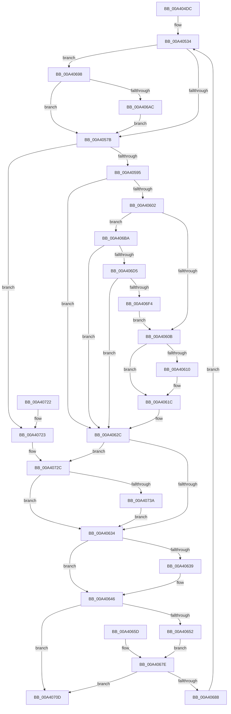

# BiCreateKey

- RVA: `0x00A404DC`–`0x00A40744` (길이 `616` bytes)
- VA: `0x0000000140A404DC`
- 실행 섹션: `PAGE`
- PDB 이름 있음: `예`; PDB Function 태그: `아니요`
- unwind 정보 RVA: `0x000AE950`
- 디코드: `145`개 명령, `616/616` bytes 표시
- 미해석 바이트: `0` (있으면 어셈블리에 `.byte`로 보존)

> 이 문서는 커널 이미지의 기계어와 PDB 기호를 분석해 생성했습니다. 4번과 5번은 함수 원형과 자료형을 바이너리 사용 방식에서 추정한 C 해석이며 원본 소스 복구 결과는 아닙니다.

## 1. Dependencies

- 직접 호출 지점: **9**; 고유 호출 대상: **8**
- 직접 호출자로 확인된 함수: **5**
- RIP 상대 이미지 참조: **0**

### Outgoing calls
- `0x00A40542` → [RtlInitUnicodeString](../../text/42/RtlInitUnicodeString_function_0042A780.md) (function, `0x0042A780`)
- `0x00A4054A` → [BiSanitizeHandle](../../text/4B/BiSanitizeHandle_function_004B0E4C.md) (function, `0x004B0E4C`)
- `0x00A40584` → [BiCreateKeySecurityDescriptor](../91/BiCreateKeySecurityDescriptor_function_00916D6C.md) (function, `0x00916D6C`)
- `0x00A405F3` → [BiZwCreateKey](../../text/4B/BiZwCreateKey_function_004BAB44.md) (function, `0x004BAB44`)
- `0x00A40641` → [ExFreePoolWithTag](../../poolcode/B8/ExFreePoolWithTag_function_00B82870.md) (function, `0x00B82870`)
- `0x00A406C2` → [BiZwSetSecurityObject](../../text/4A/BiZwSetSecurityObject_function_004A9A84.md) (function, `0x004A9A84`)
- `0x00A406E1` → [BiZwOpenKey](../../text/4A/BiZwOpenKey_function_004AF654.md) (function, `0x004AF654`)
- `0x00A406F9` → [BiZwClose](../../text/4A/BiZwClose_function_004A85DC.md) (function, `0x004A85DC`)
- `0x00A4073A` → [BiZwClose](../../text/4A/BiZwClose_function_004A85DC.md) (function, `0x004A85DC`)

### Direct callers
- [BcdSetElementDataWithFlags](../A3/BcdSetElementDataWithFlags_function_00A3F080.md) at `0x00A3F16E`
- [BiAddStoreFromFile](BiAddStoreFromFile_function_00A40C54.md) at `0x00A40E0C`
- [BiSetObjectDescription](BiSetObjectDescription_function_00A41DE8.md) at `0x00A41E22`
- [sub_00B3A518](../B3/Unknown_function_00B3A518.md) at `0x00B3A574`
- [sub_00B3A518](../B3/Unknown_function_00B3A518.md) at `0x00B3A5C1`
- [sub_00B3AA4C](../B3/Unknown_function_00B3AA4C.md) at `0x00B3AAED`

### Static image references
- 디코드된 RIP-relative 메모리 참조가 없습니다.

## 2. Other-region calls and transfers

- 다른 실행 섹션으로 향하는 call: **8**
  - `0x00A40542` → [RtlInitUnicodeString](../../text/42/RtlInitUnicodeString_function_0042A780.md) (`PAGE` → `.text`)
  - `0x00A4054A` → [BiSanitizeHandle](../../text/4B/BiSanitizeHandle_function_004B0E4C.md) (`PAGE` → `.text`)
  - `0x00A405F3` → [BiZwCreateKey](../../text/4B/BiZwCreateKey_function_004BAB44.md) (`PAGE` → `.text`)
  - `0x00A40641` → [ExFreePoolWithTag](../../poolcode/B8/ExFreePoolWithTag_function_00B82870.md) (`PAGE` → `POOLCODE`)
  - `0x00A406C2` → [BiZwSetSecurityObject](../../text/4A/BiZwSetSecurityObject_function_004A9A84.md) (`PAGE` → `.text`)
  - `0x00A406E1` → [BiZwOpenKey](../../text/4A/BiZwOpenKey_function_004AF654.md) (`PAGE` → `.text`)
  - `0x00A406F9` → [BiZwClose](../../text/4A/BiZwClose_function_004A85DC.md) (`PAGE` → `.text`)
  - `0x00A4073A` → [BiZwClose](../../text/4A/BiZwClose_function_004A85DC.md) (`PAGE` → `.text`)
- 별도 외부 분기/꼬리 이동을 확인하지 못했습니다.

## 3. Assembly (complete function range)

```asm
00A404DC  4C 8B DC                        mov r11, rsp
00A404DF  45 89 4B 20                     mov dword ptr [r11 + 0x20], r9d
00A404E3  49 89 53 10                     mov qword ptr [r11 + 0x10], rdx
00A404E7  53                              push rbx
00A404E8  56                              push rsi
00A404E9  57                              push rdi
00A404EA  41 54                           push r12
00A404EC  41 55                           push r13
00A404EE  41 56                           push r14
00A404F0  41 57                           push r15
00A404F2  48 81 EC A0 00 00 00            sub rsp, 0xa0
00A404F9  41 8B F8                        mov edi, r8d
00A404FC  48 8B C2                        mov rax, rdx
00A404FF  48 8B F1                        mov rsi, rcx
00A40502  83 64 24 44 00                  and dword ptr [rsp + 0x44], 0
00A40507  48 83 64 24 50 00               and qword ptr [rsp + 0x50], 0
00A4050D  0F 57 C0                        xorps xmm0, xmm0
00A40510  0F 11 44 24 58                  movups xmmword ptr [rsp + 0x58], xmm0
00A40515  33 C9                           xor ecx, ecx
00A40517  0F 11 44 24 68                  movups xmmword ptr [rsp + 0x68], xmm0
00A4051C  0F 11 44 24 78                  movups xmmword ptr [rsp + 0x78], xmm0
00A40521  49 89 4B B0                     mov qword ptr [r11 - 0x50], rcx
00A40525  41 89 4B B8                     mov dword ptr [r11 - 0x48], ecx
00A40529  45 33 F6                        xor r14d, r14d
00A4052C  4C 8B AC 24 08 01 00 00         mov r13, qword ptr [rsp + 0x108]
00A40534  48 83 64 24 48 00               and qword ptr [rsp + 0x48], 0
00A4053A  48 8B D0                        mov rdx, rax
00A4053D  48 8D 4C 24 58                  lea rcx, [rsp + 0x58]
00A40542  E8 39 A2 9E FF                  call 0x14042a780
00A40547  48 8B CE                        mov rcx, rsi
00A4054A  E8 FD 08 A7 FF                  call 0x1404b0e4c
00A4054F  48 89 84 24 E0 00 00 00         mov qword ptr [rsp + 0xe0], rax
00A40557  0F BA EF 12                     bts edi, 0x12
00A4055B  89 BC 24 F0 00 00 00            mov dword ptr [rsp + 0xf0], edi
00A40562  BB 40 00 00 00                  mov ebx, 0x40
00A40567  44 8B E7                        mov r12d, edi
00A4056A  45 32 FF                        xor r15b, r15b
00A4056D  F6 84 24 F8 00 00 00 01         test byte ptr [rsp + 0xf8], 1
00A40575  0F 85 1D 01 00 00               jne 0x140a40698
00A4057B  0F BA EB 09                     bts ebx, 9
00A4057F  B9 3F 00 0F 00                  mov ecx, 0xf003f
00A40584  E8 E3 67 ED FF                  call 0x140916d6c
00A40589  48 8B F0                        mov rsi, rax
00A4058C  48 85 C0                        test rax, rax
00A4058F  0F 84 8E 01 00 00               je 0x140a40723
00A40595  C7 44 24 68 30 00 00 00         mov dword ptr [rsp + 0x68], 0x30
00A4059D  48 8B 84 24 E0 00 00 00         mov rax, qword ptr [rsp + 0xe0]
00A405A5  48 89 44 24 70                  mov qword ptr [rsp + 0x70], rax
00A405AA  89 9C 24 80 00 00 00            mov dword ptr [rsp + 0x80], ebx
00A405B1  48 8D 44 24 58                  lea rax, [rsp + 0x58]
00A405B6  48 89 44 24 78                  mov qword ptr [rsp + 0x78], rax
00A405BB  48 89 B4 24 88 00 00 00         mov qword ptr [rsp + 0x88], rsi
00A405C3  48 83 A4 24 90 00 00 00 00      and qword ptr [rsp + 0x90], 0
00A405CC  8B 84 24 F8 00 00 00            mov eax, dword ptr [rsp + 0xf8]
00A405D3  D1 E8                           shr eax, 1
00A405D5  83 E0 01                        and eax, 1
00A405D8  48 8D 4C 24 44                  lea rcx, [rsp + 0x44]
00A405DD  48 89 4C 24 30                  mov qword ptr [rsp + 0x30], rcx
00A405E2  89 44 24 28                     mov dword ptr [rsp + 0x28], eax
00A405E6  4C 8D 44 24 68                  lea r8, [rsp + 0x68]
00A405EB  41 8B D4                        mov edx, r12d
00A405EE  48 8D 4C 24 48                  lea rcx, [rsp + 0x48]
00A405F3  E8 4C A5 A7 FF                  call 0x1404bab44
00A405F8  8B D8                           mov ebx, eax
00A405FA  89 44 24 40                     mov dword ptr [rsp + 0x40], eax
00A405FE  85 C0                           test eax, eax
00A40600  78 2A                           js 0x140a4062c
00A40602  45 84 FF                        test r15b, r15b
00A40605  0F 85 AF 00 00 00               jne 0x140a406ba
00A4060B  4D 85 ED                        test r13, r13
00A4060E  74 0C                           je 0x140a4061c
00A40610  83 7C 24 44 01                  cmp dword ptr [rsp + 0x44], 1
00A40615  0F 94 C0                        sete al
00A40618  41 88 45 00                     mov byte ptr [r13], al
00A4061C  48 8B 8C 24 00 01 00 00         mov rcx, qword ptr [rsp + 0x100]
00A40624  48 8B 44 24 48                  mov rax, qword ptr [rsp + 0x48]
00A40629  48 89 01                        mov qword ptr [rcx], rax
00A4062C  85 DB                           test ebx, ebx
00A4062E  0F 88 F8 00 00 00               js 0x140a4072c
00A40634  48 85 F6                        test rsi, rsi
00A40637  74 0D                           je 0x140a40646
00A40639  BA 42 43 44 4B                  mov edx, 0x4b444342
00A4063E  48 8B CE                        mov rcx, rsi
00A40641  E8 2A 22 14 00                  call 0x140b82870
00A40646  81 FB 7D 01 00 C0               cmp ebx, 0xc000017d
00A4064C  0F 85 BB 00 00 00               jne 0x140a4070d
00A40652  CC                              int3
00A40653  48 8B B4 24 E0 00 00 00         mov rsi, qword ptr [rsp + 0xe0]
00A4065B  EB 21                           jmp 0x140a4067e
00A4065D  41 BE 05 00 00 00               mov r14d, 5
00A40663  4C 8B AC 24 08 01 00 00         mov r13, qword ptr [rsp + 0x108]
00A4066B  8B BC 24 F0 00 00 00            mov edi, dword ptr [rsp + 0xf0]
00A40672  48 8B B4 24 E0 00 00 00         mov rsi, qword ptr [rsp + 0xe0]
00A4067A  8B 5C 24 40                     mov ebx, dword ptr [rsp + 0x40]
00A4067E  41 83 FE 05                     cmp r14d, 5
00A40682  0F 83 85 00 00 00               jae 0x140a4070d
00A40688  41 FF C6                        inc r14d
00A4068B  48 8B 84 24 E8 00 00 00         mov rax, qword ptr [rsp + 0xe8]
00A40693  E9 9C FE FF FF                  jmp 0x140a40534
00A40698  BB C0 00 00 00                  mov ebx, 0xc0
00A4069D  8B C7                           mov eax, edi
00A4069F  25 19 00 06 00                  and eax, 0x60019
00A406A4  3B C7                           cmp eax, edi
00A406A6  0F 84 CF FE FF FF               je 0x140a4057b
00A406AC  41 BC 00 00 04 00               mov r12d, 0x40000
00A406B2  41 B7 01                        mov r15b, 1
00A406B5  E9 C1 FE FF FF                  jmp 0x140a4057b
00A406BA  4C 8B C6                        mov r8, rsi
00A406BD  48 8B 4C 24 48                  mov rcx, qword ptr [rsp + 0x48]
00A406C2  E8 BD 93 A6 FF                  call 0x1404a9a84
00A406C7  8B D8                           mov ebx, eax
00A406C9  89 44 24 40                     mov dword ptr [rsp + 0x40], eax
00A406CD  85 C0                           test eax, eax
00A406CF  0F 88 57 FF FF FF               js 0x140a4062c
00A406D5  4C 8D 44 24 68                  lea r8, [rsp + 0x68]
00A406DA  8B D7                           mov edx, edi
00A406DC  48 8D 4C 24 50                  lea rcx, [rsp + 0x50]
00A406E1  E8 6E EF A6 FF                  call 0x1404af654
00A406E6  8B D8                           mov ebx, eax
00A406E8  89 44 24 40                     mov dword ptr [rsp + 0x40], eax
00A406EC  85 C0                           test eax, eax
00A406EE  0F 88 38 FF FF FF               js 0x140a4062c
00A406F4  48 8B 4C 24 48                  mov rcx, qword ptr [rsp + 0x48]
00A406F9  E8 DE 7E A6 FF                  call 0x1404a85dc
00A406FE  48 8B 44 24 50                  mov rax, qword ptr [rsp + 0x50]
00A40703  48 89 44 24 48                  mov qword ptr [rsp + 0x48], rax
00A40708  E9 FE FE FF FF                  jmp 0x140a4060b
00A4070D  8B C3                           mov eax, ebx
00A4070F  48 81 C4 A0 00 00 00            add rsp, 0xa0
00A40716  41 5F                           pop r15
00A40718  41 5E                           pop r14
00A4071A  41 5D                           pop r13
00A4071C  41 5C                           pop r12
00A4071E  5F                              pop rdi
00A4071F  5E                              pop rsi
00A40720  5B                              pop rbx
00A40721  C3                              ret
00A40722  CC                              int3
00A40723  BB 79 00 00 C0                  mov ebx, 0xc0000079
00A40728  89 5C 24 40                     mov dword ptr [rsp + 0x40], ebx
00A4072C  48 8B 4C 24 48                  mov rcx, qword ptr [rsp + 0x48]
00A40731  48 85 C9                        test rcx, rcx
00A40734  0F 84 FA FE FF FF               je 0x140a40634
00A4073A  E8 9D 7E A6 FF                  call 0x1404a85dc
00A4073F  E9 F0 FE FF FF                  jmp 0x140a40634
```

## 4. C-style interpretation (structured pseudocode)

```c
__int64 __fastcall BiCreateKey(__int64 a1, __int64 a2, int a3, int a4, __int64 a5, __int64 a6)
{
    __int64 result;
    __int64 v_r14;
    __int64 v_r15;
    __int64 v_rsp;
    unsigned __int64 v_stack_m48;
    unsigned __int64 v_stack_m50;
    unsigned int v_stack_m58;
    unsigned __int64 v_stack_m60;
    unsigned __int64 v_stack_m68;
    unsigned __int64 v_stack_m70;
    unsigned __int64 v_stack_m80;
    unsigned __int64 v_stack_m88;
    unsigned __int64 v_stack_m90;
    unsigned int v_stack_m94;
    unsigned int v_stack_m98;
    unsigned __int64 v_stack_mA8;
    unsigned int v_stack_mB0;
    unsigned __int64 v_stack_p10;
    unsigned int v_stack_p18;
    unsigned __int8 v_stack_p20;
    unsigned __int64 v_stack_p30;
    unsigned int v_stack_p40;
    unsigned __int64 v_stack_p48;
    unsigned __int64 v_stack_p8;

    *(unsigned int *)(v_rsp + 32) = a4;
    *(unsigned __int64 *)(v_rsp + 16) = a2;
    v_rsp = (v_rsp) - (160);
    v_stack_m80 = v_xmm0;
    a1 = 0;
    v_stack_m70 = v_xmm0;
    v_stack_m60 = v_xmm0;
    *(unsigned __int64 *)(v_rsp - 80) = 0;
    *(unsigned int *)(v_rsp - 72) = 0;
    v_r14 = 0;
loc_00A40534:
    result = RtlInitUnicodeString(v_stack_m80, a2, a3, a4);
    result = BiSanitizeHandle(0, a2, a3, a4);
    v_stack_p8 = result;
    v_stack_p18 = (unsigned int)((unsigned int)(a3));
    v_r15 = 0;
    if (((v_stack_p20) & (1)) != 0) goto loc_00A40698;
loc_00A4057B:
    result = BiCreateKeySecurityDescriptor((unsigned int)(0xF003FULL), a2, a3, a4);
    if (result == 0) goto loc_00A40723;
    v_stack_m70 = 48;
    v_stack_m68 = v_stack_p8;
    v_stack_m58 = 64;
    v_stack_m60 = v_stack_m80;
    v_stack_m50 = result;
    result = (unsigned int)(((unsigned int)(v_stack_p20)) >> (1));
    result = (unsigned int)((result) & (1));
    v_stack_mA8 = v_stack_m94;
    v_stack_mB0 = (unsigned int)(result);
    result = BiZwCreateKey(v_stack_m90, (unsigned int)((unsigned int)((unsigned int)((unsigned int)((unsigned int)(a3))))), v_stack_m70, a4);
    v_stack_m98 = (unsigned int)(result);
    if (sign_flag) goto loc_00A4062C;
    if (0 != 0) goto loc_00A406BA;
loc_00A4060B:
    if (a6 != 0) {
        result = (v_stack_m94 == 1) ? 1 : 0;
        *(unsigned __int8 *)(a6) = (unsigned __int8)(result);
    }
    *(unsigned __int64 *)(a5) = v_stack_m90;
loc_00A4062C:
    if (sign_flag) goto loc_00A4072C;
loc_00A40634:
    result = v_stack_m90;
    if (result != 0) {
        a2 = 0x4B444342ULL;
        a1 = result;
        result = ExFreePoolWithTag(a1, a2, v_stack_m70, a4);
    }
    if (((unsigned int)((unsigned int)((unsigned int)(result)))) != 0xC000017DULL) goto loc_00A4070D;
    goto loc_00A4067E;
loc_00A4067E:
    if (0 >= 5) goto loc_00A4070D;
    v_r14 = (unsigned int)((v_r14) + 1);
    goto loc_00A40534;
loc_00A40698:
    result = (unsigned int)(((unsigned int)((unsigned int)((unsigned int)(a3)))) & (0x60019ULL));
    if (((unsigned int)(result)) == ((unsigned int)((unsigned int)(a3)))) goto loc_00A4057B;
    goto loc_00A4057B;
loc_00A406BA:
    result = BiZwSetSecurityObject(v_stack_m90, a2, v_stack_p8, a4);
    v_stack_m98 = (unsigned int)(result);
    if (sign_flag) goto loc_00A4062C;
    result = BiZwOpenKey(v_stack_m88, (unsigned int)((unsigned int)((unsigned int)(a3))), v_stack_m70, a4);
    v_stack_m98 = (unsigned int)(result);
    if (sign_flag) goto loc_00A4062C;
    result = BiZwClose(v_stack_m90, (unsigned int)((unsigned int)((unsigned int)(a3))), v_stack_m70, a4);
    v_stack_m90 = v_stack_m88;
    goto loc_00A4060B;
loc_00A4070D:
    v_rsp = (v_rsp) + (160);
    return (unsigned int)((unsigned int)((unsigned int)((unsigned int)(result))));
loc_00A40723:
    v_stack_p40 = (unsigned int)((unsigned int)(0xC0000079ULL));
loc_00A4072C:
    if (v_stack_p48 == 0) goto loc_00A40634;
    result = BiZwClose(v_stack_p48, (unsigned int)((unsigned int)((unsigned int)(a3))), v_stack_m70, a4);
    goto loc_00A40634;
}
```

## 5. (Beta) C Style

```c
int64_t BiCreateKey(int64_t Arg1, int64_t Arg2, int32_t Arg3, int32_t Arg4, void *Arg5, int64_t Arg6)
{
    uint8_t *arg5 = (uint8_t *)Arg5;

    int64_t result;
    int64_t local_r14;
    int64_t local_r15;
    int64_t local_rsp;
    uint64_t v_stack_m48;
    uint64_t v_stack_m50;
    uint32_t v_stack_m58;
    uint64_t v_stack_m60;
    uint64_t v_stack_m68;
    uint64_t v_stack_m70;
    uint64_t v_stack_m80;
    uint64_t v_stack_m88;
    uint64_t v_stack_m90;
    uint32_t v_stack_m94;
    uint32_t v_stack_m98;
    uint64_t v_stack_mA8;
    uint32_t v_stack_mB0;
    uint64_t v_stack_p10;
    uint32_t v_stack_p18;
    uint8_t v_stack_p20;
    uint64_t v_stack_p30;
    uint32_t v_stack_p40;
    uint64_t v_stack_p48;
    uint64_t v_stack_p8;

    *(uint32_t *)(local_rsp + 0x20) = Arg4;
    *(uint64_t *)(local_rsp + 0x10) = Arg2;
    local_rsp = (local_rsp) - (160);
    v_stack_m80 = v_xmm0;
    Arg1 = 0;
    v_stack_m70 = v_xmm0;
    v_stack_m60 = v_xmm0;
    *(uint64_t *)(local_rsp - 0x50) = 0;
    *(uint32_t *)(local_rsp - 0x48) = 0;
    local_r14 = 0;
loc_00A40534:
    result = RtlInitUnicodeString(v_stack_m80, Arg2, Arg3, Arg4);
    result = BiSanitizeHandle(0, Arg2, Arg3, Arg4);
    v_stack_p8 = result;
    v_stack_p18 = (uint32_t)((uint32_t)(Arg3));
    local_r15 = 0;
    if (((v_stack_p20) & (1)) != 0) goto loc_00A40698;
loc_00A4057B:
    result = BiCreateKeySecurityDescriptor((uint32_t)(0xF003FULL), Arg2, Arg3, Arg4);
    if (result == 0) goto loc_00A40723;
    v_stack_m70 = 48;
    v_stack_m68 = v_stack_p8;
    v_stack_m58 = 64;
    v_stack_m60 = v_stack_m80;
    v_stack_m50 = result;
    result = (uint32_t)(((uint32_t)(v_stack_p20)) >> (1));
    result = (uint32_t)((result) & (1));
    v_stack_mA8 = v_stack_m94;
    v_stack_mB0 = (uint32_t)(result);
    result = BiZwCreateKey(v_stack_m90, (uint32_t)((uint32_t)((uint32_t)((uint32_t)((uint32_t)(Arg3))))), v_stack_m70, Arg4);
    v_stack_m98 = (uint32_t)(result);
    if (sign_flag) goto loc_00A4062C;
    if (0 != 0) goto loc_00A406BA;
loc_00A4060B:
    if (Arg6 != 0) {
        result = (v_stack_m94 == 1) ? 1 : 0;
        *(uint8_t *)(Arg6) = (uint8_t)(result);
    }
    *(uint64_t *)(arg5) = v_stack_m90;
loc_00A4062C:
    if (sign_flag) goto loc_00A4072C;
loc_00A40634:
    result = v_stack_m90;
    if (result != 0) {
        Arg2 = 0x4B444342ULL;
        Arg1 = result;
        result = ExFreePoolWithTag(Arg1, Arg2, v_stack_m70, Arg4);
    }
    if (((uint32_t)((uint32_t)((uint32_t)(result)))) != 0xC000017DULL) goto loc_00A4070D;
    goto loc_00A4067E;
loc_00A4067E:
    if (0 >= 5) goto loc_00A4070D;
    local_r14 = (uint32_t)((local_r14) + 1);
    goto loc_00A40534;
loc_00A40698:
    result = (uint32_t)(((uint32_t)((uint32_t)((uint32_t)(Arg3)))) & (0x60019ULL));
    if (((uint32_t)(result)) == ((uint32_t)((uint32_t)(Arg3)))) goto loc_00A4057B;
    goto loc_00A4057B;
loc_00A406BA:
    result = BiZwSetSecurityObject(v_stack_m90, Arg2, v_stack_p8, Arg4);
    v_stack_m98 = (uint32_t)(result);
    if (sign_flag) goto loc_00A4062C;
    result = BiZwOpenKey(v_stack_m88, (uint32_t)((uint32_t)((uint32_t)(Arg3))), v_stack_m70, Arg4);
    v_stack_m98 = (uint32_t)(result);
    if (sign_flag) goto loc_00A4062C;
    result = BiZwClose(v_stack_m90, (uint32_t)((uint32_t)((uint32_t)(Arg3))), v_stack_m70, Arg4);
    v_stack_m90 = v_stack_m88;
    goto loc_00A4060B;
loc_00A4070D:
    local_rsp = (local_rsp) + (160);
    return (uint32_t)((uint32_t)((uint32_t)((uint32_t)(result))));
loc_00A40723:
    v_stack_p40 = (uint32_t)((uint32_t)(0xC0000079ULL));
loc_00A4072C:
    if (v_stack_p48 == 0) goto loc_00A40634;
    result = BiZwClose(v_stack_p48, (uint32_t)((uint32_t)((uint32_t)(Arg3))), v_stack_m70, Arg4);
    goto loc_00A40634;
}
```

### 관측된 메모리 오프셋

구조체 형식이 확인되지 않은 접근은 인자 기준의 오프셋으로만 기록했습니다.

| 기준 인자 | 오프셋 표현 | 폭 (bit) | 접근 |
|---|---:|---:|---|
| `Arg5` | `+ 0x0` | `64` | `W` |

## 6. Execution-region graph

[열기: 2D/3D 그래프와 함수 탐색 컨트롤 패널](../../../control-panel.html?section=page&rva=0x00A404DC&view=graph)

- 2D 그래프는 위에서 아래로 흐르고, 3D 그래프는 빈 공간을 드래그해 회전합니다. Shift+드래그는 이동, 휠은 확대·축소, 함수 노드 선택은 대상 보고서 이동입니다.

### Static fallback


