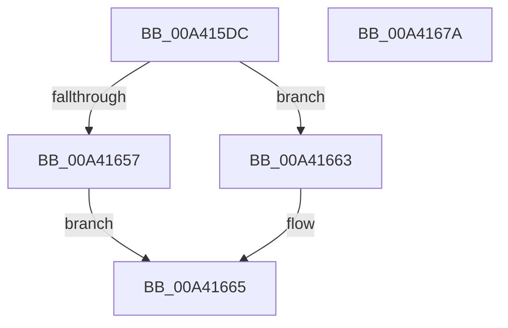

# BiDoesHiveExist

- RVA: `0x00A415DC`–`0x00A4167B` (길이 `159` bytes)
- VA: `0x0000000140A415DC`
- 실행 섹션: `PAGE`
- PDB 이름 있음: `예`; PDB Function 태그: `아니요`
- unwind 정보 RVA: `0x000AEA98`
- 디코드: `43`개 명령, `159/159` bytes 표시
- 미해석 바이트: `0` (있으면 어셈블리에 `.byte`로 보존)

> 이 문서는 커널 이미지의 기계어와 PDB 기호를 분석해 생성했습니다. 4번과 5번은 함수 원형과 자료형을 바이너리 사용 방식에서 추정한 C 해석이며 원본 소스 복구 결과는 아닙니다.

## 1. Dependencies

- 직접 호출 지점: **3**; 고유 호출 대상: **3**
- 직접 호출자로 확인된 함수: **1**
- RIP 상대 이미지 참조: **1**

### Outgoing calls
- `0x00A4161E` → [RtlInitUnicodeString](../../text/42/RtlInitUnicodeString_function_0042A780.md) (function, `0x0042A780`)
- `0x00A4164E` → [ZwQueryAttributesFile](../../text/6A/ZwQueryAttributesFile_function_006AD870.md) (function, `0x006AD870`)
- `0x00A4166C` → [_security_check_cookie](../../text/6A/_security_check_cookie_function_006AC640.md) (function, `0x006AC640`)

### Direct callers
- [BiLoadHive](BiLoadHive_function_00A412F4.md) at `0x00A4136D`

### Static image references
- `0x00A415EA` → RVA `0x00E0A740` (`.data`; read)

## 2. Other-region calls and transfers

- 다른 실행 섹션으로 향하는 call: **3**
  - `0x00A4161E` → [RtlInitUnicodeString](../../text/42/RtlInitUnicodeString_function_0042A780.md) (`PAGE` → `.text`)
  - `0x00A4164E` → [ZwQueryAttributesFile](../../text/6A/ZwQueryAttributesFile_function_006AD870.md) (`PAGE` → `.text`)
  - `0x00A4166C` → [_security_check_cookie](../../text/6A/_security_check_cookie_function_006AC640.md) (`PAGE` → `.text`)
- 별도 외부 분기/꼬리 이동을 확인하지 못했습니다.

## 3. Assembly (complete function range)

```asm
00A415DC  40 55                           push rbp
00A415DE  48 8D 6C 24 A9                  lea rbp, [rsp - 0x57]
00A415E3  48 81 EC 90 00 00 00            sub rsp, 0x90
00A415EA  48 8B 05 4F 91 3C 00            mov rax, qword ptr [rip + 0x3c914f]
00A415F1  48 33 C4                        xor rax, rsp
00A415F4  48 89 45 4F                     mov qword ptr [rbp + 0x4f], rax
00A415F8  33 C0                           xor eax, eax
00A415FA  48 8D 51 0C                     lea rdx, [rcx + 0xc]
00A415FE  21 45 13                        and dword ptr [rbp + 0x13], eax
00A41601  48 8D 4D E7                     lea rcx, [rbp - 0x19]
00A41605  0F 57 C0                        xorps xmm0, xmm0
00A41608  89 45 FB                        mov dword ptr [rbp - 5], eax
00A4160B  21 45 FB                        and dword ptr [rbp - 5], eax
00A4160E  0F 11 45 27                     movups xmmword ptr [rbp + 0x27], xmm0
00A41612  48 89 45 47                     mov qword ptr [rbp + 0x47], rax
00A41616  0F 11 45 37                     movups xmmword ptr [rbp + 0x37], xmm0
00A4161A  0F 11 45 E7                     movups xmmword ptr [rbp - 0x19], xmm0
00A4161E  E8 5D 91 9E FF                  call 0x14042a780
00A41623  48 83 65 FF 00                  and qword ptr [rbp - 1], 0
00A41628  48 8D 45 E7                     lea rax, [rbp - 0x19]
00A4162C  0F 57 C0                        xorps xmm0, xmm0
00A4162F  48 89 45 07                     mov qword ptr [rbp + 7], rax
00A41633  48 8D 55 27                     lea rdx, [rbp + 0x27]
00A41637  C7 45 F7 30 00 00 00            mov dword ptr [rbp - 9], 0x30
00A4163E  48 8D 4D F7                     lea rcx, [rbp - 9]
00A41642  C7 45 0F 40 02 00 00            mov dword ptr [rbp + 0xf], 0x240
00A41649  F3 0F 7F 45 17                  movdqu xmmword ptr [rbp + 0x17], xmm0
00A4164E  E8 1D C2 C6 FF                  call 0x1406ad870
00A41653  85 C0                           test eax, eax
00A41655  78 0C                           js 0x140a41663
00A41657  8B 45 47                        mov eax, dword ptr [rbp + 0x47]
00A4165A  C1 E8 04                        shr eax, 4
00A4165D  F6 D0                           not al
00A4165F  24 01                           and al, 1
00A41661  EB 02                           jmp 0x140a41665
00A41663  32 C0                           xor al, al
00A41665  48 8B 4D 4F                     mov rcx, qword ptr [rbp + 0x4f]
00A41669  48 33 CC                        xor rcx, rsp
00A4166C  E8 CF AF C6 FF                  call 0x1406ac640
00A41671  48 81 C4 90 00 00 00            add rsp, 0x90
00A41678  5D                              pop rbp
00A41679  C3                              ret
00A4167A  CC                              int3
```

## 4. C-style interpretation (structured pseudocode)

```c
__int64 __fastcall BiDoesHiveExist(__int64 a1)
{
    __int64 result;
    __int64 v_rsp;
    unsigned __int64 v_stack_m10;
    unsigned __int64 v_stack_m18;
    unsigned __int64 v_stack_m28;
    unsigned __int64 v_stack_m38;
    unsigned __int64 v_stack_m48;
    unsigned int v_stack_m4C;
    unsigned int v_stack_m50;
    unsigned __int64 v_stack_m58;
    unsigned __int64 v_stack_m5F;
    unsigned __int64 v_stack_m60;
    unsigned int v_stack_m64;
    unsigned int v_stack_m68;
    unsigned __int64 v_stack_m78;

    v_rsp = (v_rsp) - (144);
    result = (*(unsigned __int64 *)(v_rip + 3969359)) ^ (v_rsp);
    v_stack_m10 = result;
    result = 0;
    v_stack_m64 = 0;
    v_stack_m38 = v_xmm0;
    v_stack_m18 = 0;
    v_stack_m28 = v_xmm0;
    v_stack_m78 = v_xmm0;
    result = RtlInitUnicodeString(v_stack_m78, a1 + 12, a3, a4);
    v_stack_m58 = v_stack_m78;
    v_stack_m68 = 48;
    v_stack_m50 = 576;
    v_stack_m48 = v_xmm0;
    result = ZwQueryAttributesFile(v_stack_m68, v_stack_m38, a3, a4);
    if (sign_flag) goto loc_00A41663;
    result = (unsigned int)(((unsigned int)(v_stack_m18)) >> (4));
    result = (unsigned __int8)(~(result));
    result = (unsigned __int8)((result) & (1));
    goto loc_00A41665;
loc_00A41663:
    result = 0;
loc_00A41665:
    a1 = (v_stack_m10) ^ (v_rsp);
    result = _security_check_cookie(a1, v_stack_m38, a3, a4);
    v_rsp = (v_rsp) + (144);
    return result;
}
```

## 5. (Beta) C Style

```c
int64_t BiDoesHiveExist(void *Arg1)
{
    uint8_t *arg1 = (uint8_t *)Arg1;

    int64_t result;
    int64_t local_rsp;
    uint64_t v_stack_m10;
    uint64_t v_stack_m18;
    uint64_t v_stack_m28;
    uint64_t v_stack_m38;
    uint64_t v_stack_m48;
    uint32_t v_stack_m4C;
    uint32_t v_stack_m50;
    uint64_t v_stack_m58;
    uint64_t v_stack_m5F;
    uint64_t v_stack_m60;
    uint32_t v_stack_m64;
    uint32_t v_stack_m68;
    uint64_t v_stack_m78;

    local_rsp = (local_rsp) - (144);
    result = (*(uint64_t *)(v_rip + 0x3C914F)) ^ (local_rsp);
    v_stack_m10 = result;
    result = 0;
    v_stack_m64 = 0;
    v_stack_m38 = v_xmm0;
    v_stack_m18 = 0;
    v_stack_m28 = v_xmm0;
    v_stack_m78 = v_xmm0;
    result = RtlInitUnicodeString(v_stack_m78, Arg1 + 12, a3, a4);
    v_stack_m58 = v_stack_m78;
    v_stack_m68 = 48;
    v_stack_m50 = 576;
    v_stack_m48 = v_xmm0;
    result = ZwQueryAttributesFile(v_stack_m68, v_stack_m38, a3, a4);
    if (sign_flag) goto loc_00A41663;
    result = (uint32_t)(((uint32_t)(v_stack_m18)) >> (4));
    result = (uint8_t)(~(result));
    result = (uint8_t)((result) & (1));
    goto loc_00A41665;
loc_00A41663:
    result = 0;
loc_00A41665:
    Arg1 = (v_stack_m10) ^ (local_rsp);
    result = _security_check_cookie(Arg1, v_stack_m38, a3, a4);
    local_rsp = (local_rsp) + (144);
    return result;
}
```

### 관측된 메모리 오프셋

구조체 형식이 확인되지 않은 접근은 인자 기준의 오프셋으로만 기록했습니다.

| 기준 인자 | 오프셋 표현 | 폭 (bit) | 접근 |
|---|---:|---:|---|
| `Arg1` | `+ 0xC` | `64` | `R` |

## 6. Execution-region graph

[열기: 2D/3D 그래프와 함수 탐색 컨트롤 패널](../../../control-panel.html?section=page&rva=0x00A415DC&view=graph)

- 2D 그래프는 위에서 아래로 흐르고, 3D 그래프는 빈 공간을 드래그해 회전합니다. Shift+드래그는 이동, 휠은 확대·축소, 함수 노드 선택은 대상 보고서 이동입니다.

### Static fallback


