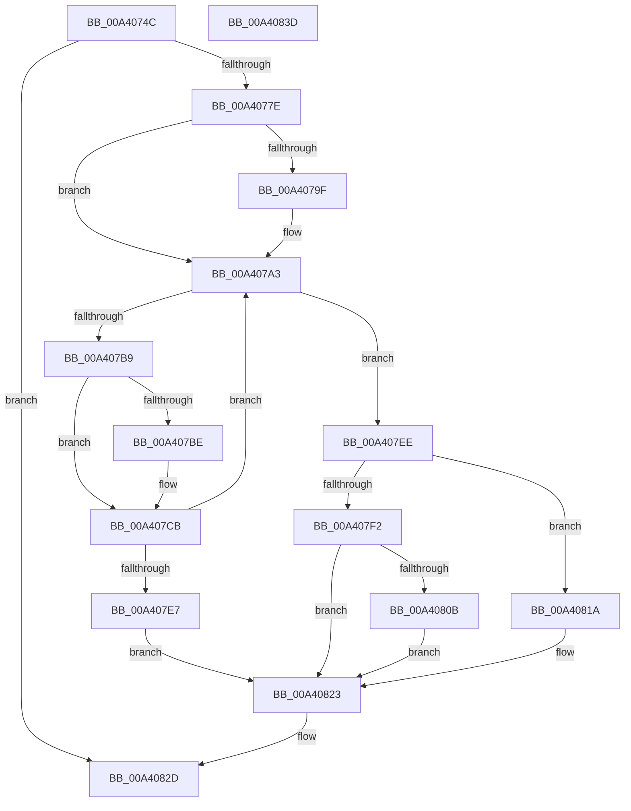

# BiEnumerateBootEntries

- RVA: `0x00A4074C`–`0x00A4083E` (길이 `242` bytes)
- VA: `0x0000000140A4074C`
- 실행 섹션: `PAGE`
- PDB 이름 있음: `예`; PDB Function 태그: `아니요`
- unwind 정보 RVA: `0x000AE984`
- 디코드: `68`개 명령, `242/242` bytes 표시
- 미해석 바이트: `0` (있으면 어셈블리에 `.byte`로 보존)

> 이 문서는 커널 이미지의 기계어와 PDB 기호를 분석해 생성했습니다. 4번과 5번은 함수 원형과 자료형을 바이너리 사용 방식에서 추정한 C 해석이며 원본 소스 복구 결과는 아닙니다.

## 1. Dependencies

- 직접 호출 지점: **8**; 고유 호출 대상: **6**
- 직접 호출자로 확인된 함수: **1**
- RIP 상대 이미지 참조: **1**

### Outgoing calls
- `0x00A4076F` → [BiAcquirePrivilege](../A3/BiAcquirePrivilege_function_00A3D658.md) (function, `0x00A3D658`)
- `0x00A40792` → [ExAllocatePool2](../../poolcode/B8/ExAllocatePool2_function_00B820F0.md) (function, `0x00B820F0`)
- `0x00A407AB` → [ZwEnumerateBootEntries](../../text/6A/ZwEnumerateBootEntries_function_006AEDB0.md) (function, `0x006AEDB0`)
- `0x00A407C6` → [ExFreePoolWithTag](../../poolcode/B8/ExFreePoolWithTag_function_00B82870.md) (function, `0x00B82870`)
- `0x00A407DA` → [ExAllocatePool2](../../poolcode/B8/ExAllocatePool2_function_00B820F0.md) (function, `0x00B820F0`)
- `0x00A40801` → [BiLogMessage](../A3/BiLogMessage_function_00A3D3A8.md) (function, `0x00A3D3A8`)
- `0x00A40813` → [ExFreePoolWithTag](../../poolcode/B8/ExFreePoolWithTag_function_00B82870.md) (function, `0x00B82870`)
- `0x00A40828` → [BiReleasePrivilege](../A3/BiReleasePrivilege_function_00A3D600.md) (function, `0x00A3D600`)

### Direct callers
- [BiBuildIdentifierList](../A3/BiBuildIdentifierList_function_00A3E584.md) at `0x00A3E7DB`

### Static image references
- `0x00A407F5` → RVA `0x00B0C820` (` ?? ::NNGAKEGL::`string'`; read)

## 2. Other-region calls and transfers

- 다른 실행 섹션으로 향하는 call: **5**
  - `0x00A40792` → [ExAllocatePool2](../../poolcode/B8/ExAllocatePool2_function_00B820F0.md) (`PAGE` → `POOLCODE`)
  - `0x00A407AB` → [ZwEnumerateBootEntries](../../text/6A/ZwEnumerateBootEntries_function_006AEDB0.md) (`PAGE` → `.text`)
  - `0x00A407C6` → [ExFreePoolWithTag](../../poolcode/B8/ExFreePoolWithTag_function_00B82870.md) (`PAGE` → `POOLCODE`)
  - `0x00A407DA` → [ExAllocatePool2](../../poolcode/B8/ExAllocatePool2_function_00B820F0.md) (`PAGE` → `POOLCODE`)
  - `0x00A40813` → [ExFreePoolWithTag](../../poolcode/B8/ExFreePoolWithTag_function_00B82870.md) (`PAGE` → `POOLCODE`)
- 별도 외부 분기/꼬리 이동을 확인하지 못했습니다.

## 3. Assembly (complete function range)

```asm
00A4074C  48 89 5C 24 08                  mov qword ptr [rsp + 8], rbx
00A40751  56                              push rsi
00A40752  57                              push rdi
00A40753  41 56                           push r14
00A40755  48 83 EC 20                     sub rsp, 0x20
00A40759  48 83 64 24 58 00               and qword ptr [rsp + 0x58], 0
00A4075F  48 8B F2                        mov rsi, rdx
00A40762  4C 8B F1                        mov r14, rcx
00A40765  48 8D 54 24 58                  lea rdx, [rsp + 0x58]
00A4076A  B9 16 00 00 00                  mov ecx, 0x16
00A4076F  E8 E4 CE FF FF                  call 0x140a3d658
00A40774  8B D8                           mov ebx, eax
00A40776  85 C0                           test eax, eax
00A40778  0F 88 AF 00 00 00               js 0x140a4082d
00A4077E  BA 00 20 00 00                  mov edx, 0x2000
00A40783  B9 02 01 00 00                  mov ecx, 0x102
00A40788  41 B8 42 43 44 4B               mov r8d, 0x4b444342
00A4078E  89 54 24 50                     mov dword ptr [rsp + 0x50], edx
00A40792  E8 59 19 14 00                  call 0x140b820f0
00A40797  48 8B F8                        mov rdi, rax
00A4079A  48 85 C0                        test rax, rax
00A4079D  75 04                           jne 0x140a407a3
00A4079F  21 44 24 50                     and dword ptr [rsp + 0x50], eax
00A407A3  48 8D 54 24 50                  lea rdx, [rsp + 0x50]
00A407A8  48 8B C8                        mov rcx, rax
00A407AB  E8 00 E6 C6 FF                  call 0x1406aedb0
00A407B0  8B D8                           mov ebx, eax
00A407B2  3D 23 00 00 C0                  cmp eax, 0xc0000023
00A407B7  75 35                           jne 0x140a407ee
00A407B9  48 85 FF                        test rdi, rdi
00A407BC  74 0D                           je 0x140a407cb
00A407BE  BA 42 43 44 4B                  mov edx, 0x4b444342
00A407C3  48 8B CF                        mov rcx, rdi
00A407C6  E8 A5 20 14 00                  call 0x140b82870
00A407CB  8B 54 24 50                     mov edx, dword ptr [rsp + 0x50]
00A407CF  B9 02 01 00 00                  mov ecx, 0x102
00A407D4  41 B8 42 43 44 4B               mov r8d, 0x4b444342
00A407DA  E8 11 19 14 00                  call 0x140b820f0
00A407DF  48 8B F8                        mov rdi, rax
00A407E2  48 85 C0                        test rax, rax
00A407E5  75 BC                           jne 0x140a407a3
00A407E7  BB 9A 00 00 C0                  mov ebx, 0xc000009a
00A407EC  EB 35                           jmp 0x140a40823
00A407EE  85 DB                           test ebx, ebx
00A407F0  79 28                           jns 0x140a4081a
00A407F2  44 8B C3                        mov r8d, ebx
00A407F5  48 8D 15 24 C0 0C 00            lea rdx, [rip + 0xcc024]
00A407FC  B9 04 00 00 00                  mov ecx, 4
00A40801  E8 A2 CB FF FF                  call 0x140a3d3a8
00A40806  48 85 FF                        test rdi, rdi
00A40809  74 18                           je 0x140a40823
00A4080B  BA 42 43 44 4B                  mov edx, 0x4b444342
00A40810  48 8B CF                        mov rcx, rdi
00A40813  E8 58 20 14 00                  call 0x140b82870
00A40818  EB 09                           jmp 0x140a40823
00A4081A  8B 44 24 50                     mov eax, dword ptr [rsp + 0x50]
00A4081E  89 06                           mov dword ptr [rsi], eax
00A40820  49 89 3E                        mov qword ptr [r14], rdi
00A40823  48 8D 4C 24 58                  lea rcx, [rsp + 0x58]
00A40828  E8 D3 CD FF FF                  call 0x140a3d600
00A4082D  8B C3                           mov eax, ebx
00A4082F  48 8B 5C 24 40                  mov rbx, qword ptr [rsp + 0x40]
00A40834  48 83 C4 20                     add rsp, 0x20
00A40838  41 5E                           pop r14
00A4083A  5F                              pop rdi
00A4083B  5E                              pop rsi
00A4083C  C3                              ret
00A4083D  CC                              int3
```

## 4. C-style interpretation (structured pseudocode)

```c
__int64 __fastcall BiEnumerateBootEntries(__int64 a1, __int64 a2)
{
    __int64 result;
    __int64 v_rsp;
    unsigned int v_stack_p18;
    unsigned __int64 v_stack_p20;
    unsigned __int64 v_stack_p8;

    v_stack_p8 = v_rbx;
    v_rsp = (v_rsp) - (32);
    result = BiAcquirePrivilege(22, v_stack_p20, a3, a4);
    if (sign_flag) goto loc_00A4082D;
    v_stack_p18 = (unsigned int)((unsigned int)(0x2000ULL));
    result = ExAllocatePool2(258, (unsigned int)(0x2000ULL), (unsigned int)(0x4B444342ULL), a4);
    if (result == 0) {
    }
    result = ZwEnumerateBootEntries(result, v_stack_p18, (unsigned int)(0x4B444342ULL), a4);
    if (((unsigned int)(result)) != 0xC0000023ULL) goto loc_00A407EE;
    if (result != 0) {
        a2 = 0x4B444342ULL;
        a1 = result;
        result = ExFreePoolWithTag(a1, a2, (unsigned int)(0x4B444342ULL), a4);
    }
    result = ExAllocatePool2(258, (unsigned int)(v_stack_p18), (unsigned int)(0x4B444342ULL), a4);
    if (result != 0) goto loc_00A407A3;
    goto loc_00A40823;
loc_00A407EE:
    if (!sign_flag) goto loc_00A4081A;
    result = BiLogMessage(4, v_rip + 835620, (unsigned int)((unsigned int)((unsigned int)(0xC000009AULL))), a4);
    if (result == 0) goto loc_00A40823;
    result = ExFreePoolWithTag(result, (unsigned int)(0x4B444342ULL), (unsigned int)((unsigned int)((unsigned int)(0xC000009AULL))), a4);
    goto loc_00A40823;
loc_00A4081A:
    *(unsigned int *)(a2) = (unsigned int)((unsigned int)(v_stack_p18));
    *(unsigned __int64 *)(a1) = result;
loc_00A40823:
    result = BiReleasePrivilege(v_stack_p20, (unsigned int)(0x4B444342ULL), (unsigned int)((unsigned int)((unsigned int)(0xC000009AULL))), a4);
loc_00A4082D:
    v_rsp = (v_rsp) + (32);
    return (unsigned int)((unsigned int)((unsigned int)(0xC000009AULL)));
}
```

## 5. (Beta) C Style

```c
int64_t BiEnumerateBootEntries(void *Arg1, void *Arg2)
{
    uint8_t *arg1 = (uint8_t *)Arg1;
    uint8_t *arg2 = (uint8_t *)Arg2;

    int64_t result;
    int64_t local_rsp;
    uint32_t v_stack_p18;
    uint64_t v_stack_p20;
    uint64_t v_stack_p8;

    v_stack_p8 = local_rbx;
    local_rsp = (local_rsp) - (32);
    result = BiAcquirePrivilege(22, v_stack_p20, a3, a4);
    if (sign_flag) goto loc_00A4082D;
    v_stack_p18 = (uint32_t)((uint32_t)(0x2000ULL));
    result = ExAllocatePool2(258, (uint32_t)(0x2000ULL), (uint32_t)(0x4B444342ULL), a4);
    if (result == 0) {
    }
    result = ZwEnumerateBootEntries(result, v_stack_p18, (uint32_t)(0x4B444342ULL), a4);
    if (((uint32_t)(result)) != 0xC0000023ULL) goto loc_00A407EE;
    if (result != 0) {
        Arg2 = 0x4B444342ULL;
        Arg1 = result;
        result = ExFreePoolWithTag(Arg1, Arg2, (uint32_t)(0x4B444342ULL), a4);
    }
    result = ExAllocatePool2(258, (uint32_t)(v_stack_p18), (uint32_t)(0x4B444342ULL), a4);
    if (result != 0) goto loc_00A407A3;
    goto loc_00A40823;
loc_00A407EE:
    if (!sign_flag) goto loc_00A4081A;
    result = BiLogMessage(4, v_rip + 835620, (uint32_t)((uint32_t)((uint32_t)(0xC000009AULL))), a4);
    if (result == 0) goto loc_00A40823;
    result = ExFreePoolWithTag(result, (uint32_t)(0x4B444342ULL), (uint32_t)((uint32_t)((uint32_t)(0xC000009AULL))), a4);
    goto loc_00A40823;
loc_00A4081A:
    *(uint32_t *)(arg2) = (uint32_t)((uint32_t)(v_stack_p18));
    *(uint64_t *)(arg1) = result;
loc_00A40823:
    result = BiReleasePrivilege(v_stack_p20, (uint32_t)(0x4B444342ULL), (uint32_t)((uint32_t)((uint32_t)(0xC000009AULL))), a4);
loc_00A4082D:
    local_rsp = (local_rsp) + (32);
    return (uint32_t)((uint32_t)((uint32_t)(0xC000009AULL)));
}
```

### 관측된 메모리 오프셋

구조체 형식이 확인되지 않은 접근은 인자 기준의 오프셋으로만 기록했습니다.

| 기준 인자 | 오프셋 표현 | 폭 (bit) | 접근 |
|---|---:|---:|---|
| `Arg1` | `+ 0x0` | `64` | `W` |
| `Arg2` | `+ 0x0` | `32` | `W` |

## 6. Execution-region graph

[열기: 2D/3D 그래프와 함수 탐색 컨트롤 패널](../../../control-panel.html?section=page&rva=0x00A4074C&view=graph)

- 2D 그래프는 위에서 아래로 흐르고, 3D 그래프는 빈 공간을 드래그해 회전합니다. Shift+드래그는 이동, 휠은 확대·축소, 함수 노드 선택은 대상 보고서 이동입니다.

### Static fallback


