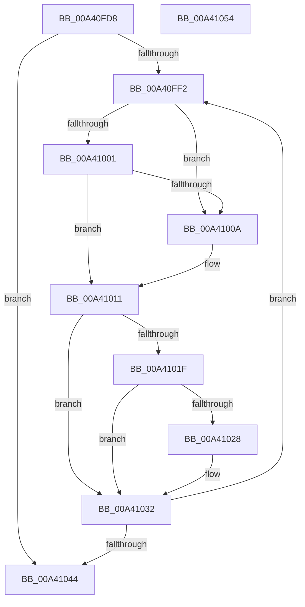

# BiFreeIdentifierList

- RVA: `0x00A40FD8`–`0x00A41055` (길이 `125` bytes)
- VA: `0x0000000140A40FD8`
- 실행 섹션: `PAGE`
- PDB 이름 있음: `예`; PDB Function 태그: `아니요`
- unwind 정보 RVA: `0x00060BC4`
- 디코드: `39`개 명령, `125/125` bytes 표시
- 미해석 바이트: `0` (있으면 어셈블리에 `.byte`로 보존)

> 이 문서는 커널 이미지의 기계어와 PDB 기호를 분석해 생성했습니다. 4번과 5번은 함수 원형과 자료형을 바이너리 사용 방식에서 추정한 C 해석이며 원본 소스 복구 결과는 아닙니다.

## 1. Dependencies

- 직접 호출 지점: **2**; 고유 호출 대상: **1**
- 직접 호출자로 확인된 함수: **3**
- RIP 상대 이미지 참조: **0**

### Outgoing calls
- `0x00A4102D` → [ExFreePoolWithTag](../../poolcode/B8/ExFreePoolWithTag_function_00B82870.md) (function, `0x00B82870`)
- `0x00A4103A` → [ExFreePoolWithTag](../../poolcode/B8/ExFreePoolWithTag_function_00B82870.md) (function, `0x00B82870`)

### Direct callers
- [BiExportStoreAlterationsToEfi](../82/BiExportStoreAlterationsToEfi_function_00826C58.md) at `0x00826CE8`
- [BiBuildIdentifierList](../A3/BiBuildIdentifierList_function_00A3E584.md) at `0x00A3EBA4`
- [BiBuildIdentifierList](../A3/BiBuildIdentifierList_function_00A3E584.md) at `0x00A3EBAD`
- [BiBuildIdentifierList](../A3/BiBuildIdentifierList_function_00A3E584.md) at `0x00A3EBB6`
- [BiBuildIdentifierList](../A3/BiBuildIdentifierList_function_00A3E584.md) at `0x00A3EBBE`
- [BiBindEfiNamespaceObjects](BiBindEfiNamespaceObjects_function_00A40EB4.md) at `0x00A40F38`

### Static image references
- 디코드된 RIP-relative 메모리 참조가 없습니다.

## 2. Other-region calls and transfers

- 다른 실행 섹션으로 향하는 call: **2**
  - `0x00A4102D` → [ExFreePoolWithTag](../../poolcode/B8/ExFreePoolWithTag_function_00B82870.md) (`PAGE` → `POOLCODE`)
  - `0x00A4103A` → [ExFreePoolWithTag](../../poolcode/B8/ExFreePoolWithTag_function_00B82870.md) (`PAGE` → `POOLCODE`)
- 별도 외부 분기/꼬리 이동을 확인하지 못했습니다.

## 3. Assembly (complete function range)

```asm
00A40FD8  48 89 5C 24 08                  mov qword ptr [rsp + 8], rbx
00A40FDD  48 89 74 24 10                  mov qword ptr [rsp + 0x10], rsi
00A40FE2  57                              push rdi
00A40FE3  48 83 EC 20                     sub rsp, 0x20
00A40FE7  48 8B 39                        mov rdi, qword ptr [rcx]
00A40FEA  48 8B F1                        mov rsi, rcx
00A40FED  48 3B F9                        cmp rdi, rcx
00A40FF0  74 52                           je 0x140a41044
00A40FF2  48 8B 0F                        mov rcx, qword ptr [rdi]
00A40FF5  48 8B DF                        mov rbx, rdi
00A40FF8  48 8B F9                        mov rdi, rcx
00A40FFB  48 39 59 08                     cmp qword ptr [rcx + 8], rbx
00A40FFF  75 09                           jne 0x140a4100a
00A41001  48 8B 43 08                     mov rax, qword ptr [rbx + 8]
00A41005  48 39 18                        cmp qword ptr [rax], rbx
00A41008  74 07                           je 0x140a41011
00A4100A  B9 03 00 00 00                  mov ecx, 3
00A4100F  CD 29                           int 0x29
00A41011  48 89 08                        mov qword ptr [rax], rcx
00A41014  48 89 41 08                     mov qword ptr [rcx + 8], rax
00A41018  8B 43 30                        mov eax, dword ptr [rbx + 0x30]
00A4101B  A8 01                           test al, 1
00A4101D  74 13                           je 0x140a41032
00A4101F  48 8B 4B 28                     mov rcx, qword ptr [rbx + 0x28]
00A41023  48 85 C9                        test rcx, rcx
00A41026  74 0A                           je 0x140a41032
00A41028  BA 42 43 44 4B                  mov edx, 0x4b444342
00A4102D  E8 3E 18 14 00                  call 0x140b82870
00A41032  BA 42 43 44 4B                  mov edx, 0x4b444342
00A41037  48 8B CB                        mov rcx, rbx
00A4103A  E8 31 18 14 00                  call 0x140b82870
00A4103F  48 3B FE                        cmp rdi, rsi
00A41042  75 AE                           jne 0x140a40ff2
00A41044  48 8B 5C 24 30                  mov rbx, qword ptr [rsp + 0x30]
00A41049  48 8B 74 24 38                  mov rsi, qword ptr [rsp + 0x38]
00A4104E  48 83 C4 20                     add rsp, 0x20
00A41052  5F                              pop rdi
00A41053  C3                              ret
00A41054  CC                              int3
```

## 4. C-style interpretation (structured pseudocode)

```c
__int64 __fastcall BiFreeIdentifierList(__int64 a1)
{
    __int64 result;
    __int64 v_rsp;
    unsigned __int64 v_stack_p10;
    unsigned __int64 v_stack_p8;

    v_stack_p8 = v_rbx;
    v_stack_p10 = v_rsi;
    v_rsp = (v_rsp) - (32);
    if ((*(unsigned __int64 *)(a1)) == a1) goto loc_00A41044;
loc_00A40FF2:
    if ((*(unsigned __int64 *)(*(unsigned __int64 *)(*(unsigned __int64 *)(a1)) + 8)) != (*(unsigned __int64 *)(a1))) goto loc_00A4100A;
    if ((*(unsigned __int64 *)(*(unsigned __int64 *)(*(unsigned __int64 *)(a1) + 8))) != (*(unsigned __int64 *)(a1))) {
        a1 = 3;
    }
    *(unsigned __int64 *)(*(unsigned __int64 *)(*(unsigned __int64 *)(a1) + 8)) = a1;
    *(unsigned __int64 *)(a1 + 8) = *(unsigned __int64 *)(*(unsigned __int64 *)(a1) + 8);
    if ((((unsigned __int8)((unsigned int)(*(unsigned int *)(*(unsigned __int64 *)(a1) + 48)))) & (1)) == 0) goto loc_00A41032;
    result = (unsigned int)(*(unsigned int *)(*(unsigned __int64 *)(a1) + 48));
    if (*(unsigned __int64 *)(*(unsigned __int64 *)(a1) + 40) != 0) {
        a2 = 0x4B444342ULL;
        result = ExFreePoolWithTag(*(unsigned __int64 *)(*(unsigned __int64 *)(a1) + 40), a2, a3, a4);
    }
    result = ExFreePoolWithTag(*(unsigned __int64 *)(a1), (unsigned int)(0x4B444342ULL), a3, a4);
    if ((*(unsigned __int64 *)(*(unsigned __int64 *)(a1))) != a1) goto loc_00A40FF2;
loc_00A41044:
    v_rsp = (v_rsp) + (32);
    return result;
}
```

## 5. (Beta) C Style

```c
int64_t BiFreeIdentifierList(void *Arg1)
{
    uint8_t *arg1 = (uint8_t *)Arg1;

    int64_t result;
    int64_t local_rsp;
    uint64_t v_stack_p10;
    uint64_t v_stack_p8;

    v_stack_p8 = local_rbx;
    v_stack_p10 = local_rsi;
    local_rsp = (local_rsp) - (32);
    if ((*(uint64_t *)(arg1)) == Arg1) goto loc_00A41044;
loc_00A40FF2:
    if ((*(uint64_t *)(*(uint64_t *)(*(uint64_t *)(arg1)) + 0x8)) != (*(uint64_t *)(arg1))) goto loc_00A4100A;
    if ((*(uint64_t *)(*(uint64_t *)(*(uint64_t *)(arg1) + 0x8))) != (*(uint64_t *)(arg1))) {
        Arg1 = 3;
    }
    *(void **)(*(uint64_t *)(*(uint64_t *)(arg1) + 0x8)) = Arg1;
    *(uint64_t *)(arg1 + 0x8) = *(uint64_t *)(*(uint64_t *)(arg1) + 0x8);
    if ((((uint8_t)((uint32_t)(*(uint32_t *)(*(uint64_t *)(arg1) + 0x30)))) & (1)) == 0) goto loc_00A41032;
    result = (uint32_t)(*(uint32_t *)(*(uint64_t *)(arg1) + 0x30));
    if (*(uint64_t *)(*(uint64_t *)(arg1) + 0x28) != 0) {
        a2 = 0x4B444342ULL;
        result = ExFreePoolWithTag(*(uint64_t *)(*(uint64_t *)(arg1) + 0x28), a2, a3, a4);
    }
    result = ExFreePoolWithTag(*(uint64_t *)(arg1), (uint32_t)(0x4B444342ULL), a3, a4);
    if ((*(uint64_t *)(*(uint64_t *)(arg1))) != Arg1) goto loc_00A40FF2;
loc_00A41044:
    local_rsp = (local_rsp) + (32);
    return result;
}
```

### 관측된 메모리 오프셋

구조체 형식이 확인되지 않은 접근은 인자 기준의 오프셋으로만 기록했습니다.

| 기준 인자 | 오프셋 표현 | 폭 (bit) | 접근 |
|---|---:|---:|---|
| `Arg1` | `+ 0x0` | `64` | `R` |

## 6. Execution-region graph

[열기: 2D/3D 그래프와 함수 탐색 컨트롤 패널](../../../control-panel.html?section=page&rva=0x00A40FD8&view=graph)

- 2D 그래프는 위에서 아래로 흐르고, 3D 그래프는 빈 공간을 드래그해 회전합니다. Shift+드래그는 이동, 휠은 확대·축소, 함수 노드 선택은 대상 보고서 이동입니다.

### Static fallback


