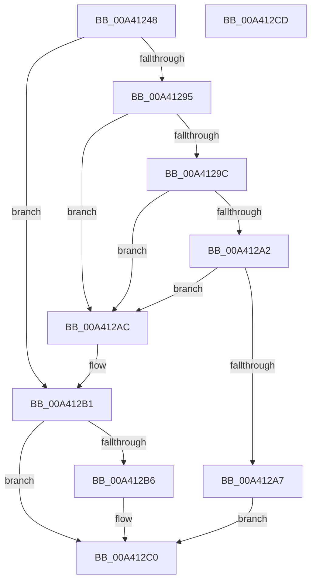

# BiGetSavedBootEntry

- RVA: `0x00A41248`–`0x00A412CE` (길이 `134` bytes)
- VA: `0x0000000140A41248`
- 실행 섹션: `PAGE`
- PDB 이름 있음: `예`; PDB Function 태그: `아니요`
- unwind 정보 RVA: `0x00084AC0`
- 디코드: `38`개 명령, `134/134` bytes 표시
- 미해석 바이트: `0` (있으면 어셈블리에 `.byte`로 보존)

> 이 문서는 커널 이미지의 기계어와 PDB 기호를 분석해 생성했습니다. 4번과 5번은 함수 원형과 자료형을 바이너리 사용 방식에서 추정한 C 해석이며 원본 소스 복구 결과는 아닙니다.

## 1. Dependencies

- 직접 호출 지점: **2**; 고유 호출 대상: **2**
- 직접 호출자로 확인된 함수: **2**
- RIP 상대 이미지 참조: **2**

### Outgoing calls
- `0x00A41285` → [BiGetRegistryValue](../A3/BiGetRegistryValue_function_00A3F3CC.md) (function, `0x00A3F3CC`)
- `0x00A412BB` → [ExFreePoolWithTag](../../poolcode/B8/ExFreePoolWithTag_function_00B82870.md) (function, `0x00B82870`)

### Direct callers
- [BiCreateEfiEntry](../82/BiCreateEfiEntry_function_008268C4.md) at `0x00826919`
- [BiBuildIdentifierList](../A3/BiBuildIdentifierList_function_00A3E584.md) at `0x00A3E7A5`

### Static image references
- `0x00A41262` → RVA `0x00AFF1D0` (` ?? ::NNGAKEGL::`string'`; read)
- `0x00A4127A` → RVA `0x00B0BF40` (` ?? ::NNGAKEGL::`string'`; read)

## 2. Other-region calls and transfers

- 다른 실행 섹션으로 향하는 call: **1**
  - `0x00A412BB` → [ExFreePoolWithTag](../../poolcode/B8/ExFreePoolWithTag_function_00B82870.md) (`PAGE` → `POOLCODE`)
- 별도 외부 분기/꼬리 이동을 확인하지 못했습니다.

## 3. Assembly (complete function range)

```asm
00A41248  4C 8B DC                        mov r11, rsp
00A4124B  49 89 5B 08                     mov qword ptr [r11 + 8], rbx
00A4124F  57                              push rdi
00A41250  48 83 EC 30                     sub rsp, 0x30
00A41254  83 64 24 50 00                  and dword ptr [rsp + 0x50], 0
00A41259  49 8D 43 18                     lea rax, [r11 + 0x18]
00A4125D  49 83 63 20 00                  and qword ptr [r11 + 0x20], 0
00A41262  4C 8D 05 67 DF 0B 00            lea r8, [rip + 0xbdf67]
00A41269  49 89 43 F0                     mov qword ptr [r11 - 0x10], rax
00A4126D  48 8B FA                        mov rdi, rdx
00A41270  49 8D 43 20                     lea rax, [r11 + 0x20]
00A41274  41 B9 03 00 00 00               mov r9d, 3
00A4127A  48 8D 15 BF AC 0C 00            lea rdx, [rip + 0xcacbf]
00A41281  49 89 43 E8                     mov qword ptr [r11 - 0x18], rax
00A41285  E8 42 E1 FF FF                  call 0x140a3f3cc
00A4128A  48 8B 4C 24 58                  mov rcx, qword ptr [rsp + 0x58]
00A4128F  8B D8                           mov ebx, eax
00A41291  85 C0                           test eax, eax
00A41293  78 1C                           js 0x140a412b1
00A41295  83 7C 24 50 1C                  cmp dword ptr [rsp + 0x50], 0x1c
00A4129A  72 10                           jb 0x140a412ac
00A4129C  83 79 04 1C                     cmp dword ptr [rcx + 4], 0x1c
00A412A0  72 0A                           jb 0x140a412ac
00A412A2  83 39 00                        cmp dword ptr [rcx], 0
00A412A5  74 05                           je 0x140a412ac
00A412A7  48 89 0F                        mov qword ptr [rdi], rcx
00A412AA  EB 14                           jmp 0x140a412c0
00A412AC  BB 0D 00 00 C0                  mov ebx, 0xc000000d
00A412B1  48 85 C9                        test rcx, rcx
00A412B4  74 0A                           je 0x140a412c0
00A412B6  BA 42 43 44 4B                  mov edx, 0x4b444342
00A412BB  E8 B0 15 14 00                  call 0x140b82870
00A412C0  8B C3                           mov eax, ebx
00A412C2  48 8B 5C 24 40                  mov rbx, qword ptr [rsp + 0x40]
00A412C7  48 83 C4 30                     add rsp, 0x30
00A412CB  5F                              pop rdi
00A412CC  C3                              ret
00A412CD  CC                              int3
```

## 4. C-style interpretation (structured pseudocode)

```c
__int64 __fastcall BiGetSavedBootEntry(__int64 a1, __int64 a2)
{
    __int64 result;
    __int64 v_rsp;
    unsigned int v_stack_p18;
    unsigned __int64 v_stack_p20;
    unsigned __int64 v_stack_p8;

    *(unsigned __int64 *)(v_rsp + 8) = v_rbx;
    v_rsp = (v_rsp) - (48);
    *(unsigned __int64 *)(v_rsp - 16) = v_rsp + 24;
    *(unsigned __int64 *)(v_rsp - 24) = v_rsp + 32;
    result = BiGetRegistryValue(a1, v_rip + 830655, v_rip + 778087, 3);
    if (sign_flag) goto loc_00A412B1;
    if (v_stack_p18 < 28) goto loc_00A412AC;
    if ((*(unsigned int *)(v_stack_p20 + 4)) < 28) goto loc_00A412AC;
    if ((*(unsigned int *)(v_stack_p20)) == 0) goto loc_00A412AC;
    *(unsigned __int64 *)(a2) = v_stack_p20;
    goto loc_00A412C0;
loc_00A412AC:
loc_00A412B1:
    if (v_stack_p20 != 0) {
        a2 = 0x4B444342ULL;
        result = ExFreePoolWithTag(v_stack_p20, a2, v_rip + 778087, 3);
    }
    v_rsp = (v_rsp) + (48);
    return (unsigned int)((unsigned int)((unsigned int)(0xC000000DULL)));
}
```

## 5. (Beta) C Style

```c
int64_t BiGetSavedBootEntry(int64_t Arg1, void *Arg2)
{
    uint8_t *arg2 = (uint8_t *)Arg2;

    int64_t result;
    int64_t local_rsp;
    uint32_t v_stack_p18;
    uint64_t v_stack_p20;
    uint64_t v_stack_p8;

    *(uint64_t *)(local_rsp + 0x8) = local_rbx;
    local_rsp = (local_rsp) - (48);
    *(uint64_t *)(local_rsp - 0x10) = local_rsp + 24;
    *(uint64_t *)(local_rsp - 0x18) = local_rsp + 32;
    result = BiGetRegistryValue(Arg1, v_rip + 830655, v_rip + 778087, 3);
    if (sign_flag) goto loc_00A412B1;
    if (v_stack_p18 < 28) goto loc_00A412AC;
    if ((*(uint32_t *)(v_stack_p20 + 0x4)) < 28) goto loc_00A412AC;
    if ((*(uint32_t *)(v_stack_p20)) == 0) goto loc_00A412AC;
    *(uint64_t *)(arg2) = v_stack_p20;
    goto loc_00A412C0;
loc_00A412AC:
loc_00A412B1:
    if (v_stack_p20 != 0) {
        Arg2 = 0x4B444342ULL;
        result = ExFreePoolWithTag(v_stack_p20, Arg2, v_rip + 778087, 3);
    }
    local_rsp = (local_rsp) + (48);
    return (uint32_t)((uint32_t)((uint32_t)(0xC000000DULL)));
}
```

### 관측된 메모리 오프셋

구조체 형식이 확인되지 않은 접근은 인자 기준의 오프셋으로만 기록했습니다.

| 기준 인자 | 오프셋 표현 | 폭 (bit) | 접근 |
|---|---:|---:|---|
| `Arg2` | `+ 0x0` | `64` | `W` |

## 6. Execution-region graph

[열기: 2D/3D 그래프와 함수 탐색 컨트롤 패널](../../../control-panel.html?section=page&rva=0x00A41248&view=graph)

- 2D 그래프는 위에서 아래로 흐르고, 3D 그래프는 빈 공간을 드래그해 회전합니다. Shift+드래그는 이동, 휠은 확대·축소, 함수 노드 선택은 대상 보고서 이동입니다.

### Static fallback


