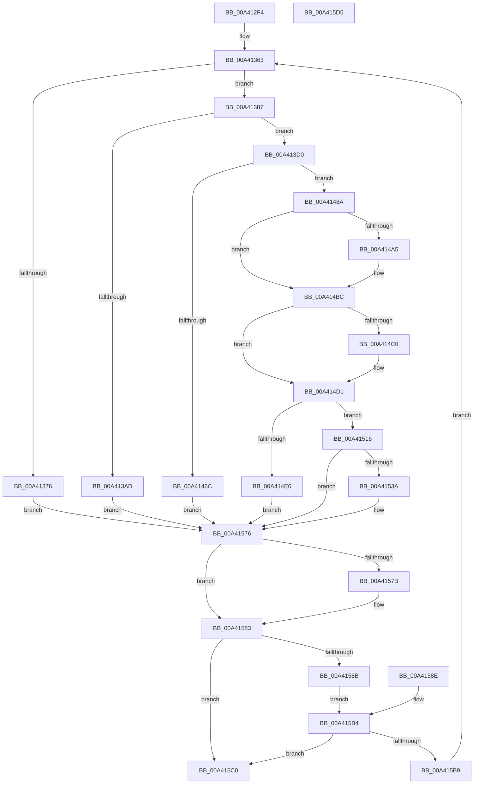

# BiLoadHive

- RVA: `0x00A412F4`–`0x00A415D6` (길이 `738` bytes)
- VA: `0x0000000140A412F4`
- 실행 섹션: `PAGE`
- PDB 이름 있음: `예`; PDB Function 태그: `아니요`
- unwind 정보 RVA: `0x000AEA64`
- 디코드: `174`개 명령, `738/738` bytes 표시
- 미해석 바이트: `0` (있으면 어셈블리에 `.byte`로 보존)

> 이 문서는 커널 이미지의 기계어와 PDB 기호를 분석해 생성했습니다. 4번과 5번은 함수 원형과 자료형을 바이너리 사용 방식에서 추정한 C 해석이며 원본 소스 복구 결과는 아닙니다.

## 1. Dependencies

- 직접 호출 지점: **18**; 고유 호출 대상: **11**
- 직접 호출자로 확인된 함수: **1**
- RIP 상대 이미지 참조: **5**

### Outgoing calls
- `0x00A4136D` → [BiDoesHiveExist](BiDoesHiveExist_function_00A415DC.md) (function, `0x00A415DC`)
- `0x00A4139B` → [BiOpenKeyNonBcd](BiOpenKeyNonBcd_function_00A40B48.md) (function, `0x00A40B48`)
- `0x00A413C1` → [BiLogMessage](../A3/BiLogMessage_function_00A3D3A8.md) (function, `0x00A3D3A8`)
- `0x00A413DB` → [RtlInitUnicodeString](../../text/42/RtlInitUnicodeString_function_0042A780.md) (function, `0x0042A780`)
- `0x00A41419` → [RtlInitUnicodeString](../../text/42/RtlInitUnicodeString_function_0042A780.md) (function, `0x0042A780`)
- `0x00A4145A` → [BiAcquirePrivilege](../A3/BiAcquirePrivilege_function_00A3D658.md) (function, `0x00A3D658`)
- `0x00A41480` → [BiLogMessage](../A3/BiLogMessage_function_00A3D3A8.md) (function, `0x00A3D3A8`)
- `0x00A4149A` → [ZwLoadKey2](../../text/6A/ZwLoadKey2_function_006AF2F0.md) (function, `0x006AF2F0`)
- `0x00A414B5` → [ZwLoadKey2](../../text/6A/ZwLoadKey2_function_006AF2F0.md) (function, `0x006AF2F0`)
- `0x00A414CA` → [ZwLoadKey](../../text/6A/ZwLoadKey_function_006AF2D0.md) (function, `0x006AF2D0`)
- `0x00A414DD` → [BiReleasePrivilege](../A3/BiReleasePrivilege_function_00A3D600.md) (function, `0x00A3D600`)
- `0x00A4150F` → [BiLogMessage](../A3/BiLogMessage_function_00A3D3A8.md) (function, `0x00A3D3A8`)
- `0x00A41528` → [ZwOpenKey](../../text/6A/ZwOpenKey_function_006AD310.md) (function, `0x006AD310`)
- `0x00A41544` → [BiAcquirePrivilege](../A3/BiAcquirePrivilege_function_00A3D658.md) (function, `0x00A3D658`)
- `0x00A4154E` → [ZwUnloadKey](../../text/6B/ZwUnloadKey_function_006B0C30.md) (function, `0x006B0C30`)
- `0x00A41558` → [BiReleasePrivilege](../A3/BiReleasePrivilege_function_00A3D600.md) (function, `0x00A3D600`)
- `0x00A41571` → [BiLogMessage](../A3/BiLogMessage_function_00A3D3A8.md) (function, `0x00A3D3A8`)
- `0x00A4157E` → [ZwClose](../../text/6A/ZwClose_function_006AD2B0.md) (function, `0x006AD2B0`)

### Direct callers
- [BiAddStoreFromFile](BiAddStoreFromFile_function_00A40C54.md) at `0x00A40CCF`

### Static image references
- `0x00A41392` → RVA `0x00B0AC40` (` ?? ::NNGAKEGL::`string'`; read)
- `0x00A413B7` → RVA `0x00B0BF70` (` ?? ::NNGAKEGL::`string'`; read)
- `0x00A41476` → RVA `0x00B0BFB0` (` ?? ::NNGAKEGL::`string'`; read)
- `0x00A41508` → RVA `0x00B0C020` (` ?? ::NNGAKEGL::`string'`; read)
- `0x00A41567` → RVA `0x00B0C090` (` ?? ::NNGAKEGL::`string'`; read)

## 2. Other-region calls and transfers

- 다른 실행 섹션으로 향하는 call: **8**
  - `0x00A413DB` → [RtlInitUnicodeString](../../text/42/RtlInitUnicodeString_function_0042A780.md) (`PAGE` → `.text`)
  - `0x00A41419` → [RtlInitUnicodeString](../../text/42/RtlInitUnicodeString_function_0042A780.md) (`PAGE` → `.text`)
  - `0x00A4149A` → [ZwLoadKey2](../../text/6A/ZwLoadKey2_function_006AF2F0.md) (`PAGE` → `.text`)
  - `0x00A414B5` → [ZwLoadKey2](../../text/6A/ZwLoadKey2_function_006AF2F0.md) (`PAGE` → `.text`)
  - `0x00A414CA` → [ZwLoadKey](../../text/6A/ZwLoadKey_function_006AF2D0.md) (`PAGE` → `.text`)
  - `0x00A41528` → [ZwOpenKey](../../text/6A/ZwOpenKey_function_006AD310.md) (`PAGE` → `.text`)
  - `0x00A4154E` → [ZwUnloadKey](../../text/6B/ZwUnloadKey_function_006B0C30.md) (`PAGE` → `.text`)
  - `0x00A4157E` → [ZwClose](../../text/6A/ZwClose_function_006AD2B0.md) (`PAGE` → `.text`)
- 별도 외부 분기/꼬리 이동을 확인하지 못했습니다.

## 3. Assembly (complete function range)

```asm
00A412F4  4C 8B DC                        mov r11, rsp
00A412F7  4D 89 43 18                     mov qword ptr [r11 + 0x18], r8
00A412FB  49 89 53 10                     mov qword ptr [r11 + 0x10], rdx
00A412FF  49 89 4B 08                     mov qword ptr [r11 + 8], rcx
00A41303  53                              push rbx
00A41304  56                              push rsi
00A41305  57                              push rdi
00A41306  41 54                           push r12
00A41308  41 55                           push r13
00A4130A  41 56                           push r14
00A4130C  41 57                           push r15
00A4130E  48 81 EC C0 00 00 00            sub rsp, 0xc0
00A41315  4C 8B EA                        mov r13, rdx
00A41318  4C 8B F9                        mov r15, rcx
00A4131B  33 C0                           xor eax, eax
00A4131D  0F 57 C0                        xorps xmm0, xmm0
00A41320  0F 11 44 24 70                  movups xmmword ptr [rsp + 0x70], xmm0
00A41325  41 0F 11 43 88                  movups xmmword ptr [r11 - 0x78], xmm0
00A4132A  49 89 43 98                     mov qword ptr [r11 - 0x68], rax
00A4132E  41 89 43 A0                     mov dword ptr [r11 - 0x60], eax
00A41332  0F 11 44 24 40                  movups xmmword ptr [rsp + 0x40], xmm0
00A41337  0F 11 44 24 50                  movups xmmword ptr [rsp + 0x50], xmm0
00A4133C  48 89 44 24 60                  mov qword ptr [rsp + 0x60], rax
00A41341  89 44 24 68                     mov dword ptr [rsp + 0x68], eax
00A41345  48 21 44 24 30                  and qword ptr [rsp + 0x30], rax
00A4134A  41 0F 11 43 B8                  movups xmmword ptr [r11 - 0x48], xmm0
00A4134F  0F 57 C9                        xorps xmm1, xmm1
00A41352  41 0F 11 4B A8                  movups xmmword ptr [r11 - 0x58], xmm1
00A41357  33 F6                           xor esi, esi
00A41359  44 8D 70 04                     lea r14d, [rax + 4]
00A4135D  41 BC 40 02 00 00               mov r12d, 0x240
00A41363  33 FF                           xor edi, edi
00A41365  48 89 7C 24 38                  mov qword ptr [rsp + 0x38], rdi
00A4136A  49 8B CD                        mov rcx, r13
00A4136D  E8 6A 02 00 00                  call 0x140a415dc
00A41372  84 C0                           test al, al
00A41374  75 11                           jne 0x140a41387
00A41376  BB 0F 00 00 C0                  mov ebx, 0xc000000f
00A4137B  89 9C 24 18 01 00 00            mov dword ptr [rsp + 0x118], ebx
00A41382  E9 EF 01 00 00                  jmp 0x140a41576
00A41387  4C 8D 4C 24 38                  lea r9, [rsp + 0x38]
00A4138C  41 B8 3F 00 0F 00               mov r8d, 0xf003f
00A41392  48 8D 15 A7 98 0C 00            lea rdx, [rip + 0xc98a7]
00A41399  33 C9                           xor ecx, ecx
00A4139B  E8 A8 F7 FF FF                  call 0x140a40b48
00A413A0  8B D8                           mov ebx, eax
00A413A2  89 84 24 18 01 00 00            mov dword ptr [rsp + 0x118], eax
00A413A9  85 C0                           test eax, eax
00A413AB  79 23                           jns 0x140a413d0
00A413AD  44 8B C8                        mov r9d, eax
00A413B0  4C 8D 05 89 98 0C 00            lea r8, [rip + 0xc9889]
00A413B7  48 8D 15 B2 AB 0C 00            lea rdx, [rip + 0xcabb2]
00A413BE  41 8B CE                        mov ecx, r14d
00A413C1  E8 E2 BF FF FF                  call 0x140a3d3a8
00A413C6  48 8B 7C 24 38                  mov rdi, qword ptr [rsp + 0x38]
00A413CB  E9 A6 01 00 00                  jmp 0x140a41576
00A413D0  49 8B D7                        mov rdx, r15
00A413D3  48 8D 8C 24 A0 00 00 00         lea rcx, [rsp + 0xa0]
00A413DB  E8 A0 93 9E FF                  call 0x14042a780
00A413E0  C7 44 24 40 30 00 00 00         mov dword ptr [rsp + 0x40], 0x30
00A413E8  48 8B 7C 24 38                  mov rdi, qword ptr [rsp + 0x38]
00A413ED  48 89 7C 24 48                  mov qword ptr [rsp + 0x48], rdi
00A413F2  44 89 64 24 58                  mov dword ptr [rsp + 0x58], r12d
00A413F7  48 8D 84 24 A0 00 00 00         lea rax, [rsp + 0xa0]
00A413FF  48 89 44 24 50                  mov qword ptr [rsp + 0x50], rax
00A41404  0F 57 C0                        xorps xmm0, xmm0
00A41407  F3 0F 7F 44 24 60               movdqu xmmword ptr [rsp + 0x60], xmm0
00A4140D  49 8D 55 0C                     lea rdx, [r13 + 0xc]
00A41411  48 8D 8C 24 B0 00 00 00         lea rcx, [rsp + 0xb0]
00A41419  E8 62 93 9E FF                  call 0x14042a780
00A4141E  C7 44 24 70 30 00 00 00         mov dword ptr [rsp + 0x70], 0x30
00A41426  48 83 64 24 78 00               and qword ptr [rsp + 0x78], 0
00A4142C  44 89 A4 24 88 00 00 00         mov dword ptr [rsp + 0x88], r12d
00A41434  48 8D 84 24 B0 00 00 00         lea rax, [rsp + 0xb0]
00A4143C  48 89 84 24 80 00 00 00         mov qword ptr [rsp + 0x80], rax
00A41444  0F 57 C0                        xorps xmm0, xmm0
00A41447  F3 0F 7F 84 24 90 00 00 00      movdqu xmmword ptr [rsp + 0x90], xmm0
00A41450  48 8D 54 24 30                  lea rdx, [rsp + 0x30]
00A41455  B9 12 00 00 00                  mov ecx, 0x12
00A4145A  E8 F9 C1 FF FF                  call 0x140a3d658
00A4145F  8B D8                           mov ebx, eax
00A41461  89 84 24 18 01 00 00            mov dword ptr [rsp + 0x118], eax
00A41468  85 C0                           test eax, eax
00A4146A  79 1E                           jns 0x140a4148a
00A4146C  44 8B C8                        mov r9d, eax
00A4146F  4C 8D 05 CA 97 0C 00            lea r8, [rip + 0xc97ca]
00A41476  48 8D 15 33 AB 0C 00            lea rdx, [rip + 0xcab33]
00A4147D  41 8B CE                        mov ecx, r14d
00A41480  E8 23 BF FF FF                  call 0x140a3d3a8
00A41485  E9 EC 00 00 00                  jmp 0x140a41576
00A4148A  41 B8 80 17 00 00               mov r8d, 0x1780
00A41490  48 8D 54 24 70                  lea rdx, [rsp + 0x70]
00A41495  48 8D 4C 24 40                  lea rcx, [rsp + 0x40]
00A4149A  E8 51 DE C6 FF                  call 0x1406af2f0
00A4149F  8B D8                           mov ebx, eax
00A414A1  85 C0                           test eax, eax
00A414A3  79 17                           jns 0x140a414bc
00A414A5  41 B8 80 13 00 00               mov r8d, 0x1380
00A414AB  48 8D 54 24 70                  lea rdx, [rsp + 0x70]
00A414B0  48 8D 4C 24 40                  lea rcx, [rsp + 0x40]
00A414B5  E8 36 DE C6 FF                  call 0x1406af2f0
00A414BA  8B D8                           mov ebx, eax
00A414BC  85 DB                           test ebx, ebx
00A414BE  79 11                           jns 0x140a414d1
00A414C0  48 8D 54 24 70                  lea rdx, [rsp + 0x70]
00A414C5  48 8D 4C 24 40                  lea rcx, [rsp + 0x40]
00A414CA  E8 01 DE C6 FF                  call 0x1406af2d0
00A414CF  8B D8                           mov ebx, eax
00A414D1  89 9C 24 18 01 00 00            mov dword ptr [rsp + 0x118], ebx
00A414D8  48 8D 4C 24 30                  lea rcx, [rsp + 0x30]
00A414DD  E8 1E C1 FF FF                  call 0x140a3d600
00A414E2  85 DB                           test ebx, ebx
00A414E4  79 30                           jns 0x140a41516
00A414E6  B9 02 00 00 00                  mov ecx, 2
00A414EB  81 FB 22 00 00 C0               cmp ebx, 0xc0000022
00A414F1  41 0F 45 CE                     cmovne ecx, r14d
00A414F5  89 5C 24 28                     mov dword ptr [rsp + 0x28], ebx
00A414F9  49 8D 45 0C                     lea rax, [r13 + 0xc]
00A414FD  48 89 44 24 20                  mov qword ptr [rsp + 0x20], rax
00A41502  45 8B CC                        mov r9d, r12d
00A41505  4D 8B C7                        mov r8, r15
00A41508  48 8D 15 11 AB 0C 00            lea rdx, [rip + 0xcab11]
00A4150F  E8 94 BE FF FF                  call 0x140a3d3a8
00A41514  EB 60                           jmp 0x140a41576
00A41516  4C 8D 44 24 40                  lea r8, [rsp + 0x40]
00A4151B  BA 19 00 02 00                  mov edx, 0x20019
00A41520  48 8B 8C 24 10 01 00 00         mov rcx, qword ptr [rsp + 0x110]
00A41528  E8 E3 BD C6 FF                  call 0x1406ad310
00A4152D  8B D8                           mov ebx, eax
00A4152F  89 84 24 18 01 00 00            mov dword ptr [rsp + 0x118], eax
00A41536  85 C0                           test eax, eax
00A41538  79 3C                           jns 0x140a41576
00A4153A  48 8D 54 24 30                  lea rdx, [rsp + 0x30]
00A4153F  B9 11 00 00 00                  mov ecx, 0x11
00A41544  E8 0F C1 FF FF                  call 0x140a3d658
00A41549  48 8D 4C 24 40                  lea rcx, [rsp + 0x40]
00A4154E  E8 DD F6 C6 FF                  call 0x1406b0c30
00A41553  48 8D 4C 24 30                  lea rcx, [rsp + 0x30]
00A41558  E8 A3 C0 FF FF                  call 0x140a3d600
00A4155D  89 5C 24 20                     mov dword ptr [rsp + 0x20], ebx
00A41561  45 8B CC                        mov r9d, r12d
00A41564  4D 8B C7                        mov r8, r15
00A41567  48 8D 15 22 AB 0C 00            lea rdx, [rip + 0xcab22]
00A4156E  41 8B CE                        mov ecx, r14d
00A41571  E8 32 BE FF FF                  call 0x140a3d3a8
00A41576  48 85 FF                        test rdi, rdi
00A41579  74 08                           je 0x140a41583
00A4157B  48 8B CF                        mov rcx, rdi
00A4157E  E8 2D BD C6 FF                  call 0x1406ad2b0
00A41583  81 FB 7D 01 00 C0               cmp ebx, 0xc000017d
00A41589  75 35                           jne 0x140a415c0
00A4158B  CC                              int3
00A4158C  EB 26                           jmp 0x140a415b4
00A4158E  BE 05 00 00 00                  mov esi, 5
00A41593  44 8D 76 FF                     lea r14d, [rsi - 1]
00A41597  41 BC 40 02 00 00               mov r12d, 0x240
00A4159D  4C 8B AC 24 08 01 00 00         mov r13, qword ptr [rsp + 0x108]
00A415A5  4C 8B BC 24 00 01 00 00         mov r15, qword ptr [rsp + 0x100]
00A415AD  8B 9C 24 18 01 00 00            mov ebx, dword ptr [rsp + 0x118]
00A415B4  83 FE 05                        cmp esi, 5
00A415B7  73 07                           jae 0x140a415c0
00A415B9  FF C6                           inc esi
00A415BB  E9 A3 FD FF FF                  jmp 0x140a41363
00A415C0  8B C3                           mov eax, ebx
00A415C2  48 81 C4 C0 00 00 00            add rsp, 0xc0
00A415C9  41 5F                           pop r15
00A415CB  41 5E                           pop r14
00A415CD  41 5D                           pop r13
00A415CF  41 5C                           pop r12
00A415D1  5F                              pop rdi
00A415D2  5E                              pop rsi
00A415D3  5B                              pop rbx
00A415D4  C3                              ret
00A415D5  CC                              int3
```

## 4. C-style interpretation (structured pseudocode)

```c
__int64 __fastcall BiLoadHive(__int64 a1, __int64 a2, __int64 a3)
{
    __int64 result;
    __int64 v_rbx;
    __int64 v_rdi;
    __int64 v_rsi;
    __int64 v_rsp;
    unsigned __int64 v_stack_m48;
    unsigned __int64 v_stack_m58;
    unsigned __int64 v_stack_m68;
    unsigned int v_stack_m70;
    unsigned __int64 v_stack_m78;
    unsigned __int64 v_stack_m80;
    unsigned __int64 v_stack_m88;
    unsigned int v_stack_m90;
    unsigned __int64 v_stack_m98;
    unsigned int v_stack_mA0;
    unsigned __int64 v_stack_mA8;
    unsigned __int64 v_stack_mB0;
    unsigned __int64 v_stack_mB8;
    unsigned __int64 v_stack_mC0;
    unsigned __int64 v_stack_mC8;
    unsigned int v_stack_mD0;
    unsigned __int64 v_stack_mD8;
    unsigned __int64 v_stack_p10;
    unsigned __int64 v_stack_p18;
    unsigned int v_stack_p20;
    unsigned __int64 v_stack_p8;

    *(unsigned __int64 *)(v_rsp + 24) = a3;
    *(unsigned __int64 *)(v_rsp + 16) = a2;
    *(unsigned __int64 *)(v_rsp + 8) = a1;
    v_rsp = (v_rsp) - (192);
    result = 0;
    v_stack_m88 = v_xmm0;
    *(unsigned __int64 *)(v_rsp - 120) = v_xmm0;
    *(unsigned __int64 *)(v_rsp - 104) = 0;
    *(unsigned int *)(v_rsp - 96) = 0;
    v_stack_mB8 = v_xmm0;
    v_stack_mA8 = v_xmm0;
    v_stack_m98 = 0;
    v_stack_m90 = 0;
    *(unsigned __int64 *)(v_rsp - 72) = v_xmm0;
    *(unsigned __int64 *)(v_rsp - 88) = v_xmm1;
    v_rsi = 0;
loc_00A41363:
    v_rdi = 0;
    v_stack_mC0 = 0;
    result = BiDoesHiveExist(a2, a2, a3, a4);
    if ((unsigned __int8)(result) != 0) goto loc_00A41387;
    v_stack_p20 = (unsigned int)((unsigned int)(0xC000000FULL));
    goto loc_00A41576;
loc_00A41387:
    a1 = 0;
    result = BiOpenKeyNonBcd(a1, v_rip + 825511, (unsigned int)(0xF003FULL), v_stack_mC0);
    v_stack_p20 = (unsigned int)(result);
    if (!sign_flag) goto loc_00A413D0;
    result = BiLogMessage((unsigned int)((unsigned int)(result + 4)), v_rip + 830386, v_rip + 825481, (unsigned int)((unsigned int)(result)));
    goto loc_00A41576;
loc_00A413D0:
    result = RtlInitUnicodeString(v_stack_m58, 0, v_rip + 825481, (unsigned int)((unsigned int)(result)));
    v_stack_mB8 = 48;
    v_stack_mB0 = v_stack_mC0;
    v_stack_mA0 = 576;
    v_stack_mA8 = v_stack_m58;
    v_stack_m98 = v_xmm0;
    result = RtlInitUnicodeString(v_stack_m48, a2 + 12, v_rip + 825481, (unsigned int)((unsigned int)(result)));
    v_stack_m88 = 48;
    v_stack_m70 = 576;
    v_stack_m78 = v_stack_m48;
    v_stack_m68 = v_xmm0;
    result = BiAcquirePrivilege(18, v_stack_mC8, v_rip + 825481, (unsigned int)((unsigned int)(result)));
    v_stack_p20 = (unsigned int)(result);
    if (!sign_flag) goto loc_00A4148A;
    result = BiLogMessage((unsigned int)((unsigned int)(result + 4)), v_rip + 830259, v_rip + 825290, (unsigned int)((unsigned int)(result)));
    goto loc_00A41576;
loc_00A4148A:
    result = ZwLoadKey2(v_stack_mB8, v_stack_m88, (unsigned int)(0x1780ULL), (unsigned int)((unsigned int)(result)));
    v_rbx = (unsigned int)((unsigned int)(result));
    if (sign_flag) {
        a3 = 0x1380ULL;
        a2 = v_stack_m88;
        a1 = v_stack_mB8;
        result = ZwLoadKey2(a1, a2, a3, (unsigned int)((unsigned int)(result)));
        v_rbx = (unsigned int)(result);
    }
    if (sign_flag) {
        a2 = v_stack_m88;
        a1 = v_stack_mB8;
        result = ZwLoadKey(a1, a2, a3, (unsigned int)((unsigned int)(result)));
        v_rbx = (unsigned int)(result);
    }
    v_stack_p20 = (unsigned int)(v_rbx);
    result = BiReleasePrivilege(v_stack_mC8, a2, a3, (unsigned int)((unsigned int)(result)));
    if (!sign_flag) goto loc_00A41516;
    a1 = 2;
    if (((unsigned int)(v_rbx)) != 0xC0000022ULL) { a1 = (unsigned int)(result + 4); }
    v_stack_mD0 = (unsigned int)(v_rbx);
    v_stack_mD8 = a2 + 12;
    result = BiLogMessage(a1, v_rip + 830225, a1, 576);
    goto loc_00A41576;
loc_00A41516:
    result = ZwOpenKey(v_stack_p18, (unsigned int)(0x20019ULL), v_stack_mB8, 576);
    v_stack_p20 = (unsigned int)(result);
    if (sign_flag) {
        a2 = v_stack_mC8;
        a1 = 17;
        result = BiAcquirePrivilege(a1, a2, v_stack_mB8, 576);
        a1 = v_stack_mB8;
        result = ZwUnloadKey(a1, a2, v_stack_mB8, 576);
        a1 = v_stack_mC8;
        result = BiReleasePrivilege(a1, a2, v_stack_mB8, 576);
        v_stack_mD8 = (unsigned int)((unsigned int)((unsigned int)(result)));
        a4 = 576;
        a3 = a1;
        a2 = v_rip + 830242;
        a1 = (unsigned int)(result + 4);
        result = BiLogMessage(a1, a2, a3, a4);
    }
    if (v_stack_mC0 != 0) {
        a1 = v_stack_mC0;
        result = ZwClose(a1, a2, a3, a4);
    }
    if (((unsigned int)((unsigned int)((unsigned int)(result)))) != 0xC000017DULL) goto loc_00A415C0;
    goto loc_00A415B4;
loc_00A415B4:
    if (0 >= 5) goto loc_00A415C0;
    v_rsi = (unsigned int)((v_rsi) + 1);
    goto loc_00A41363;
loc_00A415C0:
    v_rsp = (v_rsp) + (192);
    return (unsigned int)((unsigned int)((unsigned int)((unsigned int)(result))));
}
```

## 5. (Beta) C Style

```c
int64_t BiLoadHive(int64_t Arg1, void *Arg2, int64_t Arg3)
{
    uint8_t *arg2 = (uint8_t *)Arg2;

    int64_t result;
    int64_t local_rbx;
    int64_t local_rdi;
    int64_t local_rsi;
    int64_t local_rsp;
    uint64_t v_stack_m48;
    uint64_t v_stack_m58;
    uint64_t v_stack_m68;
    uint32_t v_stack_m70;
    uint64_t v_stack_m78;
    uint64_t v_stack_m80;
    uint64_t v_stack_m88;
    uint32_t v_stack_m90;
    uint64_t v_stack_m98;
    uint32_t v_stack_mA0;
    uint64_t v_stack_mA8;
    uint64_t v_stack_mB0;
    uint64_t v_stack_mB8;
    uint64_t v_stack_mC0;
    uint64_t v_stack_mC8;
    uint32_t v_stack_mD0;
    uint64_t v_stack_mD8;
    uint64_t v_stack_p10;
    uint64_t v_stack_p18;
    uint32_t v_stack_p20;
    uint64_t v_stack_p8;

    *(uint64_t *)(local_rsp + 0x18) = Arg3;
    *(void **)(local_rsp + 0x10) = Arg2;
    *(uint64_t *)(local_rsp + 0x8) = Arg1;
    local_rsp = (local_rsp) - (192);
    result = 0;
    v_stack_m88 = v_xmm0;
    *(uint64_t *)(local_rsp - 0x78) = v_xmm0;
    *(uint64_t *)(local_rsp - 0x68) = 0;
    *(uint32_t *)(local_rsp - 0x60) = 0;
    v_stack_mB8 = v_xmm0;
    v_stack_mA8 = v_xmm0;
    v_stack_m98 = 0;
    v_stack_m90 = 0;
    *(uint64_t *)(local_rsp - 0x48) = v_xmm0;
    *(uint64_t *)(local_rsp - 0x58) = v_xmm1;
    local_rsi = 0;
loc_00A41363:
    local_rdi = 0;
    v_stack_mC0 = 0;
    result = BiDoesHiveExist(Arg2, Arg2, Arg3, a4);
    if ((uint8_t)(result) != 0) goto loc_00A41387;
    v_stack_p20 = (uint32_t)((uint32_t)(0xC000000FULL));
    goto loc_00A41576;
loc_00A41387:
    Arg1 = 0;
    result = BiOpenKeyNonBcd(Arg1, v_rip + 825511, (uint32_t)(0xF003FULL), v_stack_mC0);
    v_stack_p20 = (uint32_t)(result);
    if (!sign_flag) goto loc_00A413D0;
    result = BiLogMessage((uint32_t)((uint32_t)(result + 4)), v_rip + 830386, v_rip + 825481, (uint32_t)((uint32_t)(result)));
    goto loc_00A41576;
loc_00A413D0:
    result = RtlInitUnicodeString(v_stack_m58, 0, v_rip + 825481, (uint32_t)((uint32_t)(result)));
    v_stack_mB8 = 48;
    v_stack_mB0 = v_stack_mC0;
    v_stack_mA0 = 576;
    v_stack_mA8 = v_stack_m58;
    v_stack_m98 = v_xmm0;
    result = RtlInitUnicodeString(v_stack_m48, Arg2 + 12, v_rip + 825481, (uint32_t)((uint32_t)(result)));
    v_stack_m88 = 48;
    v_stack_m70 = 576;
    v_stack_m78 = v_stack_m48;
    v_stack_m68 = v_xmm0;
    result = BiAcquirePrivilege(18, v_stack_mC8, v_rip + 825481, (uint32_t)((uint32_t)(result)));
    v_stack_p20 = (uint32_t)(result);
    if (!sign_flag) goto loc_00A4148A;
    result = BiLogMessage((uint32_t)((uint32_t)(result + 4)), v_rip + 830259, v_rip + 825290, (uint32_t)((uint32_t)(result)));
    goto loc_00A41576;
loc_00A4148A:
    result = ZwLoadKey2(v_stack_mB8, v_stack_m88, (uint32_t)(0x1780ULL), (uint32_t)((uint32_t)(result)));
    local_rbx = (uint32_t)((uint32_t)(result));
    if (sign_flag) {
        Arg3 = 0x1380ULL;
        Arg2 = v_stack_m88;
        Arg1 = v_stack_mB8;
        result = ZwLoadKey2(Arg1, Arg2, Arg3, (uint32_t)((uint32_t)(result)));
        local_rbx = (uint32_t)(result);
    }
    if (sign_flag) {
        Arg2 = v_stack_m88;
        Arg1 = v_stack_mB8;
        result = ZwLoadKey(Arg1, Arg2, Arg3, (uint32_t)((uint32_t)(result)));
        local_rbx = (uint32_t)(result);
    }
    v_stack_p20 = (uint32_t)(local_rbx);
    result = BiReleasePrivilege(v_stack_mC8, Arg2, Arg3, (uint32_t)((uint32_t)(result)));
    if (!sign_flag) goto loc_00A41516;
    Arg1 = 2;
    if (((uint32_t)(local_rbx)) != 0xC0000022ULL) { Arg1 = (uint32_t)(result + 4); }
    v_stack_mD0 = (uint32_t)(local_rbx);
    v_stack_mD8 = Arg2 + 12;
    result = BiLogMessage(Arg1, v_rip + 830225, Arg1, 576);
    goto loc_00A41576;
loc_00A41516:
    result = ZwOpenKey(v_stack_p18, (uint32_t)(0x20019ULL), v_stack_mB8, 576);
    v_stack_p20 = (uint32_t)(result);
    if (sign_flag) {
        Arg2 = v_stack_mC8;
        Arg1 = 17;
        result = BiAcquirePrivilege(Arg1, Arg2, v_stack_mB8, 576);
        Arg1 = v_stack_mB8;
        result = ZwUnloadKey(Arg1, Arg2, v_stack_mB8, 576);
        Arg1 = v_stack_mC8;
        result = BiReleasePrivilege(Arg1, Arg2, v_stack_mB8, 576);
        v_stack_mD8 = (uint32_t)((uint32_t)((uint32_t)(result)));
        a4 = 576;
        Arg3 = Arg1;
        Arg2 = v_rip + 830242;
        Arg1 = (uint32_t)(result + 4);
        result = BiLogMessage(Arg1, Arg2, Arg3, a4);
    }
    if (v_stack_mC0 != 0) {
        Arg1 = v_stack_mC0;
        result = ZwClose(Arg1, Arg2, Arg3, a4);
    }
    if (((uint32_t)((uint32_t)((uint32_t)(result)))) != 0xC000017DULL) goto loc_00A415C0;
    goto loc_00A415B4;
loc_00A415B4:
    if (0 >= 5) goto loc_00A415C0;
    local_rsi = (uint32_t)((local_rsi) + 1);
    goto loc_00A41363;
loc_00A415C0:
    local_rsp = (local_rsp) + (192);
    return (uint32_t)((uint32_t)((uint32_t)((uint32_t)(result))));
}
```

### 관측된 메모리 오프셋

구조체 형식이 확인되지 않은 접근은 인자 기준의 오프셋으로만 기록했습니다.

| 기준 인자 | 오프셋 표현 | 폭 (bit) | 접근 |
|---|---:|---:|---|
| `Arg2` | `+ 0xC` | `64` | `R` |

## 6. Execution-region graph

[열기: 2D/3D 그래프와 함수 탐색 컨트롤 패널](../../../control-panel.html?section=page&rva=0x00A412F4&view=graph)

- 2D 그래프는 위에서 아래로 흐르고, 3D 그래프는 빈 공간을 드래그해 회전합니다. Shift+드래그는 이동, 휠은 확대·축소, 함수 노드 선택은 대상 보고서 이동입니다.

### Static fallback


