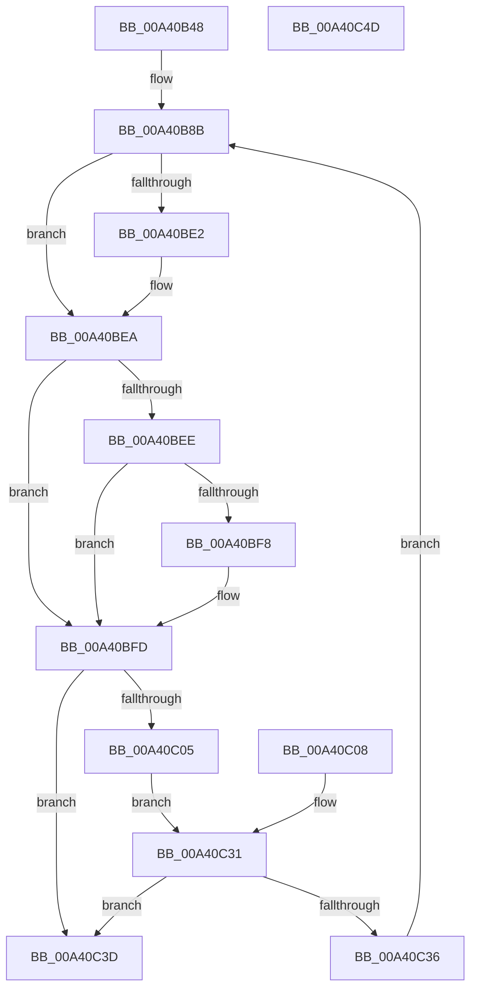

# BiOpenKeyNonBcd

- RVA: `0x00A40B48`–`0x00A40C4E` (길이 `262` bytes)
- VA: `0x0000000140A40B48`
- 실행 섹션: `PAGE`
- PDB 이름 있음: `예`; PDB Function 태그: `아니요`
- unwind 정보 RVA: `0x000AE9C4`
- 디코드: `74`개 명령, `262/262` bytes 표시
- 미해석 바이트: `0` (있으면 어셈블리에 `.byte`로 보존)

> 이 문서는 커널 이미지의 기계어와 PDB 기호를 분석해 생성했습니다. 4번과 5번은 함수 원형과 자료형을 바이너리 사용 방식에서 추정한 C 해석이며 원본 소스 복구 결과는 아닙니다.

## 1. Dependencies

- 직접 호출 지점: **3**; 고유 호출 대상: **3**
- 직접 호출자로 확인된 함수: **4**
- RIP 상대 이미지 참조: **0**

### Outgoing calls
- `0x00A40B99` → [RtlInitUnicodeString](../../text/42/RtlInitUnicodeString_function_0042A780.md) (function, `0x0042A780`)
- `0x00A40BD3` → [ZwOpenKey](../../text/6A/ZwOpenKey_function_006AD310.md) (function, `0x006AD310`)
- `0x00A40BF8` → [ZwClose](../../text/6A/ZwClose_function_006AD2B0.md) (function, `0x006AD2B0`)

### Direct callers
- [BiDoesHiveKeyExist](../82/BiDoesHiveKeyExist_function_00826114.md) at `0x00826155`
- [BiDoesHiveKeyExist](../82/BiDoesHiveKeyExist_function_00826114.md) at `0x00826171`
- [BiOpenSystemStore](BiOpenSystemStore_function_00A40844.md) at `0x00A408C2`
- [BiOpenSystemStore](BiOpenSystemStore_function_00A40844.md) at `0x00A408EF`
- [BiOpenSystemStore](BiOpenSystemStore_function_00A40844.md) at `0x00A409C1`
- [BiLoadHive](BiLoadHive_function_00A412F4.md) at `0x00A4139B`
- [BcdSetBootBcdAsSystemStore](../../init/C6/BcdSetBootBcdAsSystemStore_function_00C6D214.md) at `0x00C6D23A`

### Static image references
- 디코드된 RIP-relative 메모리 참조가 없습니다.

## 2. Other-region calls and transfers

- 다른 실행 섹션으로 향하는 call: **3**
  - `0x00A40B99` → [RtlInitUnicodeString](../../text/42/RtlInitUnicodeString_function_0042A780.md) (`PAGE` → `.text`)
  - `0x00A40BD3` → [ZwOpenKey](../../text/6A/ZwOpenKey_function_006AD310.md) (`PAGE` → `.text`)
  - `0x00A40BF8` → [ZwClose](../../text/6A/ZwClose_function_006AD2B0.md) (`PAGE` → `.text`)
- 별도 외부 분기/꼬리 이동을 확인하지 못했습니다.

## 3. Assembly (complete function range)

```asm
00A40B48  48 8B C4                        mov rax, rsp
00A40B4B  4C 89 48 20                     mov qword ptr [rax + 0x20], r9
00A40B4F  44 89 40 18                     mov dword ptr [rax + 0x18], r8d
00A40B53  48 89 50 10                     mov qword ptr [rax + 0x10], rdx
00A40B57  48 89 48 08                     mov qword ptr [rax + 8], rcx
00A40B5B  53                              push rbx
00A40B5C  56                              push rsi
00A40B5D  57                              push rdi
00A40B5E  41 54                           push r12
00A40B60  41 56                           push r14
00A40B62  41 57                           push r15
00A40B64  48 83 EC 78                     sub rsp, 0x78
00A40B68  49 8B F1                        mov rsi, r9
00A40B6B  45 8B F0                        mov r14d, r8d
00A40B6E  4C 8B FA                        mov r15, rdx
00A40B71  4C 8B E1                        mov r12, rcx
00A40B74  0F 57 C0                        xorps xmm0, xmm0
00A40B77  0F 11 40 88                     movups xmmword ptr [rax - 0x78], xmm0
00A40B7B  33 C0                           xor eax, eax
00A40B7D  89 44 24 44                     mov dword ptr [rsp + 0x44], eax
00A40B81  21 44 24 44                     and dword ptr [rsp + 0x44], eax
00A40B85  21 44 24 5C                     and dword ptr [rsp + 0x5c], eax
00A40B89  33 FF                           xor edi, edi
00A40B8B  48 83 64 24 28 00               and qword ptr [rsp + 0x28], 0
00A40B91  49 8B D7                        mov rdx, r15
00A40B94  48 8D 4C 24 30                  lea rcx, [rsp + 0x30]
00A40B99  E8 E2 9B 9E FF                  call 0x14042a780
00A40B9E  C7 44 24 40 30 00 00 00         mov dword ptr [rsp + 0x40], 0x30
00A40BA6  4C 89 64 24 48                  mov qword ptr [rsp + 0x48], r12
00A40BAB  C7 44 24 58 40 02 00 00         mov dword ptr [rsp + 0x58], 0x240
00A40BB3  48 8D 44 24 30                  lea rax, [rsp + 0x30]
00A40BB8  48 89 44 24 50                  mov qword ptr [rsp + 0x50], rax
00A40BBD  0F 57 C0                        xorps xmm0, xmm0
00A40BC0  F3 0F 7F 44 24 60               movdqu xmmword ptr [rsp + 0x60], xmm0
00A40BC6  4C 8D 44 24 40                  lea r8, [rsp + 0x40]
00A40BCB  41 8B D6                        mov edx, r14d
00A40BCE  48 8D 4C 24 28                  lea rcx, [rsp + 0x28]
00A40BD3  E8 38 C7 C6 FF                  call 0x1406ad310
00A40BD8  8B D8                           mov ebx, eax
00A40BDA  89 44 24 20                     mov dword ptr [rsp + 0x20], eax
00A40BDE  85 C0                           test eax, eax
00A40BE0  78 08                           js 0x140a40bea
00A40BE2  48 8B 4C 24 28                  mov rcx, qword ptr [rsp + 0x28]
00A40BE7  48 89 0E                        mov qword ptr [rsi], rcx
00A40BEA  85 DB                           test ebx, ebx
00A40BEC  79 0F                           jns 0x140a40bfd
00A40BEE  48 8B 4C 24 28                  mov rcx, qword ptr [rsp + 0x28]
00A40BF3  48 85 C9                        test rcx, rcx
00A40BF6  74 05                           je 0x140a40bfd
00A40BF8  E8 B3 C6 C6 FF                  call 0x1406ad2b0
00A40BFD  81 FB 7D 01 00 C0               cmp ebx, 0xc000017d
00A40C03  75 38                           jne 0x140a40c3d
00A40C05  CC                              int3
00A40C06  EB 29                           jmp 0x140a40c31
00A40C08  BF 05 00 00 00                  mov edi, 5
00A40C0D  48 8B B4 24 C8 00 00 00         mov rsi, qword ptr [rsp + 0xc8]
00A40C15  44 8B B4 24 C0 00 00 00         mov r14d, dword ptr [rsp + 0xc0]
00A40C1D  4C 8B BC 24 B8 00 00 00         mov r15, qword ptr [rsp + 0xb8]
00A40C25  4C 8B A4 24 B0 00 00 00         mov r12, qword ptr [rsp + 0xb0]
00A40C2D  8B 5C 24 20                     mov ebx, dword ptr [rsp + 0x20]
00A40C31  83 FF 05                        cmp edi, 5
00A40C34  73 07                           jae 0x140a40c3d
00A40C36  FF C7                           inc edi
00A40C38  E9 4E FF FF FF                  jmp 0x140a40b8b
00A40C3D  8B C3                           mov eax, ebx
00A40C3F  48 83 C4 78                     add rsp, 0x78
00A40C43  41 5F                           pop r15
00A40C45  41 5E                           pop r14
00A40C47  41 5C                           pop r12
00A40C49  5F                              pop rdi
00A40C4A  5E                              pop rsi
00A40C4B  5B                              pop rbx
00A40C4C  C3                              ret
00A40C4D  CC                              int3
```

## 4. C-style interpretation (structured pseudocode)

```c
__int64 __fastcall BiOpenKeyNonBcd(__int64 a1, __int64 a2, int a3, __int64 a4)
{
    __int64 result;
    __int64 v_rdi;
    __int64 v_rsp;
    unsigned __int64 v_stack_m48;
    unsigned int v_stack_m4C;
    unsigned int v_stack_m50;
    unsigned __int64 v_stack_m58;
    unsigned __int64 v_stack_m60;
    unsigned int v_stack_m64;
    unsigned int v_stack_m68;
    unsigned __int64 v_stack_m78;
    unsigned __int64 v_stack_m80;
    unsigned int v_stack_m88;
    unsigned __int64 v_stack_p10;
    unsigned int v_stack_p18;
    unsigned __int64 v_stack_p20;
    unsigned __int64 v_stack_p8;

    *(unsigned __int64 *)(v_rsp + 32) = a4;
    *(unsigned int *)(v_rsp + 24) = a3;
    *(unsigned __int64 *)(v_rsp + 16) = a2;
    *(unsigned __int64 *)(v_rsp + 8) = a1;
    v_rsp = (v_rsp) - (120);
    *(unsigned __int64 *)(v_rsp - 120) = v_xmm0;
    result = 0;
    v_stack_m64 = 0;
    v_rdi = 0;
loc_00A40B8B:
    result = RtlInitUnicodeString(v_stack_m78, a2, a3, a4);
    v_stack_m68 = 48;
    v_stack_m60 = a1;
    v_stack_m50 = 576;
    v_stack_m58 = v_stack_m78;
    v_stack_m48 = v_xmm0;
    result = ZwOpenKey(v_stack_m80, (unsigned int)((unsigned int)((unsigned int)(a3))), v_stack_m68, a4);
    v_stack_m88 = (unsigned int)(result);
    if (!(sign_flag)) {
        a1 = v_stack_m80;
        *(unsigned __int64 *)(a4) = a1;
    }
    if (!sign_flag) goto loc_00A40BFD;
    if (v_stack_m80 != 0) {
        result = ZwClose(v_stack_m80, (unsigned int)((unsigned int)((unsigned int)(a3))), v_stack_m68, a4);
    }
    if (((unsigned int)((unsigned int)((unsigned int)(result)))) != 0xC000017DULL) goto loc_00A40C3D;
    goto loc_00A40C31;
loc_00A40C31:
    if (0 >= 5) goto loc_00A40C3D;
    v_rdi = (unsigned int)((v_rdi) + 1);
    goto loc_00A40B8B;
loc_00A40C3D:
    v_rsp = (v_rsp) + (120);
    return (unsigned int)((unsigned int)((unsigned int)((unsigned int)(result))));
}
```

## 5. (Beta) C Style

```c
int64_t BiOpenKeyNonBcd(int64_t Arg1, int64_t Arg2, int32_t Arg3, void *Arg4)
{
    uint8_t *arg4 = (uint8_t *)Arg4;

    int64_t result;
    int64_t local_rdi;
    int64_t local_rsp;
    uint64_t v_stack_m48;
    uint32_t v_stack_m4C;
    uint32_t v_stack_m50;
    uint64_t v_stack_m58;
    uint64_t v_stack_m60;
    uint32_t v_stack_m64;
    uint32_t v_stack_m68;
    uint64_t v_stack_m78;
    uint64_t v_stack_m80;
    uint32_t v_stack_m88;
    uint64_t v_stack_p10;
    uint32_t v_stack_p18;
    uint64_t v_stack_p20;
    uint64_t v_stack_p8;

    *(void **)(local_rsp + 0x20) = Arg4;
    *(uint32_t *)(local_rsp + 0x18) = Arg3;
    *(uint64_t *)(local_rsp + 0x10) = Arg2;
    *(uint64_t *)(local_rsp + 0x8) = Arg1;
    local_rsp = (local_rsp) - (120);
    *(uint64_t *)(local_rsp - 0x78) = v_xmm0;
    result = 0;
    v_stack_m64 = 0;
    local_rdi = 0;
loc_00A40B8B:
    result = RtlInitUnicodeString(v_stack_m78, Arg2, Arg3, Arg4);
    v_stack_m68 = 48;
    v_stack_m60 = Arg1;
    v_stack_m50 = 576;
    v_stack_m58 = v_stack_m78;
    v_stack_m48 = v_xmm0;
    result = ZwOpenKey(v_stack_m80, (uint32_t)((uint32_t)((uint32_t)(Arg3))), v_stack_m68, Arg4);
    v_stack_m88 = (uint32_t)(result);
    if (!(sign_flag)) {
        Arg1 = v_stack_m80;
        *(uint64_t *)(arg4) = Arg1;
    }
    if (!sign_flag) goto loc_00A40BFD;
    if (v_stack_m80 != 0) {
        result = ZwClose(v_stack_m80, (uint32_t)((uint32_t)((uint32_t)(Arg3))), v_stack_m68, Arg4);
    }
    if (((uint32_t)((uint32_t)((uint32_t)(result)))) != 0xC000017DULL) goto loc_00A40C3D;
    goto loc_00A40C31;
loc_00A40C31:
    if (0 >= 5) goto loc_00A40C3D;
    local_rdi = (uint32_t)((local_rdi) + 1);
    goto loc_00A40B8B;
loc_00A40C3D:
    local_rsp = (local_rsp) + (120);
    return (uint32_t)((uint32_t)((uint32_t)((uint32_t)(result))));
}
```

### 관측된 메모리 오프셋

구조체 형식이 확인되지 않은 접근은 인자 기준의 오프셋으로만 기록했습니다.

| 기준 인자 | 오프셋 표현 | 폭 (bit) | 접근 |
|---|---:|---:|---|
| `Arg4` | `+ 0x0` | `64` | `W` |

## 6. Execution-region graph

[열기: 2D/3D 그래프와 함수 탐색 컨트롤 패널](../../../control-panel.html?section=page&rva=0x00A40B48&view=graph)

- 2D 그래프는 위에서 아래로 흐르고, 3D 그래프는 빈 공간을 드래그해 회전합니다. Shift+드래그는 이동, 휠은 확대·축소, 함수 노드 선택은 대상 보고서 이동입니다.

### Static fallback


