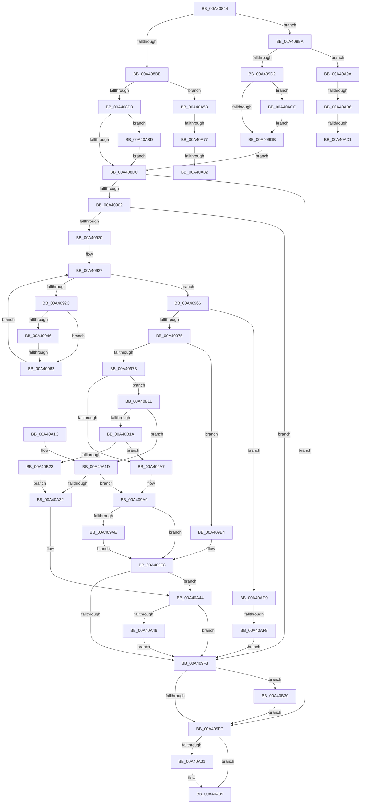

# BiOpenSystemStore

- RVA: `0x00A40844`–`0x00A40B42` (길이 `766` bytes)
- VA: `0x0000000140A40844`
- 실행 섹션: `PAGE`
- PDB 이름 있음: `예`; PDB Function 태그: `예`
- unwind 정보 RVA: `0x000AE998`
- 디코드: `205`개 명령, `766/766` bytes 표시
- 미해석 바이트: `0` (있으면 어셈블리에 `.byte`로 보존)

> 이 문서는 커널 이미지의 기계어와 PDB 기호를 분석해 생성했습니다. 4번과 5번은 함수 원형과 자료형을 바이너리 사용 방식에서 추정한 C 해석이며 원본 소스 복구 결과는 아닙니다.

## 1. Dependencies

- 직접 호출 지점: **23**; 고유 호출 대상: **13**
- 직접 호출자로 확인된 함수: **2**
- RIP 상대 이미지 참조: **7**

### Outgoing calls
- `0x00A4088C` → [BiLogMessage](../A3/BiLogMessage_function_00A3D3A8.md) (function, `0x00A3D3A8`)
- `0x00A408A0` → [BiIsWinPEBoot](BiIsWinPEBoot_function_00A40F54.md) (function, `0x00A40F54`)
- `0x00A408C2` → [BiOpenKeyNonBcd](BiOpenKeyNonBcd_function_00A40B48.md) (function, `0x00A40B48`)
- `0x00A408EF` → [BiOpenKeyNonBcd](BiOpenKeyNonBcd_function_00A40B48.md) (function, `0x00A40B48`)
- `0x00A4090D` → [BiEnumerateSubKeys](../A3/BiEnumerateSubKeys_function_00A3FD24.md) (function, `0x00A3FD24`)
- `0x00A4093D` → [wcsnicmp](../../text/50/wcsnicmp_function_005001C0.md) (function, `0x005001C0`)
- `0x00A40954` → [wcstoul](../../text/50/wcstoul_function_005024A0.md) (function, `0x005024A0`)
- `0x00A40987` → [BiLogMessage](../A3/BiLogMessage_function_00A3D3A8.md) (function, `0x00A3D3A8`)
- `0x00A4098F` → [BiWasFirmwareModified](../../text/4C/BiWasFirmwareModified_function_004CB8F4.md) (function, `0x004CB8F4`)
- `0x00A40999` → [BiGetFirmwareType](../A3/BiGetFirmwareType_function_00A3FA5C.md) (function, `0x00A3FA5C`)
- `0x00A409B3` → [BiSetFirmwareModified](../../text/4B/BiSetFirmwareModified_function_004B1DF4.md) (function, `0x004B1DF4`)
- `0x00A409C1` → [BiOpenKeyNonBcd](BiOpenKeyNonBcd_function_00A40B48.md) (function, `0x00A40B48`)
- `0x00A40A04` → [ZwClose](../../text/6A/ZwClose_function_006AD2B0.md) (function, `0x006AD2B0`)
- `0x00A40A20` → [BiBindEfiNamespaceObjects](BiBindEfiNamespaceObjects_function_00A40EB4.md) (function, `0x00A40EB4`)
- `0x00A40A3F` → [BiLogMessage](../A3/BiLogMessage_function_00A3D3A8.md) (function, `0x00A3D3A8`)
- `0x00A40A54` → [BiCloseStore](../A3/BiCloseStore_function_00A3C5D8.md) (function, `0x00A3C5D8`)
- `0x00A40A66` → [BiEnumerateSubKeys](../A3/BiEnumerateSubKeys_function_00A3FD24.md) (function, `0x00A3FD24`)
- `0x00A40A90` → [ZwClose](../../text/6A/ZwClose_function_006AD2B0.md) (function, `0x006AD2B0`)
- `0x00A40AA5` → [BiEnumerateSubKeys](../A3/BiEnumerateSubKeys_function_00A3FD24.md) (function, `0x00A3FD24`)
- `0x00A40ACF` → [ZwClose](../../text/6A/ZwClose_function_006AD2B0.md) (function, `0x006AD2B0`)
- `0x00A40AE5` → [BiLogMessage](../A3/BiLogMessage_function_00A3D3A8.md) (function, `0x00A3D3A8`)
- `0x00A40B02` → [BiLogMessage](../A3/BiLogMessage_function_00A3D3A8.md) (function, `0x00A3D3A8`)
- `0x00A40B38` → [ExFreePoolWithTag](../../poolcode/B8/ExFreePoolWithTag_function_00B82870.md) (function, `0x00B82870`)

### Direct callers
- [BcdOpenSystemStore](../82/BcdOpenSystemStore_function_00823428.md) at `0x0082345A`
- [BcdOpenStore](BcdOpenStore_function_00A4116C.md) at `0x00A41201`

### Static image references
- `0x00A40882` → RVA `0x00B0ADD0` (` ?? ::NNGAKEGL::`string'`; read)
- `0x00A408A7` → RVA `0x00B0AC40` (` ?? ::NNGAKEGL::`string'`; read)
- `0x00A40930` → RVA `0x00B0AC70` (` ?? ::NNGAKEGL::`string'`; read)
- `0x00A4097B` → RVA `0x00B0AF60` (` ?? ::NNGAKEGL::`string'`; read)
- `0x00A40A35` → RVA `0x00B0AFB0` (` ?? ::NNGAKEGL::`string'`; read)
- `0x00A40AD9` → RVA `0x00B0AEA0` (` ?? ::NNGAKEGL::`string'`; read)
- `0x00A40AF8` → RVA `0x00B0AEF0` (` ?? ::NNGAKEGL::`string'`; read)

## 2. Other-region calls and transfers

- 다른 실행 섹션으로 향하는 call: **8**
  - `0x00A4093D` → [wcsnicmp](../../text/50/wcsnicmp_function_005001C0.md) (`PAGE` → `.text`)
  - `0x00A40954` → [wcstoul](../../text/50/wcstoul_function_005024A0.md) (`PAGE` → `.text`)
  - `0x00A4098F` → [BiWasFirmwareModified](../../text/4C/BiWasFirmwareModified_function_004CB8F4.md) (`PAGE` → `.text`)
  - `0x00A409B3` → [BiSetFirmwareModified](../../text/4B/BiSetFirmwareModified_function_004B1DF4.md) (`PAGE` → `.text`)
  - `0x00A40A04` → [ZwClose](../../text/6A/ZwClose_function_006AD2B0.md) (`PAGE` → `.text`)
  - `0x00A40A90` → [ZwClose](../../text/6A/ZwClose_function_006AD2B0.md) (`PAGE` → `.text`)
  - `0x00A40ACF` → [ZwClose](../../text/6A/ZwClose_function_006AD2B0.md) (`PAGE` → `.text`)
  - `0x00A40B38` → [ExFreePoolWithTag](../../poolcode/B8/ExFreePoolWithTag_function_00B82870.md) (`PAGE` → `POOLCODE`)
- call이 아닌 외부 분기/꼬리 이동: **8**
  - `0x00A4095C` → [sub_00B3A892 + 0x128](../B3/Unknown_function_00B3A892.md) (`tail-transfer`)
  - `0x00A40A71` → [sub_00B3A892 + 0x74](../B3/Unknown_function_00B3A892.md) (`tail-transfer`)
  - `0x00A40A7C` → [sub_00B3A892 + 0x74](../B3/Unknown_function_00B3A892.md) (`tail-transfer`)
  - `0x00A40A88` → [sub_00B3A892](../B3/Unknown_function_00B3A892.md) (`tail-transfer`)
  - `0x00A40AB0` → [sub_00B3A892 + 0x10C](../B3/Unknown_function_00B3A892.md) (`tail-transfer`)
  - `0x00A40ABB` → [sub_00B3A892 + 0x10C](../B3/Unknown_function_00B3A892.md) (`tail-transfer`)
  - `0x00A40AC7` → [sub_00B3A892 + 0x90](../B3/Unknown_function_00B3A892.md) (`tail-transfer`)
  - `0x00A40AF2` → [sub_00B3A892 + 0x197](../B3/Unknown_function_00B3A892.md) (`tail-transfer`)

## 3. Assembly (complete function range)

```asm
00A40844  89 54 24 10                     mov dword ptr [rsp + 0x10], edx
00A40848  48 89 4C 24 08                  mov qword ptr [rsp + 8], rcx
00A4084D  55                              push rbp
00A4084E  53                              push rbx
00A4084F  56                              push rsi
00A40850  57                              push rdi
00A40851  41 54                           push r12
00A40853  41 55                           push r13
00A40855  41 56                           push r14
00A40857  41 57                           push r15
00A40859  48 8B EC                        mov rbp, rsp
00A4085C  48 83 EC 68                     sub rsp, 0x68
00A40860  48 83 21 00                     and qword ptr [rcx], 0
00A40864  33 FF                           xor edi, edi
00A40866  83 65 58 00                     and dword ptr [rbp + 0x58], 0
00A4086A  33 C0                           xor eax, eax
00A4086C  48 83 65 E0 00                  and qword ptr [rbp - 0x20], 0
00A40871  44 8B C2                        mov r8d, edx
00A40874  48 21 7D E8                     and qword ptr [rbp - 0x18], rdi
00A40878  44 8B EA                        mov r13d, edx
00A4087B  8D 4F 02                        lea ecx, [rdi + 2]
00A4087E  48 89 7D C0                     mov qword ptr [rbp - 0x40], rdi
00A40882  48 8D 15 47 A5 0C 00            lea rdx, [rip + 0xca547]
00A40889  89 45 60                        mov dword ptr [rbp + 0x60], eax
00A4088C  E8 17 CB FF FF                  call 0x140a3d3a8
00A40891  48 21 7D D8                     and qword ptr [rbp - 0x28], rdi
00A40895  21 7D B8                        and dword ptr [rbp - 0x48], edi
00A40898  48 21 7D D0                     and qword ptr [rbp - 0x30], rdi
00A4089C  48 21 7D C8                     and qword ptr [rbp - 0x38], rdi
00A408A0  E8 AF 06 00 00                  call 0x140a40f54
00A408A5  33 C9                           xor ecx, ecx
00A408A7  48 8D 15 92 A3 0C 00            lea rdx, [rip + 0xca392]
00A408AE  41 B8 3F 00 0F 00               mov r8d, 0xf003f
00A408B4  41 F6 C5 01                     test r13b, 1
00A408B8  0F 84 FC 00 00 00               je 0x140a409ba
00A408BE  4C 8D 4D C8                     lea r9, [rbp - 0x38]
00A408C2  E8 81 02 00 00                  call 0x140a40b48
00A408C7  4C 8B 75 C8                     mov r14, qword ptr [rbp - 0x38]
00A408CB  85 C0                           test eax, eax
00A408CD  0F 89 88 01 00 00               jns 0x140a40a5b
00A408D3  4D 85 F6                        test r14, r14
00A408D6  0F 85 B1 01 00 00               jne 0x140a40a8d
00A408DC  4C 8D 4D E0                     lea r9, [rbp - 0x20]
00A408E0  41 B8 3F 00 0F 00               mov r8d, 0xf003f
00A408E6  48 8D 15 53 A3 0C 00            lea rdx, [rip + 0xca353]
00A408ED  33 C9                           xor ecx, ecx
00A408EF  E8 54 02 00 00                  call 0x140a40b48
00A408F4  4C 8B 65 E0                     mov r12, qword ptr [rbp - 0x20]
00A408F8  8B D8                           mov ebx, eax
00A408FA  85 C0                           test eax, eax
00A408FC  0F 88 FA 00 00 00               js 0x140a409fc
00A40902  4C 8D 45 58                     lea r8, [rbp + 0x58]
00A40906  49 8B CC                        mov rcx, r12
00A40909  48 8D 55 E8                     lea rdx, [rbp - 0x18]
00A4090D  E8 12 F4 FF FF                  call 0x140a3fd24
00A40912  4C 8B 75 E8                     mov r14, qword ptr [rbp - 0x18]
00A40916  8B D8                           mov ebx, eax
00A40918  85 C0                           test eax, eax
00A4091A  0F 88 D3 00 00 00               js 0x140a409f3
00A40920  BB 25 02 00 C0                  mov ebx, 0xc0000225
00A40925  33 F6                           xor esi, esi
00A40927  3B 75 58                        cmp esi, dword ptr [rbp + 0x58]
00A4092A  73 3A                           jae 0x140a40966
00A4092C  49 8B 0C F6                     mov rcx, qword ptr [r14 + rsi*8]
00A40930  48 8D 15 39 A3 0C 00            lea rdx, [rip + 0xca339]
00A40937  41 B8 03 00 00 00               mov r8d, 3
00A4093D  E8 7E F8 AB FF                  call 0x1405001c0
00A40942  85 C0                           test eax, eax
00A40944  75 1C                           jne 0x140a40962
00A40946  49 8B 0C F6                     mov rcx, qword ptr [r14 + rsi*8]
00A4094A  44 8D 40 0A                     lea r8d, [rax + 0xa]
00A4094E  48 83 C1 06                     add rcx, 6
00A40952  33 D2                           xor edx, edx
00A40954  E8 47 1B AC FF                  call 0x1405024a0
00A40959  83 F8 FF                        cmp eax, -1
00A4095C  0F 85 58 A0 0F 00               jne 0x140b3a9ba
00A40962  FF C6                           inc esi
00A40964  EB C1                           jmp 0x140a40927
00A40966  41 BF 04 00 00 00               mov r15d, 4
00A4096C  3B 75 58                        cmp esi, dword ptr [rbp + 0x58]
00A4096F  0F 84 64 01 00 00               je 0x140a40ad9
00A40975  41 F6 C5 02                     test r13b, 2
00A40979  75 69                           jne 0x140a409e4
00A4097B  48 8D 15 DE A5 0C 00            lea rdx, [rip + 0xca5de]
00A40982  B9 02 00 00 00                  mov ecx, 2
00A40987  E8 1C CA FF FF                  call 0x140a3d3a8
00A4098C  48 8B CF                        mov rcx, rdi
00A4098F  E8 60 AF A8 FF                  call 0x1404cb8f4
00A40994  33 C9                           xor ecx, ecx
00A40996  40 8A F0                        mov sil, al
00A40999  E8 BE F0 FF FF                  call 0x140a3fa5c
00A4099E  83 E8 01                        sub eax, 1
00A409A1  0F 85 6A 01 00 00               jne 0x140a40b11
00A409A7  33 DB                           xor ebx, ebx
00A409A9  40 84 F6                        test sil, sil
00A409AC  75 3A                           jne 0x140a409e8
00A409AE  33 D2                           xor edx, edx
00A409B0  48 8B CF                        mov rcx, rdi
00A409B3  E8 3C 14 A7 FF                  call 0x1404b1df4
00A409B8  EB 2E                           jmp 0x140a409e8
00A409BA  4C 8D 4D D8                     lea r9, [rbp - 0x28]
00A409BE  44 8A E8                        mov r13b, al
00A409C1  E8 82 01 00 00                  call 0x140a40b48
00A409C6  4C 8B 75 D8                     mov r14, qword ptr [rbp - 0x28]
00A409CA  85 C0                           test eax, eax
00A409CC  0F 89 C8 00 00 00               jns 0x140a40a9a
00A409D2  4D 85 F6                        test r14, r14
00A409D5  0F 85 F1 00 00 00               jne 0x140a40acc
00A409DB  44 8B 6D 50                     mov r13d, dword ptr [rbp + 0x50]
00A409DF  E9 F8 FE FF FF                  jmp 0x140a408dc
00A409E4  48 83 CF 02                     or rdi, 2
00A409E8  48 8B 45 48                     mov rax, qword ptr [rbp + 0x48]
00A409EC  48 89 38                        mov qword ptr [rax], rdi
00A409EF  85 DB                           test ebx, ebx
00A409F1  78 51                           js 0x140a40a44
00A409F3  4D 85 F6                        test r14, r14
00A409F6  0F 85 34 01 00 00               jne 0x140a40b30
00A409FC  4D 85 E4                        test r12, r12
00A409FF  74 08                           je 0x140a40a09
00A40A01  49 8B CC                        mov rcx, r12
00A40A04  E8 A7 C8 C6 FF                  call 0x1406ad2b0
00A40A09  8B C3                           mov eax, ebx
00A40A0B  48 83 C4 68                     add rsp, 0x68
00A40A0F  41 5F                           pop r15
00A40A11  41 5E                           pop r14
00A40A13  41 5D                           pop r13
00A40A15  41 5C                           pop r12
00A40A17  5F                              pop rdi
00A40A18  5E                              pop rsi
00A40A19  5B                              pop rbx
00A40A1A  5D                              pop rbp
00A40A1B  C3                              ret
00A40A1C  CC                              int3
00A40A1D  48 8B CF                        mov rcx, rdi
00A40A20  E8 8F 04 00 00                  call 0x140a40eb4
00A40A25  8B D8                           mov ebx, eax
00A40A27  44 8B C8                        mov r9d, eax
00A40A2A  85 C0                           test eax, eax
00A40A2C  0F 89 77 FF FF FF               jns 0x140a409a9
00A40A32  45 8B C5                        mov r8d, r13d
00A40A35  48 8D 15 74 A5 0C 00            lea rdx, [rip + 0xca574]
00A40A3C  41 8B CF                        mov ecx, r15d
00A40A3F  E8 64 C9 FF FF                  call 0x140a3d3a8
00A40A44  48 85 FF                        test rdi, rdi
00A40A47  74 AA                           je 0x140a409f3
00A40A49  F7 5D 60                        neg dword ptr [rbp + 0x60]
00A40A4C  48 8B CF                        mov rcx, rdi
00A40A4F  1B D2                           sbb edx, edx
00A40A51  83 E2 02                        and edx, 2
00A40A54  E8 7F BB FF FF                  call 0x140a3c5d8
00A40A59  EB 98                           jmp 0x140a409f3
00A40A5B  4C 8D 45 B8                     lea r8, [rbp - 0x48]
00A40A5F  49 8B CE                        mov rcx, r14
00A40A62  48 8D 55 D0                     lea rdx, [rbp - 0x30]
00A40A66  E8 B9 F2 FF FF                  call 0x140a3fd24
00A40A6B  4C 8B 7D D0                     mov r15, qword ptr [rbp - 0x30]
00A40A6F  85 C0                           test eax, eax
00A40A71  0F 88 8F 9E 0F 00               js 0x140b3a906
00A40A77  8B 45 B8                        mov eax, dword ptr [rbp - 0x48]
00A40A7A  85 C0                           test eax, eax
00A40A7C  0F 84 84 9E 0F 00               je 0x140b3a906
00A40A82  49 8B DF                        mov rbx, r15
00A40A85  44 8B E0                        mov r12d, eax
00A40A88  E9 05 9E 0F 00                  jmp 0x140b3a892
00A40A8D  49 8B CE                        mov rcx, r14
00A40A90  E8 1B C8 C6 FF                  call 0x1406ad2b0
00A40A95  E9 42 FE FF FF                  jmp 0x140a408dc
00A40A9A  4C 8D 45 B8                     lea r8, [rbp - 0x48]
00A40A9E  49 8B CE                        mov rcx, r14
00A40AA1  48 8D 55 D0                     lea rdx, [rbp - 0x30]
00A40AA5  E8 7A F2 FF FF                  call 0x140a3fd24
00A40AAA  4C 8B 7D D0                     mov r15, qword ptr [rbp - 0x30]
00A40AAE  85 C0                           test eax, eax
00A40AB0  0F 88 E8 9E 0F 00               js 0x140b3a99e
00A40AB6  8B 45 B8                        mov eax, dword ptr [rbp - 0x48]
00A40AB9  85 C0                           test eax, eax
00A40ABB  0F 84 DD 9E 0F 00               je 0x140b3a99e
00A40AC1  49 8B DF                        mov rbx, r15
00A40AC4  44 8B E0                        mov r12d, eax
00A40AC7  E9 56 9E 0F 00                  jmp 0x140b3a922
00A40ACC  49 8B CE                        mov rcx, r14
00A40ACF  E8 DC C7 C6 FF                  call 0x1406ad2b0
00A40AD4  E9 02 FF FF FF                  jmp 0x140a409db
00A40AD9  48 8D 15 C0 A3 0C 00            lea rdx, [rip + 0xca3c0]
00A40AE0  B9 02 00 00 00                  mov ecx, 2
00A40AE5  E8 BE C8 FF FF                  call 0x140a3d3a8
00A40AEA  48 83 65 C0 00                  and qword ptr [rbp - 0x40], 0
00A40AEF  45 84 EF                        test r15b, r13b
00A40AF2  0F 84 31 9F 0F 00               je 0x140b3aa29
00A40AF8  48 8D 15 F1 A3 0C 00            lea rdx, [rip + 0xca3f1]
00A40AFF  41 8B CF                        mov ecx, r15d
00A40B02  E8 A1 C8 FF FF                  call 0x140a3d3a8
00A40B07  BB 25 02 00 C0                  mov ebx, 0xc0000225
00A40B0C  E9 E2 FE FF FF                  jmp 0x140a409f3
00A40B11  83 E8 01                        sub eax, 1
00A40B14  0F 84 03 FF FF FF               je 0x140a40a1d
00A40B1A  83 F8 01                        cmp eax, 1
00A40B1D  0F 84 84 FE FF FF               je 0x140a409a7
00A40B23  BB BB 00 00 C0                  mov ebx, 0xc00000bb
00A40B28  44 8B CB                        mov r9d, ebx
00A40B2B  E9 02 FF FF FF                  jmp 0x140a40a32
00A40B30  BA 42 43 44 4B                  mov edx, 0x4b444342
00A40B35  49 8B CE                        mov rcx, r14
00A40B38  E8 33 1D 14 00                  call 0x140b82870
00A40B3D  E9 BA FE FF FF                  jmp 0x140a409fc
```

## 4. C-style interpretation (structured pseudocode)

```c
__int64 __fastcall BiOpenSystemStore(__int64 a1, int a2)
{
    __int64 result;
    __int64 v_rbx;
    __int64 v_rdi;
    __int64 v_rsi;
    __int64 v_rsp;
    unsigned __int64 v_stack_m58;
    unsigned __int64 v_stack_m60;
    unsigned __int64 v_stack_m68;
    unsigned __int64 v_stack_m70;
    unsigned __int64 v_stack_m78;
    unsigned __int64 v_stack_m80;
    unsigned int v_stack_m88;
    unsigned int v_stack_p10;
    unsigned int v_stack_p18;
    unsigned int v_stack_p20;
    unsigned __int64 v_stack_p8;

    v_stack_p10 = a2;
    v_stack_p8 = a1;
    v_rsp = (v_rsp) - (104);
    v_rdi = 0;
    result = 0;
    v_stack_m80 = 0;
    v_stack_p20 = 0;
    result = BiLogMessage(v_rdi + 2, v_rip + 828743, (unsigned int)(a2), a4);
    result = BiIsWinPEBoot(v_rdi + 2, v_rip + 828743, (unsigned int)(a2), a4);
    a1 = 0;
    if ((((unsigned __int8)((unsigned int)(a2))) & (1)) == 0) goto loc_00A409BA;
    result = BiOpenKeyNonBcd(a1, v_rip + 828306, (unsigned int)(0xF003FULL), v_stack_m78);
    if (!sign_flag) goto loc_00A40A5B;
    if (v_stack_m78 != 0) goto loc_00A40A8D;
loc_00A408DC:
    a1 = 0;
    result = BiOpenKeyNonBcd(a1, v_rip + 828243, (unsigned int)(0xF003FULL), v_stack_m60);
    if (sign_flag) goto loc_00A409FC;
    result = BiEnumerateSubKeys(v_stack_m60, v_stack_m58, v_stack_p18, v_stack_m60);
    if (sign_flag) goto loc_00A409F3;
    v_rsi = 0;
loc_00A40927:
    if (0 >= v_stack_p18) goto loc_00A40966;
    result = wcsnicmp(*(unsigned __int64 *)(v_stack_m58 + v_rsi * 8), v_rip + 828217, 3, v_stack_m60);
    if ((unsigned int)(result) != 0) goto loc_00A40962;
    a1 = (*(unsigned __int64 *)(v_stack_m58 + v_rsi * 8)) + (6);
    a2 = 0;
    result = wcstoul(a1, a2, result + 10, v_stack_m60);
loc_00A40962:
    v_rsi = (unsigned int)((v_rsi) + 1);
    goto loc_00A40927;
loc_00A40966:
    if (((unsigned int)(v_rsi)) == v_stack_p18) goto loc_00A40AD9;
    if ((((unsigned __int8)((unsigned int)(a2))) & (2)) != 0) goto loc_00A409E4;
    result = BiLogMessage(2, v_rip + 828894, result + 10, v_stack_m60);
    result = BiWasFirmwareModified(0, v_rip + 828894, result + 10, v_stack_m60);
    a1 = 0;
    result = BiGetFirmwareType(a1, v_rip + 828894, result + 10, v_stack_m60);
    result = (unsigned int)((result) - (1));
    if (condition_is_not_equal) goto loc_00A40B11;
loc_00A409A7:
    v_rbx = 0;
loc_00A409A9:
    if ((unsigned __int8)((unsigned __int8)(result)) != 0) goto loc_00A409E8;
    a2 = 0;
    result = BiSetFirmwareModified(0, a2, result + 10, v_stack_m60);
    goto loc_00A409E8;
loc_00A409BA:
    result = BiOpenKeyNonBcd(0, a2, result + 10, v_stack_m68);
    if (!sign_flag) goto loc_00A40A9A;
    if (v_stack_m68 != 0) goto loc_00A40ACC;
loc_00A409DB:
    goto loc_00A408DC;
loc_00A409E4:
    v_rdi = (v_rdi) | (2);
loc_00A409E8:
    *(unsigned __int64 *)(v_stack_p8) = v_rdi;
    if (sign_flag) goto loc_00A40A44;
loc_00A409F3:
    if (v_stack_m68 != 0) goto loc_00A40B30;
loc_00A409FC:
    result = v_stack_p8;
    if (v_stack_m60 != 0) {
        a1 = v_stack_m60;
        result = ZwClose(a1, a2, result + 10, v_stack_m68);
    }
    v_rsp = (v_rsp) + (104);
    return 0;
loc_00A40A1D:
    result = BiBindEfiNamespaceObjects(v_rdi, a2, result + 10, v_stack_m68);
    if (!sign_flag) goto loc_00A409A9;
loc_00A40A32:
    result = BiLogMessage(4, v_rip + 828788, (unsigned int)((unsigned int)((unsigned int)(v_stack_p10))), (unsigned int)((unsigned int)(result)));
loc_00A40A44:
    if (v_rdi == 0) goto loc_00A409F3;
    a2 = (unsigned int)((v_rip + 828788) & (2));
    result = BiCloseStore(v_rdi, a2, (unsigned int)((unsigned int)((unsigned int)(v_stack_p10))), (unsigned int)((unsigned int)(result)));
    goto loc_00A409F3;
loc_00A40A5B:
    result = BiEnumerateSubKeys(v_stack_m68, v_stack_m70, v_stack_m88, (unsigned int)((unsigned int)(result)));
loc_00A40A8D:
    result = ZwClose(v_stack_m68, v_stack_m70, v_stack_m88, (unsigned int)((unsigned int)(result)));
    goto loc_00A408DC;
loc_00A40A9A:
    result = BiEnumerateSubKeys(v_stack_m68, v_stack_m70, v_stack_m88, (unsigned int)((unsigned int)(result)));
loc_00A40ACC:
    result = ZwClose(v_stack_m68, v_stack_m70, v_stack_m88, (unsigned int)((unsigned int)(result)));
    goto loc_00A409DB;
loc_00A40AD9:
    result = BiLogMessage(2, v_rip + 828352, v_stack_m88, (unsigned int)((unsigned int)(result)));
    result = BiLogMessage((unsigned int)((unsigned int)(v_stack_m70)), v_rip + 828401, v_stack_m88, (unsigned int)((unsigned int)(result)));
    goto loc_00A409F3;
loc_00A40B11:
    result = (unsigned int)((result) - (1));
    if (condition_is_equal) goto loc_00A40A1D;
    if (((unsigned int)(result)) == 1) goto loc_00A409A7;
    goto loc_00A40A32;
loc_00A40B30:
    result = ExFreePoolWithTag(v_stack_m68, (unsigned int)(0x4B444342ULL), v_stack_m88, (unsigned int)((unsigned int)((unsigned int)(0xC00000BBULL))));
    goto loc_00A409FC;
}
```

## 5. (Beta) C Style

```c
int64_t BiOpenSystemStore(void *Arg1, int32_t Arg2)
{
    uint8_t *arg1 = (uint8_t *)Arg1;

    int64_t result;
    int64_t local_rbx;
    int64_t local_rdi;
    int64_t local_rsi;
    int64_t local_rsp;
    uint64_t v_stack_m58;
    uint64_t v_stack_m60;
    uint64_t v_stack_m68;
    uint64_t v_stack_m70;
    uint64_t v_stack_m78;
    uint64_t v_stack_m80;
    uint32_t v_stack_m88;
    uint32_t v_stack_p10;
    uint32_t v_stack_p18;
    uint32_t v_stack_p20;
    uint64_t v_stack_p8;

    v_stack_p10 = Arg2;
    v_stack_p8 = Arg1;
    local_rsp = (local_rsp) - (104);
    local_rdi = 0;
    result = 0;
    v_stack_m80 = 0;
    v_stack_p20 = 0;
    result = BiLogMessage(local_rdi + 2, v_rip + 828743, (uint32_t)(Arg2), a4);
    result = BiIsWinPEBoot(local_rdi + 2, v_rip + 828743, (uint32_t)(Arg2), a4);
    Arg1 = 0;
    if ((((uint8_t)((uint32_t)(Arg2))) & (1)) == 0) goto loc_00A409BA;
    result = BiOpenKeyNonBcd(Arg1, v_rip + 828306, (uint32_t)(0xF003FULL), v_stack_m78);
    if (!sign_flag) goto loc_00A40A5B;
    if (v_stack_m78 != 0) goto loc_00A40A8D;
loc_00A408DC:
    Arg1 = 0;
    result = BiOpenKeyNonBcd(Arg1, v_rip + 828243, (uint32_t)(0xF003FULL), v_stack_m60);
    if (sign_flag) goto loc_00A409FC;
    result = BiEnumerateSubKeys(v_stack_m60, v_stack_m58, v_stack_p18, v_stack_m60);
    if (sign_flag) goto loc_00A409F3;
    local_rsi = 0;
loc_00A40927:
    if (0 >= v_stack_p18) goto loc_00A40966;
    result = wcsnicmp(*(uint64_t *)(v_stack_m58 + local_rsi * 8), v_rip + 828217, 3, v_stack_m60);
    if ((uint32_t)(result) != 0) goto loc_00A40962;
    Arg1 = (*(uint64_t *)(v_stack_m58 + local_rsi * 8)) + (6);
    Arg2 = 0;
    result = wcstoul(Arg1, Arg2, result + 10, v_stack_m60);
loc_00A40962:
    local_rsi = (uint32_t)((local_rsi) + 1);
    goto loc_00A40927;
loc_00A40966:
    if (((uint32_t)(local_rsi)) == v_stack_p18) goto loc_00A40AD9;
    if ((((uint8_t)((uint32_t)(Arg2))) & (2)) != 0) goto loc_00A409E4;
    result = BiLogMessage(2, v_rip + 828894, result + 10, v_stack_m60);
    result = BiWasFirmwareModified(0, v_rip + 828894, result + 10, v_stack_m60);
    Arg1 = 0;
    result = BiGetFirmwareType(Arg1, v_rip + 828894, result + 10, v_stack_m60);
    result = (uint32_t)((result) - (1));
    if (condition_is_not_equal) goto loc_00A40B11;
loc_00A409A7:
    local_rbx = 0;
loc_00A409A9:
    if ((uint8_t)((uint8_t)(result)) != 0) goto loc_00A409E8;
    Arg2 = 0;
    result = BiSetFirmwareModified(0, Arg2, result + 10, v_stack_m60);
    goto loc_00A409E8;
loc_00A409BA:
    result = BiOpenKeyNonBcd(0, Arg2, result + 10, v_stack_m68);
    if (!sign_flag) goto loc_00A40A9A;
    if (v_stack_m68 != 0) goto loc_00A40ACC;
loc_00A409DB:
    goto loc_00A408DC;
loc_00A409E4:
    local_rdi = (local_rdi) | (2);
loc_00A409E8:
    *(uint64_t *)(v_stack_p8) = local_rdi;
    if (sign_flag) goto loc_00A40A44;
loc_00A409F3:
    if (v_stack_m68 != 0) goto loc_00A40B30;
loc_00A409FC:
    result = v_stack_p8;
    if (v_stack_m60 != 0) {
        Arg1 = v_stack_m60;
        result = ZwClose(Arg1, Arg2, result + 10, v_stack_m68);
    }
    local_rsp = (local_rsp) + (104);
    return 0;
loc_00A40A1D:
    result = BiBindEfiNamespaceObjects(local_rdi, Arg2, result + 10, v_stack_m68);
    if (!sign_flag) goto loc_00A409A9;
loc_00A40A32:
    result = BiLogMessage(4, v_rip + 828788, (uint32_t)((uint32_t)((uint32_t)(v_stack_p10))), (uint32_t)((uint32_t)(result)));
loc_00A40A44:
    if (local_rdi == 0) goto loc_00A409F3;
    Arg2 = (uint32_t)((v_rip + 828788) & (2));
    result = BiCloseStore(local_rdi, Arg2, (uint32_t)((uint32_t)((uint32_t)(v_stack_p10))), (uint32_t)((uint32_t)(result)));
    goto loc_00A409F3;
loc_00A40A5B:
    result = BiEnumerateSubKeys(v_stack_m68, v_stack_m70, v_stack_m88, (uint32_t)((uint32_t)(result)));
loc_00A40A8D:
    result = ZwClose(v_stack_m68, v_stack_m70, v_stack_m88, (uint32_t)((uint32_t)(result)));
    goto loc_00A408DC;
loc_00A40A9A:
    result = BiEnumerateSubKeys(v_stack_m68, v_stack_m70, v_stack_m88, (uint32_t)((uint32_t)(result)));
loc_00A40ACC:
    result = ZwClose(v_stack_m68, v_stack_m70, v_stack_m88, (uint32_t)((uint32_t)(result)));
    goto loc_00A409DB;
loc_00A40AD9:
    result = BiLogMessage(2, v_rip + 828352, v_stack_m88, (uint32_t)((uint32_t)(result)));
    result = BiLogMessage((uint32_t)((uint32_t)(v_stack_m70)), v_rip + 828401, v_stack_m88, (uint32_t)((uint32_t)(result)));
    goto loc_00A409F3;
loc_00A40B11:
    result = (uint32_t)((result) - (1));
    if (condition_is_equal) goto loc_00A40A1D;
    if (((uint32_t)(result)) == 1) goto loc_00A409A7;
    goto loc_00A40A32;
loc_00A40B30:
    result = ExFreePoolWithTag(v_stack_m68, (uint32_t)(0x4B444342ULL), v_stack_m88, (uint32_t)((uint32_t)((uint32_t)(0xC00000BBULL))));
    goto loc_00A409FC;
}
```

### 관측된 메모리 오프셋

구조체 형식이 확인되지 않은 접근은 인자 기준의 오프셋으로만 기록했습니다.

| 기준 인자 | 오프셋 표현 | 폭 (bit) | 접근 |
|---|---:|---:|---|
| `Arg1` | `+ 0x0` | `64` | `R/W` |

## 6. Execution-region graph

[열기: 2D/3D 그래프와 함수 탐색 컨트롤 패널](../../../control-panel.html?section=page&rva=0x00A40844&view=graph)

- 2D 그래프는 위에서 아래로 흐르고, 3D 그래프는 빈 공간을 드래그해 회전합니다. Shift+드래그는 이동, 휠은 확대·축소, 함수 노드 선택은 대상 보고서 이동입니다.

### Static fallback


