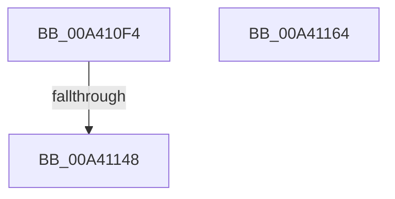

# BiUnloadHiveByName

- RVA: `0x00A410F4`–`0x00A41165` (길이 `113` bytes)
- VA: `0x0000000140A410F4`
- 실행 섹션: `PAGE`
- PDB 이름 있음: `예`; PDB Function 태그: `예`
- unwind 정보 RVA: `0x000AEA3C`
- 디코드: `36`개 명령, `113/113` bytes 표시
- 미해석 바이트: `0` (있으면 어셈블리에 `.byte`로 보존)

> 이 문서는 커널 이미지의 기계어와 PDB 기호를 분석해 생성했습니다. 4번과 5번은 함수 원형과 자료형을 바이너리 사용 방식에서 추정한 C 해석이며 원본 소스 복구 결과는 아닙니다.

## 1. Dependencies

- 직접 호출 지점: **1**; 고유 호출 대상: **1**
- 직접 호출자로 확인된 함수: **2**
- RIP 상대 이미지 참조: **0**

### Outgoing calls
- `0x00A41137` → [ExAllocatePool2](../../poolcode/B8/ExAllocatePool2_function_00B820F0.md) (function, `0x00B820F0`)

### Direct callers
- [BiUnloadHiveByHandle](BiUnloadHiveByHandle_function_00A4105C.md) at `0x00A410BF`
- [sub_00B3AA4C](../B3/Unknown_function_00B3AA4C.md) at `0x00B3AB26`

### Static image references
- 디코드된 RIP-relative 메모리 참조가 없습니다.

## 2. Other-region calls and transfers

- 다른 실행 섹션으로 향하는 call: **1**
  - `0x00A41137` → [ExAllocatePool2](../../poolcode/B8/ExAllocatePool2_function_00B820F0.md) (`PAGE` → `POOLCODE`)
- call이 아닌 외부 분기/꼬리 이동: **1**
  - `0x00A41142` → [sub_00B3AB32](../B3/Unknown_function_00B3AB32.md) (`tail-transfer`)

## 3. Assembly (complete function range)

```asm
00A410F4  48 89 5C 24 08                  mov qword ptr [rsp + 8], rbx
00A410F9  48 89 74 24 10                  mov qword ptr [rsp + 0x10], rsi
00A410FE  55                              push rbp
00A410FF  57                              push rdi
00A41100  41 56                           push r14
00A41102  48 8B EC                        mov rbp, rsp
00A41105  48 83 EC 70                     sub rsp, 0x70
00A41109  33 C0                           xor eax, eax
00A4110B  41 8A F0                        mov sil, r8b
00A4110E  21 45 EC                        and dword ptr [rbp - 0x14], eax
00A41111  4C 8B F1                        mov r14, rcx
00A41114  48 21 45 38                     and qword ptr [rbp + 0x38], rax
00A41118  0F 57 C0                        xorps xmm0, xmm0
00A4111B  89 45 D4                        mov dword ptr [rbp - 0x2c], eax
00A4111E  41 B8 42 43 44 4B               mov r8d, 0x4b444342
00A41124  21 45 D4                        and dword ptr [rbp - 0x2c], eax
00A41127  B9 02 01 00 00                  mov ecx, 0x102
00A4112C  8D 42 26                        lea eax, [rdx + 0x26]
00A4112F  8B D0                           mov edx, eax
00A41131  0F 11 45 C0                     movups xmmword ptr [rbp - 0x40], xmm0
00A41135  8B D8                           mov ebx, eax
00A41137  E8 B4 0F 14 00                  call 0x140b820f0
00A4113C  48 8B F8                        mov rdi, rax
00A4113F  48 85 C0                        test rax, rax
00A41142  0F 85 EA 99 0F 00               jne 0x140b3ab32
00A41148  BB 9A 00 00 C0                  mov ebx, 0xc000009a
00A4114D  4C 8D 5C 24 70                  lea r11, [rsp + 0x70]
00A41152  8B C3                           mov eax, ebx
00A41154  49 8B 5B 20                     mov rbx, qword ptr [r11 + 0x20]
00A41158  49 8B 73 28                     mov rsi, qword ptr [r11 + 0x28]
00A4115C  49 8B E3                        mov rsp, r11
00A4115F  41 5E                           pop r14
00A41161  5F                              pop rdi
00A41162  5D                              pop rbp
00A41163  C3                              ret
00A41164  CC                              int3
```

## 4. C-style interpretation (structured pseudocode)

```c
__int64 __fastcall BiUnloadHiveByName(__int64 a1, __int64 a2, unsigned __int8 a3)
{
    __int64 result;
    __int64 v_rsp;
    unsigned __int64 v_stack_m18;
    unsigned int v_stack_m2C;
    unsigned int v_stack_m44;
    unsigned __int64 v_stack_m58;
    unsigned __int64 v_stack_p10;
    unsigned __int64 v_stack_p20;
    unsigned __int64 v_stack_p8;

    v_stack_p8 = v_rbx;
    v_stack_p10 = v_rsi;
    v_rsp = (v_rsp) - (112);
    result = 0;
    v_stack_m44 = 0;
    v_stack_m58 = v_xmm0;
    result = ExAllocatePool2(258, (unsigned int)((unsigned int)(a2 + 38)), (unsigned int)(0x4B444342ULL), a4);
    return (unsigned int)((unsigned int)((unsigned int)(0xC000009AULL)));
}
```

## 5. (Beta) C Style

```c
int64_t BiUnloadHiveByName(int64_t Arg1, void *Arg2, uint8_t Arg3)
{
    uint8_t *arg2 = (uint8_t *)Arg2;

    int64_t result;
    int64_t local_rsp;
    uint64_t v_stack_m18;
    uint32_t v_stack_m2C;
    uint32_t v_stack_m44;
    uint64_t v_stack_m58;
    uint64_t v_stack_p10;
    uint64_t v_stack_p20;
    uint64_t v_stack_p8;

    v_stack_p8 = local_rbx;
    v_stack_p10 = local_rsi;
    local_rsp = (local_rsp) - (112);
    result = 0;
    v_stack_m44 = 0;
    v_stack_m58 = v_xmm0;
    result = ExAllocatePool2(258, (uint32_t)((uint32_t)(Arg2 + 38)), (uint32_t)(0x4B444342ULL), a4);
    return (uint32_t)((uint32_t)((uint32_t)(0xC000009AULL)));
}
```

### 관측된 메모리 오프셋

구조체 형식이 확인되지 않은 접근은 인자 기준의 오프셋으로만 기록했습니다.

| 기준 인자 | 오프셋 표현 | 폭 (bit) | 접근 |
|---|---:|---:|---|
| `Arg2` | `+ 0x26` | `32` | `R` |

## 6. Execution-region graph

[열기: 2D/3D 그래프와 함수 탐색 컨트롤 패널](../../../control-panel.html?section=page&rva=0x00A410F4&view=graph)

- 2D 그래프는 위에서 아래로 흐르고, 3D 그래프는 빈 공간을 드래그해 회전합니다. Shift+드래그는 이동, 휠은 확대·축소, 함수 노드 선택은 대상 보고서 이동입니다.

### Static fallback


