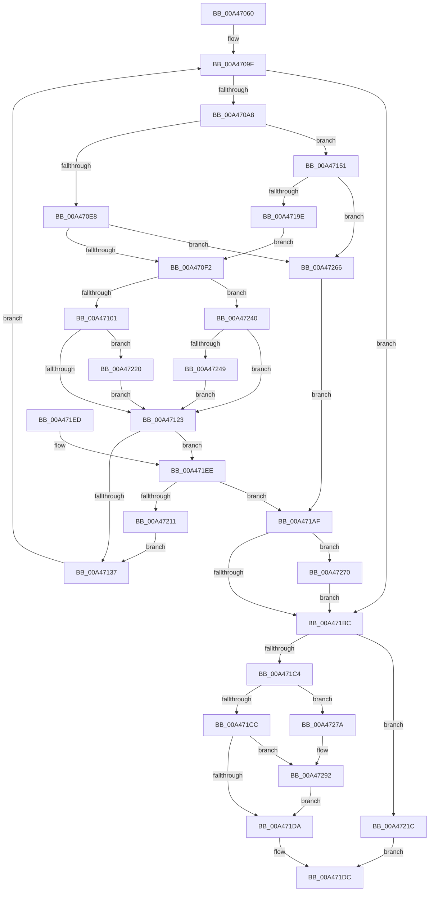

# CcMapAndCopyFromCache

- RVA: `0x00A47060`–`0x00A472A6` (길이 `582` bytes)
- VA: `0x0000000140A47060`
- 실행 섹션: `PAGE`
- PDB 이름 있음: `예`; PDB Function 태그: `아니요`
- unwind 정보 RVA: `0x000AF898`
- 디코드: `151`개 명령, `582/582` bytes 표시
- 미해석 바이트: `0` (있으면 어셈블리에 `.byte`로 보존)

> 이 문서는 커널 이미지의 기계어와 PDB 기호를 분석해 생성했습니다. 4번과 5번은 함수 원형과 자료형을 바이너리 사용 방식에서 추정한 C 해석이며 원본 소스 복구 결과는 아닙니다.

## 1. Dependencies

- 직접 호출 지점: **8**; 고유 호출 대상: **6**
- 직접 호출자로 확인된 함수: **3**
- RIP 상대 이미지 참조: **0**

### Outgoing calls
- `0x00A470D2` → [CcGetVirtualAddress](../../text/34/CcGetVirtualAddress_function_00340C9C.md) (function, `0x00340C9C`)
- `0x00A4713E` → [CcFreeVirtualAddress](../../text/33/CcFreeVirtualAddress_function_0033F2C0.md) (function, `0x0033F2C0`)
- `0x00A47191` → [CcFetchDataForRead](../../text/2F/CcFetchDataForRead_function_002F8720.md) (function, `0x002F8720`)
- `0x00A47206` → [CcCopyBytesToUserBuffer](../../text/3C/CcCopyBytesToUserBuffer_function_003CC3D0.md) (function, `0x003CC3D0`)
- `0x00A47270` → [CcFreeVirtualAddress](../../text/33/CcFreeVirtualAddress_function_0033F2C0.md) (function, `0x0033F2C0`)
- `0x00A47285` → [CcUpdateSharedCacheMapFlag](../../text/45/CcUpdateSharedCacheMapFlag_function_0045EC14.md) (function, `0x0045EC14`)
- `0x00A4728C` → [RtlRaiseStatus](../../text/2F/RtlRaiseStatus_function_002F6A50.md) (function, `0x002F6A50`)
- `0x00A4729C` → [CcUpdateSharedCacheMapFlag](../../text/45/CcUpdateSharedCacheMapFlag_function_0045EC14.md) (function, `0x0045EC14`)

### Direct callers
- [CcCopyReadEx](../../text/45/CcCopyReadEx_function_0045E160.md) at `0x0045E2C4`
- [CcCompleteAsyncRead](../../text/45/CcCompleteAsyncRead_function_0045E7DC.md) at `0x0045E946`
- [CcPerformReadAhead](../../text/48/CcPerformReadAhead_function_0048F738.md) at `0x0048FAC9`

### Static image references
- 디코드된 RIP-relative 메모리 참조가 없습니다.

## 2. Other-region calls and transfers

- 다른 실행 섹션으로 향하는 call: **8**
  - `0x00A470D2` → [CcGetVirtualAddress](../../text/34/CcGetVirtualAddress_function_00340C9C.md) (`PAGE` → `.text`)
  - `0x00A4713E` → [CcFreeVirtualAddress](../../text/33/CcFreeVirtualAddress_function_0033F2C0.md) (`PAGE` → `.text`)
  - `0x00A47191` → [CcFetchDataForRead](../../text/2F/CcFetchDataForRead_function_002F8720.md) (`PAGE` → `.text`)
  - `0x00A47206` → [CcCopyBytesToUserBuffer](../../text/3C/CcCopyBytesToUserBuffer_function_003CC3D0.md) (`PAGE` → `.text`)
  - `0x00A47270` → [CcFreeVirtualAddress](../../text/33/CcFreeVirtualAddress_function_0033F2C0.md) (`PAGE` → `.text`)
  - `0x00A47285` → [CcUpdateSharedCacheMapFlag](../../text/45/CcUpdateSharedCacheMapFlag_function_0045EC14.md) (`PAGE` → `.text`)
  - `0x00A4728C` → [RtlRaiseStatus](../../text/2F/RtlRaiseStatus_function_002F6A50.md) (`PAGE` → `.text`)
  - `0x00A4729C` → [CcUpdateSharedCacheMapFlag](../../text/45/CcUpdateSharedCacheMapFlag_function_0045EC14.md) (`PAGE` → `.text`)
- 별도 외부 분기/꼬리 이동을 확인하지 못했습니다.

## 3. Assembly (complete function range)

```asm
00A47060  44 88 4C 24 20                  mov byte ptr [rsp + 0x20], r9b
00A47065  48 89 54 24 10                  mov qword ptr [rsp + 0x10], rdx
00A4706A  48 89 4C 24 08                  mov qword ptr [rsp + 8], rcx
00A4706F  55                              push rbp
00A47070  53                              push rbx
00A47071  56                              push rsi
00A47072  57                              push rdi
00A47073  41 54                           push r12
00A47075  41 55                           push r13
00A47077  41 56                           push r14
00A47079  41 57                           push r15
00A4707B  48 8B EC                        mov rbp, rsp
00A4707E  48 83 EC 78                     sub rsp, 0x78
00A47082  48 8B 41 28                     mov rax, qword ptr [rcx + 0x28]
00A47086  45 8B F8                        mov r15d, r8d
00A47089  48 83 65 E0 00                  and qword ptr [rbp - 0x20], 0
00A4708E  48 8B DA                        mov rbx, rdx
00A47091  4C 8B 6D 70                     mov r13, qword ptr [rbp + 0x70]
00A47095  33 FF                           xor edi, edi
00A47097  4C 8B 65 68                     mov r12, qword ptr [rbp + 0x68]
00A4709B  48 8B 70 08                     mov rsi, qword ptr [rax + 8]
00A4709F  45 85 FF                        test r15d, r15d
00A470A2  0F 84 14 01 00 00               je 0x140a471bc
00A470A8  83 65 58 00                     and dword ptr [rbp + 0x58], 0
00A470AC  4C 8D 4D 58                     lea r9, [rbp + 0x58]
00A470B0  33 C0                           xor eax, eax
00A470B2  4C 8D 45 E0                     lea r8, [rbp - 0x20]
00A470B6  45 33 F6                        xor r14d, r14d
00A470B9  48 8B D3                        mov rdx, rbx
00A470BC  4D 85 E4                        test r12, r12
00A470BF  44 89 75 D8                     mov dword ptr [rbp - 0x28], r14d
00A470C3  48 8B CE                        mov rcx, rsi
00A470C6  0F 94 C0                        sete al
00A470C9  89 44 24 28                     mov dword ptr [rsp + 0x28], eax
00A470CD  44 21 74 24 20                  and dword ptr [rsp + 0x20], r14d
00A470D2  E8 C5 9B 8F FF                  call 0x140340c9c
00A470D7  4C 8B D0                        mov r10, rax
00A470DA  48 89 45 E8                     mov qword ptr [rbp - 0x18], rax
00A470DE  8B 86 98 00 00 00               mov eax, dword ptr [rsi + 0x98]
00A470E4  A8 08                           test al, 8
00A470E6  74 69                           je 0x140a47151
00A470E8  44 38 75 60                     cmp byte ptr [rbp + 0x60], r14b
00A470EC  0F 84 74 01 00 00               je 0x140a47266
00A470F2  8B 4D 58                        mov ecx, dword ptr [rbp + 0x58]
00A470F5  48 03 D9                        add rbx, rcx
00A470F8  4D 85 E4                        test r12, r12
00A470FB  0F 84 3F 01 00 00               je 0x140a47240
00A47101  48 8B 96 00 02 00 00            mov rdx, qword ptr [rsi + 0x200]
00A47108  48 8B 82 58 01 00 00            mov rax, qword ptr [rdx + 0x158]
00A4710F  48 03 C8                        add rcx, rax
00A47112  83 7D D8 00                     cmp dword ptr [rbp - 0x28], 0
00A47116  48 89 8A 58 01 00 00            mov qword ptr [rdx + 0x158], rcx
00A4711D  0F 85 FD 00 00 00               jne 0x140a47220
00A47123  44 8B 75 58                     mov r14d, dword ptr [rbp + 0x58]
00A47127  45 3B F7                        cmp r14d, r15d
00A4712A  45 0F 47 F7                     cmova r14d, r15d
00A4712E  4D 85 E4                        test r12, r12
00A47131  0F 85 B7 00 00 00               jne 0x140a471ee
00A47137  48 8B 4D E0                     mov rcx, qword ptr [rbp - 0x20]
00A4713B  45 2B FE                        sub r15d, r14d
00A4713E  E8 7D 81 8F FF                  call 0x14033f2c0
00A47143  48 83 65 E0 00                  and qword ptr [rbp - 0x20], 0
00A47148  48 89 5D 50                     mov qword ptr [rbp + 0x50], rbx
00A4714C  E9 4E FF FF FF                  jmp 0x140a4709f
00A47151  48 8B 85 88 00 00 00            mov rax, qword ptr [rbp + 0x88]
00A47158  48 8D 55 50                     lea rdx, [rbp + 0x50]
00A4715C  44 8A 4D 60                     mov r9b, byte ptr [rbp + 0x60]
00A47160  45 8B C7                        mov r8d, r15d
00A47163  48 8B 4D 48                     mov rcx, qword ptr [rbp + 0x48]
00A47167  48 89 44 24 40                  mov qword ptr [rsp + 0x40], rax
00A4716C  48 8B 85 80 00 00 00            mov rax, qword ptr [rbp + 0x80]
00A47173  48 89 44 24 38                  mov qword ptr [rsp + 0x38], rax
00A47178  8B 45 78                        mov eax, dword ptr [rbp + 0x78]
00A4717B  89 44 24 30                     mov dword ptr [rsp + 0x30], eax
00A4717F  48 8B 45 E0                     mov rax, qword ptr [rbp - 0x20]
00A47183  48 89 44 24 28                  mov qword ptr [rsp + 0x28], rax
00A47188  48 8D 45 D8                     lea rax, [rbp - 0x28]
00A4718C  48 89 44 24 20                  mov qword ptr [rsp + 0x20], rax
00A47191  E8 8A 15 8B FF                  call 0x1402f8720
00A47196  84 C0                           test al, al
00A47198  0F 84 C8 00 00 00               je 0x140a47266
00A4719E  44 8B 75 D8                     mov r14d, dword ptr [rbp - 0x28]
00A471A2  45 09 75 00                     or dword ptr [r13], r14d
00A471A6  4C 8B 55 E8                     mov r10, qword ptr [rbp - 0x18]
00A471AA  E9 43 FF FF FF                  jmp 0x140a470f2
00A471AF  48 8B 4D E0                     mov rcx, qword ptr [rbp - 0x20]
00A471B3  48 85 C9                        test rcx, rcx
00A471B6  0F 85 B4 00 00 00               jne 0x140a47270
00A471BC  81 FF D8 00 00 C0               cmp edi, 0xc00000d8
00A471C2  74 58                           je 0x140a4721c
00A471C4  85 FF                           test edi, edi
00A471C6  0F 88 AE 00 00 00               js 0x140a4727a
00A471CC  8B 86 98 00 00 00               mov eax, dword ptr [rsi + 0x98]
00A471D2  A8 08                           test al, 8
00A471D4  0F 85 B8 00 00 00               jne 0x140a47292
00A471DA  B0 01                           mov al, 1
00A471DC  48 83 C4 78                     add rsp, 0x78
00A471E0  41 5F                           pop r15
00A471E2  41 5E                           pop r14
00A471E4  41 5D                           pop r13
00A471E6  41 5C                           pop r12
00A471E8  5F                              pop rdi
00A471E9  5E                              pop rsi
00A471EA  5B                              pop rbx
00A471EB  5D                              pop rbp
00A471EC  C3                              ret
00A471ED  CC                              int3
00A471EE  44 8B 8E 98 00 00 00            mov r9d, dword ptr [rsi + 0x98]
00A471F5  45 8B C6                        mov r8d, r14d
00A471F8  41 C1 E9 0C                     shr r9d, 0xc
00A471FC  49 8B D2                        mov rdx, r10
00A471FF  41 80 E1 01                     and r9b, 1
00A47203  49 8B CC                        mov rcx, r12
00A47206  E8 C5 51 98 FF                  call 0x1403cc3d0
00A4720B  8B F8                           mov edi, eax
00A4720D  85 C0                           test eax, eax
00A4720F  78 9E                           js 0x140a471af
00A47211  41 8B CE                        mov ecx, r14d
00A47214  4C 03 E1                        add r12, rcx
00A47217  E9 1B FF FF FF                  jmp 0x140a47137
00A4721C  32 C0                           xor al, al
00A4721E  EB BC                           jmp 0x140a471dc
00A47220  48 8B 96 00 02 00 00            mov rdx, qword ptr [rsi + 0x200]
00A47227  8B 4D 58                        mov ecx, dword ptr [rbp + 0x58]
00A4722A  48 8B 82 60 01 00 00            mov rax, qword ptr [rdx + 0x160]
00A47231  48 03 C8                        add rcx, rax
00A47234  48 89 8A 60 01 00 00            mov qword ptr [rdx + 0x160], rcx
00A4723B  E9 E3 FE FF FF                  jmp 0x140a47123
00A47240  45 85 F6                        test r14d, r14d
00A47243  0F 84 DA FE FF FF               je 0x140a47123
00A47249  48 8B 96 00 02 00 00            mov rdx, qword ptr [rsi + 0x200]
00A47250  48 8B 82 68 01 00 00            mov rax, qword ptr [rdx + 0x168]
00A47257  48 03 C8                        add rcx, rax
00A4725A  48 89 8A 68 01 00 00            mov qword ptr [rdx + 0x168], rcx
00A47261  E9 BD FE FF FF                  jmp 0x140a47123
00A47266  BF D8 00 00 C0                  mov edi, 0xc00000d8
00A4726B  E9 3F FF FF FF                  jmp 0x140a471af
00A47270  E8 4B 80 8F FF                  call 0x14033f2c0
00A47275  E9 42 FF FF FF                  jmp 0x140a471bc
00A4727A  41 B0 01                        mov r8b, 1
00A4727D  BA 08 00 00 00                  mov edx, 8
00A47282  48 8B CE                        mov rcx, rsi
00A47285  E8 8A 79 A1 FF                  call 0x14045ec14
00A4728A  8B CF                           mov ecx, edi
00A4728C  E8 BF F7 8A FF                  call 0x1402f6a50
00A47291  CC                              int3
00A47292  45 33 C0                        xor r8d, r8d
00A47295  48 8B CE                        mov rcx, rsi
00A47298  41 8D 50 08                     lea edx, [r8 + 8]
00A4729C  E8 73 79 A1 FF                  call 0x14045ec14
00A472A1  E9 34 FF FF FF                  jmp 0x140a471da
```

## 4. C-style interpretation (structured pseudocode)

```c
__int64 __fastcall CcMapAndCopyFromCache(__int64 a1, __int64 a2, int a3, unsigned __int8 a4, __int64 a5, __int64 a6, unsigned int a7, __int64 a8, __int64 a9)
{
    __int64 result;
    __int64 v_r12;
    __int64 v_r14;
    __int64 v_r15;
    __int64 v_rbx;
    __int64 v_rdi;
    __int64 v_rsp;
    unsigned __int64 v_stack_m58;
    unsigned __int64 v_stack_m60;
    unsigned int v_stack_m68;
    unsigned __int64 v_stack_m78;
    unsigned __int64 v_stack_m80;
    unsigned int v_stack_m88;
    unsigned int v_stack_m90;
    unsigned int v_stack_m98;
    unsigned __int64 v_stack_p10;
    unsigned int v_stack_p18;
    unsigned __int8 v_stack_p20;
    unsigned __int64 v_stack_p8;

    v_stack_p20 = a4;
    v_stack_p10 = a2;
    v_stack_p8 = a1;
    v_rsp = (v_rsp) - (120);
    v_rdi = 0;
loc_00A4709F:
    if ((unsigned int)((unsigned int)(a3)) == 0) goto loc_00A471BC;
    result = 0;
    v_r14 = 0;
    v_stack_m68 = 0;
    result = (a5 == 0) ? 1 : 0;
    v_stack_m90 = (unsigned int)(result);
    result = CcGetVirtualAddress(*(unsigned __int64 *)(*(unsigned __int64 *)(a1 + 40) + 8), a2, v_stack_m60, v_stack_p18);
    v_stack_m58 = result;
    if ((((unsigned __int8)((unsigned int)(*(unsigned int *)(*(unsigned __int64 *)(*(unsigned __int64 *)(a1 + 40) + 8) + 152)))) & (8)) == 0) goto loc_00A47151;
    if (v_stack_p20 == 0) goto loc_00A47266;
loc_00A470F2:
    v_rbx = (a2) + ((unsigned int)(v_stack_p18));
    if (a5 == 0) goto loc_00A47240;
    a1 = ((unsigned int)(v_stack_p18)) + (*(unsigned __int64 *)(*(unsigned __int64 *)(*(unsigned __int64 *)(*(unsigned __int64 *)(a1 + 40) + 8) + 512) + 344));
    *(unsigned __int64 *)(*(unsigned __int64 *)(*(unsigned __int64 *)(*(unsigned __int64 *)(a1 + 40) + 8) + 512) + 344) = a1;
    if (v_stack_m68 != 0) goto loc_00A47220;
loc_00A47123:
    v_r14 = (unsigned int)(v_stack_p18);
    if (((unsigned int)((unsigned int)(v_stack_p18))) > ((unsigned int)((unsigned int)(a3)))) { v_r14 = (unsigned int)((unsigned int)(a3)); }
    if (a5 != 0) goto loc_00A471EE;
loc_00A47137:
    v_r15 = (unsigned int)(((unsigned int)(a3)) - ((unsigned int)(v_r14)));
    result = CcFreeVirtualAddress(v_stack_m60, *(unsigned __int64 *)(*(unsigned __int64 *)(*(unsigned __int64 *)(a1 + 40) + 8) + 512), v_stack_m60, v_stack_p18);
    v_stack_p10 = v_rbx;
    goto loc_00A4709F;
loc_00A47151:
    v_stack_m78 = a9;
    v_stack_m80 = a8;
    v_stack_m88 = (unsigned int)((unsigned int)(a7));
    v_stack_m90 = v_stack_m60;
    v_stack_m98 = v_stack_m68;
    result = CcFetchDataForRead(v_stack_p8, v_stack_p10, (unsigned int)((unsigned int)(v_r15)), v_stack_p20);
    if ((unsigned __int8)(result) == 0) goto loc_00A47266;
    goto loc_00A470F2;
loc_00A471AF:
    if (v_stack_m60 != 0) goto loc_00A47270;
loc_00A471BC:
    if (0 == 0xC00000D8ULL) goto loc_00A4721C;
    if (sign_flag) goto loc_00A4727A;
    if ((((unsigned __int8)((unsigned int)(*(unsigned int *)(*(unsigned __int64 *)(*(unsigned __int64 *)(a1 + 40) + 8) + 152)))) & (8)) != 0) goto loc_00A47292;
loc_00A471DA:
loc_00A471DC:
    v_rsp = (v_rsp) + (120);
    return 1;
loc_00A471EE:
    a4 = (unsigned int)(((unsigned int)(*(unsigned int *)(*(unsigned __int64 *)(*(unsigned __int64 *)(a1 + 40) + 8) + 152))) >> (12));
    a4 = (unsigned __int8)((a4) & (1));
    result = CcCopyBytesToUserBuffer(a5, v_stack_m58, (unsigned int)((unsigned int)((unsigned int)(v_stack_m68))), a4);
    if (sign_flag) goto loc_00A471AF;
    v_r12 = (a5) + ((unsigned int)((unsigned int)((unsigned int)(v_stack_m68))));
    goto loc_00A47137;
loc_00A4721C:
    result = 0;
    goto loc_00A471DC;
loc_00A47220:
    a1 = ((unsigned int)(v_stack_p18)) + (*(unsigned __int64 *)(*(unsigned __int64 *)(*(unsigned __int64 *)(*(unsigned __int64 *)(a1 + 40) + 8) + 512) + 352));
    *(unsigned __int64 *)(*(unsigned __int64 *)(*(unsigned __int64 *)(*(unsigned __int64 *)(a1 + 40) + 8) + 512) + 352) = a1;
    goto loc_00A47123;
loc_00A47240:
    if ((unsigned int)((unsigned int)(v_stack_m68)) == 0) goto loc_00A47123;
    a1 = (a1) + (*(unsigned __int64 *)(*(unsigned __int64 *)(*(unsigned __int64 *)(*(unsigned __int64 *)(a1 + 40) + 8) + 512) + 360));
    *(unsigned __int64 *)(*(unsigned __int64 *)(*(unsigned __int64 *)(*(unsigned __int64 *)(a1 + 40) + 8) + 512) + 360) = a1;
    goto loc_00A47123;
loc_00A47266:
    goto loc_00A471AF;
loc_00A47270:
    result = CcFreeVirtualAddress(a1, *(unsigned __int64 *)(*(unsigned __int64 *)(*(unsigned __int64 *)(a1 + 40) + 8) + 512), (unsigned int)((unsigned int)((unsigned int)(v_stack_m68))), a4);
    goto loc_00A471BC;
loc_00A4727A:
    result = CcUpdateSharedCacheMapFlag(*(unsigned __int64 *)(*(unsigned __int64 *)(a1 + 40) + 8), 8, 1, a4);
    result = RtlRaiseStatus((unsigned int)((unsigned int)((unsigned int)(0xC00000D8ULL))), 8, 1, a4);
loc_00A47292:
    a3 = 0;
    result = CcUpdateSharedCacheMapFlag(*(unsigned __int64 *)(*(unsigned __int64 *)(a1 + 40) + 8), a3 + 8, a3, a4);
    goto loc_00A471DA;
}
```

## 5. (Beta) C Style

```c
int64_t CcMapAndCopyFromCache(void *Arg1, int64_t Arg2, int32_t Arg3, uint8_t Arg4, int64_t Arg5, void *Arg6, uint32_t Arg7, int64_t Arg8, int64_t Arg9)
{
    uint8_t *arg1 = (uint8_t *)Arg1;
    uint8_t *arg6 = (uint8_t *)Arg6;

    int64_t result;
    int64_t local_r12;
    int64_t local_r14;
    int64_t local_r15;
    int64_t local_rbx;
    int64_t local_rdi;
    int64_t local_rsp;
    uint64_t v_stack_m58;
    uint64_t v_stack_m60;
    uint32_t v_stack_m68;
    uint64_t v_stack_m78;
    uint64_t v_stack_m80;
    uint32_t v_stack_m88;
    uint32_t v_stack_m90;
    uint32_t v_stack_m98;
    uint64_t v_stack_p10;
    uint32_t v_stack_p18;
    uint8_t v_stack_p20;
    uint64_t v_stack_p8;

    v_stack_p20 = Arg4;
    v_stack_p10 = Arg2;
    v_stack_p8 = Arg1;
    local_rsp = (local_rsp) - (120);
    local_rdi = 0;
loc_00A4709F:
    if ((uint32_t)((uint32_t)(Arg3)) == 0) goto loc_00A471BC;
    result = 0;
    local_r14 = 0;
    v_stack_m68 = 0;
    result = (Arg5 == 0) ? 1 : 0;
    v_stack_m90 = (uint32_t)(result);
    result = CcGetVirtualAddress(*(uint64_t *)(*(uint64_t *)(arg1 + 0x28) + 0x8), Arg2, v_stack_m60, v_stack_p18);
    v_stack_m58 = result;
    if ((((uint8_t)((uint32_t)(*(uint32_t *)(*(uint64_t *)(*(uint64_t *)(arg1 + 0x28) + 0x8) + 0x98)))) & (8)) == 0) goto loc_00A47151;
    if (v_stack_p20 == 0) goto loc_00A47266;
loc_00A470F2:
    local_rbx = (Arg2) + ((uint32_t)(v_stack_p18));
    if (Arg5 == 0) goto loc_00A47240;
    Arg1 = ((uint32_t)(v_stack_p18)) + (*(uint64_t *)(*(uint64_t *)(*(uint64_t *)(*(uint64_t *)(arg1 + 0x28) + 0x8) + 0x200) + 0x158));
    *(void **)(*(uint64_t *)(*(uint64_t *)(*(uint64_t *)(arg1 + 0x28) + 0x8) + 0x200) + 0x158) = Arg1;
    if (v_stack_m68 != 0) goto loc_00A47220;
loc_00A47123:
    local_r14 = (uint32_t)(v_stack_p18);
    if (((uint32_t)((uint32_t)(v_stack_p18))) > ((uint32_t)((uint32_t)(Arg3)))) { local_r14 = (uint32_t)((uint32_t)(Arg3)); }
    if (Arg5 != 0) goto loc_00A471EE;
loc_00A47137:
    local_r15 = (uint32_t)(((uint32_t)(Arg3)) - ((uint32_t)(local_r14)));
    result = CcFreeVirtualAddress(v_stack_m60, *(uint64_t *)(*(uint64_t *)(*(uint64_t *)(arg1 + 0x28) + 0x8) + 0x200), v_stack_m60, v_stack_p18);
    v_stack_p10 = local_rbx;
    goto loc_00A4709F;
loc_00A47151:
    v_stack_m78 = Arg9;
    v_stack_m80 = Arg8;
    v_stack_m88 = (uint32_t)((uint32_t)(Arg7));
    v_stack_m90 = v_stack_m60;
    v_stack_m98 = v_stack_m68;
    result = CcFetchDataForRead(v_stack_p8, v_stack_p10, (uint32_t)((uint32_t)(local_r15)), v_stack_p20);
    if ((uint8_t)(result) == 0) goto loc_00A47266;
    goto loc_00A470F2;
loc_00A471AF:
    if (v_stack_m60 != 0) goto loc_00A47270;
loc_00A471BC:
    if (0 == 0xC00000D8ULL) goto loc_00A4721C;
    if (sign_flag) goto loc_00A4727A;
    if ((((uint8_t)((uint32_t)(*(uint32_t *)(*(uint64_t *)(*(uint64_t *)(arg1 + 0x28) + 0x8) + 0x98)))) & (8)) != 0) goto loc_00A47292;
loc_00A471DA:
loc_00A471DC:
    local_rsp = (local_rsp) + (120);
    return 1;
loc_00A471EE:
    Arg4 = (uint32_t)(((uint32_t)(*(uint32_t *)(*(uint64_t *)(*(uint64_t *)(arg1 + 0x28) + 0x8) + 0x98))) >> (12));
    Arg4 = (uint8_t)((Arg4) & (1));
    result = CcCopyBytesToUserBuffer(Arg5, v_stack_m58, (uint32_t)((uint32_t)((uint32_t)(v_stack_m68))), Arg4);
    if (sign_flag) goto loc_00A471AF;
    local_r12 = (Arg5) + ((uint32_t)((uint32_t)((uint32_t)(v_stack_m68))));
    goto loc_00A47137;
loc_00A4721C:
    result = 0;
    goto loc_00A471DC;
loc_00A47220:
    Arg1 = ((uint32_t)(v_stack_p18)) + (*(uint64_t *)(*(uint64_t *)(*(uint64_t *)(*(uint64_t *)(arg1 + 0x28) + 0x8) + 0x200) + 0x160));
    *(void **)(*(uint64_t *)(*(uint64_t *)(*(uint64_t *)(arg1 + 0x28) + 0x8) + 0x200) + 0x160) = Arg1;
    goto loc_00A47123;
loc_00A47240:
    if ((uint32_t)((uint32_t)(v_stack_m68)) == 0) goto loc_00A47123;
    Arg1 = (Arg1) + (*(uint64_t *)(*(uint64_t *)(*(uint64_t *)(*(uint64_t *)(arg1 + 0x28) + 0x8) + 0x200) + 0x168));
    *(void **)(*(uint64_t *)(*(uint64_t *)(*(uint64_t *)(arg1 + 0x28) + 0x8) + 0x200) + 0x168) = Arg1;
    goto loc_00A47123;
loc_00A47266:
    goto loc_00A471AF;
loc_00A47270:
    result = CcFreeVirtualAddress(Arg1, *(uint64_t *)(*(uint64_t *)(*(uint64_t *)(arg1 + 0x28) + 0x8) + 0x200), (uint32_t)((uint32_t)((uint32_t)(v_stack_m68))), Arg4);
    goto loc_00A471BC;
loc_00A4727A:
    result = CcUpdateSharedCacheMapFlag(*(uint64_t *)(*(uint64_t *)(arg1 + 0x28) + 0x8), 8, 1, Arg4);
    result = RtlRaiseStatus((uint32_t)((uint32_t)((uint32_t)(0xC00000D8ULL))), 8, 1, Arg4);
loc_00A47292:
    Arg3 = 0;
    result = CcUpdateSharedCacheMapFlag(*(uint64_t *)(*(uint64_t *)(arg1 + 0x28) + 0x8), Arg3 + 8, Arg3, Arg4);
    goto loc_00A471DA;
}
```

### 관측된 메모리 오프셋

구조체 형식이 확인되지 않은 접근은 인자 기준의 오프셋으로만 기록했습니다.

| 기준 인자 | 오프셋 표현 | 폭 (bit) | 접근 |
|---|---:|---:|---|
| `Arg1` | `+ 0x28` | `64` | `R` |
| `Arg6` | `+ 0x0` | `32` | `R/W` |

## 6. Execution-region graph

[열기: 2D/3D 그래프와 함수 탐색 컨트롤 패널](../../../control-panel.html?section=page&rva=0x00A47060&view=graph)

- 2D 그래프는 위에서 아래로 흐르고, 3D 그래프는 빈 공간을 드래그해 회전합니다. Shift+드래그는 이동, 휠은 확대·축소, 함수 노드 선택은 대상 보고서 이동입니다.

### Static fallback


