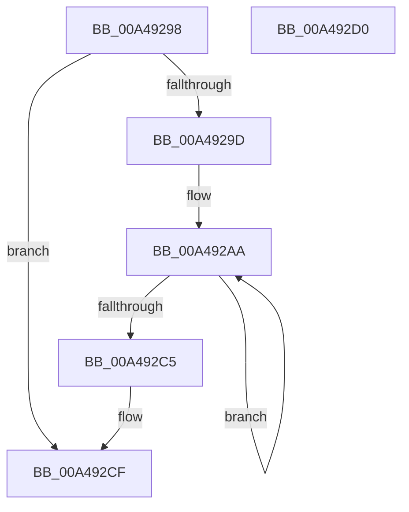

# CcMdlReadComplete2

- RVA: `0x00A49298`–`0x00A492D1` (길이 `57` bytes)
- VA: `0x0000000140A49298`
- 실행 섹션: `PAGE`
- PDB 이름 있음: `예`; PDB Function 태그: `아니요`
- unwind 정보 RVA: `0x00084918`
- 디코드: `19`개 명령, `57/57` bytes 표시
- 미해석 바이트: `0` (있으면 어셈블리에 `.byte`로 보존)

> 이 문서는 커널 이미지의 기계어와 PDB 기호를 분석해 생성했습니다. 4번과 5번은 함수 원형과 자료형을 바이너리 사용 방식에서 추정한 C 해석이며 원본 소스 복구 결과는 아닙니다.

## 1. Dependencies

- 직접 호출 지점: **2**; 고유 호출 대상: **2**
- 직접 호출자로 확인된 함수: **2**
- RIP 상대 이미지 참조: **0**

### Outgoing calls
- `0x00A492B0` → [MmUnlockPages](../../text/29/MmUnlockPages_function_0029EEE0.md) (function, `0x0029EEE0`)
- `0x00A492B8` → [IoFreeMdl](../../text/29/IoFreeMdl_function_0029EA80.md) (function, `0x0029EA80`)

### Direct callers
- [FsRtlMdlReadCompleteDev](../../text/49/FsRtlMdlReadCompleteDev_function_00499A50.md) at `0x00499A54`
- [CcMdlReadComplete](CcMdlReadComplete_function_00A49230.md) at `0x00A4928B`

### Static image references
- 디코드된 RIP-relative 메모리 참조가 없습니다.

## 2. Other-region calls and transfers

- 다른 실행 섹션으로 향하는 call: **2**
  - `0x00A492B0` → [MmUnlockPages](../../text/29/MmUnlockPages_function_0029EEE0.md) (`PAGE` → `.text`)
  - `0x00A492B8` → [IoFreeMdl](../../text/29/IoFreeMdl_function_0029EA80.md) (`PAGE` → `.text`)
- 별도 외부 분기/꼬리 이동을 확인하지 못했습니다.

## 3. Assembly (complete function range)

```asm
00A49298  48 85 D2                        test rdx, rdx
00A4929B  74 32                           je 0x140a492cf
00A4929D  48 89 5C 24 08                  mov qword ptr [rsp + 8], rbx
00A492A2  57                              push rdi
00A492A3  48 83 EC 20                     sub rsp, 0x20
00A492A7  48 8B FA                        mov rdi, rdx
00A492AA  48 8B 1F                        mov rbx, qword ptr [rdi]
00A492AD  48 8B CF                        mov rcx, rdi
00A492B0  E8 2B 5C 85 FF                  call 0x14029eee0
00A492B5  48 8B CF                        mov rcx, rdi
00A492B8  E8 C3 57 85 FF                  call 0x14029ea80
00A492BD  48 8B FB                        mov rdi, rbx
00A492C0  48 85 DB                        test rbx, rbx
00A492C3  75 E5                           jne 0x140a492aa
00A492C5  48 8B 5C 24 30                  mov rbx, qword ptr [rsp + 0x30]
00A492CA  48 83 C4 20                     add rsp, 0x20
00A492CE  5F                              pop rdi
00A492CF  C3                              ret
00A492D0  CC                              int3
```

## 4. C-style interpretation (structured pseudocode)

```c
__int64 __fastcall CcMdlReadComplete2(__int64 a1, __int64 a2)
{
    __int64 result;
    __int64 v_rsp;
    unsigned __int64 v_stack_p8;

    if (a2 == 0) goto loc_00A492CF;
    v_stack_p8 = v_rbx;
    v_rsp = (v_rsp) - (32);
loc_00A492AA:
    result = MmUnlockPages(a2, a2, a3, a4);
    result = IoFreeMdl(a2, a2, a3, a4);
    if (*(unsigned __int64 *)(a2) != 0) goto loc_00A492AA;
    v_rsp = (v_rsp) + (32);
loc_00A492CF:
    return result;
}
```

## 5. (Beta) C Style

```c
int64_t CcMdlReadComplete2(int64_t Arg1, int64_t Arg2)
{
    int64_t result;
    int64_t local_rsp;
    uint64_t v_stack_p8;

    if (Arg2 == 0) goto loc_00A492CF;
    v_stack_p8 = local_rbx;
    local_rsp = (local_rsp) - (32);
loc_00A492AA:
    result = MmUnlockPages(Arg2, Arg2, a3, a4);
    result = IoFreeMdl(Arg2, Arg2, a3, a4);
    if (*(uint64_t *)(Arg2) != 0) goto loc_00A492AA;
    local_rsp = (local_rsp) + (32);
loc_00A492CF:
    return result;
}
```

## 6. Execution-region graph

[열기: 2D/3D 그래프와 함수 탐색 컨트롤 패널](../../../control-panel.html?section=page&rva=0x00A49298&view=graph)

- 2D 그래프는 위에서 아래로 흐르고, 3D 그래프는 빈 공간을 드래그해 회전합니다. Shift+드래그는 이동, 휠은 확대·축소, 함수 노드 선택은 대상 보고서 이동입니다.

### Static fallback


