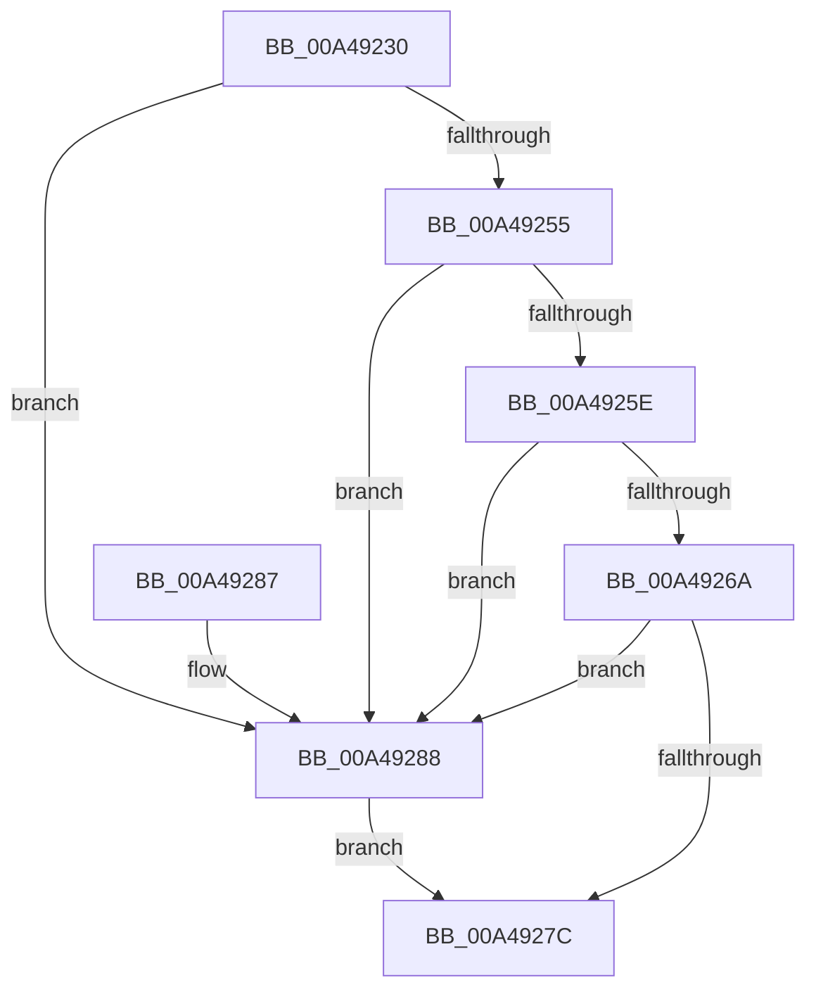

# CcMdlReadComplete

- RVA: `0x00A49230`–`0x00A49292` (길이 `98` bytes)
- VA: `0x0000000140A49230`
- 실행 섹션: `PAGE`
- PDB 이름 있음: `예`; PDB Function 태그: `아니요`
- unwind 정보 RVA: `0x0006B95C`
- 디코드: `30`개 명령, `98/98` bytes 표시
- 미해석 바이트: `0` (있으면 어셈블리에 `.byte`로 보존)

> 이 문서는 커널 이미지의 기계어와 PDB 기호를 분석해 생성했습니다. 4번과 5번은 함수 원형과 자료형을 바이너리 사용 방식에서 추정한 C 해석이며 원본 소스 복구 결과는 아닙니다.

## 1. Dependencies

- 직접 호출 지점: **3**; 고유 호출 대상: **3**
- 직접 호출자로 확인된 함수: **0**
- RIP 상대 이미지 참조: **0**

### Outgoing calls
- `0x00A49240` → [IoGetRelatedDeviceObject](../../text/29/IoGetRelatedDeviceObject_function_0029B120.md) (function, `0x0029B120`)
- `0x00A49273` → [guard_dispatch_icall](../../text/6B/guard_dispatch_icall_function_006BAAD0.md) (function, `0x006BAAD0`)
- `0x00A4928B` → [CcMdlReadComplete2](CcMdlReadComplete2_function_00A49298.md) (function, `0x00A49298`)

### Direct callers
- 이 함수 시작 RVA로 연결되는 직접 call은 확인되지 않았습니다. 간접 호출은 완전히 역산할 수 없습니다.

### Static image references
- 디코드된 RIP-relative 메모리 참조가 없습니다.

## 2. Other-region calls and transfers

- 다른 실행 섹션으로 향하는 call: **2**
  - `0x00A49240` → [IoGetRelatedDeviceObject](../../text/29/IoGetRelatedDeviceObject_function_0029B120.md) (`PAGE` → `.text`)
  - `0x00A49273` → [guard_dispatch_icall](../../text/6B/guard_dispatch_icall_function_006BAAD0.md) (`PAGE` → `.text`)
- 별도 외부 분기/꼬리 이동을 확인하지 못했습니다.

## 3. Assembly (complete function range)

```asm
00A49230  48 89 5C 24 08                  mov qword ptr [rsp + 8], rbx
00A49235  57                              push rdi
00A49236  48 83 EC 20                     sub rsp, 0x20
00A4923A  48 8B DA                        mov rbx, rdx
00A4923D  48 8B F9                        mov rdi, rcx
00A49240  E8 DB 1E 85 FF                  call 0x14029b120
00A49245  48 8B C8                        mov rcx, rax
00A49248  4C 8B 40 08                     mov r8, qword ptr [rax + 8]
00A4924C  4D 8B 48 50                     mov r9, qword ptr [r8 + 0x50]
00A49250  4D 85 C9                        test r9, r9
00A49253  74 33                           je 0x140a49288
00A49255  41 81 39 98 00 00 00            cmp dword ptr [r9], 0x98
00A4925C  76 2A                           jbe 0x140a49288
00A4925E  49 8B 81 88 00 00 00            mov rax, qword ptr [r9 + 0x88]
00A49265  48 85 C0                        test rax, rax
00A49268  74 1E                           je 0x140a49288
00A4926A  4C 8B C1                        mov r8, rcx
00A4926D  48 8B D3                        mov rdx, rbx
00A49270  48 8B CF                        mov rcx, rdi
00A49273  E8 58 18 C7 FF                  call 0x1406baad0
00A49278  84 C0                           test al, al
00A4927A  74 0C                           je 0x140a49288
00A4927C  48 8B 5C 24 30                  mov rbx, qword ptr [rsp + 0x30]
00A49281  48 83 C4 20                     add rsp, 0x20
00A49285  5F                              pop rdi
00A49286  C3                              ret
00A49287  CC                              int3
00A49288  48 8B D3                        mov rdx, rbx
00A4928B  E8 08 00 00 00                  call 0x140a49298
00A49290  EB EA                           jmp 0x140a4927c
```

## 4. C-style interpretation (structured pseudocode)

```c
__int64 __fastcall CcMdlReadComplete(__int64 a1, __int64 a2)
{
    __int64 result;
    __int64 v_rsp;
    unsigned __int64 v_stack_p8;

    v_stack_p8 = v_rbx;
    v_rsp = (v_rsp) - (32);
    result = IoGetRelatedDeviceObject(a1, a2, a3, a4);
    if (*(unsigned __int64 *)(*(unsigned __int64 *)(result + 8) + 80) == 0) goto loc_00A49288;
    if ((*(unsigned int *)(*(unsigned __int64 *)(*(unsigned __int64 *)(result + 8) + 80))) <= 152) goto loc_00A49288;
    if (*(unsigned __int64 *)(*(unsigned __int64 *)(*(unsigned __int64 *)(result + 8) + 80) + 136) == 0) goto loc_00A49288;
    result = guard_dispatch_icall(a1, a2, result, *(unsigned __int64 *)(*(unsigned __int64 *)(result + 8) + 80));
    if ((unsigned __int8)(result) == 0) goto loc_00A49288;
loc_00A4927C:
    v_rsp = (v_rsp) + (32);
    return result;
loc_00A49288:
    result = CcMdlReadComplete2(a1, v_stack_p8, result, *(unsigned __int64 *)(*(unsigned __int64 *)(result + 8) + 80));
    goto loc_00A4927C;
}
```

## 5. (Beta) C Style

```c
int64_t CcMdlReadComplete(int64_t Arg1, int64_t Arg2)
{
    int64_t result;
    int64_t local_rsp;
    uint64_t v_stack_p8;

    v_stack_p8 = local_rbx;
    local_rsp = (local_rsp) - (32);
    result = IoGetRelatedDeviceObject(Arg1, Arg2, a3, a4);
    if (*(uint64_t *)(*(uint64_t *)(result + 0x8) + 0x50) == 0) goto loc_00A49288;
    if ((*(uint32_t *)(*(uint64_t *)(*(uint64_t *)(result + 0x8) + 0x50))) <= 152) goto loc_00A49288;
    if (*(uint64_t *)(*(uint64_t *)(*(uint64_t *)(result + 0x8) + 0x50) + 0x88) == 0) goto loc_00A49288;
    result = guard_dispatch_icall(Arg1, Arg2, result, *(uint64_t *)(*(uint64_t *)(result + 0x8) + 0x50));
    if ((uint8_t)(result) == 0) goto loc_00A49288;
loc_00A4927C:
    local_rsp = (local_rsp) + (32);
    return result;
loc_00A49288:
    result = CcMdlReadComplete2(Arg1, v_stack_p8, result, *(uint64_t *)(*(uint64_t *)(result + 0x8) + 0x50));
    goto loc_00A4927C;
}
```

## 6. Execution-region graph

[열기: 2D/3D 그래프와 함수 탐색 컨트롤 패널](../../../control-panel.html?section=page&rva=0x00A49230&view=graph)

- 2D 그래프는 위에서 아래로 흐르고, 3D 그래프는 빈 공간을 드래그해 회전합니다. Shift+드래그는 이동, 휠은 확대·축소, 함수 노드 선택은 대상 보고서 이동입니다.

### Static fallback


