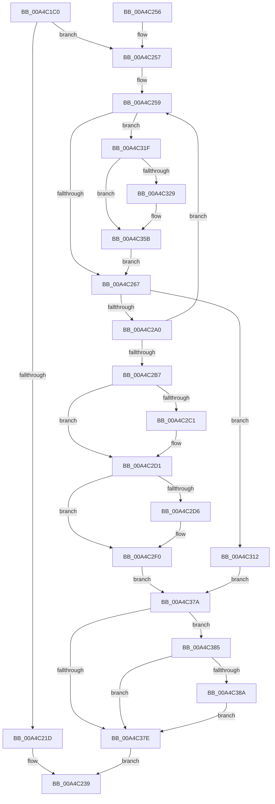

# CcPreparePinWrite

- RVA: `0x00A4C1C0`–`0x00A4C391` (길이 `465` bytes)
- VA: `0x0000000140A4C1C0`
- 실행 섹션: `PAGE`
- PDB 이름 있음: `예`; PDB Function 태그: `아니요`
- unwind 정보 RVA: `0x000B03A4`
- 디코드: `120`개 명령, `465/465` bytes 표시
- 미해석 바이트: `0` (있으면 어셈블리에 `.byte`로 보존)

> 이 문서는 커널 이미지의 기계어와 PDB 기호를 분석해 생성했습니다. 4번과 5번은 함수 원형과 자료형을 바이너리 사용 방식에서 추정한 C 해석이며 원본 소스 복구 결과는 아닙니다.

## 1. Dependencies

- 직접 호출 지점: **6**; 고유 호출 대상: **6**
- 직접 호출자로 확인된 함수: **0**
- RIP 상대 이미지 참조: **0**

### Outgoing calls
- `0x00A4C232` → [CcMapDataForOverwrite](../../text/46/CcMapDataForOverwrite_function_00466160.md) (function, `0x00466160`)
- `0x00A4C297` → [CcPinFileData](../../text/33/CcPinFileData_function_0033FB40.md) (function, `0x0033FB40`)
- `0x00A4C2EB` → [memset](../../text/6C/memset_function_006C6C40.md) (function, `0x006C6C40`)
- `0x00A4C2F7` → [CcSetDirtyPinnedData](../../text/35/CcSetDirtyPinnedData_function_0035A120.md) (function, `0x0035A120`)
- `0x00A4C32E` → [CcAllocateObcb](../71/CcAllocateObcb_function_0071031C.md) (function, `0x0071031C`)
- `0x00A4C38A` → [CcUnpinData](../9A/CcUnpinData_function_009A7A80.md) (function, `0x009A7A80`)

### Direct callers
- 이 함수 시작 RVA로 연결되는 직접 call은 확인되지 않았습니다. 간접 호출은 완전히 역산할 수 없습니다.

### Static image references
- 디코드된 RIP-relative 메모리 참조가 없습니다.

## 2. Other-region calls and transfers

- 다른 실행 섹션으로 향하는 call: **4**
  - `0x00A4C232` → [CcMapDataForOverwrite](../../text/46/CcMapDataForOverwrite_function_00466160.md) (`PAGE` → `.text`)
  - `0x00A4C297` → [CcPinFileData](../../text/33/CcPinFileData_function_0033FB40.md) (`PAGE` → `.text`)
  - `0x00A4C2EB` → [memset](../../text/6C/memset_function_006C6C40.md) (`PAGE` → `.text`)
  - `0x00A4C2F7` → [CcSetDirtyPinnedData](../../text/35/CcSetDirtyPinnedData_function_0035A120.md) (`PAGE` → `.text`)
- 별도 외부 분기/꼬리 이동을 확인하지 못했습니다.

## 3. Assembly (complete function range)

```asm
00A4C1C0  4C 8B DC                        mov r11, rsp
00A4C1C3  49 89 5B 08                     mov qword ptr [r11 + 8], rbx
00A4C1C7  49 89 73 20                     mov qword ptr [r11 + 0x20], rsi
00A4C1CB  57                              push rdi
00A4C1CC  41 54                           push r12
00A4C1CE  41 55                           push r13
00A4C1D0  41 56                           push r14
00A4C1D2  41 57                           push r15
00A4C1D4  48 81 EC 80 00 00 00            sub rsp, 0x80
00A4C1DB  45 8A E1                        mov r12b, r9b
00A4C1DE  41 8B F8                        mov edi, r8d
00A4C1E1  4C 8B F2                        mov r14, rdx
00A4C1E4  4C 8B F9                        mov r15, rcx
00A4C1E7  49 83 63 C8 00                  and qword ptr [r11 - 0x38], 0
00A4C1EC  45 33 D2                        xor r10d, r10d
00A4C1EF  4D 89 53 C0                     mov qword ptr [r11 - 0x40], r10
00A4C1F3  48 8B 02                        mov rax, qword ptr [rdx]
00A4C1F6  48 89 44 24 60                  mov qword ptr [rsp + 0x60], rax
00A4C1FB  4D 21 53 B0                     and qword ptr [r11 - 0x50], r10
00A4C1FF  49 8D 73 B0                     lea rsi, [r11 - 0x50]
00A4C203  44 89 84 24 B8 00 00 00         mov dword ptr [rsp + 0xb8], r8d
00A4C20B  45 88 53 A8                     mov byte ptr [r11 - 0x58], r10b
00A4C20F  44 8B AC 24 D0 00 00 00         mov r13d, dword ptr [rsp + 0xd0]
00A4C217  41 F6 C5 20                     test r13b, 0x20
00A4C21B  74 3A                           je 0x140a4c257
00A4C21D  48 8B 84 24 E0 00 00 00         mov rax, qword ptr [rsp + 0xe0]
00A4C225  48 89 44 24 20                  mov qword ptr [rsp + 0x20], rax
00A4C22A  4C 8B 8C 24 D8 00 00 00         mov r9, qword ptr [rsp + 0xd8]
00A4C232  E8 29 9F A1 FF                  call 0x140466160
00A4C237  B0 01                           mov al, 1
00A4C239  4C 8D 9C 24 80 00 00 00         lea r11, [rsp + 0x80]
00A4C241  49 8B 5B 30                     mov rbx, qword ptr [r11 + 0x30]
00A4C245  49 8B 73 48                     mov rsi, qword ptr [r11 + 0x48]
00A4C249  49 8B E3                        mov rsp, r11
00A4C24C  41 5F                           pop r15
00A4C24E  41 5E                           pop r14
00A4C250  41 5D                           pop r13
00A4C252  41 5C                           pop r12
00A4C254  5F                              pop rdi
00A4C255  C3                              ret
00A4C256  CC                              int3
00A4C257  B3 01                           mov bl, 1
00A4C259  4C 8B 44 24 58                  mov r8, qword ptr [rsp + 0x58]
00A4C25E  4D 85 C0                        test r8, r8
00A4C261  0F 85 B8 00 00 00               jne 0x140a4c31f
00A4C267  48 8D 44 24 68                  lea rax, [rsp + 0x68]
00A4C26C  48 89 44 24 40                  mov qword ptr [rsp + 0x40], rax
00A4C271  48 8D 44 24 70                  lea rax, [rsp + 0x70]
00A4C276  48 89 44 24 38                  mov qword ptr [rsp + 0x38], rax
00A4C27B  48 89 74 24 30                  mov qword ptr [rsp + 0x30], rsi
00A4C280  44 89 6C 24 28                  mov dword ptr [rsp + 0x28], r13d
00A4C285  88 5C 24 20                     mov byte ptr [rsp + 0x20], bl
00A4C289  45 33 C9                        xor r9d, r9d
00A4C28C  44 8B C7                        mov r8d, edi
00A4C28F  48 8D 54 24 60                  lea rdx, [rsp + 0x60]
00A4C294  49 8B CF                        mov rcx, r15
00A4C297  E8 A4 38 8F FF                  call 0x14033fb40
00A4C29C  84 C0                           test al, al
00A4C29E  74 72                           je 0x140a4c312
00A4C2A0  4C 8B 54 24 68                  mov r10, qword ptr [rsp + 0x68]
00A4C2A5  49 8B D2                        mov rdx, r10
00A4C2A8  48 8B 44 24 60                  mov rax, qword ptr [rsp + 0x60]
00A4C2AD  48 2B D0                        sub rdx, rax
00A4C2B0  8B CF                           mov ecx, edi
00A4C2B2  48 3B D1                        cmp rdx, rcx
00A4C2B5  7C A2                           jl 0x140a4c259
00A4C2B7  48 8D 44 24 58                  lea rax, [rsp + 0x58]
00A4C2BC  48 3B F0                        cmp rsi, rax
00A4C2BF  75 10                           jne 0x140a4c2d1
00A4C2C1  48 8B 4C 24 70                  mov rcx, qword ptr [rsp + 0x70]
00A4C2C6  48 8B 84 24 E0 00 00 00         mov rax, qword ptr [rsp + 0xe0]
00A4C2CE  48 89 08                        mov qword ptr [rax], rcx
00A4C2D1  45 84 E4                        test r12b, r12b
00A4C2D4  74 1A                           je 0x140a4c2f0
00A4C2D6  44 8B 84 24 B8 00 00 00         mov r8d, dword ptr [rsp + 0xb8]
00A4C2DE  33 D2                           xor edx, edx
00A4C2E0  48 8B 8C 24 E0 00 00 00         mov rcx, qword ptr [rsp + 0xe0]
00A4C2E8  48 8B 09                        mov rcx, qword ptr [rcx]
00A4C2EB  E8 50 A9 C7 FF                  call 0x1406c6c40
00A4C2F0  33 D2                           xor edx, edx
00A4C2F2  48 8B 4C 24 58                  mov rcx, qword ptr [rsp + 0x58]
00A4C2F7  E8 24 DE 90 FF                  call 0x14035a120
00A4C2FC  48 8B 4C 24 58                  mov rcx, qword ptr [rsp + 0x58]
00A4C301  48 8B 84 24 D8 00 00 00         mov rax, qword ptr [rsp + 0xd8]
00A4C309  48 89 08                        mov qword ptr [rax], rcx
00A4C30C  88 5C 24 50                     mov byte ptr [rsp + 0x50], bl
00A4C310  EB 68                           jmp 0x140a4c37a
00A4C312  32 DB                           xor bl, bl
00A4C314  88 5C 24 50                     mov byte ptr [rsp + 0x50], bl
00A4C318  48 8B 4C 24 58                  mov rcx, qword ptr [rsp + 0x58]
00A4C31D  EB 5B                           jmp 0x140a4c37a
00A4C31F  48 8D 4C 24 58                  lea rcx, [rsp + 0x58]
00A4C324  48 3B F1                        cmp rsi, rcx
00A4C327  75 32                           jne 0x140a4c35b
00A4C329  8B D7                           mov edx, edi
00A4C32B  49 8B CE                        mov rcx, r14
00A4C32E  E8 E9 3F CC FF                  call 0x14071031c
00A4C333  48 89 44 24 58                  mov qword ptr [rsp + 0x58], rax
00A4C338  48 8D 70 10                     lea rsi, [rax + 0x10]
00A4C33C  48 89 74 24 78                  mov qword ptr [rsp + 0x78], rsi
00A4C341  48 8B 4C 24 70                  mov rcx, qword ptr [rsp + 0x70]
00A4C346  48 8B 84 24 E0 00 00 00         mov rax, qword ptr [rsp + 0xe0]
00A4C34E  48 89 08                        mov qword ptr [rax], rcx
00A4C351  4C 8B 54 24 68                  mov r10, qword ptr [rsp + 0x68]
00A4C356  48 8B 44 24 60                  mov rax, qword ptr [rsp + 0x60]
00A4C35B  41 2B C2                        sub eax, r10d
00A4C35E  03 F8                           add edi, eax
00A4C360  89 BC 24 C0 00 00 00            mov dword ptr [rsp + 0xc0], edi
00A4C367  4C 89 54 24 60                  mov qword ptr [rsp + 0x60], r10
00A4C36C  48 83 C6 08                     add rsi, 8
00A4C370  48 89 74 24 78                  mov qword ptr [rsp + 0x78], rsi
00A4C375  E9 ED FE FF FF                  jmp 0x140a4c267
00A4C37A  84 DB                           test bl, bl
00A4C37C  74 07                           je 0x140a4c385
00A4C37E  8A C3                           mov al, bl
00A4C380  E9 B4 FE FF FF                  jmp 0x140a4c239
00A4C385  48 85 C9                        test rcx, rcx
00A4C388  74 F4                           je 0x140a4c37e
00A4C38A  E8 F1 B6 F5 FF                  call 0x1409a7a80
00A4C38F  EB ED                           jmp 0x140a4c37e
```

## 4. C-style interpretation (structured pseudocode)

```c
__int64 __fastcall CcPreparePinWrite(__int64 a1, __int64 a2, int a3, unsigned __int8 a4, unsigned int a5, __int64 a6, __int64 a7)
{
    __int64 result;
    __int64 v_r10;
    __int64 v_rbx;
    __int64 v_rdi;
    __int64 v_rsi;
    __int64 v_rsp;
    unsigned __int64 v_stack_m10;
    unsigned __int64 v_stack_m18;
    unsigned __int64 v_stack_m20;
    unsigned __int64 v_stack_m28;
    unsigned __int8 v_stack_m30;
    unsigned __int64 v_stack_m40;
    unsigned __int64 v_stack_m48;
    unsigned __int64 v_stack_m50;
    unsigned int v_stack_m58;
    unsigned __int8 v_stack_m60;
    unsigned __int64 v_stack_m8;
    unsigned __int64 v_stack_m88;
    unsigned int v_stack_p10;
    unsigned int v_stack_p38;
    unsigned int v_stack_p40;

    *(unsigned __int64 *)(v_rsp + 8) = v_rbx;
    *(unsigned __int64 *)(v_rsp + 32) = v_rsi;
    v_rsp = (v_rsp) - (128);
    v_r10 = 0;
    *(unsigned __int64 *)(v_rsp - 64) = 0;
    v_stack_m48 = *(unsigned __int64 *)(a2);
    v_stack_p10 = a3;
    *(unsigned __int8 *)(v_rsp - 88) = 0;
    if ((((unsigned __int8)((unsigned int)(a5))) & (32)) == 0) goto loc_00A4C257;
    v_stack_m88 = a7;
    result = CcMapDataForOverwrite(a1, a2, a3, a6);
loc_00A4C239:
    return 1;
loc_00A4C257:
loc_00A4C259:
    if (v_stack_m28 != 0) goto loc_00A4C31F;
loc_00A4C267:
    v_stack_m40 = v_stack_m18;
    v_stack_m48 = v_stack_m10;
    v_stack_m50 = *(unsigned __int64 *)(v_stack_m28 + 72);
    v_stack_m58 = (unsigned int)((unsigned int)(a5));
    v_stack_m60 = 1;
    a4 = 0;
    result = CcPinFileData(a1, v_stack_m20, (unsigned int)((unsigned int)((unsigned int)(a3))), a4);
    if ((unsigned __int8)(result) == 0) goto loc_00A4C312;
    a2 = (v_stack_m18) - (v_stack_m20);
    if (a2 < ((unsigned int)((unsigned int)((unsigned int)(a3))))) goto loc_00A4C259;
    result = v_stack_m28;
    if ((*(unsigned __int64 *)(v_stack_m28 + 72)) == v_stack_m28) {
        a1 = v_stack_m10;
        result = a7;
        *(unsigned __int64 *)(result) = a1;
    }
    if (0 != 0) {
        a3 = v_stack_p38;
        a2 = 0;
        a1 = a7;
        a1 = *(unsigned __int64 *)(a1);
        result = memset(a1, a2, a3, a4);
    }
    a2 = 0;
    result = CcSetDirtyPinnedData(v_stack_m28, a2, a3, a4);
    *(unsigned __int64 *)(a6) = v_stack_m28;
    v_stack_m30 = 1;
    goto loc_00A4C37A;
loc_00A4C312:
    v_rbx = 0;
    v_stack_m30 = 0;
    goto loc_00A4C37A;
loc_00A4C31F:
    result = a6;
    v_rsi = *(unsigned __int64 *)(v_stack_m28 + 72);
    v_r10 = v_stack_m18;
    if ((*(unsigned __int64 *)(v_stack_m28 + 72)) == v_stack_m28) {
        a2 = (unsigned int)((unsigned int)(a3));
        a1 = a2;
        result = CcAllocateObcb(a1, a2, a3, a4);
        v_stack_m28 = result;
        v_rsi = result + 16;
        v_stack_m8 = v_rsi;
        a1 = v_stack_m10;
        result = a7;
        *(unsigned __int64 *)(result) = a1;
        v_r10 = v_stack_m18;
        result = v_stack_m20;
    }
    result = (unsigned int)((result) - ((unsigned int)(v_r10)));
    v_rdi = (unsigned int)(((unsigned int)(a3)) + ((unsigned int)(result)));
    v_stack_p40 = (unsigned int)(v_rdi);
    v_stack_m20 = v_r10;
    v_rsi = (v_rsi) + (8);
    v_stack_m8 = v_rsi;
    goto loc_00A4C267;
loc_00A4C37A:
    if (0 == 0) goto loc_00A4C385;
loc_00A4C37E:
    goto loc_00A4C239;
loc_00A4C385:
    if (a1 == 0) goto loc_00A4C37E;
    result = CcUnpinData(a1, a2, a3, a4);
    goto loc_00A4C37E;
}
```

## 5. (Beta) C Style

```c
int64_t CcPreparePinWrite(int64_t Arg1, void *Arg2, int32_t Arg3, uint8_t Arg4, uint32_t Arg5, void *Arg6, void *Arg7)
{
    uint8_t *arg2 = (uint8_t *)Arg2;
    uint8_t *arg6 = (uint8_t *)Arg6;
    uint8_t *arg7 = (uint8_t *)Arg7;

    int64_t result;
    int64_t local_r10;
    int64_t local_rbx;
    int64_t local_rdi;
    int64_t local_rsi;
    int64_t local_rsp;
    uint64_t v_stack_m10;
    uint64_t v_stack_m18;
    uint64_t v_stack_m20;
    uint64_t v_stack_m28;
    uint8_t v_stack_m30;
    uint64_t v_stack_m40;
    uint64_t v_stack_m48;
    uint64_t v_stack_m50;
    uint32_t v_stack_m58;
    uint8_t v_stack_m60;
    uint64_t v_stack_m8;
    uint64_t v_stack_m88;
    uint32_t v_stack_p10;
    uint32_t v_stack_p38;
    uint32_t v_stack_p40;

    *(uint64_t *)(local_rsp + 0x8) = local_rbx;
    *(uint64_t *)(local_rsp + 0x20) = local_rsi;
    local_rsp = (local_rsp) - (128);
    local_r10 = 0;
    *(uint64_t *)(local_rsp - 0x40) = 0;
    v_stack_m48 = *(uint64_t *)(arg2);
    v_stack_p10 = Arg3;
    *(uint8_t *)(local_rsp - 0x58) = 0;
    if ((((uint8_t)((uint32_t)(Arg5))) & (32)) == 0) goto loc_00A4C257;
    v_stack_m88 = Arg7;
    result = CcMapDataForOverwrite(Arg1, Arg2, Arg3, Arg6);
loc_00A4C239:
    return 1;
loc_00A4C257:
loc_00A4C259:
    if (v_stack_m28 != 0) goto loc_00A4C31F;
loc_00A4C267:
    v_stack_m40 = v_stack_m18;
    v_stack_m48 = v_stack_m10;
    v_stack_m50 = *(uint64_t *)(v_stack_m28 + 0x48);
    v_stack_m58 = (uint32_t)((uint32_t)(Arg5));
    v_stack_m60 = 1;
    Arg4 = 0;
    result = CcPinFileData(Arg1, v_stack_m20, (uint32_t)((uint32_t)((uint32_t)(Arg3))), Arg4);
    if ((uint8_t)(result) == 0) goto loc_00A4C312;
    Arg2 = (v_stack_m18) - (v_stack_m20);
    if (Arg2 < ((uint32_t)((uint32_t)((uint32_t)(Arg3))))) goto loc_00A4C259;
    result = v_stack_m28;
    if ((*(uint64_t *)(v_stack_m28 + 0x48)) == v_stack_m28) {
        Arg1 = v_stack_m10;
        result = Arg7;
        *(uint64_t *)(result) = Arg1;
    }
    if (0 != 0) {
        Arg3 = v_stack_p38;
        Arg2 = 0;
        Arg1 = Arg7;
        Arg1 = *(uint64_t *)(Arg1);
        result = memset(Arg1, Arg2, Arg3, Arg4);
    }
    Arg2 = 0;
    result = CcSetDirtyPinnedData(v_stack_m28, Arg2, Arg3, Arg4);
    *(uint64_t *)(arg6) = v_stack_m28;
    v_stack_m30 = 1;
    goto loc_00A4C37A;
loc_00A4C312:
    local_rbx = 0;
    v_stack_m30 = 0;
    goto loc_00A4C37A;
loc_00A4C31F:
    result = Arg6;
    local_rsi = *(uint64_t *)(v_stack_m28 + 0x48);
    local_r10 = v_stack_m18;
    if ((*(uint64_t *)(v_stack_m28 + 0x48)) == v_stack_m28) {
        Arg2 = (uint32_t)((uint32_t)(Arg3));
        Arg1 = Arg2;
        result = CcAllocateObcb(Arg1, Arg2, Arg3, Arg4);
        v_stack_m28 = result;
        local_rsi = result + 16;
        v_stack_m8 = local_rsi;
        Arg1 = v_stack_m10;
        result = Arg7;
        *(uint64_t *)(result) = Arg1;
        local_r10 = v_stack_m18;
        result = v_stack_m20;
    }
    result = (uint32_t)((result) - ((uint32_t)(local_r10)));
    local_rdi = (uint32_t)(((uint32_t)(Arg3)) + ((uint32_t)(result)));
    v_stack_p40 = (uint32_t)(local_rdi);
    v_stack_m20 = local_r10;
    local_rsi = (local_rsi) + (8);
    v_stack_m8 = local_rsi;
    goto loc_00A4C267;
loc_00A4C37A:
    if (0 == 0) goto loc_00A4C385;
loc_00A4C37E:
    goto loc_00A4C239;
loc_00A4C385:
    if (Arg1 == 0) goto loc_00A4C37E;
    result = CcUnpinData(Arg1, Arg2, Arg3, Arg4);
    goto loc_00A4C37E;
}
```

### 관측된 메모리 오프셋

구조체 형식이 확인되지 않은 접근은 인자 기준의 오프셋으로만 기록했습니다.

| 기준 인자 | 오프셋 표현 | 폭 (bit) | 접근 |
|---|---:|---:|---|
| `Arg2` | `+ 0x0` | `64` | `R` |
| `Arg6` | `+ 0x0` | `64` | `W` |
| `Arg7` | `+ 0x0` | `64` | `R` |
| `Arg7` | `+ 0x0` | `64` | `W` |

## 6. Execution-region graph

[열기: 2D/3D 그래프와 함수 탐색 컨트롤 패널](../../../control-panel.html?section=page&rva=0x00A4C1C0&view=graph)

- 2D 그래프는 위에서 아래로 흐르고, 3D 그래프는 빈 공간을 드래그해 회전합니다. Shift+드래그는 이동, 휠은 확대·축소, 함수 노드 선택은 대상 보고서 이동입니다.

### Static fallback


