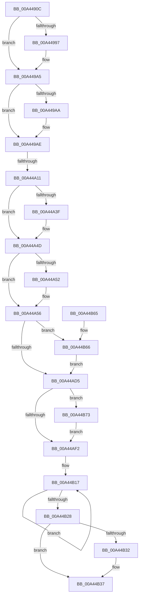

# CmFcManagerUpdateFeatureUsageSubscriptions

- RVA: `0x00A4490C`–`0x00A44B84` (길이 `632` bytes)
- VA: `0x0000000140A4490C`
- 실행 섹션: `PAGE`
- PDB 이름 있음: `예`; PDB Function 태그: `예`
- unwind 정보 RVA: `0x000AF234`
- 디코드: `152`개 명령, `632/632` bytes 표시
- 미해석 바이트: `0` (있으면 어셈블리에 `.byte`로 보존)

> 이 문서는 커널 이미지의 기계어와 PDB 기호를 분석해 생성했습니다. 4번과 5번은 함수 원형과 자료형을 바이너리 사용 방식에서 추정한 C 해석이며 원본 소스 복구 결과는 아닙니다.

## 1. Dependencies

- 직접 호출 지점: **20**; 고유 호출 대상: **15**
- 직접 호출자로 확인된 함수: **1**
- RIP 상대 이미지 참조: **12**

### Outgoing calls
- `0x00A4495E` → [memset](../../text/6C/memset_function_006C6C40.md) (function, `0x006C6C40`)
- `0x00A44987` → [KeAbPreAcquire](../../text/21/KeAbPreAcquire_function_00210230.md) (function, `0x00210230`)
- `0x00A449A0` → [ExfAcquirePushLockExclusiveEx](../../text/20/ExfAcquirePushLockExclusiveEx_function_0020FC90.md) (function, `0x0020FC90`)
- `0x00A449BF` → [RtlpFcBufferManagerReferenceBuffers](../../text/4A/RtlpFcBufferManagerReferenceBuffers_function_004A73B8.md) (function, `0x004A73B8`)
- `0x00A44A02` → [RtlpFcUpdateUsageTriggers](RtlpFcUpdateUsageTriggers_function_00A44BB0.md) (function, `0x00A44BB0`)
- `0x00A44A1B` → [RtlpFcBufferManagerDereferenceBuffers](../../text/37/RtlpFcBufferManagerDereferenceBuffers_function_00378D84.md) (function, `0x00378D84`)
- `0x00A44A2F` → [KeAbPreAcquire](../../text/21/KeAbPreAcquire_function_00210230.md) (function, `0x00210230`)
- `0x00A44A48` → [ExfAcquirePushLockExclusiveEx](../../text/20/ExfAcquirePushLockExclusiveEx_function_0020FC90.md) (function, `0x0020FC90`)
- `0x00A44A95` → [RtlpFcBufferManagerUpdateBuffers](RtlpFcBufferManagerUpdateBuffers_function_00A44DB0.md) (function, `0x00A44DB0`)
- `0x00A44AA4` → [RtlpFcWriteHighLowHigh](../../text/4C/RtlpFcWriteHighLowHigh_function_004C84BC.md) (function, `0x004C84BC`)
- `0x00A44ABA` → [RtlpFcWriteHighLowHigh](../../text/4C/RtlpFcWriteHighLowHigh_function_004C84BC.md) (function, `0x004C84BC`)
- `0x00A44AD8` → [KeAbPostRelease](../../text/2E/KeAbPostRelease_function_002E1600.md) (function, `0x002E1600`)
- `0x00A44AF9` → [KeAbPostRelease](../../text/2E/KeAbPostRelease_function_002E1600.md) (function, `0x002E1600`)
- `0x00A44B01` → [CmFcpManagerPublishChangeNotifications](CmFcpManagerPublishChangeNotifications_function_00A44E94.md) (function, `0x00A44E94`)
- `0x00A44B1A` → [CmFcpUnmapSection](CmFcpUnmapSection_function_00A44B8C.md) (function, `0x00A44B8C`)
- `0x00A44B32` → [ObfDereferenceObject](../../text/2F/ObfDereferenceObject_function_002F9350.md) (function, `0x002F9350`)
- `0x00A44B37` → [KeLeaveCriticalRegion](../../text/25/KeLeaveCriticalRegion_function_0025D8B0.md) (function, `0x0025D8B0`)
- `0x00A44B45` → [_security_check_cookie](../../text/6A/_security_check_cookie_function_006AC640.md) (function, `0x006AC640`)
- `0x00A44B69` → [ExfTryToWakePushLock](../../text/26/ExfTryToWakePushLock_function_00265DD0.md) (function, `0x00265DD0`)
- `0x00A44B7A` → [ExfTryToWakePushLock](../../text/26/ExfTryToWakePushLock_function_00265DD0.md) (function, `0x00265DD0`)

### Direct callers
- [CmUpdateFeatureUsageSubscription](../7E/CmUpdateFeatureUsageSubscription_function_007E5E78.md) at `0x007E5F7D`

### Static image references
- `0x00A44928` → RVA `0x00E0A740` (`.data`; read)
- `0x00A4496C` → RVA `0x00EF72F0` (`.data`; read)
- `0x00A449B8` → RVA `0x00EF7368` (`.data`; read)
- `0x00A44A20` → RVA `0x00EF72E8` (`.data`; read)
- `0x00A44A56` → RVA `0x00EF7340` (`.data`; read)
- `0x00A44A6A` → RVA `0x00EF7338` (`.data`; write)
- `0x00A44A76` → RVA `0x00EF7340` (`.data`; write)
- `0x00A44A8E` → RVA `0x00EF7348` (`.data`; write)
- `0x00A44A9D` → RVA `0x00EF72F8` (`.data`; read)
- `0x00A44AA9` → RVA `0x00FC5008` (`ALMOSTRO`; read)
- `0x00A44AC2` → RVA `0x00EF72E8` (`.data`; read/write)
- `0x00A44ADD` → RVA `0x00EF72F0` (`.data`; read/write)

## 2. Other-region calls and transfers

- 다른 실행 섹션으로 향하는 call: **16**
  - `0x00A4495E` → [memset](../../text/6C/memset_function_006C6C40.md) (`PAGE` → `.text`)
  - `0x00A44987` → [KeAbPreAcquire](../../text/21/KeAbPreAcquire_function_00210230.md) (`PAGE` → `.text`)
  - `0x00A449A0` → [ExfAcquirePushLockExclusiveEx](../../text/20/ExfAcquirePushLockExclusiveEx_function_0020FC90.md) (`PAGE` → `.text`)
  - `0x00A449BF` → [RtlpFcBufferManagerReferenceBuffers](../../text/4A/RtlpFcBufferManagerReferenceBuffers_function_004A73B8.md) (`PAGE` → `.text`)
  - `0x00A44A1B` → [RtlpFcBufferManagerDereferenceBuffers](../../text/37/RtlpFcBufferManagerDereferenceBuffers_function_00378D84.md) (`PAGE` → `.text`)
  - `0x00A44A2F` → [KeAbPreAcquire](../../text/21/KeAbPreAcquire_function_00210230.md) (`PAGE` → `.text`)
  - `0x00A44A48` → [ExfAcquirePushLockExclusiveEx](../../text/20/ExfAcquirePushLockExclusiveEx_function_0020FC90.md) (`PAGE` → `.text`)
  - `0x00A44AA4` → [RtlpFcWriteHighLowHigh](../../text/4C/RtlpFcWriteHighLowHigh_function_004C84BC.md) (`PAGE` → `.text`)
  - `0x00A44ABA` → [RtlpFcWriteHighLowHigh](../../text/4C/RtlpFcWriteHighLowHigh_function_004C84BC.md) (`PAGE` → `.text`)
  - `0x00A44AD8` → [KeAbPostRelease](../../text/2E/KeAbPostRelease_function_002E1600.md) (`PAGE` → `.text`)
  - `0x00A44AF9` → [KeAbPostRelease](../../text/2E/KeAbPostRelease_function_002E1600.md) (`PAGE` → `.text`)
  - `0x00A44B32` → [ObfDereferenceObject](../../text/2F/ObfDereferenceObject_function_002F9350.md) (`PAGE` → `.text`)
  - `0x00A44B37` → [KeLeaveCriticalRegion](../../text/25/KeLeaveCriticalRegion_function_0025D8B0.md) (`PAGE` → `.text`)
  - `0x00A44B45` → [_security_check_cookie](../../text/6A/_security_check_cookie_function_006AC640.md) (`PAGE` → `.text`)
  - `0x00A44B69` → [ExfTryToWakePushLock](../../text/26/ExfTryToWakePushLock_function_00265DD0.md) (`PAGE` → `.text`)
  - `0x00A44B7A` → [ExfTryToWakePushLock](../../text/26/ExfTryToWakePushLock_function_00265DD0.md) (`PAGE` → `.text`)
- call이 아닌 외부 분기/꼬리 이동: **1**
  - `0x00A44A0B` → [sub_00B3AEBA](../B3/Unknown_function_00B3AEBA.md) (`tail-transfer`)

## 3. Assembly (complete function range)

```asm
00A4490C  48 89 5C 24 08                  mov qword ptr [rsp + 8], rbx
00A44911  55                              push rbp
00A44912  56                              push rsi
00A44913  57                              push rdi
00A44914  41 54                           push r12
00A44916  41 55                           push r13
00A44918  41 56                           push r14
00A4491A  41 57                           push r15
00A4491C  48 8D 6C 24 F0                  lea rbp, [rsp - 0x10]
00A44921  48 81 EC 10 01 00 00            sub rsp, 0x110
00A44928  48 8B 05 11 5E 3C 00            mov rax, qword ptr [rip + 0x3c5e11]
00A4492F  48 33 C4                        xor rax, rsp
00A44932  48 89 45 00                     mov qword ptr [rbp], rax
00A44936  45 33 ED                        xor r13d, r13d
00A44939  45 8B F8                        mov r15d, r8d
00A4493C  4C 8B E2                        mov r12, rdx
00A4493F  4C 89 6C 24 50                  mov qword ptr [rsp + 0x50], r13
00A44944  33 D2                           xor edx, edx
00A44946  4C 89 6C 24 30                  mov qword ptr [rsp + 0x30], r13
00A4494B  48 8D 4C 24 70                  lea rcx, [rsp + 0x70]
00A44950  4C 89 6C 24 40                  mov qword ptr [rsp + 0x40], r13
00A44955  45 8D 45 60                     lea r8d, [r13 + 0x60]
00A44959  4C 89 6C 24 48                  mov qword ptr [rsp + 0x48], r13
00A4495E  E8 DD 22 C8 FF                  call 0x1406c6c40
00A44963  65 48 8B 04 25 88 01 00 00      mov rax, qword ptr gs:[0x188]
00A4496C  48 8D 35 7D 29 4B 00            lea rsi, [rip + 0x4b297d]
00A44973  48 83 CB FF                     or rbx, 0xffffffffffffffff
00A44977  45 33 C0                        xor r8d, r8d
00A4497A  33 D2                           xor edx, edx
00A4497C  48 8B CE                        mov rcx, rsi
00A4497F  66 01 98 E4 01 00 00            add word ptr [rax + 0x1e4], bx
00A44986  90                              nop
00A44987  E8 A4 B8 7C FF                  call 0x140210230
00A4498C  F0 48 0F BA 2E 00               lock bts qword ptr [rsi], 0
00A44992  48 8B F8                        mov rdi, rax
00A44995  73 0E                           jae 0x140a449a5
00A44997  4C 8B C6                        mov r8, rsi
00A4499A  48 8B D0                        mov rdx, rax
00A4499D  48 8B CE                        mov rcx, rsi
00A449A0  E8 EB B2 7C FF                  call 0x14020fc90
00A449A5  48 85 FF                        test rdi, rdi
00A449A8  74 04                           je 0x140a449ae
00A449AA  C6 47 0A 01                     mov byte ptr [rdi + 0xa], 1
00A449AE  4C 8D 44 24 30                  lea r8, [rsp + 0x30]
00A449B3  48 8D 54 24 50                  lea rdx, [rsp + 0x50]
00A449B8  48 8D 0D A9 29 4B 00            lea rcx, [rip + 0x4b29a9]
00A449BF  E8 F4 29 A6 FF                  call 0x1404a73b8
00A449C4  48 8B 74 24 50                  mov rsi, qword ptr [rsp + 0x50]
00A449C9  B8 01 00 00 00                  mov eax, 1
00A449CE  4C 8B 74 24 30                  mov r14, qword ptr [rsp + 0x30]
00A449D3  48 83 C6 01                     add rsi, 1
00A449D7  4D 8B CF                        mov r9, r15
00A449DA  4C 89 6C 24 58                  mov qword ptr [rsp + 0x58], r13
00A449DF  48 0F 44 F0                     cmove rsi, rax
00A449E3  4D 8B C4                        mov r8, r12
00A449E6  48 8D 44 24 58                  lea rax, [rsp + 0x58]
00A449EB  48 89 74 24 38                  mov qword ptr [rsp + 0x38], rsi
00A449F0  49 8B 4E 38                     mov rcx, qword ptr [r14 + 0x38]
00A449F4  48 89 44 24 28                  mov qword ptr [rsp + 0x28], rax
00A449F9  4C 89 6C 24 20                  mov qword ptr [rsp + 0x20], r13
00A449FE  48 89 75 A0                     mov qword ptr [rbp - 0x60], rsi
00A44A02  E8 A9 01 00 00                  call 0x140a44bb0
00A44A07  8B F8                           mov edi, eax
00A44A09  85 C0                           test eax, eax
00A44A0B  0F 88 A9 64 0F 00               js 0x140b3aeba
00A44A11  49 8B D6                        mov rdx, r14
00A44A14  48 8D 0D 4D 29 4B 00            lea rcx, [rip + 0x4b294d]
00A44A1B  E8 64 43 93 FF                  call 0x140378d84
00A44A20  4C 8D 35 C1 28 4B 00            lea r14, [rip + 0x4b28c1]
00A44A27  45 33 C0                        xor r8d, r8d
00A44A2A  49 8B CE                        mov rcx, r14
00A44A2D  33 D2                           xor edx, edx
00A44A2F  E8 FC B7 7C FF                  call 0x140210230
00A44A34  F0 49 0F BA 2E 00               lock bts qword ptr [r14], 0
00A44A3A  48 8B F8                        mov rdi, rax
00A44A3D  73 0E                           jae 0x140a44a4d
00A44A3F  4D 8B C6                        mov r8, r14
00A44A42  48 8B D0                        mov rdx, rax
00A44A45  49 8B CE                        mov rcx, r14
00A44A48  E8 43 B2 7C FF                  call 0x14020fc90
00A44A4D  48 85 FF                        test rdi, rdi
00A44A50  74 04                           je 0x140a44a56
00A44A52  C6 47 0A 01                     mov byte ptr [rdi + 0xa], 1
00A44A56  48 8B 0D E3 28 4B 00            mov rcx, qword ptr [rip + 0x4b28e3]
00A44A5D  4C 8D 44 24 70                  lea r8, [rsp + 0x70]
00A44A62  48 8B 44 24 38                  mov rax, qword ptr [rsp + 0x38]
00A44A67  48 8B D6                        mov rdx, rsi
00A44A6A  48 89 05 C7 28 4B 00            mov qword ptr [rip + 0x4b28c7], rax
00A44A71  48 8B 44 24 40                  mov rax, qword ptr [rsp + 0x40]
00A44A76  48 89 05 C3 28 4B 00            mov qword ptr [rip + 0x4b28c3], rax
00A44A7D  48 8B 44 24 48                  mov rax, qword ptr [rsp + 0x48]
00A44A82  48 89 4C 24 40                  mov qword ptr [rsp + 0x40], rcx
00A44A87  48 8D 0D DA 28 4B 00            lea rcx, [rip + 0x4b28da]
00A44A8E  48 89 05 B3 28 4B 00            mov qword ptr [rip + 0x4b28b3], rax
00A44A95  E8 16 03 00 00                  call 0x140a44db0
00A44A9A  48 8B D6                        mov rdx, rsi
00A44A9D  48 8D 0D 54 28 4B 00            lea rcx, [rip + 0x4b2854]
00A44AA4  E8 13 3A A8 FF                  call 0x1404c84bc
00A44AA9  48 8B 0D 58 05 58 00            mov rcx, qword ptr [rip + 0x580558]
00A44AB0  48 8B D6                        mov rdx, rsi
00A44AB3  48 81 C1 20 07 00 00            add rcx, 0x720
00A44ABA  E8 FD 39 A8 FF                  call 0x1404c84bc
00A44ABF  48 8B C3                        mov rax, rbx
00A44AC2  F0 48 0F C1 05 1D 28 4B 00      lock xadd qword ptr [rip + 0x4b281d], rax
00A44ACB  24 06                           and al, 6
00A44ACD  3C 02                           cmp al, 2
00A44ACF  0F 84 91 00 00 00               je 0x140a44b66
00A44AD5  49 8B CE                        mov rcx, r14
00A44AD8  E8 23 CB 89 FF                  call 0x1402e1600
00A44ADD  F0 48 0F C1 1D 0A 28 4B 00      lock xadd qword ptr [rip + 0x4b280a], rbx
00A44AE6  80 E3 06                        and bl, 6
00A44AE9  80 FB 02                        cmp bl, 2
00A44AEC  0F 84 81 00 00 00               je 0x140a44b73
00A44AF2  48 8D 0D F7 27 4B 00            lea rcx, [rip + 0x4b27f7]
00A44AF9  E8 02 CB 89 FF                  call 0x1402e1600
00A44AFE  48 8B D6                        mov rdx, rsi
00A44B01  E8 8E 03 00 00                  call 0x140a44e94
00A44B06  41 8B FD                        mov edi, r13d
00A44B09  BE 04 00 00 00                  mov esi, 4
00A44B0E  48 8D 5C 24 70                  lea rbx, [rsp + 0x70]
00A44B13  44 8D 6E FD                     lea r13d, [rsi - 3]
00A44B17  48 8B CB                        mov rcx, rbx
00A44B1A  E8 6D 00 00 00                  call 0x140a44b8c
00A44B1F  48 83 C3 18                     add rbx, 0x18
00A44B23  49 2B F5                        sub rsi, r13
00A44B26  75 EF                           jne 0x140a44b17
00A44B28  48 8B 4C 24 40                  mov rcx, qword ptr [rsp + 0x40]
00A44B2D  48 85 C9                        test rcx, rcx
00A44B30  74 05                           je 0x140a44b37
00A44B32  E8 19 48 8B FF                  call 0x1402f9350
00A44B37  E8 74 8D 81 FF                  call 0x14025d8b0
00A44B3C  8B C7                           mov eax, edi
00A44B3E  48 8B 4D 00                     mov rcx, qword ptr [rbp]
00A44B42  48 33 CC                        xor rcx, rsp
00A44B45  E8 F6 7A C6 FF                  call 0x1406ac640
00A44B4A  48 8B 9C 24 50 01 00 00         mov rbx, qword ptr [rsp + 0x150]
00A44B52  48 81 C4 10 01 00 00            add rsp, 0x110
00A44B59  41 5F                           pop r15
00A44B5B  41 5E                           pop r14
00A44B5D  41 5D                           pop r13
00A44B5F  41 5C                           pop r12
00A44B61  5F                              pop rdi
00A44B62  5E                              pop rsi
00A44B63  5D                              pop rbp
00A44B64  C3                              ret
00A44B65  CC                              int3
00A44B66  49 8B CE                        mov rcx, r14
00A44B69  E8 62 12 82 FF                  call 0x140265dd0
00A44B6E  E9 62 FF FF FF                  jmp 0x140a44ad5
00A44B73  48 8D 0D 76 27 4B 00            lea rcx, [rip + 0x4b2776]
00A44B7A  E8 51 12 82 FF                  call 0x140265dd0
00A44B7F  E9 6E FF FF FF                  jmp 0x140a44af2
```

## 4. C-style interpretation (structured pseudocode)

```c
__int64 __fastcall CmFcManagerUpdateFeatureUsageSubscriptions(__int64 a1, __int64 a2, int a3)
{
    __int64 result;
    __int64 v_r13;
    __int64 v_rbx;
    __int64 v_rsi;
    __int64 v_rsp;
    unsigned __int64 v_stack_m100;
    unsigned __int64 v_stack_m108;
    unsigned __int64 v_stack_m110;
    unsigned __int64 v_stack_m118;
    unsigned __int64 v_stack_m120;
    unsigned __int64 v_stack_m128;
    unsigned __int64 v_stack_m48;
    unsigned __int64 v_stack_mA8;
    unsigned __int64 v_stack_mD8;
    unsigned __int64 v_stack_mF0;
    unsigned __int64 v_stack_mF8;
    unsigned __int64 v_stack_p8;

    v_stack_p8 = v_rbx;
    v_rsp = (v_rsp) - (272);
    result = (*(unsigned __int64 *)(v_rip + 3956241)) ^ (v_rsp);
    v_stack_m48 = result;
    v_r13 = 0;
    v_stack_mF8 = 0;
    a2 = 0;
    v_stack_m118 = 0;
    v_stack_m108 = 0;
    v_stack_m100 = 0;
    result = memset(v_stack_mD8, a2, v_r13 + 96, a4);
    v_rbx = (v_rbx) | (-1);
    a3 = 0;
    a2 = 0;
    result = KeAbPreAcquire(v_rip + 4925821, a2, a3, a4);
    if (!(condition_is_above_or_equal)) {
        a3 = v_rip + 4925821;
        a2 = result;
        a1 = v_rip + 4925821;
        result = ExfAcquirePushLockExclusiveEx(a1, a2, a3, a4);
    }
    if (result != 0) {
        *(unsigned __int8 *)(result + 10) = 1;
    }
    result = RtlpFcBufferManagerReferenceBuffers(v_rip + 4925865, v_stack_mF8, v_stack_m118, a4);
    v_rsi = (v_stack_mF8) + (1);
    v_stack_mF0 = 0;
    if (condition_is_equal) { v_rsi = 1; }
    v_stack_m110 = v_rsi;
    v_stack_m120 = v_stack_mF0;
    v_stack_m128 = 0;
    v_stack_mA8 = v_rsi;
    result = RtlpFcUpdateUsageTriggers(*(unsigned __int64 *)(v_stack_m118 + 56), v_stack_mF8, a2, (unsigned int)(a3));
    result = RtlpFcBufferManagerDereferenceBuffers(v_rip + 4925773, v_stack_m118, a2, (unsigned int)(a3));
    a3 = 0;
    a2 = 0;
    result = KeAbPreAcquire(v_rip + 4925633, a2, a3, (unsigned int)(a3));
    if (!(condition_is_above_or_equal)) {
        a3 = v_rip + 4925633;
        a2 = result;
        a1 = v_rip + 4925633;
        result = ExfAcquirePushLockExclusiveEx(a1, a2, a3, (unsigned int)(a3));
    }
    if (result != 0) {
        *(unsigned __int8 *)(result + 10) = 1;
    }
    *(unsigned __int64 *)(v_rip + 4925639) = v_stack_m110;
    *(unsigned __int64 *)(v_rip + 4925635) = v_stack_m108;
    v_stack_m108 = *(unsigned __int64 *)(v_rip + 4925667);
    *(unsigned __int64 *)(v_rip + 4925619) = v_stack_m100;
    result = RtlpFcBufferManagerUpdateBuffers(v_rip + 4925658, v_rsi, v_stack_mD8, (unsigned int)(a3));
    result = RtlpFcWriteHighLowHigh(v_rip + 4925524, v_rsi, v_stack_mD8, (unsigned int)(a3));
    a1 = (*(unsigned __int64 *)(v_rip + 5768536)) + (0x720ULL);
    result = RtlpFcWriteHighLowHigh(a1, v_rsi, v_stack_mD8, (unsigned int)(a3));
    result = (unsigned __int8)((v_rbx) & (6));
    if (((unsigned __int8)(result)) == 2) goto loc_00A44B66;
loc_00A44AD5:
    result = KeAbPostRelease(v_rip + 4925633, v_rsi, v_stack_mD8, (unsigned int)(a3));
    v_rbx = (unsigned __int8)((v_rbx) & (6));
    if (((unsigned __int8)(v_rbx)) == 2) goto loc_00A44B73;
loc_00A44AF2:
    result = KeAbPostRelease(v_rip + 4925431, v_rsi, v_stack_mD8, (unsigned int)(a3));
    result = CmFcpManagerPublishChangeNotifications(v_rip + 4925431, v_rsi, v_stack_mD8, (unsigned int)(a3));
loc_00A44B17:
    result = CmFcpUnmapSection(v_stack_mD8, v_rsi, v_stack_mD8, (unsigned int)(a3));
    v_rbx = (v_stack_mD8) + (24);
    v_rsi = (4) - (4 - 3);
    if (condition_is_not_equal) goto loc_00A44B17;
    if (v_stack_m108 != 0) {
        result = ObfDereferenceObject(v_stack_m108, v_rsi, v_stack_mD8, (unsigned int)(a3));
    }
    result = KeLeaveCriticalRegion(v_stack_m108, v_rsi, v_stack_mD8, (unsigned int)(a3));
    a1 = (v_stack_m48) ^ (v_rsp);
    result = _security_check_cookie(a1, v_rsi, v_stack_mD8, (unsigned int)(a3));
    v_rsp = (v_rsp) + (272);
    return result;
loc_00A44B66:
    result = ExfTryToWakePushLock(v_rip + 4925633, v_rsi, v_stack_mD8, (unsigned int)(a3));
    goto loc_00A44AD5;
loc_00A44B73:
    result = ExfTryToWakePushLock(v_rip + 4925302, v_rsi, v_stack_mD8, (unsigned int)(a3));
    goto loc_00A44AF2;
}
```

## 5. (Beta) C Style

```c
int64_t CmFcManagerUpdateFeatureUsageSubscriptions(int64_t Arg1, int64_t Arg2, int32_t Arg3)
{
    int64_t result;
    int64_t local_r13;
    int64_t local_rbx;
    int64_t local_rsi;
    int64_t local_rsp;
    uint64_t v_stack_m100;
    uint64_t v_stack_m108;
    uint64_t v_stack_m110;
    uint64_t v_stack_m118;
    uint64_t v_stack_m120;
    uint64_t v_stack_m128;
    uint64_t v_stack_m48;
    uint64_t v_stack_mA8;
    uint64_t v_stack_mD8;
    uint64_t v_stack_mF0;
    uint64_t v_stack_mF8;
    uint64_t v_stack_p8;

    v_stack_p8 = local_rbx;
    local_rsp = (local_rsp) - (272);
    result = (*(uint64_t *)(v_rip + 0x3C5E11)) ^ (local_rsp);
    v_stack_m48 = result;
    local_r13 = 0;
    v_stack_mF8 = 0;
    Arg2 = 0;
    v_stack_m118 = 0;
    v_stack_m108 = 0;
    v_stack_m100 = 0;
    result = memset(v_stack_mD8, Arg2, local_r13 + 96, a4);
    local_rbx = (local_rbx) | (-1);
    Arg3 = 0;
    Arg2 = 0;
    result = KeAbPreAcquire(v_rip + 4925821, Arg2, Arg3, a4);
    if (!(condition_is_above_or_equal)) {
        Arg3 = v_rip + 4925821;
        Arg2 = result;
        Arg1 = v_rip + 4925821;
        result = ExfAcquirePushLockExclusiveEx(Arg1, Arg2, Arg3, a4);
    }
    if (result != 0) {
        *(uint8_t *)(result + 0xA) = 1;
    }
    result = RtlpFcBufferManagerReferenceBuffers(v_rip + 4925865, v_stack_mF8, v_stack_m118, a4);
    local_rsi = (v_stack_mF8) + (1);
    v_stack_mF0 = 0;
    if (condition_is_equal) { local_rsi = 1; }
    v_stack_m110 = local_rsi;
    v_stack_m120 = v_stack_mF0;
    v_stack_m128 = 0;
    v_stack_mA8 = local_rsi;
    result = RtlpFcUpdateUsageTriggers(*(uint64_t *)(v_stack_m118 + 0x38), v_stack_mF8, Arg2, (uint32_t)(Arg3));
    result = RtlpFcBufferManagerDereferenceBuffers(v_rip + 4925773, v_stack_m118, Arg2, (uint32_t)(Arg3));
    Arg3 = 0;
    Arg2 = 0;
    result = KeAbPreAcquire(v_rip + 4925633, Arg2, Arg3, (uint32_t)(Arg3));
    if (!(condition_is_above_or_equal)) {
        Arg3 = v_rip + 4925633;
        Arg2 = result;
        Arg1 = v_rip + 4925633;
        result = ExfAcquirePushLockExclusiveEx(Arg1, Arg2, Arg3, (uint32_t)(Arg3));
    }
    if (result != 0) {
        *(uint8_t *)(result + 0xA) = 1;
    }
    *(uint64_t *)(v_rip + 0x4B28C7) = v_stack_m110;
    *(uint64_t *)(v_rip + 0x4B28C3) = v_stack_m108;
    v_stack_m108 = *(uint64_t *)(v_rip + 0x4B28E3);
    *(uint64_t *)(v_rip + 0x4B28B3) = v_stack_m100;
    result = RtlpFcBufferManagerUpdateBuffers(v_rip + 4925658, local_rsi, v_stack_mD8, (uint32_t)(Arg3));
    result = RtlpFcWriteHighLowHigh(v_rip + 4925524, local_rsi, v_stack_mD8, (uint32_t)(Arg3));
    Arg1 = (*(uint64_t *)(v_rip + 0x580558)) + (0x720ULL);
    result = RtlpFcWriteHighLowHigh(Arg1, local_rsi, v_stack_mD8, (uint32_t)(Arg3));
    result = (uint8_t)((local_rbx) & (6));
    if (((uint8_t)(result)) == 2) goto loc_00A44B66;
loc_00A44AD5:
    result = KeAbPostRelease(v_rip + 4925633, local_rsi, v_stack_mD8, (uint32_t)(Arg3));
    local_rbx = (uint8_t)((local_rbx) & (6));
    if (((uint8_t)(local_rbx)) == 2) goto loc_00A44B73;
loc_00A44AF2:
    result = KeAbPostRelease(v_rip + 4925431, local_rsi, v_stack_mD8, (uint32_t)(Arg3));
    result = CmFcpManagerPublishChangeNotifications(v_rip + 4925431, local_rsi, v_stack_mD8, (uint32_t)(Arg3));
loc_00A44B17:
    result = CmFcpUnmapSection(v_stack_mD8, local_rsi, v_stack_mD8, (uint32_t)(Arg3));
    local_rbx = (v_stack_mD8) + (24);
    local_rsi = (4) - (4 - 3);
    if (condition_is_not_equal) goto loc_00A44B17;
    if (v_stack_m108 != 0) {
        result = ObfDereferenceObject(v_stack_m108, local_rsi, v_stack_mD8, (uint32_t)(Arg3));
    }
    result = KeLeaveCriticalRegion(v_stack_m108, local_rsi, v_stack_mD8, (uint32_t)(Arg3));
    Arg1 = (v_stack_m48) ^ (local_rsp);
    result = _security_check_cookie(Arg1, local_rsi, v_stack_mD8, (uint32_t)(Arg3));
    local_rsp = (local_rsp) + (272);
    return result;
loc_00A44B66:
    result = ExfTryToWakePushLock(v_rip + 4925633, local_rsi, v_stack_mD8, (uint32_t)(Arg3));
    goto loc_00A44AD5;
loc_00A44B73:
    result = ExfTryToWakePushLock(v_rip + 4925302, local_rsi, v_stack_mD8, (uint32_t)(Arg3));
    goto loc_00A44AF2;
}
```

## 6. Execution-region graph

[열기: 2D/3D 그래프와 함수 탐색 컨트롤 패널](../../../control-panel.html?section=page&rva=0x00A4490C&view=graph)

- 2D 그래프는 위에서 아래로 흐르고, 3D 그래프는 빈 공간을 드래그해 회전합니다. Shift+드래그는 이동, 휠은 확대·축소, 함수 노드 선택은 대상 보고서 이동입니다.

### Static fallback


