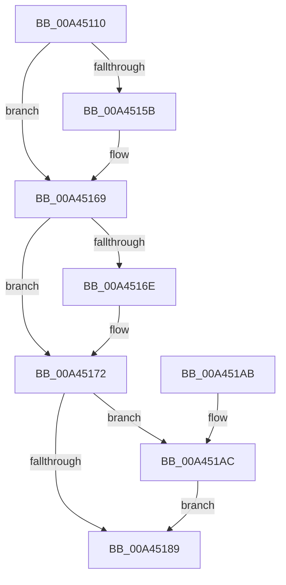

# CmFcpManagerDrainUsageNotificationsWorker

- RVA: `0x00A45110`–`0x00A451B6` (길이 `166` bytes)
- VA: `0x0000000140A45110`
- 실행 섹션: `PAGE`
- PDB 이름 있음: `예`; PDB Function 태그: `아니요`
- unwind 정보 RVA: `0x00073808`
- 디코드: `45`개 명령, `166/166` bytes 표시
- 미해석 바이트: `0` (있으면 어셈블리에 `.byte`로 보존)

> 이 문서는 커널 이미지의 기계어와 PDB 기호를 분석해 생성했습니다. 4번과 5번은 함수 원형과 자료형을 바이너리 사용 방식에서 추정한 C 해석이며 원본 소스 복구 결과는 아닙니다.

## 1. Dependencies

- 직접 호출 지점: **6**; 고유 호출 대상: **6**
- 직접 호출자로 확인된 함수: **0**
- RIP 상대 이미지 참조: **0**

### Outgoing calls
- `0x00A4514B` → [KeAbPreAcquire](../../text/21/KeAbPreAcquire_function_00210230.md) (function, `0x00210230`)
- `0x00A45164` → [ExfAcquirePushLockExclusiveEx](../../text/20/ExfAcquirePushLockExclusiveEx_function_0020FC90.md) (function, `0x0020FC90`)
- `0x00A45177` → [CmFcpManagerDrainUsageNotifications](CmFcpManagerDrainUsageNotifications_function_00A451BC.md) (function, `0x00A451BC`)
- `0x00A4518C` → [KeAbPostRelease](../../text/2E/KeAbPostRelease_function_002E1600.md) (function, `0x002E1600`)
- `0x00A45191` → [KeLeaveCriticalRegion](../../text/25/KeLeaveCriticalRegion_function_0025D8B0.md) (function, `0x0025D8B0`)
- `0x00A451AF` → [ExfTryToWakePushLock](../../text/26/ExfTryToWakePushLock_function_00265DD0.md) (function, `0x00265DD0`)

### Direct callers
- 이 함수 시작 RVA로 연결되는 직접 call은 확인되지 않았습니다. 간접 호출은 완전히 역산할 수 없습니다.

### Static image references
- 디코드된 RIP-relative 메모리 참조가 없습니다.

## 2. Other-region calls and transfers

- 다른 실행 섹션으로 향하는 call: **5**
  - `0x00A4514B` → [KeAbPreAcquire](../../text/21/KeAbPreAcquire_function_00210230.md) (`PAGE` → `.text`)
  - `0x00A45164` → [ExfAcquirePushLockExclusiveEx](../../text/20/ExfAcquirePushLockExclusiveEx_function_0020FC90.md) (`PAGE` → `.text`)
  - `0x00A4518C` → [KeAbPostRelease](../../text/2E/KeAbPostRelease_function_002E1600.md) (`PAGE` → `.text`)
  - `0x00A45191` → [KeLeaveCriticalRegion](../../text/25/KeLeaveCriticalRegion_function_0025D8B0.md) (`PAGE` → `.text`)
  - `0x00A451AF` → [ExfTryToWakePushLock](../../text/26/ExfTryToWakePushLock_function_00265DD0.md) (`PAGE` → `.text`)
- 별도 외부 분기/꼬리 이동을 확인하지 못했습니다.

## 3. Assembly (complete function range)

```asm
00A45110  48 89 5C 24 08                  mov qword ptr [rsp + 8], rbx
00A45115  48 89 6C 24 10                  mov qword ptr [rsp + 0x10], rbp
00A4511A  48 89 74 24 18                  mov qword ptr [rsp + 0x18], rsi
00A4511F  57                              push rdi
00A45120  48 83 EC 20                     sub rsp, 0x20
00A45124  65 48 8B 04 25 88 01 00 00      mov rax, qword ptr gs:[0x188]
00A4512D  48 8D BA 90 01 00 00            lea rdi, [rdx + 0x190]
00A45134  48 8B EA                        mov rbp, rdx
00A45137  48 83 CB FF                     or rbx, 0xffffffffffffffff
00A4513B  45 33 C0                        xor r8d, r8d
00A4513E  33 D2                           xor edx, edx
00A45140  48 8B CF                        mov rcx, rdi
00A45143  66 01 98 E4 01 00 00            add word ptr [rax + 0x1e4], bx
00A4514A  90                              nop
00A4514B  E8 E0 B0 7C FF                  call 0x140210230
00A45150  F0 48 0F BA 2F 00               lock bts qword ptr [rdi], 0
00A45156  48 8B F0                        mov rsi, rax
00A45159  73 0E                           jae 0x140a45169
00A4515B  4C 8B C7                        mov r8, rdi
00A4515E  48 8B D0                        mov rdx, rax
00A45161  48 8B CF                        mov rcx, rdi
00A45164  E8 27 AB 7C FF                  call 0x14020fc90
00A45169  48 85 F6                        test rsi, rsi
00A4516C  74 04                           je 0x140a45172
00A4516E  C6 46 0A 01                     mov byte ptr [rsi + 0xa], 1
00A45172  33 D2                           xor edx, edx
00A45174  48 8B CD                        mov rcx, rbp
00A45177  E8 40 00 00 00                  call 0x140a451bc
00A4517C  F0 48 0F C1 1F                  lock xadd qword ptr [rdi], rbx
00A45181  80 E3 06                        and bl, 6
00A45184  80 FB 02                        cmp bl, 2
00A45187  74 23                           je 0x140a451ac
00A45189  48 8B CF                        mov rcx, rdi
00A4518C  E8 6F C4 89 FF                  call 0x1402e1600
00A45191  E8 1A 87 81 FF                  call 0x14025d8b0
00A45196  48 8B 5C 24 30                  mov rbx, qword ptr [rsp + 0x30]
00A4519B  48 8B 6C 24 38                  mov rbp, qword ptr [rsp + 0x38]
00A451A0  48 8B 74 24 40                  mov rsi, qword ptr [rsp + 0x40]
00A451A5  48 83 C4 20                     add rsp, 0x20
00A451A9  5F                              pop rdi
00A451AA  C3                              ret
00A451AB  CC                              int3
00A451AC  48 8B CF                        mov rcx, rdi
00A451AF  E8 1C 0C 82 FF                  call 0x140265dd0
00A451B4  EB D3                           jmp 0x140a45189
```

## 4. C-style interpretation (structured pseudocode)

```c
__int64 __fastcall CmFcpManagerDrainUsageNotificationsWorker(__int64 a1, __int64 a2, int a3)
{
    __int64 result;
    __int64 v_rbx;
    __int64 v_rsp;
    unsigned __int64 v_stack_p10;
    unsigned __int64 v_stack_p18;
    unsigned __int64 v_stack_p8;

    v_stack_p8 = v_rbx;
    v_stack_p10 = v_rbp;
    v_stack_p18 = v_rsi;
    v_rsp = (v_rsp) - (32);
    v_rbx = (v_rbx) | (-1);
    a3 = 0;
    a2 = 0;
    result = KeAbPreAcquire(a2 + 400, a2, a3, a4);
    if (!(condition_is_above_or_equal)) {
        a3 = a2 + 400;
        a2 = result;
        a1 = a2 + 400;
        result = ExfAcquirePushLockExclusiveEx(a1, a2, a3, a4);
    }
    if (result != 0) {
        *(unsigned __int8 *)(result + 10) = 1;
    }
    a2 = 0;
    result = CmFcpManagerDrainUsageNotifications(0, a2, a3, a4);
    v_rbx = (unsigned __int8)((v_rbx) & (6));
    if (((unsigned __int8)(v_rbx)) == 2) goto loc_00A451AC;
loc_00A45189:
    result = KeAbPostRelease(a2 + 400, a2, a3, a4);
    result = KeLeaveCriticalRegion(a2 + 400, a2, a3, a4);
    v_rsp = (v_rsp) + (32);
    return result;
loc_00A451AC:
    result = ExfTryToWakePushLock(a2 + 400, a2, a3, a4);
    goto loc_00A45189;
}
```

## 5. (Beta) C Style

```c
int64_t CmFcpManagerDrainUsageNotificationsWorker(int64_t Arg1, void *Arg2, int32_t Arg3)
{
    uint8_t *arg2 = (uint8_t *)Arg2;

    int64_t result;
    int64_t local_rbx;
    int64_t local_rsp;
    uint64_t v_stack_p10;
    uint64_t v_stack_p18;
    uint64_t v_stack_p8;

    v_stack_p8 = local_rbx;
    v_stack_p10 = local_rbp;
    v_stack_p18 = local_rsi;
    local_rsp = (local_rsp) - (32);
    local_rbx = (local_rbx) | (-1);
    Arg3 = 0;
    Arg2 = 0;
    result = KeAbPreAcquire(Arg2 + 400, Arg2, Arg3, a4);
    if (!(condition_is_above_or_equal)) {
        Arg3 = Arg2 + 400;
        Arg2 = result;
        Arg1 = Arg2 + 400;
        result = ExfAcquirePushLockExclusiveEx(Arg1, Arg2, Arg3, a4);
    }
    if (result != 0) {
        *(uint8_t *)(result + 0xA) = 1;
    }
    Arg2 = 0;
    result = CmFcpManagerDrainUsageNotifications(0, Arg2, Arg3, a4);
    local_rbx = (uint8_t)((local_rbx) & (6));
    if (((uint8_t)(local_rbx)) == 2) goto loc_00A451AC;
loc_00A45189:
    result = KeAbPostRelease(Arg2 + 400, Arg2, Arg3, a4);
    result = KeLeaveCriticalRegion(Arg2 + 400, Arg2, Arg3, a4);
    local_rsp = (local_rsp) + (32);
    return result;
loc_00A451AC:
    result = ExfTryToWakePushLock(Arg2 + 400, Arg2, Arg3, a4);
    goto loc_00A45189;
}
```

### 관측된 메모리 오프셋

구조체 형식이 확인되지 않은 접근은 인자 기준의 오프셋으로만 기록했습니다.

| 기준 인자 | 오프셋 표현 | 폭 (bit) | 접근 |
|---|---:|---:|---|
| `Arg2` | `+ 0x0` | `64` | `R/W` |
| `Arg2` | `+ 0x190` | `64` | `R` |

## 6. Execution-region graph

[열기: 2D/3D 그래프와 함수 탐색 컨트롤 패널](../../../control-panel.html?section=page&rva=0x00A45110&view=graph)

- 2D 그래프는 위에서 아래로 흐르고, 3D 그래프는 빈 공간을 드래그해 회전합니다. Shift+드래그는 이동, 휠은 확대·축소, 함수 노드 선택은 대상 보고서 이동입니다.

### Static fallback


