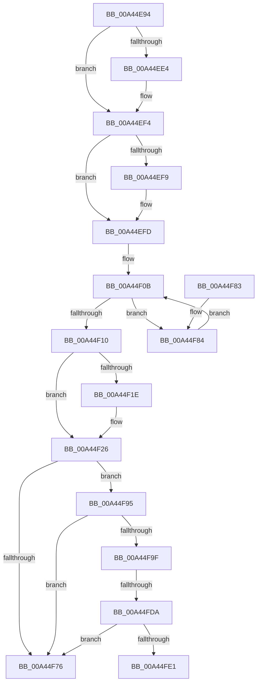

# CmFcpManagerPublishChangeNotifications

- RVA: `0x00A44E94`–`0x00A44FE6` (길이 `338` bytes)
- VA: `0x0000000140A44E94`
- 실행 섹션: `PAGE`
- PDB 이름 있음: `예`; PDB Function 태그: `예`
- unwind 정보 RVA: `0x000AF288`
- 디코드: `91`개 명령, `338/338` bytes 표시
- 미해석 바이트: `0` (있으면 어셈블리에 `.byte`로 보존)

> 이 문서는 커널 이미지의 기계어와 PDB 기호를 분석해 생성했습니다. 4번과 5번은 함수 원형과 자료형을 바이너리 사용 방식에서 추정한 C 해석이며 원본 소스 복구 결과는 아닙니다.

## 1. Dependencies

- 직접 호출 지점: **7**; 고유 호출 대상: **7**
- 직접 호출자로 확인된 함수: **3**
- RIP 상대 이미지 참조: **5**

### Outgoing calls
- `0x00A44ECB` → [KeAbPreAcquire](../../text/21/KeAbPreAcquire_function_00210230.md) (function, `0x00210230`)
- `0x00A44EEF` → [ExfAcquirePushLockSharedEx](../../text/21/ExfAcquirePushLockSharedEx_function_0021044C.md) (function, `0x0021044C`)
- `0x00A44F21` → [ExfReleasePushLockShared](../../text/26/ExfReleasePushLockShared_function_00263440.md) (function, `0x00263440`)
- `0x00A44F29` → [KeAbPostRelease](../../text/2E/KeAbPostRelease_function_002E1600.md) (function, `0x002E1600`)
- `0x00A44F6D` → [ZwQueryWnfStateData](../../text/6A/ZwQueryWnfStateData_function_006AFEF0.md) (function, `0x006AFEF0`)
- `0x00A44F88` → [CmpWorkItemQueueWork](../../text/37/CmpWorkItemQueueWork_function_00378D4C.md) (function, `0x00378D4C`)
- `0x00A44FC8` → [ZwUpdateWnfStateData](../../text/6B/ZwUpdateWnfStateData_function_006B0D10.md) (function, `0x006B0D10`)

### Direct callers
- [CmFcManagerOverwriteFeatureConfigurationSection](../7F/CmFcManagerOverwriteFeatureConfigurationSection_function_007F4450.md) at `0x007F48C0`
- [CmFcManagerUpdateFeatureConfigurations](../7F/CmFcManagerUpdateFeatureConfigurations_function_007F4CF4.md) at `0x007F5276`
- [CmFcManagerUpdateFeatureUsageSubscriptions](CmFcManagerUpdateFeatureUsageSubscriptions_function_00A4490C.md) at `0x00A44B01`

### Static image references
- `0x00A44EAF` → RVA `0x00EF7558` (`.data`; read)
- `0x00A44EFD` → RVA `0x00EF7560` (`.data`; read)
- `0x00A44F2E` → RVA `0x00EF747B` (`.data`; read)
- `0x00A44F5F` → RVA `0x0001A520` (`.rdata`; read)
- `0x00A44F66` → RVA `0x0001A530` (`.rdata`; read)

## 2. Other-region calls and transfers

- 다른 실행 섹션으로 향하는 call: **7**
  - `0x00A44ECB` → [KeAbPreAcquire](../../text/21/KeAbPreAcquire_function_00210230.md) (`PAGE` → `.text`)
  - `0x00A44EEF` → [ExfAcquirePushLockSharedEx](../../text/21/ExfAcquirePushLockSharedEx_function_0021044C.md) (`PAGE` → `.text`)
  - `0x00A44F21` → [ExfReleasePushLockShared](../../text/26/ExfReleasePushLockShared_function_00263440.md) (`PAGE` → `.text`)
  - `0x00A44F29` → [KeAbPostRelease](../../text/2E/KeAbPostRelease_function_002E1600.md) (`PAGE` → `.text`)
  - `0x00A44F6D` → [ZwQueryWnfStateData](../../text/6A/ZwQueryWnfStateData_function_006AFEF0.md) (`PAGE` → `.text`)
  - `0x00A44F88` → [CmpWorkItemQueueWork](../../text/37/CmpWorkItemQueueWork_function_00378D4C.md) (`PAGE` → `.text`)
  - `0x00A44FC8` → [ZwUpdateWnfStateData](../../text/6B/ZwUpdateWnfStateData_function_006B0D10.md) (`PAGE` → `.text`)
- call이 아닌 외부 분기/꼬리 이동: **2**
  - `0x00A44FD4` → [sub_00B3AFF6](../B3/Unknown_function_00B3AFF6.md) (`tail-transfer`)
  - `0x00A44FE1` → [sub_00B3AFF6](../B3/Unknown_function_00B3AFF6.md) (`tail-transfer`)

## 3. Assembly (complete function range)

```asm
00A44E94  48 89 54 24 10                  mov qword ptr [rsp + 0x10], rdx
00A44E99  48 89 4C 24 08                  mov qword ptr [rsp + 8], rcx
00A44E9E  55                              push rbp
00A44E9F  53                              push rbx
00A44EA0  56                              push rsi
00A44EA1  57                              push rdi
00A44EA2  41 56                           push r14
00A44EA4  41 57                           push r15
00A44EA6  48 8B EC                        mov rbp, rsp
00A44EA9  48 83 EC 68                     sub rsp, 0x68
00A44EAD  33 FF                           xor edi, edi
00A44EAF  48 8D 35 A2 26 4B 00            lea rsi, [rip + 0x4b26a2]
00A44EB6  48 8B CE                        mov rcx, rsi
00A44EB9  89 7D 38                        mov dword ptr [rbp + 0x38], edi
00A44EBC  45 33 C0                        xor r8d, r8d
00A44EBF  89 7D D8                        mov dword ptr [rbp - 0x28], edi
00A44EC2  33 D2                           xor edx, edx
00A44EC4  48 89 7D E8                     mov qword ptr [rbp - 0x18], rdi
00A44EC8  89 7D 48                        mov dword ptr [rbp + 0x48], edi
00A44ECB  E8 60 B3 7C FF                  call 0x140210230
00A44ED0  48 8B D8                        mov rbx, rax
00A44ED3  44 8D 7F 11                     lea r15d, [rdi + 0x11]
00A44ED7  33 C0                           xor eax, eax
00A44ED9  F0 4C 0F B1 3D 76 26 4B 00      lock cmpxchg qword ptr [rip + 0x4b2676], r15
00A44EE2  74 10                           je 0x140a44ef4
00A44EE4  4C 8B CE                        mov r9, rsi
00A44EE7  4C 8B C3                        mov r8, rbx
00A44EEA  33 D2                           xor edx, edx
00A44EEC  48 8B CE                        mov rcx, rsi
00A44EEF  E8 58 B5 7C FF                  call 0x14021044c
00A44EF4  48 85 DB                        test rbx, rbx
00A44EF7  74 04                           je 0x140a44efd
00A44EF9  C6 43 0A 01                     mov byte ptr [rbx + 0xa], 1
00A44EFD  48 8B 1D 5C 26 4B 00            mov rbx, qword ptr [rip + 0x4b265c]
00A44F04  4C 8D 35 55 26 4B 00            lea r14, [rip + 0x4b2655]
00A44F0B  49 3B DE                        cmp rbx, r14
00A44F0E  75 74                           jne 0x140a44f84
00A44F10  49 8B C7                        mov rax, r15
00A44F13  F0 48 0F B1 3D 3C 26 4B 00      lock cmpxchg qword ptr [rip + 0x4b263c], rdi
00A44F1C  74 08                           je 0x140a44f26
00A44F1E  48 8B CE                        mov rcx, rsi
00A44F21  E8 1A E5 81 FF                  call 0x140263440
00A44F26  48 8B CE                        mov rcx, rsi
00A44F29  E8 D2 C6 89 FF                  call 0x1402e1600
00A44F2E  8A 1D 47 25 4B 00               mov bl, byte ptr [rip + 0x4b2547]
00A44F34  BE 08 00 00 00                  mov esi, 8
00A44F39  41 BE 00 00 00 80               mov r14d, 0x80000000
00A44F3F  48 8D 45 50                     lea rax, [rbp + 0x50]
00A44F43  48 89 7D E0                     mov qword ptr [rbp - 0x20], rdi
00A44F47  48 89 44 24 28                  mov qword ptr [rsp + 0x28], rax
00A44F4C  4C 8D 4D 38                     lea r9, [rbp + 0x38]
00A44F50  48 8D 45 E0                     lea rax, [rbp - 0x20]
00A44F54  89 75 50                        mov dword ptr [rbp + 0x50], esi
00A44F57  45 33 C0                        xor r8d, r8d
00A44F5A  48 89 44 24 20                  mov qword ptr [rsp + 0x20], rax
00A44F5F  48 8D 15 BA 55 5D FF            lea rdx, [rip - 0xa2aa46]
00A44F66  48 8D 0D C3 55 5D FF            lea rcx, [rip - 0xa2aa3d]
00A44F6D  E8 7E AF C6 FF                  call 0x1406afef0
00A44F72  85 C0                           test eax, eax
00A44F74  79 1F                           jns 0x140a44f95
00A44F76  48 83 C4 68                     add rsp, 0x68
00A44F7A  41 5F                           pop r15
00A44F7C  41 5E                           pop r14
00A44F7E  5F                              pop rdi
00A44F7F  5E                              pop rsi
00A44F80  5B                              pop rbx
00A44F81  5D                              pop rbp
00A44F82  C3                              ret
00A44F83  CC                              int3
00A44F84  48 8D 4B 10                     lea rcx, [rbx + 0x10]
00A44F88  E8 BF 3D 93 FF                  call 0x140378d4c
00A44F8D  48 8B 1B                        mov rbx, qword ptr [rbx]
00A44F90  E9 76 FF FF FF                  jmp 0x140a44f0b
00A44F95  48 8B 45 40                     mov rax, qword ptr [rbp + 0x40]
00A44F99  48 39 45 E0                     cmp qword ptr [rbp - 0x20], rax
00A44F9D  73 D7                           jae 0x140a44f76
00A44F9F  8B 45 38                        mov eax, dword ptr [rbp + 0x38]
00A44FA2  4C 8D 0D 77 55 5D FF            lea r9, [rip - 0xa2aa89]
00A44FA9  C7 44 24 30 01 00 00 00         mov dword ptr [rsp + 0x30], 1
00A44FB1  48 8D 55 40                     lea rdx, [rbp + 0x40]
00A44FB5  89 44 24 28                     mov dword ptr [rsp + 0x28], eax
00A44FB9  48 8D 0D 70 55 5D FF            lea rcx, [rip - 0xa2aa90]
00A44FC0  44 8B C6                        mov r8d, esi
00A44FC3  48 89 7C 24 20                  mov qword ptr [rsp + 0x20], rdi
00A44FC8  E8 43 BD C6 FF                  call 0x1406b0d10
00A44FCD  42 8D 0C 30                     lea ecx, [rax + r14]
00A44FD1  41 85 CE                        test r14d, ecx
00A44FD4  0F 85 1C 60 0F 00               jne 0x140b3aff6
00A44FDA  3D 01 00 00 C0                  cmp eax, 0xc0000001
00A44FDF  75 95                           jne 0x140a44f76
00A44FE1  E9 10 60 0F 00                  jmp 0x140b3aff6
```

## 4. C-style interpretation (structured pseudocode)

```c
__int64 __fastcall CmFcpManagerPublishChangeNotifications(__int64 a1, __int64 a2, int a3)
{
    __int64 result;
    __int64 v_rdi;
    __int64 v_rsp;
    unsigned __int64 v_stack_m48;
    unsigned __int64 v_stack_m50;
    unsigned int v_stack_m58;
    unsigned __int64 v_stack_m70;
    unsigned __int64 v_stack_m78;
    unsigned __int64 v_stack_p10;
    unsigned int v_stack_p18;
    unsigned __int64 v_stack_p20;
    unsigned int v_stack_p28;
    unsigned int v_stack_p30;
    unsigned __int64 v_stack_p8;

    v_stack_p10 = a2;
    v_stack_p8 = a1;
    v_rsp = (v_rsp) - (104);
    v_rdi = 0;
    v_stack_p8 = 0;
    a3 = 0;
    v_stack_m58 = 0;
    a2 = 0;
    v_stack_m48 = 0;
    v_stack_p18 = 0;
    result = KeAbPreAcquire(v_rip + 4925090, a2, a3, a4);
    result = 0;
    if (!(condition_is_equal)) {
        a4 = v_rip + 4925090;
        a3 = 0;
        a2 = 0;
        a1 = v_rip + 4925090;
        result = ExfAcquirePushLockSharedEx(a1, a2, a3, a4);
    }
    if (result != 0) {
        *(unsigned __int8 *)(result + 10) = 1;
    }
loc_00A44F0B:
    if ((*(unsigned __int64 *)(v_rip + 4925020)) != (v_rip + 4925013)) goto loc_00A44F84;
    result = v_rdi + 17;
    if ((*(unsigned __int64 *)(v_rip + 4925020)) != (v_rip + 4925013)) {
        a1 = v_rip + 4925090;
        result = ExfReleasePushLockShared(a1, a2, a3, a4);
    }
    result = KeAbPostRelease(v_rip + 4925090, a2, a3, a4);
    v_stack_m50 = 0;
    v_stack_m70 = v_stack_p20;
    v_stack_p20 = 8;
    a3 = 0;
    v_stack_m78 = v_stack_m50;
    result = ZwQueryWnfStateData(v_rip - 10660413, v_rip - 10660422, a3, v_stack_p8);
    if (!sign_flag) goto loc_00A44F95;
loc_00A44F76:
    v_rsp = (v_rsp) + (104);
    return result;
loc_00A44F84:
    result = CmpWorkItemQueueWork(*(unsigned __int8 *)(v_rip + 4924743) + 16, v_rip - 10660422, a3, v_stack_p8);
    goto loc_00A44F0B;
loc_00A44F95:
    if (v_stack_m50 >= v_stack_p10) goto loc_00A44F76;
    v_stack_p30 = 1;
    v_stack_p28 = (unsigned int)((unsigned int)(v_stack_p8));
    v_stack_p20 = 0;
    result = ZwUpdateWnfStateData(v_rip - 10660496, v_stack_p10, 8, v_rip - 10660489);
    if (((unsigned int)(result)) != 0xC0000001ULL) goto loc_00A44F76;
}
```

## 5. (Beta) C Style

```c
int64_t CmFcpManagerPublishChangeNotifications(int64_t Arg1, int64_t Arg2, int32_t Arg3)
{
    int64_t result;
    int64_t local_rdi;
    int64_t local_rsp;
    uint64_t v_stack_m48;
    uint64_t v_stack_m50;
    uint32_t v_stack_m58;
    uint64_t v_stack_m70;
    uint64_t v_stack_m78;
    uint64_t v_stack_p10;
    uint32_t v_stack_p18;
    uint64_t v_stack_p20;
    uint32_t v_stack_p28;
    uint32_t v_stack_p30;
    uint64_t v_stack_p8;

    v_stack_p10 = Arg2;
    v_stack_p8 = Arg1;
    local_rsp = (local_rsp) - (104);
    local_rdi = 0;
    v_stack_p8 = 0;
    Arg3 = 0;
    v_stack_m58 = 0;
    Arg2 = 0;
    v_stack_m48 = 0;
    v_stack_p18 = 0;
    result = KeAbPreAcquire(v_rip + 4925090, Arg2, Arg3, a4);
    result = 0;
    if (!(condition_is_equal)) {
        a4 = v_rip + 4925090;
        Arg3 = 0;
        Arg2 = 0;
        Arg1 = v_rip + 4925090;
        result = ExfAcquirePushLockSharedEx(Arg1, Arg2, Arg3, a4);
    }
    if (result != 0) {
        *(uint8_t *)(result + 0xA) = 1;
    }
loc_00A44F0B:
    if ((*(uint64_t *)(v_rip + 0x4B265C)) != (v_rip + 4925013)) goto loc_00A44F84;
    result = local_rdi + 17;
    if ((*(uint64_t *)(v_rip + 0x4B265C)) != (v_rip + 4925013)) {
        Arg1 = v_rip + 4925090;
        result = ExfReleasePushLockShared(Arg1, Arg2, Arg3, a4);
    }
    result = KeAbPostRelease(v_rip + 4925090, Arg2, Arg3, a4);
    v_stack_m50 = 0;
    v_stack_m70 = v_stack_p20;
    v_stack_p20 = 8;
    Arg3 = 0;
    v_stack_m78 = v_stack_m50;
    result = ZwQueryWnfStateData(v_rip - 10660413, v_rip - 10660422, Arg3, v_stack_p8);
    if (!sign_flag) goto loc_00A44F95;
loc_00A44F76:
    local_rsp = (local_rsp) + (104);
    return result;
loc_00A44F84:
    result = CmpWorkItemQueueWork(*(uint8_t *)(v_rip + 0x4B2547) + 16, v_rip - 10660422, Arg3, v_stack_p8);
    goto loc_00A44F0B;
loc_00A44F95:
    if (v_stack_m50 >= v_stack_p10) goto loc_00A44F76;
    v_stack_p30 = 1;
    v_stack_p28 = (uint32_t)((uint32_t)(v_stack_p8));
    v_stack_p20 = 0;
    result = ZwUpdateWnfStateData(v_rip - 10660496, v_stack_p10, 8, v_rip - 10660489);
    if (((uint32_t)(result)) != 0xC0000001ULL) goto loc_00A44F76;
}
```

## 6. Execution-region graph

[열기: 2D/3D 그래프와 함수 탐색 컨트롤 패널](../../../control-panel.html?section=page&rva=0x00A44E94&view=graph)

- 2D 그래프는 위에서 아래로 흐르고, 3D 그래프는 빈 공간을 드래그해 회전합니다. Shift+드래그는 이동, 휠은 확대·축소, 함수 노드 선택은 대상 보고서 이동입니다.

### Static fallback


