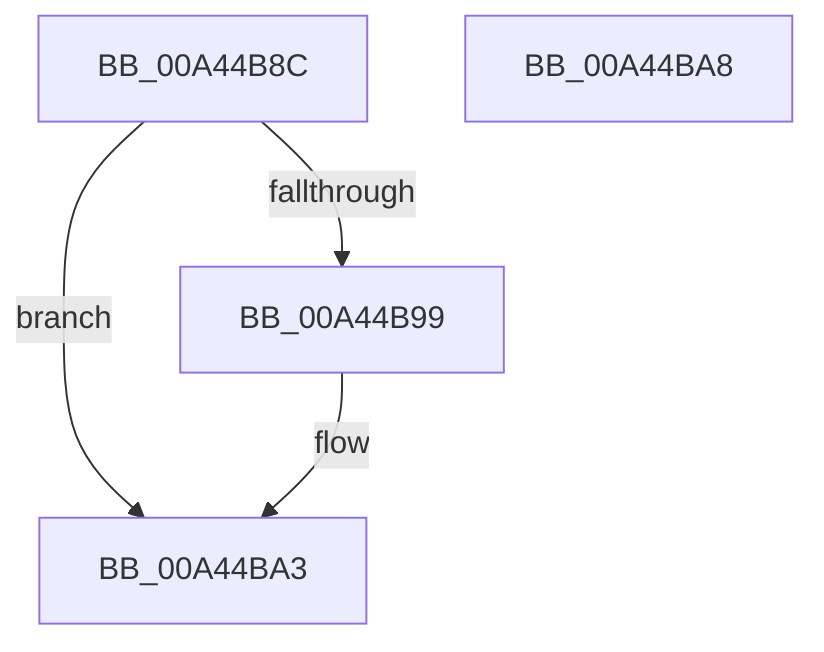

# CmFcpUnmapSection

- RVA: `0x00A44B8C`–`0x00A44BA9` (길이 `29` bytes)
- VA: `0x0000000140A44B8C`
- 실행 섹션: `PAGE`
- PDB 이름 있음: `예`; PDB Function 태그: `아니요`
- unwind 정보 RVA: `0x0005C788`
- 디코드: `9`개 명령, `29/29` bytes 표시
- 미해석 바이트: `0` (있으면 어셈블리에 `.byte`로 보존)

> 이 문서는 커널 이미지의 기계어와 PDB 기호를 분석해 생성했습니다. 4번과 5번은 함수 원형과 자료형을 바이너리 사용 방식에서 추정한 C 해석이며 원본 소스 복구 결과는 아닙니다.

## 1. Dependencies

- 직접 호출 지점: **1**; 고유 호출 대상: **1**
- 직접 호출자로 확인된 함수: **5**
- RIP 상대 이미지 참조: **0**

### Outgoing calls
- `0x00A44B9E` → [MiRemoveFromSystemSpace](../../text/29/MiRemoveFromSystemSpace_function_002962FC.md) (function, `0x002962FC`)

### Direct callers
- [CmFcManagerOverwriteFeatureConfigurationSection](../7F/CmFcManagerOverwriteFeatureConfigurationSection_function_007F4450.md) at `0x007F4647`
- [CmFcManagerUpdateFeatureConfigurations](../7F/CmFcManagerUpdateFeatureConfigurations_function_007F4CF4.md) at `0x007F5290`
- [CmFcpManagerCreateSectionFromBuffer](../7F/CmFcpManagerCreateSectionFromBuffer_function_007F5438.md) at `0x007F54D5`
- [CmFcManagerUpdateFeatureUsageSubscriptions](CmFcManagerUpdateFeatureUsageSubscriptions_function_00A4490C.md) at `0x00A44B1A`
- [CmFcManagerStartRuntimePhase](../../init/C5/CmFcManagerStartRuntimePhase_function_00C5DC70.md) at `0x00C5E1FD`

### Static image references
- 디코드된 RIP-relative 메모리 참조가 없습니다.

## 2. Other-region calls and transfers

- 다른 실행 섹션으로 향하는 call: **1**
  - `0x00A44B9E` → [MiRemoveFromSystemSpace](../../text/29/MiRemoveFromSystemSpace_function_002962FC.md) (`PAGE` → `.text`)
- 별도 외부 분기/꼬리 이동을 확인하지 못했습니다.

## 3. Assembly (complete function range)

```asm
00A44B8C  48 83 EC 28                     sub rsp, 0x28
00A44B90  48 8B 49 08                     mov rcx, qword ptr [rcx + 8]
00A44B94  48 85 C9                        test rcx, rcx
00A44B97  74 0A                           je 0x140a44ba3
00A44B99  BA 01 00 00 00                  mov edx, 1
00A44B9E  E8 59 17 85 FF                  call 0x1402962fc
00A44BA3  48 83 C4 28                     add rsp, 0x28
00A44BA7  C3                              ret
00A44BA8  CC                              int3
```

## 4. C-style interpretation (structured pseudocode)

```c
__int64 __fastcall CmFcpUnmapSection(__int64 a1)
{
    __int64 result;
    __int64 v_rsp;

    v_rsp = (v_rsp) - (40);
    if (*(unsigned __int64 *)(a1 + 8) != 0) {
        a2 = 1;
        result = MiRemoveFromSystemSpace(*(unsigned __int64 *)(a1 + 8), a2, a3, a4);
    }
    v_rsp = (v_rsp) + (40);
    return result;
}
```

## 5. (Beta) C Style

```c
int64_t CmFcpUnmapSection(void *Arg1)
{
    uint8_t *arg1 = (uint8_t *)Arg1;

    int64_t result;
    int64_t local_rsp;

    local_rsp = (local_rsp) - (40);
    if (*(uint64_t *)(arg1 + 0x8) != 0) {
        a2 = 1;
        result = MiRemoveFromSystemSpace(*(uint64_t *)(arg1 + 0x8), a2, a3, a4);
    }
    local_rsp = (local_rsp) + (40);
    return result;
}
```

### 관측된 메모리 오프셋

구조체 형식이 확인되지 않은 접근은 인자 기준의 오프셋으로만 기록했습니다.

| 기준 인자 | 오프셋 표현 | 폭 (bit) | 접근 |
|---|---:|---:|---|
| `Arg1` | `+ 0x8` | `64` | `R` |

## 6. Execution-region graph

[열기: 2D/3D 그래프와 함수 탐색 컨트롤 패널](../../../control-panel.html?section=page&rva=0x00A44B8C&view=graph)

- 2D 그래프는 위에서 아래로 흐르고, 3D 그래프는 빈 공간을 드래그해 회전합니다. Shift+드래그는 이동, 휠은 확대·축소, 함수 노드 선택은 대상 보고서 이동입니다.

### Static fallback


