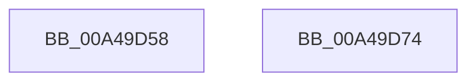

# CmpFindSubKeyByName

- RVA: `0x00A49D58`–`0x00A49D75` (길이 `29` bytes)
- VA: `0x0000000140A49D58`
- 실행 섹션: `PAGE`
- PDB 이름 있음: `예`; PDB Function 태그: `아니요`
- unwind 정보 RVA: `0x0005C788`
- 디코드: `8`개 명령, `29/29` bytes 표시
- 미해석 바이트: `0` (있으면 어셈블리에 `.byte`로 보존)

> 이 문서는 커널 이미지의 기계어와 PDB 기호를 분석해 생성했습니다. 4번과 5번은 함수 원형과 자료형을 바이너리 사용 방식에서 추정한 C 해석이며 원본 소스 복구 결과는 아닙니다.

## 1. Dependencies

- 직접 호출 지점: **1**; 고유 호출 대상: **1**
- 직접 호출자로 확인된 함수: **10**
- RIP 상대 이미지 참조: **0**

### Outgoing calls
- `0x00A49D66` → [CmpFindSubKeyByNameWithStatus](../85/CmpFindSubKeyByNameWithStatus_function_00852770.md) (function, `0x00852770`)

### Direct callers
- [CmpGetSystemControlValues](../../init/C5/CmpGetSystemControlValues_function_00C5959C.md) at `0x00C59728`
- [CmpGetSystemControlValues](../../init/C5/CmpGetSystemControlValues_function_00C5959C.md) at `0x00C597E1`
- [CmpFindGroupOrderList](../../init/C5/CmpFindGroupOrderList_function_00C5C2B0.md) at `0x00C5C2FB`
- [CmpFindGroupOrderList](../../init/C5/CmpFindGroupOrderList_function_00C5C2B0.md) at `0x00C5C355`
- [CmpFindStateSepKeysRedirectionMapNode](../../init/C5/CmpFindStateSepKeysRedirectionMapNode_function_00C5C554.md) at `0x00C5C5B0`
- [CmpGetStateSepKeysRedirectionPathValue](../../init/C5/CmpGetStateSepKeysRedirectionPathValue_function_00C5CA3C.md) at `0x00C5CAAB`
- [CmpIsLoadType](../../init/C5/CmpIsLoadType_function_00C5CBF8.md) at `0x00C5CCE1`
- [CmpIsLoadType](../../init/C5/CmpIsLoadType_function_00C5CBF8.md) at `0x00C5CE2A`
- [CmpLoadManufacturingModeNode](../../init/C5/CmpLoadManufacturingModeNode_function_00C5CF94.md) at `0x00C5CFFA`
- [CmpLoadManufacturingModeNode](../../init/C5/CmpLoadManufacturingModeNode_function_00C5CF94.md) at `0x00C5D056`
- [CmpLoadManufacturingProfileNode](../../init/C5/CmpLoadManufacturingProfileNode_function_00C5D0C8.md) at `0x00C5D15C`
- [CmpLoadManufacturingProfileServicesNode](../../init/C5/CmpLoadManufacturingProfileServicesNode_function_00C5D1B4.md) at `0x00C5D201`
- [CmpLoadServicesNode](../../init/C5/CmpLoadServicesNode_function_00C5D274.md) at `0x00C5D2C4`
- [CmpSortDriverList](../../init/C5/CmpSortDriverList_function_00C5D3D0.md) at `0x00C5D442`
- [CmpSortDriverList](../../init/C5/CmpSortDriverList_function_00C5D3D0.md) at `0x00C5D4A2`

### Static image references
- 디코드된 RIP-relative 메모리 참조가 없습니다.

## 2. Other-region calls and transfers

- 다른 실행 섹션으로 향하는 call: **0**
- 별도 외부 분기/꼬리 이동을 확인하지 못했습니다.

## 3. Assembly (complete function range)

```asm
00A49D58  48 83 EC 28                     sub rsp, 0x28
00A49D5C  83 64 24 48 00                  and dword ptr [rsp + 0x48], 0
00A49D61  4C 8D 4C 24 48                  lea r9, [rsp + 0x48]
00A49D66  E8 05 8A E0 FF                  call 0x140852770
00A49D6B  8B 44 24 48                     mov eax, dword ptr [rsp + 0x48]
00A49D6F  48 83 C4 28                     add rsp, 0x28
00A49D73  C3                              ret
00A49D74  CC                              int3
```

## 4. C-style interpretation (structured pseudocode)

```c
__int64 __fastcall CmpFindSubKeyByName(void)
{
    __int64 result;
    __int64 v_rsp;
    unsigned int v_stack_p20;

    v_rsp = (v_rsp) - (40);
    result = CmpFindSubKeyByNameWithStatus(a1, a2, a3, v_stack_p20);
    v_rsp = (v_rsp) + (40);
    return (unsigned int)(v_stack_p20);
}
```

## 5. (Beta) C Style

```c
void CmpFindSubKeyByName(void)
{
    int64_t result;
    int64_t local_rsp;
    uint32_t v_stack_p20;

    local_rsp = (local_rsp) - (40);
    result = CmpFindSubKeyByNameWithStatus(a1, a2, a3, v_stack_p20);
    local_rsp = (local_rsp) + (40);
    return (uint32_t)(v_stack_p20);
}
```

## 6. Execution-region graph

[열기: 2D/3D 그래프와 함수 탐색 컨트롤 패널](../../../control-panel.html?section=page&rva=0x00A49D58&view=graph)

- 2D 그래프는 위에서 아래로 흐르고, 3D 그래프는 빈 공간을 드래그해 회전합니다. Shift+드래그는 이동, 휠은 확대·축소, 함수 노드 선택은 대상 보고서 이동입니다.

### Static fallback


