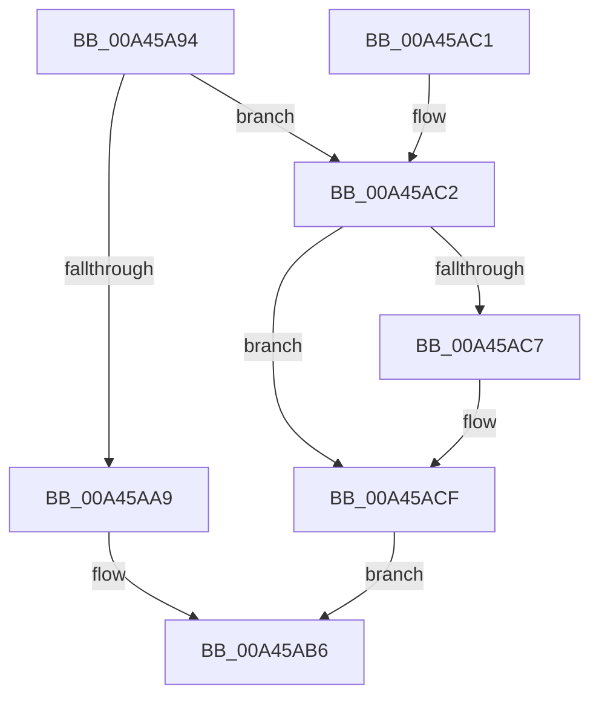

# CmpLockTwoSecurityCachesExclusiveShared

- RVA: `0x00A45A94`–`0x00A45AD6` (길이 `66` bytes)
- VA: `0x0000000140A45A94`
- 실행 섹션: `PAGE`
- PDB 이름 있음: `예`; PDB Function 태그: `아니요`
- unwind 정보 RVA: `0x000A2244`
- 디코드: `21`개 명령, `66/66` bytes 표시
- 미해석 바이트: `0` (있으면 어셈블리에 `.byte`로 보존)

> 이 문서는 커널 이미지의 기계어와 PDB 기호를 분석해 생성했습니다. 4번과 5번은 함수 원형과 자료형을 바이너리 사용 방식에서 추정한 C 해석이며 원본 소스 복구 결과는 아닙니다.

## 1. Dependencies

- 직접 호출 지점: **4**; 고유 호출 대상: **2**
- 직접 호출자로 확인된 함수: **3**
- RIP 상대 이미지 참조: **0**

### Outgoing calls
- `0x00A45AA9` → [CmLockHiveSecurityExclusive](../84/CmLockHiveSecurityExclusive_function_0084B1A8.md) (function, `0x0084B1A8`)
- `0x00A45AB1` → [CmLockHiveSecurityShared](../../pagecmrc/BC/CmLockHiveSecurityShared_function_00BC996C.md) (function, `0x00BC996C`)
- `0x00A45AC7` → [CmLockHiveSecurityShared](../../pagecmrc/BC/CmLockHiveSecurityShared_function_00BC996C.md) (function, `0x00BC996C`)
- `0x00A45ACF` → [CmLockHiveSecurityExclusive](../84/CmLockHiveSecurityExclusive_function_0084B1A8.md) (function, `0x0084B1A8`)

### Direct callers
- [CmpDoBuildVirtualStack](../7E/CmpDoBuildVirtualStack_function_007EB4C4.md) at `0x007EB872`
- [CmpSyncKeyValues](../7F/CmpSyncKeyValues_function_007F2DF4.md) at `0x007F2EA1`
- [CmpCopyKeyPartial](../85/CmpCopyKeyPartial_function_0085AFF4.md) at `0x0085B186`

### Static image references
- 디코드된 RIP-relative 메모리 참조가 없습니다.

## 2. Other-region calls and transfers

- 다른 실행 섹션으로 향하는 call: **2**
  - `0x00A45AB1` → [CmLockHiveSecurityShared](../../pagecmrc/BC/CmLockHiveSecurityShared_function_00BC996C.md) (`PAGE` → `PAGECMRC`)
  - `0x00A45AC7` → [CmLockHiveSecurityShared](../../pagecmrc/BC/CmLockHiveSecurityShared_function_00BC996C.md) (`PAGE` → `PAGECMRC`)
- 별도 외부 분기/꼬리 이동을 확인하지 못했습니다.

## 3. Assembly (complete function range)

```asm
00A45A94  48 89 5C 24 08                  mov qword ptr [rsp + 8], rbx
00A45A99  57                              push rdi
00A45A9A  48 83 EC 20                     sub rsp, 0x20
00A45A9E  48 8B DA                        mov rbx, rdx
00A45AA1  48 8B F9                        mov rdi, rcx
00A45AA4  48 3B CA                        cmp rcx, rdx
00A45AA7  73 19                           jae 0x140a45ac2
00A45AA9  E8 FA 56 E0 FF                  call 0x14084b1a8
00A45AAE  48 8B CB                        mov rcx, rbx
00A45AB1  E8 B6 3E 18 00                  call 0x140bc996c
00A45AB6  48 8B 5C 24 30                  mov rbx, qword ptr [rsp + 0x30]
00A45ABB  48 83 C4 20                     add rsp, 0x20
00A45ABF  5F                              pop rdi
00A45AC0  C3                              ret
00A45AC1  CC                              int3
00A45AC2  48 8B CB                        mov rcx, rbx
00A45AC5  76 08                           jbe 0x140a45acf
00A45AC7  E8 A0 3E 18 00                  call 0x140bc996c
00A45ACC  48 8B CF                        mov rcx, rdi
00A45ACF  E8 D4 56 E0 FF                  call 0x14084b1a8
00A45AD4  EB E0                           jmp 0x140a45ab6
```

## 4. C-style interpretation (structured pseudocode)

```c
__int64 __fastcall CmpLockTwoSecurityCachesExclusiveShared(__int64 a1, __int64 a2)
{
    __int64 result;
    __int64 v_rsp;
    unsigned __int64 v_stack_p8;

    v_stack_p8 = v_rbx;
    v_rsp = (v_rsp) - (32);
    if (a1 >= a2) goto loc_00A45AC2;
    result = CmLockHiveSecurityExclusive(a1, a2, a3, a4);
    result = CmLockHiveSecurityShared(a2, a2, a3, a4);
loc_00A45AB6:
    v_rsp = (v_rsp) + (32);
    return result;
loc_00A45AC2:
    if (!(condition_is_below_or_equal)) {
        result = CmLockHiveSecurityShared(v_stack_p8, a2, a3, a4);
        a1 = a1;
    }
    result = CmLockHiveSecurityExclusive(a1, a2, a3, a4);
    goto loc_00A45AB6;
}
```

## 5. (Beta) C Style

```c
int64_t CmpLockTwoSecurityCachesExclusiveShared(int64_t Arg1, int64_t Arg2)
{
    int64_t result;
    int64_t local_rsp;
    uint64_t v_stack_p8;

    v_stack_p8 = local_rbx;
    local_rsp = (local_rsp) - (32);
    if (Arg1 >= Arg2) goto loc_00A45AC2;
    result = CmLockHiveSecurityExclusive(Arg1, Arg2, a3, a4);
    result = CmLockHiveSecurityShared(Arg2, Arg2, a3, a4);
loc_00A45AB6:
    local_rsp = (local_rsp) + (32);
    return result;
loc_00A45AC2:
    if (!(condition_is_below_or_equal)) {
        result = CmLockHiveSecurityShared(v_stack_p8, Arg2, a3, a4);
        Arg1 = Arg1;
    }
    result = CmLockHiveSecurityExclusive(Arg1, Arg2, a3, a4);
    goto loc_00A45AB6;
}
```

## 6. Execution-region graph

[열기: 2D/3D 그래프와 함수 탐색 컨트롤 패널](../../../control-panel.html?section=page&rva=0x00A45A94&view=graph)

- 2D 그래프는 위에서 아래로 흐르고, 3D 그래프는 빈 공간을 드래그해 회전합니다. Shift+드래그는 이동, 휠은 확대·축소, 함수 노드 선택은 대상 보고서 이동입니다.

### Static fallback


