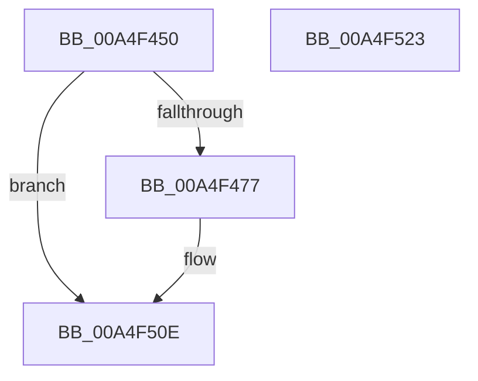

# CmpLogFlushPhaseStart

- RVA: `0x00A4F450`–`0x00A4F524` (길이 `212` bytes)
- VA: `0x0000000140A4F450`
- 실행 섹션: `PAGE`
- PDB 이름 있음: `예`; PDB Function 태그: `아니요`
- unwind 정보 RVA: `0x000B0904`
- 디코드: `47`개 명령, `212/212` bytes 표시
- 미해석 바이트: `0` (있으면 어셈블리에 `.byte`로 보존)

> 이 문서는 커널 이미지의 기계어와 PDB 기호를 분석해 생성했습니다. 4번과 5번은 함수 원형과 자료형을 바이너리 사용 방식에서 추정한 C 해석이며 원본 소스 복구 결과는 아닙니다.

## 1. Dependencies

- 직접 호출 지점: **2**; 고유 호출 대상: **2**
- 직접 호출자로 확인된 함수: **1**
- RIP 상대 이미지 참조: **8**

### Outgoing calls
- `0x00A4F509` → [EtwWriteTransfer](../../text/41/EtwWriteTransfer_function_0041C830.md) (function, `0x0041C830`)
- `0x00A4F515` → [_security_check_cookie](../../text/6A/_security_check_cookie_function_006AC640.md) (function, `0x006AC640`)

### Direct callers
- [CmpFlushHive](../9B/CmpFlushHive_function_009B3DC0.md) at `0x009B426C`
- [CmpFlushHive](../9B/CmpFlushHive_function_009B3DC0.md) at `0x009B42BE`
- [CmpFlushHive](../9B/CmpFlushHive_function_009B3DC0.md) at `0x009B4514`
- [CmpFlushHive](../9B/CmpFlushHive_function_009B3DC0.md) at `0x009B4550`
- [CmpFlushHive](../9B/CmpFlushHive_function_009B3DC0.md) at `0x009B4594`
- [CmpFlushHive](../9B/CmpFlushHive_function_009B3DC0.md) at `0x009B45DE`
- [CmpFlushHive](../9B/CmpFlushHive_function_009B3DC0.md) at `0x009B466D`

### Static image references
- `0x00A4F45C` → RVA `0x00E0A740` (`.data`; read)
- `0x00A4F46A` → RVA `0x00E09F58` (`.data`; read)
- `0x00A4F490` → RVA `0x00056183` (`.rdata`; read)
- `0x00A4F49D` → RVA `0x00E09F60` (`.data`; read)
- `0x00A4F4BF` → RVA `0x0005618D` (`.rdata`; read)
- `0x00A4F4CA` → RVA `0x0005BCFD` (`.rdata`; read)
- `0x00A4F4D4` → RVA `0x00043590` (`.rdata`; read)
- `0x00A4F4F1` → RVA `0x00E09F78` (`.data`; read)

## 2. Other-region calls and transfers

- 다른 실행 섹션으로 향하는 call: **2**
  - `0x00A4F509` → [EtwWriteTransfer](../../text/41/EtwWriteTransfer_function_0041C830.md) (`PAGE` → `.text`)
  - `0x00A4F515` → [_security_check_cookie](../../text/6A/_security_check_cookie_function_006AC640.md) (`PAGE` → `.text`)
- 별도 외부 분기/꼬리 이동을 확인하지 못했습니다.

## 3. Assembly (complete function range)

```asm
00A4F450  40 55                           push rbp
00A4F452  48 8B EC                        mov rbp, rsp
00A4F455  48 81 EC 80 00 00 00            sub rsp, 0x80
00A4F45C  48 8B 05 DD B2 3B 00            mov rax, qword ptr [rip + 0x3bb2dd]
00A4F463  48 33 C4                        xor rax, rsp
00A4F466  48 89 45 F8                     mov qword ptr [rbp - 8], rax
00A4F46A  83 3D E7 AA 3B 00 04            cmp dword ptr [rip + 0x3baae7], 4
00A4F471  0F 86 97 00 00 00               jbe 0x140a4f50e
00A4F477  83 65 F4 00                     and dword ptr [rbp - 0xc], 0
00A4F47B  48 8D 45 B0                     lea rax, [rbp - 0x50]
00A4F47F  48 83 65 C0 00                  and qword ptr [rbp - 0x40], 0
00A4F484  B9 01 00 00 00                  mov ecx, 1
00A4F489  48 89 45 E8                     mov qword ptr [rbp - 0x18], rax
00A4F48D  45 33 C9                        xor r9d, r9d
00A4F490  0F B7 05 EC 6C 60 FF            movzx eax, word ptr [rip - 0x9f9314]
00A4F497  45 33 C0                        xor r8d, r8d
00A4F49A  89 45 BC                        mov dword ptr [rbp - 0x44], eax
00A4F49D  48 8B 05 BC AA 3B 00            mov rax, qword ptr [rip + 0x3baabc]
00A4F4A4  48 89 45 C8                     mov qword ptr [rbp - 0x38], rax
00A4F4A8  89 4D F0                        mov dword ptr [rbp - 0x10], ecx
00A4F4AB  88 55 B0                        mov byte ptr [rbp - 0x50], dl
00A4F4AE  48 8D 55 B8                     lea rdx, [rbp - 0x48]
00A4F4B2  C7 45 B8 00 00 00 0B            mov dword ptr [rbp - 0x48], 0xb000000
00A4F4B9  0F B7 00                        movzx eax, word ptr [rax]
00A4F4BC  89 45 D0                        mov dword ptr [rbp - 0x30], eax
00A4F4BF  48 8D 05 C7 6C 60 FF            lea rax, [rip - 0x9f9339]
00A4F4C6  48 89 45 D8                     mov qword ptr [rbp - 0x28], rax
00A4F4CA  48 8D 05 2C C8 60 FF            lea rax, [rip - 0x9f37d4]
00A4F4D1  89 4D E4                        mov dword ptr [rbp - 0x1c], ecx
00A4F4D4  48 8D 0D B5 40 5F FF            lea rcx, [rip - 0xa0bf4b]
00A4F4DB  2B C1                           sub eax, ecx
00A4F4DD  C7 45 D4 02 00 00 00            mov dword ptr [rbp - 0x2c], 2
00A4F4E4  C7 45 E0 1A 00 00 00            mov dword ptr [rbp - 0x20], 0x1a
00A4F4EB  89 45 B4                        mov dword ptr [rbp - 0x4c], eax
00A4F4EE  8B 45 B4                        mov eax, dword ptr [rbp - 0x4c]
00A4F4F1  48 8B 0D 80 AA 3B 00            mov rcx, qword ptr [rip + 0x3baa80]
00A4F4F8  48 8D 45 C8                     lea rax, [rbp - 0x38]
00A4F4FC  48 89 44 24 28                  mov qword ptr [rsp + 0x28], rax
00A4F501  C7 44 24 20 03 00 00 00         mov dword ptr [rsp + 0x20], 3
00A4F509  E8 22 D3 9C FF                  call 0x14041c830
00A4F50E  48 8B 4D F8                     mov rcx, qword ptr [rbp - 8]
00A4F512  48 33 CC                        xor rcx, rsp
00A4F515  E8 26 D1 C5 FF                  call 0x1406ac640
00A4F51A  48 81 C4 80 00 00 00            add rsp, 0x80
00A4F521  5D                              pop rbp
00A4F522  C3                              ret
00A4F523  CC                              int3
```

## 4. C-style interpretation (structured pseudocode)

```c
__int64 __fastcall CmpLogFlushPhaseStart(__int64 a1, unsigned __int8 a2, int a3, int a4)
{
    __int64 result;
    __int64 v_rsp;
    unsigned __int64 v_stack_m10;
    unsigned int v_stack_m14;
    unsigned int v_stack_m18;
    unsigned __int64 v_stack_m20;
    unsigned int v_stack_m24;
    unsigned int v_stack_m28;
    unsigned __int64 v_stack_m30;
    unsigned int v_stack_m34;
    unsigned int v_stack_m38;
    unsigned __int64 v_stack_m40;
    unsigned __int64 v_stack_m48;
    unsigned int v_stack_m4C;
    unsigned __int64 v_stack_m50;
    unsigned int v_stack_m54;
    unsigned __int64 v_stack_m58;
    unsigned __int64 v_stack_m60;
    unsigned int v_stack_m68;

    v_rsp = (v_rsp) - (128);
    result = (*(unsigned __int64 *)(v_rip + 3912413)) ^ (v_rsp);
    v_stack_m10 = result;
    if ((*(unsigned int *)(v_rip + 3910375)) >= = 4) {
        result = v_stack_m58;
        a1 = 1;
        v_stack_m20 = result;
        a4 = 0;
        result = *(unsigned __int16 *)(v_rip - 10457876);
        a3 = 0;
        v_stack_m4C = (unsigned int)(result);
        result = *(unsigned __int64 *)(v_rip + 3910332);
        v_stack_m40 = result;
        v_stack_m18 = (unsigned int)(a1);
        v_stack_m58 = a2;
        a2 = v_stack_m50;
        v_stack_m50 = 0xB000000ULL;
        result = *(unsigned __int16 *)(result);
        v_stack_m38 = (unsigned int)(result);
        result = v_rip - 10457913;
        v_stack_m30 = result;
        result = v_rip - 10434516;
        v_stack_m24 = (unsigned int)(a1);
        a1 = v_rip - 10534731;
        result = (unsigned int)((result) - ((unsigned int)(a1)));
        v_stack_m34 = 2;
        v_stack_m28 = 26;
        v_stack_m54 = (unsigned int)(result);
        result = v_stack_m54;
        a1 = *(unsigned __int64 *)(v_rip + 3910272);
        result = v_stack_m40;
        v_stack_m60 = result;
        v_stack_m68 = 3;
        result = EtwWriteTransfer(a1, a2, a3, a4);
    }
    a1 = (v_stack_m10) ^ (v_rsp);
    result = _security_check_cookie(a1, a2, a3, a4);
    v_rsp = (v_rsp) + (128);
    return result;
}
```

## 5. (Beta) C Style

```c
int64_t CmpLogFlushPhaseStart(int64_t Arg1, uint8_t Arg2, int32_t Arg3, int32_t Arg4)
{
    int64_t result;
    int64_t local_rsp;
    uint64_t v_stack_m10;
    uint32_t v_stack_m14;
    uint32_t v_stack_m18;
    uint64_t v_stack_m20;
    uint32_t v_stack_m24;
    uint32_t v_stack_m28;
    uint64_t v_stack_m30;
    uint32_t v_stack_m34;
    uint32_t v_stack_m38;
    uint64_t v_stack_m40;
    uint64_t v_stack_m48;
    uint32_t v_stack_m4C;
    uint64_t v_stack_m50;
    uint32_t v_stack_m54;
    uint64_t v_stack_m58;
    uint64_t v_stack_m60;
    uint32_t v_stack_m68;

    local_rsp = (local_rsp) - (128);
    result = (*(uint64_t *)(v_rip + 0x3BB2DD)) ^ (local_rsp);
    v_stack_m10 = result;
    if ((*(uint32_t *)(v_rip + 0x3BAAE7)) >= = 4) {
        result = v_stack_m58;
        Arg1 = 1;
        v_stack_m20 = result;
        Arg4 = 0;
        result = *(uint16_t *)(v_rip - 0x9F9314);
        Arg3 = 0;
        v_stack_m4C = (uint32_t)(result);
        result = *(uint64_t *)(v_rip + 0x3BAABC);
        v_stack_m40 = result;
        v_stack_m18 = (uint32_t)(Arg1);
        v_stack_m58 = Arg2;
        Arg2 = v_stack_m50;
        v_stack_m50 = 0xB000000ULL;
        result = *(uint16_t *)(result);
        v_stack_m38 = (uint32_t)(result);
        result = v_rip - 10457913;
        v_stack_m30 = result;
        result = v_rip - 10434516;
        v_stack_m24 = (uint32_t)(Arg1);
        Arg1 = v_rip - 10534731;
        result = (uint32_t)((result) - ((uint32_t)(Arg1)));
        v_stack_m34 = 2;
        v_stack_m28 = 26;
        v_stack_m54 = (uint32_t)(result);
        result = v_stack_m54;
        Arg1 = *(uint64_t *)(v_rip + 0x3BAA80);
        result = v_stack_m40;
        v_stack_m60 = result;
        v_stack_m68 = 3;
        result = EtwWriteTransfer(Arg1, Arg2, Arg3, Arg4);
    }
    Arg1 = (v_stack_m10) ^ (local_rsp);
    result = _security_check_cookie(Arg1, Arg2, Arg3, Arg4);
    local_rsp = (local_rsp) + (128);
    return result;
}
```

## 6. Execution-region graph

[열기: 2D/3D 그래프와 함수 탐색 컨트롤 패널](../../../control-panel.html?section=page&rva=0x00A4F450&view=graph)

- 2D 그래프는 위에서 아래로 흐르고, 3D 그래프는 빈 공간을 드래그해 회전합니다. Shift+드래그는 이동, 휠은 확대·축소, 함수 노드 선택은 대상 보고서 이동입니다.

### Static fallback


