# CmpNotifyChangeKey

- RVA: `0x00A43C80`–`0x00A43FC3` (길이 `835` bytes)
- VA: `0x0000000140A43C80`
- 실행 섹션: `PAGE`
- PDB 이름 있음: `예`; PDB Function 태그: `예`
- unwind 정보 RVA: `0x000AF068`
- 디코드: `209`개 명령, `835/835` bytes 표시
- 미해석 바이트: `0` (있으면 어셈블리에 `.byte`로 보존)

> 이 문서는 커널 이미지의 기계어와 PDB 기호를 분석해 생성했습니다. 4번과 5번은 함수 원형과 자료형을 바이너리 사용 방식에서 추정한 C 해석이며 원본 소스 복구 결과는 아닙니다.

## 1. Dependencies

- 직접 호출 지점: **7**; 고유 호출 대상: **7**
- 직접 호출자로 확인된 함수: **1**
- RIP 상대 이미지 참조: **5**

### Outgoing calls
- `0x00A43CAC` → [CmpIsKeyDeletedForKeyBody](../../pagecmrc/BC/CmpIsKeyDeletedForKeyBody_function_00BC9480.md) (function, `0x00BC9480`)
- `0x00A43D14` → [ExAllocatePool2](../../poolcode/B8/ExAllocatePool2_function_00B820F0.md) (function, `0x00B820F0`)
- `0x00A43D66` → [SeCaptureSubjectContext](../86/SeCaptureSubjectContext_function_0086B820.md) (function, `0x0086B820`)
- `0x00A43ED1` → [KiLowerIrqlProcessIrqlFlags](../../text/4F/KiLowerIrqlProcessIrqlFlags_function_004F5698.md) (function, `0x004F5698`)
- `0x00A43F40` → [KiRaiseIrqlProcessIrqlFlags](../../text/4F/KiRaiseIrqlProcessIrqlFlags_function_004F56FC.md) (function, `0x004F56FC`)
- `0x00A43F93` → [CmpLogNotificationRegister](../7E/CmpLogNotificationRegister_function_007E6504.md) (function, `0x007E6504`)
- `0x00A43FB7` → [CmpPostNotify](../86/CmpPostNotify_function_008645D8.md) (function, `0x008645D8`)

### Direct callers
- [NtNotifyChangeMultipleKeys](../9D/NtNotifyChangeMultipleKeys_function_009DC6B0.md) at `0x009DCC84`
- [NtNotifyChangeMultipleKeys](../9D/NtNotifyChangeMultipleKeys_function_009DC6B0.md) at `0x009DCD77`

### Static image references
- `0x00A43DE8` → RVA `0x00FD85E0` (`PAGEDATA`; read)
- `0x00A43DEF` → RVA `0x00FD85D8` (`PAGEDATA`; read)
- `0x00A43E0D` → RVA `0x00FD85E0` (`PAGEDATA`; write)
- `0x00A43E4A` → RVA `0x00FC6D20` (`ALMOSTRO`; read)
- `0x00A43EDE` → RVA `0x00FC6B08` (`ALMOSTRO`; read)

## 2. Other-region calls and transfers

- 다른 실행 섹션으로 향하는 call: **4**
  - `0x00A43CAC` → [CmpIsKeyDeletedForKeyBody](../../pagecmrc/BC/CmpIsKeyDeletedForKeyBody_function_00BC9480.md) (`PAGE` → `PAGECMRC`)
  - `0x00A43D14` → [ExAllocatePool2](../../poolcode/B8/ExAllocatePool2_function_00B820F0.md) (`PAGE` → `POOLCODE`)
  - `0x00A43ED1` → [KiLowerIrqlProcessIrqlFlags](../../text/4F/KiLowerIrqlProcessIrqlFlags_function_004F5698.md) (`PAGE` → `.text`)
  - `0x00A43F40` → [KiRaiseIrqlProcessIrqlFlags](../../text/4F/KiRaiseIrqlProcessIrqlFlags_function_004F56FC.md) (`PAGE` → `.text`)
- call이 아닌 외부 분기/꼬리 이동: **2**
  - `0x00A43F4F` → [sub_00B3AD0E](../B3/Unknown_function_00B3AD0E.md) (`tail-transfer`)
  - `0x00A43F61` → [sub_00B3AD0E](../B3/Unknown_function_00B3AD0E.md) (`tail-transfer`)

## 3. Assembly (complete function range)

```asm
00A43C80  48 8B C4                        mov rax, rsp
00A43C83  48 89 58 08                     mov qword ptr [rax + 8], rbx
00A43C87  48 89 68 10                     mov qword ptr [rax + 0x10], rbp
00A43C8B  48 89 70 18                     mov qword ptr [rax + 0x18], rsi
00A43C8F  48 89 78 20                     mov qword ptr [rax + 0x20], rdi
00A43C93  41 55                           push r13
00A43C95  41 56                           push r14
00A43C97  41 57                           push r15
00A43C99  48 83 EC 40                     sub rsp, 0x40
00A43C9D  48 8B FA                        mov rdi, rdx
00A43CA0  45 0F B6 F9                     movzx r15d, r9b
00A43CA4  33 D2                           xor edx, edx
00A43CA6  45 8B F0                        mov r14d, r8d
00A43CA9  48 8B F1                        mov rsi, rcx
00A43CAC  E8 CF 57 18 00                  call 0x140bc9480
00A43CB1  84 C0                           test al, al
00A43CB3  0F 85 91 02 00 00               jne 0x140a43f4a
00A43CB9  48 8B 46 08                     mov rax, qword ptr [rsi + 8]
00A43CBD  41 BD 01 00 00 00               mov r13d, 1
00A43CC3  48 8B 5E 10                     mov rbx, qword ptr [rsi + 0x10]
00A43CC7  48 8B 68 20                     mov rbp, qword ptr [rax + 0x20]
00A43CCB  48 85 DB                        test rbx, rbx
00A43CCE  74 18                           je 0x140a43ce8
00A43CD0  48 8D 43 10                     lea rax, [rbx + 0x10]
00A43CD4  48 8B 08                        mov rcx, qword ptr [rax]
00A43CD7  48 39 41 08                     cmp qword ptr [rcx + 8], rax
00A43CDB  0F 84 D9 00 00 00               je 0x140a43dba
00A43CE1  B9 03 00 00 00                  mov ecx, 3
00A43CE6  CD 29                           int 0x29
00A43CE8  8B 47 38                        mov eax, dword ptr [rdi + 0x38]
00A43CEB  0F B7 C0                        movzx eax, ax
00A43CEE  83 F8 04                        cmp eax, 4
00A43CF1  0F 84 5D 02 00 00               je 0x140a43f54
00A43CF7  33 C9                           xor ecx, ecx
00A43CF9  83 F8 02                        cmp eax, 2
00A43CFC  0F 84 52 02 00 00               je 0x140a43f54
00A43D02  48 81 C1 00 01 00 00            add rcx, 0x100
00A43D09  BA 58 00 00 00                  mov edx, 0x58
00A43D0E  41 B8 43 4D 6E 62               mov r8d, 0x626e4d43
00A43D14  E8 D7 E3 13 00                  call 0x140b820f0
00A43D19  48 8B D8                        mov rbx, rax
00A43D1C  48 85 C0                        test rax, rax
00A43D1F  0F 84 37 02 00 00               je 0x140a43f5c
00A43D25  48 8B 46 08                     mov rax, qword ptr [rsi + 8]
00A43D29  BA FF FF FF 3F                  mov edx, 0x3fffffff
00A43D2E  48 89 43 20                     mov qword ptr [rbx + 0x20], rax
00A43D32  8B 43 30                        mov eax, dword ptr [rbx + 0x30]
00A43D35  8B C8                           mov ecx, eax
00A43D37  41 33 CE                        xor ecx, r14d
00A43D3A  23 CA                           and ecx, edx
00A43D3C  33 C8                           xor ecx, eax
00A43D3E  41 8B C7                        mov eax, r15d
00A43D41  C1 E0 1E                        shl eax, 0x1e
00A43D44  23 CA                           and ecx, edx
00A43D46  33 C1                           xor eax, ecx
00A43D48  48 8D 4B 38                     lea rcx, [rbx + 0x38]
00A43D4C  0F BA F0 1F                     btr eax, 0x1f
00A43D50  89 43 30                        mov dword ptr [rbx + 0x30], eax
00A43D53  48 8D 43 10                     lea rax, [rbx + 0x10]
00A43D57  48 89 40 08                     mov qword ptr [rax + 8], rax
00A43D5B  48 89 00                        mov qword ptr [rax], rax
00A43D5E  48 89 5E 10                     mov qword ptr [rsi + 0x10], rbx
00A43D62  48 89 73 28                     mov qword ptr [rbx + 0x28], rsi
00A43D66  E8 B5 7A E2 FF                  call 0x14086b820
00A43D6B  4C 8D 85 38 06 00 00            lea r8, [rbp + 0x638]
00A43D72  41 B9 00 00 E0 7F               mov r9d, 0x7fe00000
00A43D78  49 8B 00                        mov rax, qword ptr [r8]
00A43D7B  48 85 C0                        test rax, rax
00A43D7E  0F 84 E2 01 00 00               je 0x140a43f66
00A43D84  4C 8B C0                        mov r8, rax
00A43D87  48 8B 40 20                     mov rax, qword ptr [rax + 0x20]
00A43D8B  8B 50 08                        mov edx, dword ptr [rax + 8]
00A43D8E  48 8B 46 08                     mov rax, qword ptr [rsi + 8]
00A43D92  41 23 D1                        and edx, r9d
00A43D95  8B 48 08                        mov ecx, dword ptr [rax + 8]
00A43D98  41 23 C9                        and ecx, r9d
00A43D9B  3B D1                           cmp edx, ecx
00A43D9D  76 D9                           jbe 0x140a43d78
00A43D9F  4C 89 03                        mov qword ptr [rbx], r8
00A43DA2  49 8B 40 08                     mov rax, qword ptr [r8 + 8]
00A43DA6  48 89 18                        mov qword ptr [rax], rbx
00A43DA9  49 8B 40 08                     mov rax, qword ptr [r8 + 8]
00A43DAD  48 89 43 08                     mov qword ptr [rbx + 8], rax
00A43DB1  49 89 58 08                     mov qword ptr [r8 + 8], rbx
00A43DB5  E9 16 FF FF FF                  jmp 0x140a43cd0
00A43DBA  48 89 0F                        mov qword ptr [rdi], rcx
00A43DBD  48 89 47 08                     mov qword ptr [rdi + 8], rax
00A43DC1  48 89 79 08                     mov qword ptr [rcx + 8], rdi
00A43DC5  48 8D 4F 20                     lea rcx, [rdi + 0x20]
00A43DC9  48 89 38                        mov qword ptr [rax], rdi
00A43DCC  0F BA 67 38 10                  bt dword ptr [rdi + 0x38], 0x10
00A43DD1  73 46                           jae 0x140a43e19
00A43DD3  48 89 49 08                     mov qword ptr [rcx + 8], rcx
00A43DD7  48 89 09                        mov qword ptr [rcx], rcx
00A43DDA  8B 47 38                        mov eax, dword ptr [rdi + 0x38]
00A43DDD  0F B7 C8                        movzx ecx, ax
00A43DE0  83 E9 03                        sub ecx, 3
00A43DE3  41 3B CD                        cmp ecx, r13d
00A43DE6  77 5A                           ja 0x140a43e42
00A43DE8  48 8B 0D F1 47 59 00            mov rcx, qword ptr [rip + 0x5947f1]
00A43DEF  48 8D 15 E2 47 59 00            lea rdx, [rip + 0x5947e2]
00A43DF6  48 8D 47 10                     lea rax, [rdi + 0x10]
00A43DFA  48 39 11                        cmp qword ptr [rcx], rdx
00A43DFD  0F 85 DE FE FF FF               jne 0x140a43ce1
00A43E03  48 89 10                        mov qword ptr [rax], rdx
00A43E06  48 89 48 08                     mov qword ptr [rax + 8], rcx
00A43E0A  48 89 01                        mov qword ptr [rcx], rax
00A43E0D  48 89 05 CC 47 59 00            mov qword ptr [rip + 0x5947cc], rax
00A43E14  E9 C5 00 00 00                  jmp 0x140a43ede
00A43E19  48 8B 84 24 90 00 00 00         mov rax, qword ptr [rsp + 0x90]
00A43E21  48 83 C0 20                     add rax, 0x20
00A43E25  48 8B 50 08                     mov rdx, qword ptr [rax + 8]
00A43E29  48 39 02                        cmp qword ptr [rdx], rax
00A43E2C  0F 85 AF FE FF FF               jne 0x140a43ce1
00A43E32  48 89 01                        mov qword ptr [rcx], rax
00A43E35  48 89 51 08                     mov qword ptr [rcx + 8], rdx
00A43E39  48 89 0A                        mov qword ptr [rdx], rcx
00A43E3C  48 89 48 08                     mov qword ptr [rax + 8], rcx
00A43E40  EB 98                           jmp 0x140a43dda
00A43E42  44 0F 20 C5                     mov rbp, cr8
00A43E46  45 0F 22 C5                     mov cr8, r13
00A43E4A  83 3D CF 2E 58 00 00            cmp dword ptr [rip + 0x582ecf], 0
00A43E51  0F 85 E3 00 00 00               jne 0x140a43f3a
00A43E57  65 48 8B 0C 25 88 01 00 00      mov rcx, qword ptr gs:[0x188]
00A43E60  8A 81 A8 05 00 00               mov al, byte ptr [rcx + 0x5a8]
00A43E66  A8 08                           test al, 8
00A43E68  75 21                           jne 0x140a43e8b
00A43E6A  8A 81 A8 05 00 00               mov al, byte ptr [rcx + 0x5a8]
00A43E70  0C 08                           or al, 8
00A43E72  88 81 A8 05 00 00               mov byte ptr [rcx + 0x5a8], al
00A43E78  F0 83 0C 24 00                  lock or dword ptr [rsp], 0
00A43E7D  48 8D 81 D8 04 00 00            lea rax, [rcx + 0x4d8]
00A43E84  48 89 40 08                     mov qword ptr [rax + 8], rax
00A43E88  48 89 00                        mov qword ptr [rax], rax
00A43E8B  65 48 8B 14 25 88 01 00 00      mov rdx, qword ptr gs:[0x188]
00A43E94  48 8D 4F 10                     lea rcx, [rdi + 0x10]
00A43E98  0F BA 67 38 10                  bt dword ptr [rdi + 0x38], 0x10
00A43E9D  48 8D 82 D8 04 00 00            lea rax, [rdx + 0x4d8]
00A43EA4  73 77                           jae 0x140a43f1d
00A43EA6  48 8B 10                        mov rdx, qword ptr [rax]
00A43EA9  48 39 42 08                     cmp qword ptr [rdx + 8], rax
00A43EAD  0F 85 2E FE FF FF               jne 0x140a43ce1
00A43EB3  48 89 11                        mov qword ptr [rcx], rdx
00A43EB6  48 89 41 08                     mov qword ptr [rcx + 8], rax
00A43EBA  48 89 4A 08                     mov qword ptr [rdx + 8], rcx
00A43EBE  48 89 08                        mov qword ptr [rax], rcx
00A43EC1  83 3D 58 2E 58 00 00            cmp dword ptr [rip + 0x582e58], 0
00A43EC8  74 0C                           je 0x140a43ed6
00A43ECA  44 0F 20 C1                     mov rcx, cr8
00A43ECE  40 8A D5                        mov dl, bpl
00A43ED1  E8 C2 17 AB FF                  call 0x1404f5698
00A43ED6  40 0F B6 C5                     movzx eax, bpl
00A43EDA  44 0F 22 C0                     mov cr8, rax
00A43EDE  F7 05 20 2C 58 00 00 00 00 02   test dword ptr [rip + 0x582c20], 0x2000000
00A43EE8  0F 85 88 00 00 00               jne 0x140a43f76
00A43EEE  83 7B 30 00                     cmp dword ptr [rbx + 0x30], 0
00A43EF2  0F 8C A5 00 00 00               jl 0x140a43f9d
00A43EF8  B8 03 01 00 00                  mov eax, 0x103
00A43EFD  48 8B 5C 24 60                  mov rbx, qword ptr [rsp + 0x60]
00A43F02  48 8B 6C 24 68                  mov rbp, qword ptr [rsp + 0x68]
00A43F07  48 8B 74 24 70                  mov rsi, qword ptr [rsp + 0x70]
00A43F0C  48 8B 7C 24 78                  mov rdi, qword ptr [rsp + 0x78]
00A43F11  48 83 C4 40                     add rsp, 0x40
00A43F15  41 5F                           pop r15
00A43F17  41 5E                           pop r14
00A43F19  41 5D                           pop r13
00A43F1B  C3                              ret
00A43F1C  CC                              int3
00A43F1D  48 8B 50 08                     mov rdx, qword ptr [rax + 8]
00A43F21  48 39 02                        cmp qword ptr [rdx], rax
00A43F24  0F 85 B7 FD FF FF               jne 0x140a43ce1
00A43F2A  48 89 01                        mov qword ptr [rcx], rax
00A43F2D  48 89 51 08                     mov qword ptr [rcx + 8], rdx
00A43F31  48 89 0A                        mov qword ptr [rdx], rcx
00A43F34  48 89 48 08                     mov qword ptr [rax + 8], rcx
00A43F38  EB 87                           jmp 0x140a43ec1
00A43F3A  41 8A D5                        mov dl, r13b
00A43F3D  40 8A CD                        mov cl, bpl
00A43F40  E8 B7 17 AB FF                  call 0x1404f56fc
00A43F45  E9 0D FF FF FF                  jmp 0x140a43e57
00A43F4A  BB 7C 01 00 C0                  mov ebx, 0xc000017c
00A43F4F  E9 BA 6D 0F 00                  jmp 0x140b3ad0e
00A43F54  49 8B CD                        mov rcx, r13
00A43F57  E9 A6 FD FF FF                  jmp 0x140a43d02
00A43F5C  BB 9A 00 00 C0                  mov ebx, 0xc000009a
00A43F61  E9 A8 6D 0F 00                  jmp 0x140b3ad0e
00A43F66  49 89 18                        mov qword ptr [r8], rbx
00A43F69  48 83 23 00                     and qword ptr [rbx], 0
00A43F6D  4C 89 43 08                     mov qword ptr [rbx + 8], r8
00A43F71  E9 5A FD FF FF                  jmp 0x140a43cd0
00A43F76  8B 4F 38                        mov ecx, dword ptr [rdi + 0x38]
00A43F79  45 8A CF                        mov r9b, r15b
00A43F7C  48 8B 56 08                     mov rdx, qword ptr [rsi + 8]
00A43F80  8B C1                           mov eax, ecx
00A43F82  C1 E8 10                        shr eax, 0x10
00A43F85  41 22 C5                        and al, r13b
00A43F88  44 0F B7 C1                     movzx r8d, cx
00A43F8C  48 8B CF                        mov rcx, rdi
00A43F8F  88 44 24 20                     mov byte ptr [rsp + 0x20], al
00A43F93  E8 6C 25 DA FF                  call 0x1407e6504
00A43F98  E9 51 FF FF FF                  jmp 0x140a43eee
00A43F9D  48 83 64 24 30 00               and qword ptr [rsp + 0x30], 0
00A43FA3  41 B9 0C 01 00 00               mov r9d, 0x10c
00A43FA9  48 83 64 24 28 00               and qword ptr [rsp + 0x28], 0
00A43FAF  48 8B CB                        mov rcx, rbx
00A43FB2  44 88 6C 24 20                  mov byte ptr [rsp + 0x20], r13b
00A43FB7  E8 1C 06 E2 FF                  call 0x1408645d8
00A43FBC  33 C0                           xor eax, eax
00A43FBE  E9 3A FF FF FF                  jmp 0x140a43efd
```

## 4. C-style interpretation (structured pseudocode)

```c
__int64 __fastcall CmpNotifyChangeKey(__int64 a1, __int64 a2, int a3, unsigned __int8 a4, __int64 a5, __int64 a6, __int64 a7)
{
    __int64 result;
    __int64 v_rsp;
    unsigned int v_stack_m58;
    unsigned __int64 v_stack_p10;
    unsigned __int64 v_stack_p18;
    unsigned __int64 v_stack_p20;
    unsigned __int64 v_stack_p28;
    unsigned __int64 v_stack_p30;
    unsigned __int64 v_stack_p8;

    *(unsigned __int64 *)(v_rsp + 8) = v_rbx;
    *(unsigned __int64 *)(v_rsp + 16) = v_rbp;
    *(unsigned __int64 *)(v_rsp + 24) = v_rsi;
    *(unsigned __int64 *)(v_rsp + 32) = v_rdi;
    v_rsp = (v_rsp) - (64);
    a2 = 0;
    result = CmpIsKeyDeletedForKeyBody(a1, a2, a3, a4);
    if ((unsigned __int8)(result) != 0) goto loc_00A43F4A;
    if (*(unsigned __int64 *)(a1 + 16) == 0) goto loc_00A43CE8;
loc_00A43CD0:
    if ((*(unsigned __int64 *)(*(unsigned __int64 *)(*(unsigned __int64 *)(a1 + 16) + 16) + 8)) == (*(unsigned __int64 *)(a1 + 16) + 16)) goto loc_00A43DBA;
loc_00A43CE1:
loc_00A43CE8:
    if (((unsigned int)((unsigned __int16)((unsigned int)(*(unsigned int *)(a2 + 56))))) == 4) goto loc_00A43F54;
    a1 = 0;
    if (((unsigned int)((unsigned __int16)((unsigned int)(*(unsigned int *)(a2 + 56))))) == 2) goto loc_00A43F54;
loc_00A43D02:
    a1 = (a1) + (256);
    result = ExAllocatePool2(a1, 88, (unsigned int)(0x626E4D43ULL), a4);
    if (result == 0) goto loc_00A43F5C;
    *(unsigned __int64 *)(result + 32) = *(unsigned __int64 *)(a1 + 8);
    a1 = (unsigned int)(((unsigned int)((unsigned int)((unsigned int)(*(unsigned int *)(result + 48))))) ^ ((unsigned int)((unsigned int)(a3))));
    a1 = (unsigned int)((a1) & ((unsigned int)((unsigned int)(0x3FFFFFFFULL))));
    a1 = (unsigned int)((a1) ^ ((unsigned int)((unsigned int)(*(unsigned int *)(result + 48)))));
    result = (unsigned int)(((unsigned int)(a4)) << (30));
    a1 = (unsigned int)((a1) & ((unsigned int)((unsigned int)(0x3FFFFFFFULL))));
    result = (unsigned int)((result) ^ ((unsigned int)(a1)));
    *(unsigned int *)(result + 48) = (unsigned int)(result);
    *(unsigned __int64 *)(result + 16 + 8) = result + 16;
    *(unsigned __int64 *)(result + 16) = result + 16;
    *(unsigned __int64 *)(a1 + 16) = result;
    *(unsigned __int64 *)(result + 40) = a1;
    result = SeCaptureSubjectContext(result + 56, (unsigned int)(0x3FFFFFFFULL), (unsigned int)(0x626E4D43ULL), a4);
loc_00A43D78:
    if (*(unsigned __int64 *)(*(unsigned __int64 *)(*(unsigned __int64 *)(a1 + 8) + 32) + 1592) == 0) goto loc_00A43F66;
    a2 = (unsigned int)(((unsigned int)(*(unsigned int *)(*(unsigned __int64 *)(*(unsigned __int64 *)(*(unsigned __int64 *)(*(unsigned __int64 *)(a1 + 8) + 32) + 1592) + 32) + 8))) & ((unsigned int)((unsigned int)(0x7FE00000ULL))));
    a1 = (unsigned int)(((unsigned int)(*(unsigned int *)(*(unsigned __int64 *)(a1 + 8) + 8))) & ((unsigned int)((unsigned int)(0x7FE00000ULL))));
    if (((unsigned int)(a2)) <= ((unsigned int)(a1))) goto loc_00A43D78;
    *(unsigned __int64 *)(result) = *(unsigned __int64 *)(*(unsigned __int64 *)(*(unsigned __int64 *)(a1 + 8) + 32) + 1592);
    *(unsigned __int64 *)(*(unsigned __int64 *)(*(unsigned __int64 *)(*(unsigned __int64 *)(*(unsigned __int64 *)(a1 + 8) + 32) + 1592) + 8)) = result;
    *(unsigned __int64 *)(result + 8) = *(unsigned __int64 *)(*(unsigned __int64 *)(*(unsigned __int64 *)(*(unsigned __int64 *)(a1 + 8) + 32) + 1592) + 8);
    *(unsigned __int64 *)(*(unsigned __int64 *)(*(unsigned __int64 *)(*(unsigned __int64 *)(a1 + 8) + 32) + 1592) + 8) = result;
    goto loc_00A43CD0;
loc_00A43DBA:
    *(unsigned __int64 *)(a2) = a1;
    *(unsigned __int64 *)(a2 + 8) = *(unsigned __int64 *)(*(unsigned __int64 *)(*(unsigned __int64 *)(*(unsigned __int64 *)(a1 + 8) + 32) + 1592) + 8);
    *(unsigned __int64 *)(a1 + 8) = a2;
    *(unsigned __int64 *)(*(unsigned __int64 *)(*(unsigned __int64 *)(*(unsigned __int64 *)(*(unsigned __int64 *)(a1 + 8) + 32) + 1592) + 8)) = a2;
    if (((unsigned int)(a2)) >= ((unsigned int)(a1))) goto loc_00A43E19;
    *(unsigned __int64 *)(a2 + 32 + 8) = a2 + 32;
    *(unsigned __int64 *)(a2 + 32) = a2 + 32;
loc_00A43DDA:
    a1 = (unsigned int)(((unsigned __int16)((unsigned int)(*(unsigned int *)(a2 + 56)))) - (3));
    if (((unsigned int)(a1)) > 1) goto loc_00A43E42;
    if ((*(unsigned __int64 *)(*(unsigned __int64 *)(v_rip + 5851121))) != (v_rip + 5851106)) goto loc_00A43CE1;
    *(unsigned __int64 *)(a2 + 16) = v_rip + 5851106;
    *(unsigned __int64 *)(a2 + 16 + 8) = *(unsigned __int64 *)(v_rip + 5851121);
    *(unsigned __int64 *)(*(unsigned __int64 *)(v_rip + 5851121)) = a2 + 16;
    *(unsigned __int64 *)(v_rip + 5851084) = a2 + 16;
    goto loc_00A43EDE;
loc_00A43E19:
    result = (a7) + (32);
    if ((*(unsigned __int64 *)(*(unsigned __int64 *)(result + 8))) != result) goto loc_00A43CE1;
    *(unsigned __int64 *)(*(unsigned __int64 *)(v_rip + 5851121)) = result;
    *(unsigned __int64 *)(*(unsigned __int64 *)(v_rip + 5851121) + 8) = *(unsigned __int64 *)(result + 8);
    *(unsigned __int64 *)(*(unsigned __int64 *)(result + 8)) = *(unsigned __int64 *)(v_rip + 5851121);
    *(unsigned __int64 *)(result + 8) = *(unsigned __int64 *)(v_rip + 5851121);
    goto loc_00A43DDA;
loc_00A43E42:
    if ((*(unsigned int *)(v_rip + 5779151)) != 0) goto loc_00A43F3A;
loc_00A43E57:
    result = *(unsigned __int8 *)(*(unsigned __int64 *)(gs_base + (0 + 392)) + 1448);
    if ((((unsigned __int8)(*(unsigned __int8 *)(*(unsigned __int64 *)(gs_base + (0 + 392)) + 1448))) & (8)) == 0) {
        result = *(unsigned __int8 *)(*(unsigned __int64 *)(gs_base + (0 + 392)) + 1448);
        result = (unsigned __int8)((result) | (8));
        *(unsigned __int8 *)(*(unsigned __int64 *)(gs_base + (0 + 392)) + 1448) = (unsigned __int8)(result);
        result = *(unsigned __int64 *)(gs_base + (0 + 392)) + 1240;
        *(unsigned __int64 *)(result + 8) = result;
        *(unsigned __int64 *)(result) = result;
    }
    if (condition_is_above_or_equal) goto loc_00A43F1D;
    if ((*(unsigned __int64 *)(*(unsigned __int64 *)(*(unsigned __int64 *)(gs_base + (0 + 392)) + 1240) + 8)) != (*(unsigned __int64 *)(gs_base + (0 + 392)) + 1240)) goto loc_00A43CE1;
    *(unsigned __int64 *)(a2 + 16) = *(unsigned __int64 *)(*(unsigned __int64 *)(gs_base + (0 + 392)) + 1240);
    *(unsigned __int64 *)(a2 + 16 + 8) = *(unsigned __int64 *)(gs_base + (0 + 392)) + 1240;
    *(unsigned __int64 *)(*(unsigned __int64 *)(*(unsigned __int64 *)(gs_base + (0 + 392)) + 1240) + 8) = a2 + 16;
    *(unsigned __int64 *)(*(unsigned __int64 *)(gs_base + (0 + 392)) + 1240) = a2 + 16;
loc_00A43EC1:
    result = *(unsigned __int64 *)(gs_base + (0 + 392)) + 1240;
    if ((*(unsigned int *)(v_rip + 5779032)) != 0) {
        a1 = 1;
        a2 = (unsigned __int8)(v_cr8);
        result = KiLowerIrqlProcessIrqlFlags(a1, a2, *(unsigned __int64 *)(*(unsigned __int64 *)(*(unsigned __int64 *)(a1 + 8) + 32) + 1592), (unsigned int)(0x7FE00000ULL));
    }
loc_00A43EDE:
    if (((*(unsigned int *)(v_rip + 5778464)) & (0x2000000ULL)) != 0) goto loc_00A43F76;
loc_00A43EEE:
    if ((*(unsigned int *)(result + 48)) < 0) goto loc_00A43F9D;
loc_00A43EFD:
    v_rsp = (v_rsp) + (64);
    return 259;
loc_00A43F1D:
    if ((*(unsigned __int64 *)(*(unsigned __int64 *)(259 + 8))) != 259) goto loc_00A43CE1;
    *(unsigned __int64 *)(a1) = 259;
    *(unsigned __int64 *)(a1 + 8) = *(unsigned __int64 *)(259 + 8);
    *(unsigned __int64 *)(*(unsigned __int64 *)(259 + 8)) = a1;
    *(unsigned __int64 *)(259 + 8) = a1;
    goto loc_00A43EC1;
loc_00A43F3A:
    result = KiRaiseIrqlProcessIrqlFlags((unsigned __int8)(v_stack_p10), 1, *(unsigned __int64 *)(*(unsigned __int64 *)(*(unsigned __int64 *)(a1 + 8) + 32) + 1592), (unsigned int)(0x7FE00000ULL));
    goto loc_00A43E57;
loc_00A43F4A:
loc_00A43F54:
    goto loc_00A43D02;
loc_00A43F5C:
loc_00A43F66:
    *(unsigned __int64 *)(*(unsigned __int64 *)(*(unsigned __int64 *)(*(unsigned __int64 *)(a1 + 8) + 32) + 1592)) = (unsigned int)(0xC000009AULL);
    *(unsigned __int64 *)((unsigned int)(0xC000009AULL) + 8) = *(unsigned __int64 *)(*(unsigned __int64 *)(*(unsigned __int64 *)(a1 + 8) + 32) + 1592);
    goto loc_00A43CD0;
loc_00A43F76:
    result = (unsigned int)(((unsigned int)((unsigned int)((unsigned int)(*(unsigned int *)(v_stack_p20 + 56))))) >> (16));
    result = (unsigned __int8)((result) & (1));
    v_stack_p20 = (unsigned __int8)(result);
    result = CmpLogNotificationRegister(v_stack_p20, *(unsigned __int64 *)(v_stack_p18 + 8), (unsigned __int16)((unsigned int)(*(unsigned int *)(v_stack_p20 + 56))), a4);
    goto loc_00A43EEE;
loc_00A43F9D:
    v_stack_p20 = 1;
    result = CmpPostNotify((unsigned int)(0xC000009AULL), *(unsigned __int64 *)(v_stack_p18 + 8), (unsigned __int16)((unsigned int)(*(unsigned int *)(v_stack_p20 + 56))), 268);
    result = 0;
    goto loc_00A43EFD;
}
```

## 5. (Beta) C Style

```c
int64_t CmpNotifyChangeKey(void *Arg1, void *Arg2, int32_t Arg3, uint8_t Arg4, uint64_t Arg5, uint64_t Arg6, void *Arg7)
{
    uint8_t *arg1 = (uint8_t *)Arg1;
    uint8_t *arg2 = (uint8_t *)Arg2;
    uint8_t *arg7 = (uint8_t *)Arg7;

    int64_t result;
    int64_t local_rsp;
    uint32_t v_stack_m58;
    uint64_t v_stack_p10;
    uint64_t v_stack_p18;
    uint64_t v_stack_p20;
    uint64_t v_stack_p28;
    uint64_t v_stack_p30;
    uint64_t v_stack_p8;

    *(uint64_t *)(local_rsp + 0x8) = local_rbx;
    *(uint64_t *)(local_rsp + 0x10) = local_rbp;
    *(uint64_t *)(local_rsp + 0x18) = local_rsi;
    *(uint64_t *)(local_rsp + 0x20) = local_rdi;
    local_rsp = (local_rsp) - (64);
    Arg2 = 0;
    result = CmpIsKeyDeletedForKeyBody(Arg1, Arg2, Arg3, Arg4);
    if ((uint8_t)(result) != 0) goto loc_00A43F4A;
    if (*(uint64_t *)(arg1 + 0x10) == 0) goto loc_00A43CE8;
loc_00A43CD0:
    if ((*(uint64_t *)(*(uint64_t *)(*(uint64_t *)(arg1 + 0x10) + 0x10) + 0x8)) == (*(uint64_t *)(arg1 + 0x10) + 16)) goto loc_00A43DBA;
loc_00A43CE1:
loc_00A43CE8:
    if (((uint32_t)((uint16_t)((uint32_t)(*(uint32_t *)(arg2 + 0x38))))) == 4) goto loc_00A43F54;
    Arg1 = 0;
    if (((uint32_t)((uint16_t)((uint32_t)(*(uint32_t *)(arg2 + 0x38))))) == 2) goto loc_00A43F54;
loc_00A43D02:
    Arg1 = (Arg1) + (256);
    result = ExAllocatePool2(Arg1, 88, (uint32_t)(0x626E4D43ULL), Arg4);
    if (result == 0) goto loc_00A43F5C;
    *(uint64_t *)(result + 0x20) = *(uint64_t *)(arg1 + 0x8);
    Arg1 = (uint32_t)(((uint32_t)((uint32_t)((uint32_t)(*(uint32_t *)(result + 0x30))))) ^ ((uint32_t)((uint32_t)(Arg3))));
    Arg1 = (uint32_t)((Arg1) & ((uint32_t)((uint32_t)(0x3FFFFFFFULL))));
    Arg1 = (uint32_t)((Arg1) ^ ((uint32_t)((uint32_t)(*(uint32_t *)(result + 0x30)))));
    result = (uint32_t)(((uint32_t)(Arg4)) << (30));
    Arg1 = (uint32_t)((Arg1) & ((uint32_t)((uint32_t)(0x3FFFFFFFULL))));
    result = (uint32_t)((result) ^ ((uint32_t)(Arg1)));
    *(uint32_t *)(result + 0x30) = (uint32_t)(result);
    *(uint64_t *)(result + 0x10 + 0x8) = result + 16;
    *(uint64_t *)(result + 0x10) = result + 16;
    *(uint64_t *)(arg1 + 0x10) = result;
    *(void **)(result + 0x28) = Arg1;
    result = SeCaptureSubjectContext(result + 56, (uint32_t)(0x3FFFFFFFULL), (uint32_t)(0x626E4D43ULL), Arg4);
loc_00A43D78:
    if (*(uint64_t *)(*(uint64_t *)(*(uint64_t *)(arg1 + 0x8) + 0x20) + 0x638) == 0) goto loc_00A43F66;
    Arg2 = (uint32_t)(((uint32_t)(*(uint32_t *)(*(uint64_t *)(*(uint64_t *)(*(uint64_t *)(*(uint64_t *)(arg1 + 0x8) + 0x20) + 0x638) + 0x20) + 0x8))) & ((uint32_t)((uint32_t)(0x7FE00000ULL))));
    Arg1 = (uint32_t)(((uint32_t)(*(uint32_t *)(*(uint64_t *)(arg1 + 0x8) + 0x8))) & ((uint32_t)((uint32_t)(0x7FE00000ULL))));
    if (((uint32_t)(Arg2)) <= ((uint32_t)(Arg1))) goto loc_00A43D78;
    *(uint64_t *)(result) = *(uint64_t *)(*(uint64_t *)(*(uint64_t *)(arg1 + 0x8) + 0x20) + 0x638);
    *(uint64_t *)(*(uint64_t *)(*(uint64_t *)(*(uint64_t *)(*(uint64_t *)(arg1 + 0x8) + 0x20) + 0x638) + 0x8)) = result;
    *(uint64_t *)(result + 0x8) = *(uint64_t *)(*(uint64_t *)(*(uint64_t *)(*(uint64_t *)(arg1 + 0x8) + 0x20) + 0x638) + 0x8);
    *(uint64_t *)(*(uint64_t *)(*(uint64_t *)(*(uint64_t *)(arg1 + 0x8) + 0x20) + 0x638) + 0x8) = result;
    goto loc_00A43CD0;
loc_00A43DBA:
    *(void **)(arg2) = Arg1;
    *(uint64_t *)(arg2 + 0x8) = *(uint64_t *)(*(uint64_t *)(*(uint64_t *)(*(uint64_t *)(arg1 + 0x8) + 0x20) + 0x638) + 0x8);
    *(void **)(arg1 + 0x8) = Arg2;
    *(void **)(*(uint64_t *)(*(uint64_t *)(*(uint64_t *)(*(uint64_t *)(arg1 + 0x8) + 0x20) + 0x638) + 0x8)) = Arg2;
    if (((uint32_t)(Arg2)) >= ((uint32_t)(Arg1))) goto loc_00A43E19;
    *(void **)(arg2 + 0x20 + 0x8) = Arg2 + 32;
    *(void **)(arg2 + 0x20) = Arg2 + 32;
loc_00A43DDA:
    Arg1 = (uint32_t)(((uint16_t)((uint32_t)(*(uint32_t *)(arg2 + 0x38)))) - (3));
    if (((uint32_t)(Arg1)) > 1) goto loc_00A43E42;
    if ((*(uint64_t *)(*(uint64_t *)(v_rip + 0x5947F1))) != (v_rip + 5851106)) goto loc_00A43CE1;
    *(uint64_t *)(arg2 + 0x10) = v_rip + 5851106;
    *(uint64_t *)(arg2 + 0x10 + 0x8) = *(uint64_t *)(v_rip + 0x5947F1);
    *(void **)(*(uint64_t *)(v_rip + 0x5947F1)) = Arg2 + 16;
    *(void **)(v_rip + 0x5947CC) = Arg2 + 16;
    goto loc_00A43EDE;
loc_00A43E19:
    result = (Arg7) + (32);
    if ((*(uint64_t *)(*(uint64_t *)(result + 0x8))) != result) goto loc_00A43CE1;
    *(uint64_t *)(*(uint64_t *)(v_rip + 0x5947F1)) = result;
    *(uint64_t *)(*(uint64_t *)(v_rip + 0x5947F1) + 0x8) = *(uint64_t *)(result + 0x8);
    *(uint64_t *)(*(uint64_t *)(result + 0x8)) = *(uint64_t *)(v_rip + 0x5947F1);
    *(uint64_t *)(result + 0x8) = *(uint64_t *)(v_rip + 0x5947F1);
    goto loc_00A43DDA;
loc_00A43E42:
    if ((*(uint32_t *)(v_rip + 0x582ECF)) != 0) goto loc_00A43F3A;
loc_00A43E57:
    result = *(uint8_t *)(*(uint64_t *)(gs_base + (0 + 0x188)) + 0x5A8);
    if ((((uint8_t)(*(uint8_t *)(*(uint64_t *)(gs_base + (0 + 0x188)) + 0x5A8))) & (8)) == 0) {
        result = *(uint8_t *)(*(uint64_t *)(gs_base + (0 + 0x188)) + 0x5A8);
        result = (uint8_t)((result) | (8));
        *(uint8_t *)(*(uint64_t *)(gs_base + (0 + 0x188)) + 0x5A8) = (uint8_t)(result);
        result = *(uint64_t *)(gs_base + (0 + 0x188)) + 1240;
        *(uint64_t *)(result + 0x8) = result;
        *(uint64_t *)(result) = result;
    }
    if (condition_is_above_or_equal) goto loc_00A43F1D;
    if ((*(uint64_t *)(*(uint64_t *)(*(uint64_t *)(gs_base + (0 + 0x188)) + 0x4D8) + 0x8)) != (*(uint64_t *)(gs_base + (0 + 0x188)) + 1240)) goto loc_00A43CE1;
    *(uint64_t *)(arg2 + 0x10) = *(uint64_t *)(*(uint64_t *)(gs_base + (0 + 0x188)) + 0x4D8);
    *(uint64_t *)(arg2 + 0x10 + 0x8) = *(uint64_t *)(gs_base + (0 + 0x188)) + 1240;
    *(void **)(*(uint64_t *)(*(uint64_t *)(gs_base + (0 + 0x188)) + 0x4D8) + 0x8) = Arg2 + 16;
    *(void **)(*(uint64_t *)(gs_base + (0 + 0x188)) + 0x4D8) = Arg2 + 16;
loc_00A43EC1:
    result = *(uint64_t *)(gs_base + (0 + 0x188)) + 1240;
    if ((*(uint32_t *)(v_rip + 0x582E58)) != 0) {
        Arg1 = 1;
        Arg2 = (uint8_t)(v_cr8);
        result = KiLowerIrqlProcessIrqlFlags(Arg1, Arg2, *(uint64_t *)(*(uint64_t *)(*(uint64_t *)(arg1 + 0x8) + 0x20) + 0x638), (uint32_t)(0x7FE00000ULL));
    }
loc_00A43EDE:
    if (((*(uint32_t *)(v_rip + 0x582C20)) & (0x2000000ULL)) != 0) goto loc_00A43F76;
loc_00A43EEE:
    if ((*(uint32_t *)(result + 0x30)) < 0) goto loc_00A43F9D;
loc_00A43EFD:
    local_rsp = (local_rsp) + (64);
    return 259;
loc_00A43F1D:
    if ((*(uint64_t *)(*(uint64_t *)(259 + 0x8))) != 259) goto loc_00A43CE1;
    *(uint64_t *)(arg1) = 259;
    *(uint64_t *)(arg1 + 0x8) = *(uint64_t *)(259 + 0x8);
    *(void **)(*(uint64_t *)(259 + 0x8)) = Arg1;
    *(void **)(259 + 0x8) = Arg1;
    goto loc_00A43EC1;
loc_00A43F3A:
    result = KiRaiseIrqlProcessIrqlFlags((uint8_t)(v_stack_p10), 1, *(uint64_t *)(*(uint64_t *)(*(uint64_t *)(arg1 + 0x8) + 0x20) + 0x638), (uint32_t)(0x7FE00000ULL));
    goto loc_00A43E57;
loc_00A43F4A:
loc_00A43F54:
    goto loc_00A43D02;
loc_00A43F5C:
loc_00A43F66:
    *(uint64_t *)(*(uint64_t *)(*(uint64_t *)(*(uint64_t *)(arg1 + 0x8) + 0x20) + 0x638)) = (uint32_t)(0xC000009AULL);
    *(uint64_t *)((uint32_t)(0xC000009AULL) + 0x8) = *(uint64_t *)(*(uint64_t *)(*(uint64_t *)(arg1 + 0x8) + 0x20) + 0x638);
    goto loc_00A43CD0;
loc_00A43F76:
    result = (uint32_t)(((uint32_t)((uint32_t)((uint32_t)(*(uint32_t *)(v_stack_p20 + 0x38))))) >> (16));
    result = (uint8_t)((result) & (1));
    v_stack_p20 = (uint8_t)(result);
    result = CmpLogNotificationRegister(v_stack_p20, *(uint64_t *)(v_stack_p18 + 0x8), (uint16_t)((uint32_t)(*(uint32_t *)(v_stack_p20 + 0x38))), Arg4);
    goto loc_00A43EEE;
loc_00A43F9D:
    v_stack_p20 = 1;
    result = CmpPostNotify((uint32_t)(0xC000009AULL), *(uint64_t *)(v_stack_p18 + 0x8), (uint16_t)((uint32_t)(*(uint32_t *)(v_stack_p20 + 0x38))), 268);
    result = 0;
    goto loc_00A43EFD;
}
```

### 관측된 메모리 오프셋

구조체 형식이 확인되지 않은 접근은 인자 기준의 오프셋으로만 기록했습니다.

| 기준 인자 | 오프셋 표현 | 폭 (bit) | 접근 |
|---|---:|---:|---|
| `Arg1` | `+ 0x8` | `64` | `R` |
| `Arg1` | `+ 0x10` | `64` | `R` |
| `Arg1` | `+ 0x10` | `64` | `W` |
| `Arg2` | `+ 0x0` | `64` | `W` |
| `Arg2` | `+ 0x8` | `64` | `W` |
| `Arg2` | `+ 0x10` | `64` | `R` |
| `Arg2` | `+ 0x20` | `64` | `R` |
| `Arg2` | `+ 0x38` | `32` | `R` |
| `Arg7` | `+ 0x8` | `64` | `R` |
| `Arg7` | `+ 0x8` | `64` | `W` |

## 6. Execution-region graph

[열기: 2D/3D 그래프와 함수 탐색 컨트롤 패널](../../../control-panel.html?section=page&rva=0x00A43C80&view=graph)

- 2D 그래프는 위에서 아래로 흐르고, 3D 그래프는 빈 공간을 드래그해 회전합니다. Shift+드래그는 이동, 휠은 확대·축소, 함수 노드 선택은 대상 보고서 이동입니다.

### Static fallback

```mermaid
flowchart TD
  bb_00A43C80[BB_00A43C80]
  bb_00A43CB9[BB_00A43CB9]
  bb_00A43CD0[BB_00A43CD0]
  bb_00A43CE1[BB_00A43CE1]
  bb_00A43CE8[BB_00A43CE8]
  bb_00A43CF7[BB_00A43CF7]
  bb_00A43D02[BB_00A43D02]
  bb_00A43D25[BB_00A43D25]
  bb_00A43D78[BB_00A43D78]
  bb_00A43D84[BB_00A43D84]
  bb_00A43D9F[BB_00A43D9F]
  bb_00A43DBA[BB_00A43DBA]
  bb_00A43DD3[BB_00A43DD3]
  bb_00A43DDA[BB_00A43DDA]
  bb_00A43DE8[BB_00A43DE8]
  bb_00A43E03[BB_00A43E03]
  bb_00A43E19[BB_00A43E19]
  bb_00A43E32[BB_00A43E32]
  bb_00A43E42[BB_00A43E42]
  bb_00A43E57[BB_00A43E57]
  bb_00A43E6A[BB_00A43E6A]
  bb_00A43E8B[BB_00A43E8B]
  bb_00A43EA6[BB_00A43EA6]
  bb_00A43EB3[BB_00A43EB3]
  bb_00A43EC1[BB_00A43EC1]
  bb_00A43ECA[BB_00A43ECA]
  bb_00A43ED6[BB_00A43ED6]
  bb_00A43EDE[BB_00A43EDE]
  bb_00A43EEE[BB_00A43EEE]
  bb_00A43EF8[BB_00A43EF8]
  bb_00A43EFD[BB_00A43EFD]
  bb_00A43F1C[BB_00A43F1C]
  bb_00A43F1D[BB_00A43F1D]
  bb_00A43F2A[BB_00A43F2A]
  bb_00A43F3A[BB_00A43F3A]
  bb_00A43F4A[BB_00A43F4A]
  bb_00A43F54[BB_00A43F54]
  bb_00A43F5C[BB_00A43F5C]
  bb_00A43F66[BB_00A43F66]
  bb_00A43F76[BB_00A43F76]
  bb_00A43F9D[BB_00A43F9D]
  bb_00A43C80 -->|branch| bb_00A43F4A
  bb_00A43C80 -->|fallthrough| bb_00A43CB9
  bb_00A43CB9 -->|branch| bb_00A43CE8
  bb_00A43CB9 -->|fallthrough| bb_00A43CD0
  bb_00A43CD0 -->|branch| bb_00A43DBA
  bb_00A43CD0 -->|fallthrough| bb_00A43CE1
  bb_00A43CE1 -->|flow| bb_00A43CE8
  bb_00A43CE8 -->|branch| bb_00A43F54
  bb_00A43CE8 -->|fallthrough| bb_00A43CF7
  bb_00A43CF7 -->|branch| bb_00A43F54
  bb_00A43CF7 -->|fallthrough| bb_00A43D02
  bb_00A43D02 -->|branch| bb_00A43F5C
  bb_00A43D02 -->|fallthrough| bb_00A43D25
  bb_00A43D25 -->|flow| bb_00A43D78
  bb_00A43D78 -->|branch| bb_00A43F66
  bb_00A43D78 -->|fallthrough| bb_00A43D84
  bb_00A43D84 -->|branch| bb_00A43D78
  bb_00A43D84 -->|fallthrough| bb_00A43D9F
  bb_00A43D9F -->|branch| bb_00A43CD0
  bb_00A43DBA -->|branch| bb_00A43E19
  bb_00A43DBA -->|fallthrough| bb_00A43DD3
  bb_00A43DD3 -->|flow| bb_00A43DDA
  bb_00A43DDA -->|branch| bb_00A43E42
  bb_00A43DDA -->|fallthrough| bb_00A43DE8
  bb_00A43DE8 -->|branch| bb_00A43CE1
  bb_00A43DE8 -->|fallthrough| bb_00A43E03
  bb_00A43E03 -->|branch| bb_00A43EDE
  bb_00A43E19 -->|branch| bb_00A43CE1
  bb_00A43E19 -->|fallthrough| bb_00A43E32
  bb_00A43E32 -->|branch| bb_00A43DDA
  bb_00A43E42 -->|branch| bb_00A43F3A
  bb_00A43E42 -->|fallthrough| bb_00A43E57
  bb_00A43E57 -->|branch| bb_00A43E8B
  bb_00A43E57 -->|fallthrough| bb_00A43E6A
  bb_00A43E6A -->|flow| bb_00A43E8B
  bb_00A43E8B -->|branch| bb_00A43F1D
  bb_00A43E8B -->|fallthrough| bb_00A43EA6
  bb_00A43EA6 -->|branch| bb_00A43CE1
  bb_00A43EA6 -->|fallthrough| bb_00A43EB3
  bb_00A43EB3 -->|flow| bb_00A43EC1
  bb_00A43EC1 -->|branch| bb_00A43ED6
  bb_00A43EC1 -->|fallthrough| bb_00A43ECA
  bb_00A43ECA -->|flow| bb_00A43ED6
  bb_00A43ED6 -->|flow| bb_00A43EDE
  bb_00A43EDE -->|branch| bb_00A43F76
  bb_00A43EDE -->|fallthrough| bb_00A43EEE
  bb_00A43EEE -->|branch| bb_00A43F9D
  bb_00A43EEE -->|fallthrough| bb_00A43EF8
  bb_00A43EF8 -->|flow| bb_00A43EFD
  bb_00A43F1C -->|flow| bb_00A43F1D
  bb_00A43F1D -->|branch| bb_00A43CE1
  bb_00A43F1D -->|fallthrough| bb_00A43F2A
  bb_00A43F2A -->|branch| bb_00A43EC1
  bb_00A43F3A -->|branch| bb_00A43E57
  bb_00A43F54 -->|branch| bb_00A43D02
  bb_00A43F66 -->|branch| bb_00A43CD0
  bb_00A43F76 -->|branch| bb_00A43EEE
  bb_00A43F9D -->|branch| bb_00A43EFD
```


