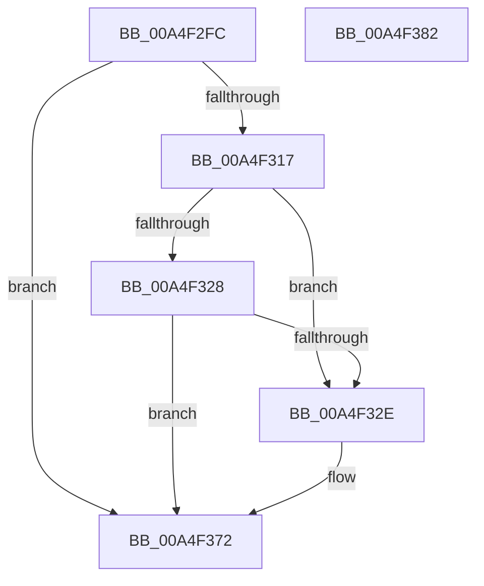

# CmpTrimHive

- RVA: `0x00A4F2FC`–`0x00A4F383` (길이 `135` bytes)
- VA: `0x0000000140A4F2FC`
- 실행 섹션: `PAGE`
- PDB 이름 있음: `예`; PDB Function 태그: `아니요`
- unwind 정보 RVA: `0x00060BC4`
- 디코드: `36`개 명령, `135/135` bytes 표시
- 미해석 바이트: `0` (있으면 어셈블리에 `.byte`로 보존)

> 이 문서는 커널 이미지의 기계어와 PDB 기호를 분석해 생성했습니다. 4번과 5번은 함수 원형과 자료형을 바이너리 사용 방식에서 추정한 C 해석이며 원본 소스 복구 결과는 아닙니다.

## 1. Dependencies

- 직접 호출 지점: **7**; 고유 호출 대상: **7**
- 직접 호출자로 확인된 함수: **2**
- RIP 상대 이미지 참조: **1**

### Outgoing calls
- `0x00A4F32E` → [CmpLockRegistry](../../pagecmrc/BC/CmpLockRegistry_function_00BC9B34.md) (function, `0x00BC9B34`)
- `0x00A4F336` → [HvLockHiveFlusherShared](../84/HvLockHiveFlusherShared_function_0084F95C.md) (function, `0x0084F95C`)
- `0x00A4F33E` → [HvLockHiveWriter](../85/HvLockHiveWriter_function_00859894.md) (function, `0x00859894`)
- `0x00A4F358` → [HvTrimHive](HvTrimHive_function_00A4F38C.md) (function, `0x00A4F38C`)
- `0x00A4F360` → [HvUnlockHiveWriter](../85/HvUnlockHiveWriter_function_008598E4.md) (function, `0x008598E4`)
- `0x00A4F368` → [HvUnlockHiveFlusherShared](../84/HvUnlockHiveFlusherShared_function_00848738.md) (function, `0x00848738`)
- `0x00A4F36D` → [CmpUnlockRegistry](../../pagecmrc/BC/CmpUnlockRegistry_function_00BC9A84.md) (function, `0x00BC9A84`)

### Direct callers
- [CmpLoadKeyCommon](../../text/46/CmpLoadKeyCommon_function_0046E9F8.md) at `0x0046ED3B`
- [CmpAcceptBoot](../7D/CmpAcceptBoot_function_007DF574.md) at `0x007DF60B`

### Static image references
- `0x00A4F30B` → RVA `0x00E0EC94` (`.data`; read)

## 2. Other-region calls and transfers

- 다른 실행 섹션으로 향하는 call: **2**
  - `0x00A4F32E` → [CmpLockRegistry](../../pagecmrc/BC/CmpLockRegistry_function_00BC9B34.md) (`PAGE` → `PAGECMRC`)
  - `0x00A4F36D` → [CmpUnlockRegistry](../../pagecmrc/BC/CmpUnlockRegistry_function_00BC9A84.md) (`PAGE` → `PAGECMRC`)
- 별도 외부 분기/꼬리 이동을 확인하지 못했습니다.

## 3. Assembly (complete function range)

```asm
00A4F2FC  48 89 5C 24 08                  mov qword ptr [rsp + 8], rbx
00A4F301  48 89 74 24 10                  mov qword ptr [rsp + 0x10], rsi
00A4F306  57                              push rdi
00A4F307  48 83 EC 20                     sub rsp, 0x20
00A4F30B  80 3D 82 F9 3B 00 02            cmp byte ptr [rip + 0x3bf982], 2
00A4F312  48 8B D9                        mov rbx, rcx
00A4F315  75 5B                           jne 0x140a4f372
00A4F317  8B B9 90 12 00 00               mov edi, dword ptr [rcx + 0x1290]
00A4F31D  48 8D B1 94 12 00 00            lea rsi, [rcx + 0x1294]
00A4F324  85 FF                           test edi, edi
00A4F326  75 06                           jne 0x140a4f32e
00A4F328  8B 3E                           mov edi, dword ptr [rsi]
00A4F32A  85 FF                           test edi, edi
00A4F32C  74 44                           je 0x140a4f372
00A4F32E  E8 01 A8 17 00                  call 0x140bc9b34
00A4F333  48 8B CB                        mov rcx, rbx
00A4F336  E8 21 06 E0 FF                  call 0x14084f95c
00A4F33B  48 8B CB                        mov rcx, rbx
00A4F33E  E8 51 A5 E0 FF                  call 0x140859894
00A4F343  44 8B 83 18 01 00 00            mov r8d, dword ptr [rbx + 0x118]
00A4F34A  8B D7                           mov edx, edi
00A4F34C  48 8B CB                        mov rcx, rbx
00A4F34F  44 89 83 98 12 00 00            mov dword ptr [rbx + 0x1298], r8d
00A4F356  89 3E                           mov dword ptr [rsi], edi
00A4F358  E8 2F 00 00 00                  call 0x140a4f38c
00A4F35D  48 8B CB                        mov rcx, rbx
00A4F360  E8 7F A5 E0 FF                  call 0x1408598e4
00A4F365  48 8B CB                        mov rcx, rbx
00A4F368  E8 CB 93 DF FF                  call 0x140848738
00A4F36D  E8 12 A7 17 00                  call 0x140bc9a84
00A4F372  48 8B 5C 24 30                  mov rbx, qword ptr [rsp + 0x30]
00A4F377  48 8B 74 24 38                  mov rsi, qword ptr [rsp + 0x38]
00A4F37C  48 83 C4 20                     add rsp, 0x20
00A4F380  5F                              pop rdi
00A4F381  C3                              ret
00A4F382  CC                              int3
```

## 4. C-style interpretation (structured pseudocode)

```c
__int64 __fastcall CmpTrimHive(__int64 a1)
{
    __int64 result;
    __int64 v_rsp;
    unsigned __int64 v_stack_p10;
    unsigned __int64 v_stack_p8;

    v_stack_p8 = v_rbx;
    v_stack_p10 = v_rsi;
    v_rsp = (v_rsp) - (32);
    if ((*(unsigned __int8 *)(v_rip + 3930498)) != 2) goto loc_00A4F372;
    if ((unsigned int)((unsigned int)(*(unsigned int *)(a1 + 4752))) != 0) goto loc_00A4F32E;
    if ((unsigned int)((unsigned int)(*(unsigned int *)(a1 + 4756))) != 0) {
        result = CmpLockRegistry(a1, a2, a3, a4);
        a1 = a1;
        result = HvLockHiveFlusherShared(a1, a2, a3, a4);
        a1 = a1;
        result = HvLockHiveWriter(a1, a2, a3, a4);
        a3 = *(unsigned int *)(a1 + 280);
        a2 = (unsigned int)((unsigned int)(*(unsigned int *)(a1 + 4756)));
        a1 = a1;
        *(unsigned int *)(a1 + 4760) = (unsigned int)(a3);
        *(unsigned int *)(a1 + 4756) = (unsigned int)((unsigned int)(*(unsigned int *)(a1 + 4756)));
        result = HvTrimHive(a1, a2, a3, a4);
        a1 = a1;
        result = HvUnlockHiveWriter(a1, a2, a3, a4);
        a1 = a1;
        result = HvUnlockHiveFlusherShared(a1, a2, a3, a4);
        result = CmpUnlockRegistry(a1, a2, a3, a4);
    }
    v_rsp = (v_rsp) + (32);
    return result;
}
```

## 5. (Beta) C Style

```c
int64_t CmpTrimHive(void *Arg1)
{
    uint8_t *arg1 = (uint8_t *)Arg1;

    int64_t result;
    int64_t local_rsp;
    uint64_t v_stack_p10;
    uint64_t v_stack_p8;

    v_stack_p8 = local_rbx;
    v_stack_p10 = local_rsi;
    local_rsp = (local_rsp) - (32);
    if ((*(uint8_t *)(v_rip + 0x3BF982)) != 2) goto loc_00A4F372;
    if ((uint32_t)((uint32_t)(*(uint32_t *)(arg1 + 0x1290))) != 0) goto loc_00A4F32E;
    if ((uint32_t)((uint32_t)(*(uint32_t *)(arg1 + 0x1294))) != 0) {
        result = CmpLockRegistry(Arg1, a2, a3, a4);
        Arg1 = Arg1;
        result = HvLockHiveFlusherShared(Arg1, a2, a3, a4);
        Arg1 = Arg1;
        result = HvLockHiveWriter(Arg1, a2, a3, a4);
        a3 = *(uint32_t *)(arg1 + 0x118);
        a2 = (uint32_t)((uint32_t)(*(uint32_t *)(arg1 + 0x1294)));
        Arg1 = Arg1;
        *(uint32_t *)(arg1 + 0x1298) = (uint32_t)(a3);
        *(uint32_t *)(arg1 + 0x1294) = (uint32_t)((uint32_t)(*(uint32_t *)(arg1 + 0x1294)));
        result = HvTrimHive(Arg1, a2, a3, a4);
        Arg1 = Arg1;
        result = HvUnlockHiveWriter(Arg1, a2, a3, a4);
        Arg1 = Arg1;
        result = HvUnlockHiveFlusherShared(Arg1, a2, a3, a4);
        result = CmpUnlockRegistry(Arg1, a2, a3, a4);
    }
    local_rsp = (local_rsp) + (32);
    return result;
}
```

### 관측된 메모리 오프셋

구조체 형식이 확인되지 않은 접근은 인자 기준의 오프셋으로만 기록했습니다.

| 기준 인자 | 오프셋 표현 | 폭 (bit) | 접근 |
|---|---:|---:|---|
| `Arg1` | `+ 0x0` | `32` | `R` |
| `Arg1` | `+ 0x0` | `32` | `W` |
| `Arg1` | `+ 0x118` | `32` | `R` |
| `Arg1` | `+ 0x1290` | `32` | `R` |
| `Arg1` | `+ 0x1294` | `64` | `R` |
| `Arg1` | `+ 0x1298` | `32` | `W` |

## 6. Execution-region graph

[열기: 2D/3D 그래프와 함수 탐색 컨트롤 패널](../../../control-panel.html?section=page&rva=0x00A4F2FC&view=graph)

- 2D 그래프는 위에서 아래로 흐르고, 3D 그래프는 빈 공간을 드래그해 회전합니다. Shift+드래그는 이동, 휠은 확대·축소, 함수 노드 선택은 대상 보고서 이동입니다.

### Static fallback


