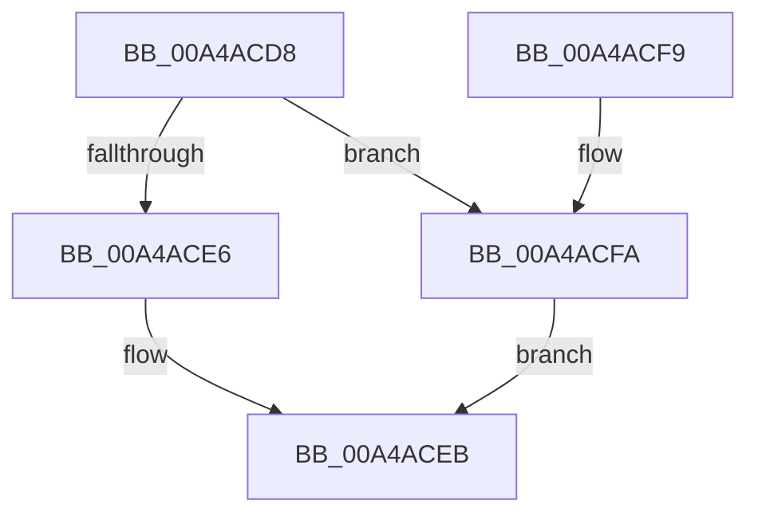

# CmpUnlockTwoSecurityCaches

- RVA: `0x00A4ACD8`–`0x00A4ACFF` (길이 `39` bytes)
- VA: `0x0000000140A4ACD8`
- 실행 섹션: `PAGE`
- PDB 이름 있음: `예`; PDB Function 태그: `아니요`
- unwind 정보 RVA: `0x0006F174`
- 디코드: `14`개 명령, `39/39` bytes 표시
- 미해석 바이트: `0` (있으면 어셈블리에 `.byte`로 보존)

> 이 문서는 커널 이미지의 기계어와 PDB 기호를 분석해 생성했습니다. 4번과 5번은 함수 원형과 자료형을 바이너리 사용 방식에서 추정한 C 해석이며 원본 소스 복구 결과는 아닙니다.

## 1. Dependencies

- 직접 호출 지점: **2**; 고유 호출 대상: **1**
- 직접 호출자로 확인된 함수: **3**
- RIP 상대 이미지 참조: **0**

### Outgoing calls
- `0x00A4ACE6` → [CmUnlockHiveSecurity](../../pagecmrc/BC/CmUnlockHiveSecurity_function_00BC99C8.md) (function, `0x00BC99C8`)
- `0x00A4ACEE` → [CmUnlockHiveSecurity](../../pagecmrc/BC/CmUnlockHiveSecurity_function_00BC99C8.md) (function, `0x00BC99C8`)

### Direct callers
- [CmpDoBuildVirtualStack](../7E/CmpDoBuildVirtualStack_function_007EB4C4.md) at `0x007EB897`
- [CmpSyncKeyValues](../7F/CmpSyncKeyValues_function_007F2DF4.md) at `0x007F30A6`
- [CmpCopyKeyPartial](../85/CmpCopyKeyPartial_function_0085AFF4.md) at `0x0085B1E1`

### Static image references
- 디코드된 RIP-relative 메모리 참조가 없습니다.

## 2. Other-region calls and transfers

- 다른 실행 섹션으로 향하는 call: **2**
  - `0x00A4ACE6` → [CmUnlockHiveSecurity](../../pagecmrc/BC/CmUnlockHiveSecurity_function_00BC99C8.md) (`PAGE` → `PAGECMRC`)
  - `0x00A4ACEE` → [CmUnlockHiveSecurity](../../pagecmrc/BC/CmUnlockHiveSecurity_function_00BC99C8.md) (`PAGE` → `PAGECMRC`)
- 별도 외부 분기/꼬리 이동을 확인하지 못했습니다.

## 3. Assembly (complete function range)

```asm
00A4ACD8  40 53                           push rbx
00A4ACDA  48 83 EC 20                     sub rsp, 0x20
00A4ACDE  48 8B DA                        mov rbx, rdx
00A4ACE1  48 3B CA                        cmp rcx, rdx
00A4ACE4  74 14                           je 0x140a4acfa
00A4ACE6  E8 DD EC 17 00                  call 0x140bc99c8
00A4ACEB  48 8B CB                        mov rcx, rbx
00A4ACEE  E8 D5 EC 17 00                  call 0x140bc99c8
00A4ACF3  48 83 C4 20                     add rsp, 0x20
00A4ACF7  5B                              pop rbx
00A4ACF8  C3                              ret
00A4ACF9  CC                              int3
00A4ACFA  48 8B D9                        mov rbx, rcx
00A4ACFD  EB EC                           jmp 0x140a4aceb
```

## 4. C-style interpretation (structured pseudocode)

```c
__int64 __fastcall CmpUnlockTwoSecurityCaches(__int64 a1, __int64 a2)
{
    __int64 result;
    __int64 v_rsp;

    v_rsp = (v_rsp) - (32);
    if (a1 == a2) goto loc_00A4ACFA;
    result = CmUnlockHiveSecurity(a1, a2, a3, a4);
loc_00A4ACEB:
    result = CmUnlockHiveSecurity(a2, a2, a3, a4);
    v_rsp = (v_rsp) + (32);
    return result;
loc_00A4ACFA:
    goto loc_00A4ACEB;
}
```

## 5. (Beta) C Style

```c
int64_t CmpUnlockTwoSecurityCaches(int64_t Arg1, int64_t Arg2)
{
    int64_t result;
    int64_t local_rsp;

    local_rsp = (local_rsp) - (32);
    if (Arg1 == Arg2) goto loc_00A4ACFA;
    result = CmUnlockHiveSecurity(Arg1, Arg2, a3, a4);
loc_00A4ACEB:
    result = CmUnlockHiveSecurity(Arg2, Arg2, a3, a4);
    local_rsp = (local_rsp) + (32);
    return result;
loc_00A4ACFA:
    goto loc_00A4ACEB;
}
```

## 6. Execution-region graph

[열기: 2D/3D 그래프와 함수 탐색 컨트롤 패널](../../../control-panel.html?section=page&rva=0x00A4ACD8&view=graph)

- 2D 그래프는 위에서 아래로 흐르고, 3D 그래프는 빈 공간을 드래그해 회전합니다. Shift+드래그는 이동, 휠은 확대·축소, 함수 노드 선택은 대상 보고서 이동입니다.

### Static fallback


