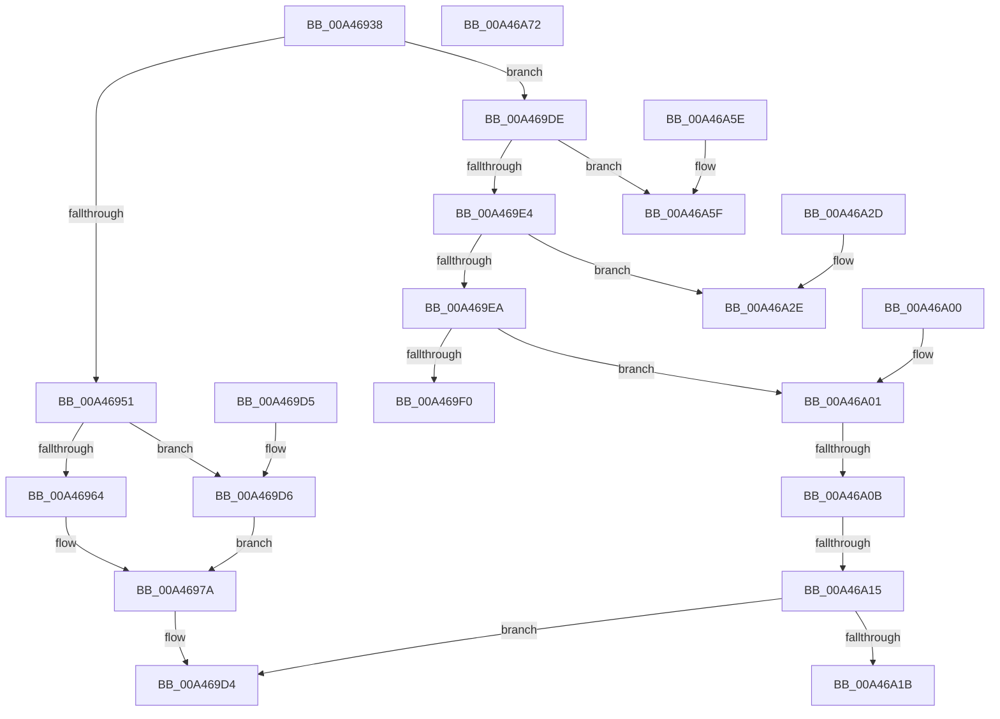

# DbgkpConvertKernelToUserStateChange

- RVA: `0x00A46938`–`0x00A46A73` (길이 `315` bytes)
- VA: `0x0000000140A46938`
- 실행 섹션: `PAGE`
- PDB 이름 있음: `예`; PDB Function 태그: `예`
- unwind 정보 RVA: `0x000DB714`
- 디코드: `77`개 명령, `315/315` bytes 표시
- 미해석 바이트: `0` (있으면 어셈블리에 `.byte`로 보존)

> 이 문서는 커널 이미지의 기계어와 PDB 기호를 분석해 생성했습니다. 4번과 5번은 함수 원형과 자료형을 바이너리 사용 방식에서 추정한 C 해석이며 원본 소스 복구 결과는 아닙니다.

## 1. Dependencies

- 직접 호출 지점: **0**; 고유 호출 대상: **0**
- 직접 호출자로 확인된 함수: **1**
- RIP 상대 이미지 참조: **0**

### Outgoing calls
- 직접 디코드된 call 명령이 없습니다.

### Direct callers
- [NtWaitForDebugEvent](NtWaitForDebugEvent_function_00A464E0.md) at `0x00A4676A`

### Static image references
- 디코드된 RIP-relative 메모리 참조가 없습니다.

## 2. Other-region calls and transfers

- 다른 실행 섹션으로 향하는 call: **0**
- call이 아닌 외부 분기/꼬리 이동: **2**
  - `0x00A46A05` → `0x00B3B238` (`tail-transfer`)
  - `0x00A46A0F` → `0x00B3B212` (`tail-transfer`)

## 3. Assembly (complete function range)

```asm
00A46938  0F 10 42 28                     movups xmm0, xmmword ptr [rdx + 0x28]
00A4693C  F3 0F 7F 41 08                  movdqu xmmword ptr [rcx + 8], xmm0
00A46941  44 8B 82 80 00 00 00            mov r8d, dword ptr [rdx + 0x80]
00A46948  45 85 C0                        test r8d, r8d
00A4694B  0F 85 8D 00 00 00               jne 0x140a469de
00A46951  48 81 C2 88 00 00 00            add rdx, 0x88
00A46958  44 8B 02                        mov r8d, dword ptr [rdx]
00A4695B  41 81 F8 03 00 00 80            cmp r8d, 0x80000003
00A46962  74 72                           je 0x140a469d6
00A46964  B8 08 00 00 00                  mov eax, 8
00A46969  41 81 F8 04 00 00 80            cmp r8d, 0x80000004
00A46970  44 8D 48 FE                     lea r9d, [rax - 2]
00A46974  41 0F 45 C1                     cmovne eax, r9d
00A46978  89 01                           mov dword ptr [rcx], eax
00A4697A  0F 10 02                        movups xmm0, xmmword ptr [rdx]
00A4697D  48 8D 41 18                     lea rax, [rcx + 0x18]
00A46981  B9 80 00 00 00                  mov ecx, 0x80
00A46986  0F 11 00                        movups xmmword ptr [rax], xmm0
00A46989  0F 10 4A 10                     movups xmm1, xmmword ptr [rdx + 0x10]
00A4698D  0F 11 48 10                     movups xmmword ptr [rax + 0x10], xmm1
00A46991  0F 10 42 20                     movups xmm0, xmmword ptr [rdx + 0x20]
00A46995  0F 11 40 20                     movups xmmword ptr [rax + 0x20], xmm0
00A46999  0F 10 4A 30                     movups xmm1, xmmword ptr [rdx + 0x30]
00A4699D  0F 11 48 30                     movups xmmword ptr [rax + 0x30], xmm1
00A469A1  0F 10 42 40                     movups xmm0, xmmword ptr [rdx + 0x40]
00A469A5  0F 11 40 40                     movups xmmword ptr [rax + 0x40], xmm0
00A469A9  0F 10 4A 50                     movups xmm1, xmmword ptr [rdx + 0x50]
00A469AD  0F 11 48 50                     movups xmmword ptr [rax + 0x50], xmm1
00A469B1  0F 10 42 60                     movups xmm0, xmmword ptr [rdx + 0x60]
00A469B5  0F 11 40 60                     movups xmmword ptr [rax + 0x60], xmm0
00A469B9  0F 10 42 70                     movups xmm0, xmmword ptr [rdx + 0x70]
00A469BD  0F 11 44 08 F0                  movups xmmword ptr [rax + rcx - 0x10], xmm0
00A469C2  0F 10 0C 0A                     movups xmm1, xmmword ptr [rdx + rcx]
00A469C6  0F 11 0C 08                     movups xmmword ptr [rax + rcx], xmm1
00A469CA  0F 10 44 0A 10                  movups xmm0, xmmword ptr [rdx + rcx + 0x10]
00A469CF  0F 11 44 08 10                  movups xmmword ptr [rax + rcx + 0x10], xmm0
00A469D4  C3                              ret
00A469D5  CC                              int3
00A469D6  C7 01 07 00 00 00               mov dword ptr [rcx], 7
00A469DC  EB 9C                           jmp 0x140a4697a
00A469DE  41 83 E8 01                     sub r8d, 1
00A469E2  74 7B                           je 0x140a46a5f
00A469E4  41 83 E8 01                     sub r8d, 1
00A469E8  74 44                           je 0x140a46a2e
00A469EA  41 83 E8 01                     sub r8d, 1
00A469EE  75 11                           jne 0x140a46a01
00A469F0  C7 01 04 00 00 00               mov dword ptr [rcx], 4
00A469F6  8B 82 88 00 00 00               mov eax, dword ptr [rdx + 0x88]
00A469FC  89 41 18                        mov dword ptr [rcx + 0x18], eax
00A469FF  C3                              ret
00A46A00  CC                              int3
00A46A01  41 83 E8 01                     sub r8d, 1
00A46A05  0F 84 2D 48 0F 00               je 0x140b3b238
00A46A0B  41 83 E8 01                     sub r8d, 1
00A46A0F  0F 84 FD 47 0F 00               je 0x140b3b212
00A46A15  41 83 F8 01                     cmp r8d, 1
00A46A19  75 B9                           jne 0x140a469d4
00A46A1B  C7 01 0A 00 00 00               mov dword ptr [rcx], 0xa
00A46A21  48 8B 82 88 00 00 00            mov rax, qword ptr [rdx + 0x88]
00A46A28  48 89 41 18                     mov qword ptr [rcx + 0x18], rax
00A46A2C  C3                              ret
00A46A2D  CC                              int3
00A46A2E  C7 01 03 00 00 00               mov dword ptr [rcx], 3
00A46A34  0F 10 82 88 00 00 00            movups xmm0, xmmword ptr [rdx + 0x88]
00A46A3B  0F 11 41 28                     movups xmmword ptr [rcx + 0x28], xmm0
00A46A3F  0F 10 8A 98 00 00 00            movups xmm1, xmmword ptr [rdx + 0x98]
00A46A46  0F 11 49 38                     movups xmmword ptr [rcx + 0x38], xmm1
00A46A4A  0F 10 82 A8 00 00 00            movups xmm0, xmmword ptr [rdx + 0xa8]
00A46A51  0F 11 41 48                     movups xmmword ptr [rcx + 0x48], xmm0
00A46A55  48 83 A2 90 00 00 00 00         and qword ptr [rdx + 0x90], 0
00A46A5D  C3                              ret
00A46A5E  CC                              int3
00A46A5F  C7 01 02 00 00 00               mov dword ptr [rcx], 2
00A46A65  0F 10 82 88 00 00 00            movups xmm0, xmmword ptr [rdx + 0x88]
00A46A6C  F3 0F 7F 41 20                  movdqu xmmword ptr [rcx + 0x20], xmm0
00A46A71  C3                              ret
00A46A72  CC                              int3
```

## 4. C-style interpretation (structured pseudocode)

```c
__int64 __fastcall DbgkpConvertKernelToUserStateChange(__int64 a1, __int64 a2)
{
    __int64 result;

    *(unsigned __int64 *)(a1 + 8) = v_xmm0;
    if ((unsigned int)((unsigned int)(*(unsigned int *)(a2 + 128))) != 0) goto loc_00A469DE;
    a2 = (a2) + (136);
    if (((unsigned int)((unsigned int)(*(unsigned int *)(a2)))) == 0x80000003ULL) goto loc_00A469D6;
    result = 8;
    if (((unsigned int)((unsigned int)(*(unsigned int *)(a2)))) != 0x80000004ULL) { result = (unsigned int)(8 - 2); }
    *(unsigned int *)(a1) = (unsigned int)(result);
loc_00A4697A:
    *(unsigned __int64 *)(a1 + 24) = v_xmm0;
    *(unsigned __int64 *)(a1 + 24 + 16) = v_xmm1;
    *(unsigned __int64 *)(a1 + 24 + 32) = v_xmm0;
    *(unsigned __int64 *)(a1 + 24 + 48) = v_xmm1;
    *(unsigned __int64 *)(a1 + 24 + 64) = v_xmm0;
    *(unsigned __int64 *)(a1 + 24 + 80) = v_xmm1;
    *(unsigned __int64 *)(a1 + 24 + 96) = v_xmm0;
    *(unsigned __int64 *)(a1 + 24 + 128 * 1 - 16) = v_xmm0;
    *(unsigned __int64 *)(a1 + 24 + 128 * 1) = v_xmm1;
    *(unsigned __int64 *)(a1 + 24 + 128 * 1 + 16) = v_xmm0;
loc_00A469D4:
    return a1 + 24;
loc_00A469D6:
    *(unsigned int *)(128) = 7;
    goto loc_00A4697A;
loc_00A469DE:
    a3 = (unsigned int)(((unsigned int)(*(unsigned int *)(a2))) - (1));
    if (condition_is_equal) goto loc_00A46A5F;
    a3 = (unsigned int)((a3) - (1));
    if (condition_is_equal) goto loc_00A46A2E;
    a3 = (unsigned int)((a3) - (1));
    if (condition_is_not_equal) goto loc_00A46A01;
    *(unsigned int *)(128) = 4;
    *(unsigned int *)(128 + 24) = (unsigned int)((unsigned int)(*(unsigned int *)(a2 + 136)));
    return (unsigned int)(*(unsigned int *)(a2 + 136));
loc_00A46A01:
    a3 = (unsigned int)((a3) - (1));
    a3 = (unsigned int)((a3) - (1));
    if (((unsigned int)(a3)) != 1) goto loc_00A469D4;
    *(unsigned int *)(128) = 10;
    *(unsigned __int64 *)(128 + 24) = *(unsigned __int64 *)(a2 + 136);
    return *(unsigned __int64 *)(a2 + 136);
loc_00A46A2E:
    *(unsigned int *)(128) = 3;
    *(unsigned __int64 *)(128 + 40) = v_xmm0;
    *(unsigned __int64 *)(128 + 56) = v_xmm1;
    *(unsigned __int64 *)(128 + 72) = v_xmm0;
    return *(unsigned __int64 *)(a2 + 136);
loc_00A46A5F:
    *(unsigned int *)(128) = 2;
    *(unsigned __int64 *)(128 + 32) = v_xmm0;
    return *(unsigned __int64 *)(a2 + 136);
}
```

## 5. (Beta) C Style

```c
void *DbgkpConvertKernelToUserStateChange(void *Arg1, void *Arg2)
{
    uint8_t *arg1 = (uint8_t *)Arg1;
    uint8_t *arg2 = (uint8_t *)Arg2;

    int64_t result;

    *(uint64_t *)(arg1 + 0x8) = v_xmm0;
    if ((uint32_t)((uint32_t)(*(uint32_t *)(arg2 + 0x80))) != 0) goto loc_00A469DE;
    Arg2 = (Arg2) + (136);
    if (((uint32_t)((uint32_t)(*(uint32_t *)(arg2)))) == 0x80000003ULL) goto loc_00A469D6;
    result = 8;
    if (((uint32_t)((uint32_t)(*(uint32_t *)(arg2)))) != 0x80000004ULL) { result = (uint32_t)(8 - 2); }
    *(uint32_t *)(arg1) = (uint32_t)(result);
loc_00A4697A:
    *(uint64_t *)(arg1 + 0x18) = v_xmm0;
    *(uint64_t *)(arg1 + 0x18 + 0x10) = v_xmm1;
    *(uint64_t *)(arg1 + 0x18 + 0x20) = v_xmm0;
    *(uint64_t *)(arg1 + 0x18 + 0x30) = v_xmm1;
    *(uint64_t *)(arg1 + 0x18 + 0x40) = v_xmm0;
    *(uint64_t *)(arg1 + 0x18 + 0x50) = v_xmm1;
    *(uint64_t *)(arg1 + 0x18 + 0x60) = v_xmm0;
    *(uint64_t *)(arg1 + 0x18 + 0x80 * 1 - 0x10) = v_xmm0;
    *(uint64_t *)(arg1 + 0x18 + 0x80 * 1) = v_xmm1;
    *(uint64_t *)(arg1 + 0x18 + 0x80 * 1 + 0x10) = v_xmm0;
loc_00A469D4:
    return Arg1 + 24;
loc_00A469D6:
    *(uint32_t *)(128) = 7;
    goto loc_00A4697A;
loc_00A469DE:
    a3 = (uint32_t)(((uint32_t)(*(uint32_t *)(arg2))) - (1));
    if (condition_is_equal) goto loc_00A46A5F;
    a3 = (uint32_t)((a3) - (1));
    if (condition_is_equal) goto loc_00A46A2E;
    a3 = (uint32_t)((a3) - (1));
    if (condition_is_not_equal) goto loc_00A46A01;
    *(uint32_t *)(128) = 4;
    *(uint32_t *)(128 + 0x18) = (uint32_t)((uint32_t)(*(uint32_t *)(arg2 + 0x88)));
    return (uint32_t)(*(uint32_t *)(arg2 + 0x88));
loc_00A46A01:
    a3 = (uint32_t)((a3) - (1));
    a3 = (uint32_t)((a3) - (1));
    if (((uint32_t)(a3)) != 1) goto loc_00A469D4;
    *(uint32_t *)(128) = 10;
    *(uint64_t *)(128 + 0x18) = *(uint64_t *)(arg2 + 0x88);
    return *(uint64_t *)(arg2 + 0x88);
loc_00A46A2E:
    *(uint32_t *)(128) = 3;
    *(uint64_t *)(128 + 0x28) = v_xmm0;
    *(uint64_t *)(128 + 0x38) = v_xmm1;
    *(uint64_t *)(128 + 0x48) = v_xmm0;
    return *(uint64_t *)(arg2 + 0x88);
loc_00A46A5F:
    *(uint32_t *)(128) = 2;
    *(uint64_t *)(128 + 0x20) = v_xmm0;
    return *(uint64_t *)(arg2 + 0x88);
}
```

### 관측된 메모리 오프셋

구조체 형식이 확인되지 않은 접근은 인자 기준의 오프셋으로만 기록했습니다.

| 기준 인자 | 오프셋 표현 | 폭 (bit) | 접근 |
|---|---:|---:|---|
| `Arg1` | `- 0x10 + rcx*1` | `128` | `R` |
| `Arg1` | `+ 0x0` | `32` | `W` |
| `Arg1` | `+ 0x0` | `128` | `R` |
| `Arg1` | `+ 0x0 + rcx*1` | `128` | `R` |
| `Arg1` | `+ 0x8` | `128` | `W` |
| `Arg1` | `+ 0x10` | `128` | `R` |
| `Arg1` | `+ 0x10 + rcx*1` | `128` | `R` |
| `Arg1` | `+ 0x18` | `32` | `W` |
| `Arg1` | `+ 0x18` | `64` | `R` |
| `Arg1` | `+ 0x18` | `64` | `W` |
| `Arg1` | `+ 0x20` | `128` | `R` |
| `Arg1` | `+ 0x20` | `128` | `W` |
| `Arg1` | `+ 0x28` | `128` | `R` |
| `Arg1` | `+ 0x30` | `128` | `R` |
| `Arg1` | `+ 0x38` | `128` | `R` |
| `Arg1` | `+ 0x40` | `128` | `R` |
| `Arg1` | `+ 0x48` | `128` | `R` |
| `Arg1` | `+ 0x50` | `128` | `R` |
| `Arg1` | `+ 0x60` | `128` | `R` |
| `Arg2` | `+ 0x0` | `32` | `R` |
| `Arg2` | `+ 0x0` | `128` | `R` |
| `Arg2` | `+ 0x0 + rcx*1` | `128` | `R` |
| `Arg2` | `+ 0x10` | `128` | `R` |
| `Arg2` | `+ 0x10 + rcx*1` | `128` | `R` |
| `Arg2` | `+ 0x20` | `128` | `R` |
| `Arg2` | `+ 0x28` | `128` | `R` |
| `Arg2` | `+ 0x30` | `128` | `R` |
| `Arg2` | `+ 0x40` | `128` | `R` |
| `Arg2` | `+ 0x50` | `128` | `R` |
| `Arg2` | `+ 0x60` | `128` | `R` |
| `Arg2` | `+ 0x70` | `128` | `R` |
| `Arg2` | `+ 0x80` | `32` | `R` |

추가 오프셋 6개는 표에서 생략했습니다.

## 6. Execution-region graph

[열기: 2D/3D 그래프와 함수 탐색 컨트롤 패널](../../../control-panel.html?section=page&rva=0x00A46938&view=graph)

- 2D 그래프는 위에서 아래로 흐르고, 3D 그래프는 빈 공간을 드래그해 회전합니다. Shift+드래그는 이동, 휠은 확대·축소, 함수 노드 선택은 대상 보고서 이동입니다.

### Static fallback


