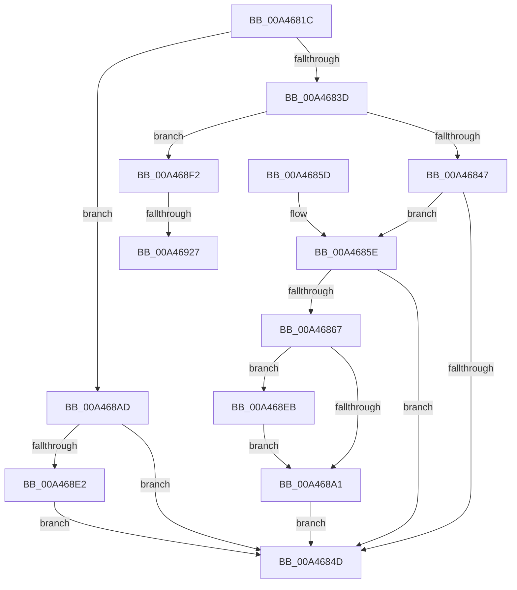

# DbgkpOpenHandles

- RVA: `0x00A4681C`–`0x00A46930` (길이 `276` bytes)
- VA: `0x0000000140A4681C`
- 실행 섹션: `PAGE`
- PDB 이름 있음: `예`; PDB Function 태그: `예`
- unwind 정보 RVA: `0x000AF778`
- 디코드: `69`개 명령, `276/276` bytes 표시
- 미해석 바이트: `0` (있으면 어셈블리에 `.byte`로 보존)

> 이 문서는 커널 이미지의 기계어와 PDB 기호를 분석해 생성했습니다. 4번과 5번은 함수 원형과 자료형을 바이너리 사용 방식에서 추정한 C 해석이며 원본 소스 복구 결과는 아닙니다.

## 1. Dependencies

- 직접 호출 지점: **4**; 고유 호출 대상: **3**
- 직접 호출자로 확인된 함수: **1**
- RIP 상대 이미지 참조: **1**

### Outgoing calls
- `0x00A46898` → [ObDuplicateObject](../8C/ObDuplicateObject_function_008C4FA0.md) (function, `0x008C4FA0`)
- `0x00A468A6` → [ObCloseHandle](../8A/ObCloseHandle_function_008A1870.md) (function, `0x008A1870`)
- `0x00A468D5` → [ObOpenObjectByPointer](../8B/ObOpenObjectByPointer_function_008B7420.md) (function, `0x008B7420`)
- `0x00A4691A` → [ObOpenObjectByPointer](../8B/ObOpenObjectByPointer_function_008B7420.md) (function, `0x008B7420`)

### Direct callers
- [NtWaitForDebugEvent](NtWaitForDebugEvent_function_00A464E0.md) at `0x00A46796`

### Static image references
- `0x00A468AD` → RVA `0x00FC6AC8` (`ALMOSTRO`; read)

## 2. Other-region calls and transfers

- 다른 실행 섹션으로 향하는 call: **0**
- call이 아닌 외부 분기/꼬리 이동: **2**
  - `0x00A46921` → [sub_00B3B188](../B3/Unknown_function_00B3B188.md) (`tail-transfer`)
  - `0x00A4692B` → [sub_00B3B188](../B3/Unknown_function_00B3B188.md) (`tail-transfer`)

## 3. Assembly (complete function range)

```asm
00A4681C  48 89 6C 24 08                  mov qword ptr [rsp + 8], rbp
00A46821  48 89 74 24 10                  mov qword ptr [rsp + 0x10], rsi
00A46826  57                              push rdi
00A46827  48 83 EC 40                     sub rsp, 0x40
00A4682B  44 8B 09                        mov r9d, dword ptr [rcx]
00A4682E  4D 8B D0                        mov r10, r8
00A46831  48 8B EA                        mov rbp, rdx
00A46834  48 8B F9                        mov rdi, rcx
00A46837  41 83 E9 02                     sub r9d, 2
00A4683B  74 70                           je 0x140a468ad
00A4683D  41 83 E9 01                     sub r9d, 1
00A46841  0F 84 AB 00 00 00               je 0x140a468f2
00A46847  41 83 F9 06                     cmp r9d, 6
00A4684B  74 11                           je 0x140a4685e
00A4684D  48 8B 6C 24 50                  mov rbp, qword ptr [rsp + 0x50]
00A46852  48 8B 74 24 58                  mov rsi, qword ptr [rsp + 0x58]
00A46857  48 83 C4 40                     add rsp, 0x40
00A4685B  5F                              pop rdi
00A4685C  C3                              ret
00A4685D  CC                              int3
00A4685E  48 8B 71 18                     mov rsi, qword ptr [rcx + 0x18]
00A46862  48 85 F6                        test rsi, rsi
00A46865  74 E6                           je 0x140a4684d
00A46867  65 48 8B 04 25 88 01 00 00      mov rax, qword ptr gs:[0x188]
00A46870  4C 8D 4F 18                     lea r9, [rdi + 0x18]
00A46874  C6 44 24 38 00                  mov byte ptr [rsp + 0x38], 0
00A46879  48 8B D6                        mov rdx, rsi
00A4687C  C7 44 24 30 02 00 00 00         mov dword ptr [rsp + 0x30], 2
00A46884  83 64 24 28 00                  and dword ptr [rsp + 0x28], 0
00A46889  48 8B 88 B8 00 00 00            mov rcx, qword ptr [rax + 0xb8]
00A46890  83 64 24 20 00                  and dword ptr [rsp + 0x20], 0
00A46895  4C 8B C1                        mov r8, rcx
00A46898  E8 03 E7 E7 FF                  call 0x1408c4fa0
00A4689D  85 C0                           test eax, eax
00A4689F  78 4A                           js 0x140a468eb
00A468A1  33 D2                           xor edx, edx
00A468A3  48 8B CE                        mov rcx, rsi
00A468A6  E8 C5 AF E5 FF                  call 0x1408a1870
00A468AB  EB A0                           jmp 0x140a4684d
00A468AD  48 8B 05 14 02 58 00            mov rax, qword ptr [rip + 0x580214]
00A468B4  48 83 C7 18                     add rdi, 0x18
00A468B8  48 89 7C 24 30                  mov qword ptr [rsp + 0x30], rdi
00A468BD  41 B9 7B 00 12 00               mov r9d, 0x12007b
00A468C3  C6 44 24 28 00                  mov byte ptr [rsp + 0x28], 0
00A468C8  45 33 C0                        xor r8d, r8d
00A468CB  33 D2                           xor edx, edx
00A468CD  48 89 44 24 20                  mov qword ptr [rsp + 0x20], rax
00A468D2  49 8B CA                        mov rcx, r10
00A468D5  E8 46 0B E7 FF                  call 0x1408b7420
00A468DA  85 C0                           test eax, eax
00A468DC  0F 89 6B FF FF FF               jns 0x140a4684d
00A468E2  48 83 27 00                     and qword ptr [rdi], 0
00A468E6  E9 62 FF FF FF                  jmp 0x140a4684d
00A468EB  48 83 67 18 00                  and qword ptr [rdi + 0x18], 0
00A468F0  EB AF                           jmp 0x140a468a1
00A468F2  48 8B 05 CF 01 58 00            mov rax, qword ptr [rip + 0x5801cf]
00A468F9  48 8D 71 20                     lea rsi, [rcx + 0x20]
00A468FD  48 89 74 24 30                  mov qword ptr [rsp + 0x30], rsi
00A46902  41 B9 7B 00 12 00               mov r9d, 0x12007b
00A46908  C6 44 24 28 00                  mov byte ptr [rsp + 0x28], 0
00A4690D  45 33 C0                        xor r8d, r8d
00A46910  33 D2                           xor edx, edx
00A46912  48 89 44 24 20                  mov qword ptr [rsp + 0x20], rax
00A46917  49 8B CA                        mov rcx, r10
00A4691A  E8 01 0B E7 FF                  call 0x1408b7420
00A4691F  85 C0                           test eax, eax
00A46921  0F 89 61 48 0F 00               jns 0x140b3b188
00A46927  48 83 26 00                     and qword ptr [rsi], 0
00A4692B  E9 58 48 0F 00                  jmp 0x140b3b188
```

## 4. C-style interpretation (structured pseudocode)

```c
__int64 __fastcall DbgkpOpenHandles(__int64 a1, __int64 a2, __int64 a3)
{
    __int64 result;
    __int64 v_rdi;
    __int64 v_rsp;
    unsigned __int64 v_stack_p10;
    unsigned int v_stack_p20;
    unsigned int v_stack_p28;
    unsigned int v_stack_p30;
    unsigned __int8 v_stack_p38;
    unsigned __int64 v_stack_p8;

    v_stack_p8 = v_rbp;
    v_stack_p10 = v_rsi;
    v_rsp = (v_rsp) - (64);
    a4 = (unsigned int)(((unsigned int)(*(unsigned int *)(a1))) - (2));
    if (condition_is_equal) goto loc_00A468AD;
    a4 = (unsigned int)((a4) - (1));
    if (condition_is_equal) goto loc_00A468F2;
    if (((unsigned int)(a4)) == 6) goto loc_00A4685E;
loc_00A4684D:
    v_rsp = (v_rsp) + (64);
    return result;
loc_00A4685E:
    if (*(unsigned __int64 *)(a1 + 24) == 0) goto loc_00A4684D;
    v_stack_p38 = 0;
    v_stack_p30 = 2;
    result = ObDuplicateObject(*(unsigned __int64 *)(*(unsigned __int64 *)(gs_base + (0 + 392)) + 184), *(unsigned __int64 *)(a1 + 24), *(unsigned __int64 *)(*(unsigned __int64 *)(gs_base + (0 + 392)) + 184), a1 + 24);
    if (sign_flag) goto loc_00A468EB;
loc_00A468A1:
    a2 = 0;
    result = ObCloseHandle(*(unsigned __int64 *)(a1 + 24), a2, *(unsigned __int64 *)(*(unsigned __int64 *)(gs_base + (0 + 392)) + 184), a1 + 24);
    goto loc_00A4684D;
loc_00A468AD:
    v_rdi = (a1) + (24);
    v_stack_p30 = v_rdi;
    v_stack_p28 = 0;
    a3 = 0;
    a2 = 0;
    v_stack_p20 = *(unsigned __int64 *)(v_rip + 5767700);
    result = ObOpenObjectByPointer(0, a2, a3, (unsigned int)(0x12007BULL));
    if (!sign_flag) goto loc_00A4684D;
    goto loc_00A4684D;
loc_00A468EB:
    goto loc_00A468A1;
loc_00A468F2:
    v_stack_p30 = 0 + 32;
    v_stack_p28 = 0;
    a3 = 0;
    a2 = 0;
    v_stack_p20 = *(unsigned __int64 *)(v_rip + 5767631);
    result = ObOpenObjectByPointer(0, a2, a3, (unsigned int)(0x12007BULL));
}
```

## 5. (Beta) C Style

```c
int64_t DbgkpOpenHandles(void *Arg1, int64_t Arg2, int64_t Arg3)
{
    uint8_t *arg1 = (uint8_t *)Arg1;

    int64_t result;
    int64_t local_rdi;
    int64_t local_rsp;
    uint64_t v_stack_p10;
    uint32_t v_stack_p20;
    uint32_t v_stack_p28;
    uint32_t v_stack_p30;
    uint8_t v_stack_p38;
    uint64_t v_stack_p8;

    v_stack_p8 = local_rbp;
    v_stack_p10 = local_rsi;
    local_rsp = (local_rsp) - (64);
    a4 = (uint32_t)(((uint32_t)(*(uint32_t *)(arg1))) - (2));
    if (condition_is_equal) goto loc_00A468AD;
    a4 = (uint32_t)((a4) - (1));
    if (condition_is_equal) goto loc_00A468F2;
    if (((uint32_t)(a4)) == 6) goto loc_00A4685E;
loc_00A4684D:
    local_rsp = (local_rsp) + (64);
    return result;
loc_00A4685E:
    if (*(uint64_t *)(arg1 + 0x18) == 0) goto loc_00A4684D;
    v_stack_p38 = 0;
    v_stack_p30 = 2;
    result = ObDuplicateObject(*(uint64_t *)(*(uint64_t *)(gs_base + (0 + 0x188)) + 0xB8), *(uint64_t *)(arg1 + 0x18), *(uint64_t *)(*(uint64_t *)(gs_base + (0 + 0x188)) + 0xB8), Arg1 + 24);
    if (sign_flag) goto loc_00A468EB;
loc_00A468A1:
    Arg2 = 0;
    result = ObCloseHandle(*(uint64_t *)(arg1 + 0x18), Arg2, *(uint64_t *)(*(uint64_t *)(gs_base + (0 + 0x188)) + 0xB8), Arg1 + 24);
    goto loc_00A4684D;
loc_00A468AD:
    local_rdi = (Arg1) + (24);
    v_stack_p30 = local_rdi;
    v_stack_p28 = 0;
    Arg3 = 0;
    Arg2 = 0;
    v_stack_p20 = *(uint64_t *)(v_rip + 0x580214);
    result = ObOpenObjectByPointer(0, Arg2, Arg3, (uint32_t)(0x12007BULL));
    if (!sign_flag) goto loc_00A4684D;
    goto loc_00A4684D;
loc_00A468EB:
    goto loc_00A468A1;
loc_00A468F2:
    v_stack_p30 = 0 + 32;
    v_stack_p28 = 0;
    Arg3 = 0;
    Arg2 = 0;
    v_stack_p20 = *(uint64_t *)(v_rip + 0x5801CF);
    result = ObOpenObjectByPointer(0, Arg2, Arg3, (uint32_t)(0x12007BULL));
}
```

### 관측된 메모리 오프셋

구조체 형식이 확인되지 않은 접근은 인자 기준의 오프셋으로만 기록했습니다.

| 기준 인자 | 오프셋 표현 | 폭 (bit) | 접근 |
|---|---:|---:|---|
| `Arg1` | `+ 0x0` | `32` | `R` |
| `Arg1` | `+ 0x0` | `64` | `R/W` |
| `Arg1` | `+ 0x18` | `64` | `R` |
| `Arg1` | `+ 0x18` | `64` | `R/W` |
| `Arg1` | `+ 0x20` | `64` | `R` |

## 6. Execution-region graph

[열기: 2D/3D 그래프와 함수 탐색 컨트롤 패널](../../../control-panel.html?section=page&rva=0x00A4681C&view=graph)

- 2D 그래프는 위에서 아래로 흐르고, 3D 그래프는 빈 공간을 드래그해 회전합니다. Shift+드래그는 이동, 휠은 확대·축소, 함수 노드 선택은 대상 보고서 이동입니다.

### Static fallback


