# EtwTimLogProhibitChildProcessCreation

- RVA: `0x00A43694`–`0x00A43C77` (길이 `1,507` bytes)
- VA: `0x0000000140A43694`
- 실행 섹션: `PAGE`
- PDB 이름 있음: `예`; PDB Function 태그: `아니요`
- unwind 정보 RVA: `0x000AF03C`
- 디코드: `343`개 명령, `1,507/1,507` bytes 표시
- 미해석 바이트: `0` (있으면 어셈블리에 `.byte`로 보존)

> 이 문서는 커널 이미지의 기계어와 PDB 기호를 분석해 생성했습니다. 4번과 5번은 함수 원형과 자료형을 바이너리 사용 방식에서 추정한 C 해석이며 원본 소스 복구 결과는 아닙니다.

## 1. Dependencies

- 직접 호출 지점: **11**; 고유 호출 대상: **8**
- 직접 호출자로 확인된 함수: **1**
- RIP 상대 이미지 참조: **15**

### Outgoing calls
- `0x00A4371A` → [EtwpQueryProcessCommandLine](../8A/EtwpQueryProcessCommandLine_function_008A5C20.md) (function, `0x008A5C20`)
- `0x00A43804` → [EtwpTiFillProcessIdentity](../../text/3B/EtwpTiFillProcessIdentity_function_003B8F30.md) (function, `0x003B8F30`)
- `0x00A43827` → [EtwpTiFillThreadIdentity](../../text/47/EtwpTiFillThreadIdentity_function_00471C1C.md) (function, `0x00471C1C`)
- `0x00A43931` → [EtwWrite](../../text/41/EtwWrite_function_0041C720.md) (function, `0x0041C720`)
- `0x00A43954` → [ExFreePoolWithTag](../../poolcode/B8/ExFreePoolWithTag_function_00B82870.md) (function, `0x00B82870`)
- `0x00A43963` → [_security_check_cookie](../../text/6A/_security_check_cookie_function_006AC640.md) (function, `0x006AC640`)
- `0x00A43B11` → [tlgWriteTransfer_EtwWriteTransfer](../../text/42/tlgWriteTransfer_EtwWriteTransfer_function_004260E0.md) (function, `0x004260E0`)
- `0x00A43BD2` → [tlgWriteTransfer_EtwWriteTransfer](../../text/42/tlgWriteTransfer_EtwWriteTransfer_function_004260E0.md) (function, `0x004260E0`)
- `0x00A43C30` → [RtlInitUnicodeString](../../text/42/RtlInitUnicodeString_function_0042A780.md) (function, `0x0042A780`)
- `0x00A43C4D` → [RtlInitUnicodeString](../../text/42/RtlInitUnicodeString_function_0042A780.md) (function, `0x0042A780`)
- `0x00A43C66` → [RtlInitUnicodeString](../../text/42/RtlInitUnicodeString_function_0042A780.md) (function, `0x0042A780`)

### Direct callers
- [SeSubProcessToken](../AA/SeSubProcessToken_function_00AAD570.md) at `0x00AAD7B4`

### Static image references
- `0x00A436BA` → RVA `0x00E0A740` (`.data`; read)
- `0x00A436D2` → RVA `0x00002F28` (`.rdata`; read)
- `0x00A43724` → RVA `0x00AFE5E0` (` ?? ::NNGAKEGL::`string'`; read)
- `0x00A4375A` → RVA `0x00E091A0` (`.data`; read)
- `0x00A4377E` → RVA `0x00B076E0` (` ?? ::NNGAKEGL::`string'`; read)
- `0x00A438E2` → RVA `0x0001A510` (`.rdata`; read)
- `0x00A438F9` → RVA `0x0001A500` (`.rdata`; read)
- `0x00A4391A` → RVA `0x00EFF828` (`.data`; read)
- `0x00A43936` → RVA `0x00E09168` (`.data`; read)
- `0x00A43A1B` → RVA `0x00E09178` (`.data`; read)
- `0x00A43A42` → RVA `0x00054D42` (`.rdata`; read)
- `0x00A43B25` → RVA `0x00E091B0` (`.data`; read)
- `0x00A43BBA` → RVA `0x00054DDA` (`.rdata`; read)
- `0x00A43BED` → RVA `0x00E09180` (`.data`; read)
- `0x00A43C09` → RVA `0x00E091B8` (`.data`; read)

## 2. Other-region calls and transfers

- 다른 실행 섹션으로 향하는 call: **10**
  - `0x00A43804` → [EtwpTiFillProcessIdentity](../../text/3B/EtwpTiFillProcessIdentity_function_003B8F30.md) (`PAGE` → `.text`)
  - `0x00A43827` → [EtwpTiFillThreadIdentity](../../text/47/EtwpTiFillThreadIdentity_function_00471C1C.md) (`PAGE` → `.text`)
  - `0x00A43931` → [EtwWrite](../../text/41/EtwWrite_function_0041C720.md) (`PAGE` → `.text`)
  - `0x00A43954` → [ExFreePoolWithTag](../../poolcode/B8/ExFreePoolWithTag_function_00B82870.md) (`PAGE` → `POOLCODE`)
  - `0x00A43963` → [_security_check_cookie](../../text/6A/_security_check_cookie_function_006AC640.md) (`PAGE` → `.text`)
  - `0x00A43B11` → [tlgWriteTransfer_EtwWriteTransfer](../../text/42/tlgWriteTransfer_EtwWriteTransfer_function_004260E0.md) (`PAGE` → `.text`)
  - `0x00A43BD2` → [tlgWriteTransfer_EtwWriteTransfer](../../text/42/tlgWriteTransfer_EtwWriteTransfer_function_004260E0.md) (`PAGE` → `.text`)
  - `0x00A43C30` → [RtlInitUnicodeString](../../text/42/RtlInitUnicodeString_function_0042A780.md) (`PAGE` → `.text`)
  - `0x00A43C4D` → [RtlInitUnicodeString](../../text/42/RtlInitUnicodeString_function_0042A780.md) (`PAGE` → `.text`)
  - `0x00A43C66` → [RtlInitUnicodeString](../../text/42/RtlInitUnicodeString_function_0042A780.md) (`PAGE` → `.text`)
- 별도 외부 분기/꼬리 이동을 확인하지 못했습니다.

## 3. Assembly (complete function range)

```asm
00A43694  48 8B C4                        mov rax, rsp
00A43697  48 89 58 08                     mov qword ptr [rax + 8], rbx
00A4369B  48 89 70 18                     mov qword ptr [rax + 0x18], rsi
00A4369F  48 89 78 20                     mov qword ptr [rax + 0x20], rdi
00A436A3  55                              push rbp
00A436A4  41 54                           push r12
00A436A6  41 55                           push r13
00A436A8  41 56                           push r14
00A436AA  41 57                           push r15
00A436AC  48 8D A8 78 FE FF FF            lea rbp, [rax - 0x188]
00A436B3  48 81 EC 60 02 00 00            sub rsp, 0x260
00A436BA  48 8B 05 7F 70 3C 00            mov rax, qword ptr [rip + 0x3c707f]
00A436C1  48 33 C4                        xor rax, rsp
00A436C4  48 89 85 50 01 00 00            mov qword ptr [rbp + 0x150], rax
00A436CB  48 8B 82 50 03 00 00            mov rax, qword ptr [rdx + 0x350]
00A436D2  4C 8D 35 4F F8 5B FF            lea r14, [rip - 0xa407b1]
00A436D9  89 4C 24 44                     mov dword ptr [rsp + 0x44], ecx
00A436DD  4C 8B EA                        mov r13, rdx
00A436E0  33 C9                           xor ecx, ecx
00A436E2  48 8D 54 24 50                  lea rdx, [rsp + 0x50]
00A436E7  0F 57 C0                        xorps xmm0, xmm0
00A436EA  48 89 4C 24 60                  mov qword ptr [rsp + 0x60], rcx
00A436EF  48 85 C0                        test rax, rax
00A436F2  0F 57 C9                        xorps xmm1, xmm1
00A436F5  49 8B F9                        mov rdi, r9
00A436F8  49 8B F0                        mov rsi, r8
00A436FB  44 8D 61 01                     lea r12d, [rcx + 1]
00A436FF  4C 0F 45 F0                     cmovne r14, rax
00A43703  49 8B CD                        mov rcx, r13
00A43706  44 88 64 24 30                  mov byte ptr [rsp + 0x30], r12b
00A4370B  0F 11 44 24 50                  movups xmmword ptr [rsp + 0x50], xmm0
00A43710  0F 11 4C 24 68                  movups xmmword ptr [rsp + 0x68], xmm1
00A43715  0F 11 44 24 78                  movups xmmword ptr [rsp + 0x78], xmm0
00A4371A  E8 01 25 E6 FF                  call 0x1408a5c20
00A4371F  0F B7 5C 24 50                  movzx ebx, word ptr [rsp + 0x50]
00A43724  4C 8D 3D B5 AE 0B 00            lea r15, [rip + 0xbaeb5]
00A4372B  33 D2                           xor edx, edx
00A4372D  66 85 DB                        test bx, bx
00A43730  0F 84 F2 04 00 00               je 0x140a43c28
00A43736  48 85 F6                        test rsi, rsi
00A43739  0F 84 06 05 00 00               je 0x140a43c45
00A4373F  66 39 16                        cmp word ptr [rsi], dx
00A43742  0F 84 FD 04 00 00               je 0x140a43c45
00A43748  48 85 FF                        test rdi, rdi
00A4374B  0F 84 0D 05 00 00               je 0x140a43c5e
00A43751  66 39 17                        cmp word ptr [rdi], dx
00A43754  0F 84 04 05 00 00               je 0x140a43c5e
00A4375A  83 3D 3F 5A 3C 00 05            cmp dword ptr [rip + 0x3c5a3f], 5
00A43761  41 B8 02 00 00 00               mov r8d, 2
00A43767  4C 8B 7C 24 58                  mov r15, qword ptr [rsp + 0x58]
00A4376C  76 0B                           jbe 0x140a43779
00A4376E  44 39 44 24 44                  cmp dword ptr [rsp + 0x44], r8d
00A43773  0F 84 A2 03 00 00               je 0x140a43b1b
00A43779  BA 0C 00 00 00                  mov edx, 0xc
00A4377E  4C 8D 0D 5B 3F 0C 00            lea r9, [rip + 0xc3f5b]
00A43785  45 33 DB                        xor r11d, r11d
00A43788  44 8D 62 FA                     lea r12d, [rdx - 6]
00A4378C  4D 85 F6                        test r14, r14
00A4378F  0F 85 27 02 00 00               jne 0x140a439bc
00A43795  48 8D 44 24 34                  lea rax, [rsp + 0x34]
00A4379A  66 44 89 64 24 34               mov word ptr [rsp + 0x34], r12w
00A437A0  48 89 45 50                     mov qword ptr [rbp + 0x50], rax
00A437A4  49 8B C9                        mov rcx, r9
00A437A7  8B C2                           mov eax, edx
00A437A9  48 C7 45 58 02 00 00 00         mov qword ptr [rbp + 0x58], 2
00A437B1  89 45 68                        mov dword ptr [rbp + 0x68], eax
00A437B4  48 8D 44 24 38                  lea rax, [rsp + 0x38]
00A437B9  48 89 45 70                     mov qword ptr [rbp + 0x70], rax
00A437BD  48 89 4D 60                     mov qword ptr [rbp + 0x60], rcx
00A437C1  44 89 5D 6C                     mov dword ptr [rbp + 0x6c], r11d
00A437C5  48 C7 45 78 02 00 00 00         mov qword ptr [rbp + 0x78], 2
00A437CD  66 85 DB                        test bx, bx
00A437D0  0F 84 06 04 00 00               je 0x140a43bdc
00A437D6  0F B7 C3                        movzx eax, bx
00A437D9  66 D1 EB                        shr bx, 1
00A437DC  4C 89 BD 80 00 00 00            mov qword ptr [rbp + 0x80], r15
00A437E3  4C 8D 44 24 60                  lea r8, [rsp + 0x60]
00A437E8  66 89 5C 24 38                  mov word ptr [rsp + 0x38], bx
00A437ED  49 8B D5                        mov rdx, r13
00A437F0  89 85 88 00 00 00               mov dword ptr [rbp + 0x88], eax
00A437F6  48 8D 8D 90 00 00 00            lea rcx, [rbp + 0x90]
00A437FD  44 89 9D 8C 00 00 00            mov dword ptr [rbp + 0x8c], r11d
00A43804  E8 27 57 97 FF                  call 0x1403b8f30
00A43809  65 48 8B 14 25 88 01 00 00      mov rdx, qword ptr gs:[0x188]
00A43812  44 8B D0                        mov r10d, eax
00A43815  44 8D 40 04                     lea r8d, [rax + 4]
00A43819  48 8D 45 50                     lea rax, [rbp + 0x50]
00A4381D  41 8B C8                        mov ecx, r8d
00A43820  48 C1 E1 04                     shl rcx, 4
00A43824  48 03 C8                        add rcx, rax
00A43827  E8 F0 E3 A2 FF                  call 0x140471c1c
00A4382C  44 03 C0                        add r8d, eax
00A4382F  8B C8                           mov ecx, eax
00A43831  48 85 F6                        test rsi, rsi
00A43834  0F 85 50 01 00 00               jne 0x140a4398a
00A4383A  41 8B C0                        mov eax, r8d
00A4383D  41 BD 0C 00 00 00               mov r13d, 0xc
00A43843  48 C1 E0 04                     shl rax, 4
00A43847  44 8D 41 05                     lea r8d, [rcx + 5]
00A4384B  45 03 C2                        add r8d, r10d
00A4384E  66 44 89 64 24 3C               mov word ptr [rsp + 0x3c], r12w
00A43854  4C 89 4C 24 48                  mov qword ptr [rsp + 0x48], r9
00A43859  4C 8D 7D 50                     lea r15, [rbp + 0x50]
00A4385D  41 8B C8                        mov ecx, r8d
00A43860  48 C1 E1 04                     shl rcx, 4
00A43864  4C 8D 64 24 3C                  lea r12, [rsp + 0x3c]
00A43869  4D 89 24 07                     mov qword ptr [r15 + rax], r12
00A4386D  4C 8D 5D 50                     lea r11, [rbp + 0x50]
00A43871  C7 44 05 58 02 00 00 00         mov dword ptr [rbp + rax + 0x58], 2
00A43879  45 8D 50 01                     lea r10d, [r8 + 1]
00A4387D  41 83 64 07 0C 00               and dword ptr [r15 + rax + 0xc], 0
00A43883  48 8B D8                        mov rbx, rax
00A43886  48 8B 44 24 48                  mov rax, qword ptr [rsp + 0x48]
00A4388B  48 8B D1                        mov rdx, rcx
00A4388E  49 89 04 0B                     mov qword ptr [r11 + rcx], rax
00A43892  33 C0                           xor eax, eax
00A43894  44 89 6C 0D 58                  mov dword ptr [rbp + rcx + 0x58], r13d
00A43899  41 89 44 0B 0C                  mov dword ptr [r11 + rcx + 0xc], eax
00A4389E  44 8D 60 01                     lea r12d, [rax + 1]
00A438A2  48 85 FF                        test rdi, rdi
00A438A5  0F 85 44 01 00 00               jne 0x140a439ef
00A438AB  B8 06 00 00 00                  mov eax, 6
00A438B0  41 83 C0 02                     add r8d, 2
00A438B4  44 8D 78 06                     lea r15d, [rax + 6]
00A438B8  66 89 44 24 40                  mov word ptr [rsp + 0x40], ax
00A438BD  48 8D 5D 50                     lea rbx, [rbp + 0x50]
00A438C1  41 8B C2                        mov eax, r10d
00A438C4  4C 8D 6C 24 40                  lea r13, [rsp + 0x40]
00A438C9  48 C1 E0 04                     shl rax, 4
00A438CD  4C 8D 55 50                     lea r10, [rbp + 0x50]
00A438D1  41 8B C8                        mov ecx, r8d
00A438D4  4C 8B D8                        mov r11, rax
00A438D7  48 C1 E1 04                     shl rcx, 4
00A438DB  48 8B D1                        mov rdx, rcx
00A438DE  4C 89 2C 03                     mov qword ptr [rbx + rax], r13
00A438E2  48 8D 15 27 6C 5D FF            lea rdx, [rip - 0xa293d9]
00A438E9  C7 44 05 58 02 00 00 00         mov dword ptr [rbp + rax + 0x58], 2
00A438F1  45 33 ED                        xor r13d, r13d
00A438F4  44 89 6C 03 0C                  mov dword ptr [rbx + rax + 0xc], r13d
00A438F9  48 8D 05 00 6C 5D FF            lea rax, [rip - 0xa29400]
00A43900  4E 89 0C 11                     mov qword ptr [rcx + r10], r9
00A43904  45 8D 48 01                     lea r9d, [r8 + 1]
00A43908  44 89 7C 0D 58                  mov dword ptr [rbp + rcx + 0x58], r15d
00A4390D  46 89 6C 11 0C                  mov dword ptr [rcx + r10 + 0xc], r13d
00A43912  44 8B 7C 24 44                  mov r15d, dword ptr [rsp + 0x44]
00A43917  45 3B FC                        cmp r15d, r12d
00A4391A  48 8B 0D 07 BF 4B 00            mov rcx, qword ptr [rip + 0x4bbf07]
00A43921  48 0F 45 D0                     cmovne rdx, rax
00A43925  48 8D 45 50                     lea rax, [rbp + 0x50]
00A43929  45 33 C0                        xor r8d, r8d
00A4392C  48 89 44 24 20                  mov qword ptr [rsp + 0x20], rax
00A43931  E8 EA 8D 9D FF                  call 0x14041c720
00A43936  83 3D 2B 58 3C 00 05            cmp dword ptr [rip + 0x3c582b], 5
00A4393D  48 8B 5C 24 58                  mov rbx, qword ptr [rsp + 0x58]
00A43942  0F 87 C9 00 00 00               ja 0x140a43a11
00A43948  44 38 6C 24 30                  cmp byte ptr [rsp + 0x30], r13b
00A4394D  74 0A                           je 0x140a43959
00A4394F  33 D2                           xor edx, edx
00A43951  48 8B CB                        mov rcx, rbx
00A43954  E8 17 EF 13 00                  call 0x140b82870
00A43959  48 8B 8D 50 01 00 00            mov rcx, qword ptr [rbp + 0x150]
00A43960  48 33 CC                        xor rcx, rsp
00A43963  E8 D8 8C C6 FF                  call 0x1406ac640
00A43968  4C 8D 9C 24 60 02 00 00         lea r11, [rsp + 0x260]
00A43970  49 8B 5B 30                     mov rbx, qword ptr [r11 + 0x30]
00A43974  49 8B 73 40                     mov rsi, qword ptr [r11 + 0x40]
00A43978  49 8B 7B 48                     mov rdi, qword ptr [r11 + 0x48]
00A4397C  49 8B E3                        mov rsp, r11
00A4397F  41 5F                           pop r15
00A43981  41 5E                           pop r14
00A43983  41 5D                           pop r13
00A43985  41 5C                           pop r12
00A43987  5D                              pop rbp
00A43988  C3                              ret
00A43989  CC                              int3
00A4398A  0F B7 16                        movzx edx, word ptr [rsi]
00A4398D  66 85 D2                        test dx, dx
00A43990  0F 84 A4 FE FF FF               je 0x140a4383a
00A43996  0F B7 C2                        movzx eax, dx
00A43999  44 8B EA                        mov r13d, edx
00A4399C  48 8B 56 08                     mov rdx, qword ptr [rsi + 8]
00A439A0  66 D1 E8                        shr ax, 1
00A439A3  66 89 44 24 3C                  mov word ptr [rsp + 0x3c], ax
00A439A8  41 8B C0                        mov eax, r8d
00A439AB  48 C1 E0 04                     shl rax, 4
00A439AF  41 FF C0                        inc r8d
00A439B2  48 89 54 24 48                  mov qword ptr [rsp + 0x48], rdx
00A439B7  E9 9D FE FF FF                  jmp 0x140a43859
00A439BC  41 0F B7 06                     movzx eax, word ptr [r14]
00A439C0  66 85 C0                        test ax, ax
00A439C3  0F 84 CC FD FF FF               je 0x140a43795
00A439C9  66 D1 E8                        shr ax, 1
00A439CC  66 89 44 24 34                  mov word ptr [rsp + 0x34], ax
00A439D1  48 8D 44 24 34                  lea rax, [rsp + 0x34]
00A439D6  48 89 45 50                     mov qword ptr [rbp + 0x50], rax
00A439DA  48 C7 45 58 02 00 00 00         mov qword ptr [rbp + 0x58], 2
00A439E2  41 0F B7 06                     movzx eax, word ptr [r14]
00A439E6  49 8B 4E 08                     mov rcx, qword ptr [r14 + 8]
00A439EA  E9 C2 FD FF FF                  jmp 0x140a437b1
00A439EF  0F B7 17                        movzx edx, word ptr [rdi]
00A439F2  66 85 D2                        test dx, dx
00A439F5  0F 84 B0 FE FF FF               je 0x140a438ab
00A439FB  4C 8B 4F 08                     mov r9, qword ptr [rdi + 8]
00A439FF  45 8D 42 01                     lea r8d, [r10 + 1]
00A43A03  0F B7 C2                        movzx eax, dx
00A43A06  44 8B FA                        mov r15d, edx
00A43A09  66 D1 E8                        shr ax, 1
00A43A0C  E9 A7 FE FF FF                  jmp 0x140a438b8
00A43A11  48 BA 00 00 00 00 00 40 00 00   movabs rdx, 0x400000000000
00A43A1B  48 85 15 56 57 3C 00            test qword ptr [rip + 0x3c5756], rdx
00A43A22  0F 85 C5 01 00 00               jne 0x140a43bed
00A43A28  45 8A E5                        mov r12b, r13b
00A43A2B  45 84 E4                        test r12b, r12b
00A43A2E  0F 84 14 FF FF FF               je 0x140a43948
00A43A34  48 8D 44 24 44                  lea rax, [rsp + 0x44]
00A43A39  44 89 7C 24 44                  mov dword ptr [rsp + 0x44], r15d
00A43A3E  48 89 45 B0                     mov qword ptr [rbp - 0x50], rax
00A43A42  48 8D 15 F9 12 61 FF            lea rdx, [rip - 0x9eed07]
00A43A49  48 8D 45 D8                     lea rax, [rbp - 0x28]
00A43A4D  48 C7 45 B8 04 00 00 00         mov qword ptr [rbp - 0x48], 4
00A43A55  48 89 45 C0                     mov qword ptr [rbp - 0x40], rax
00A43A59  48 8D 0D 08 57 3C 00            lea rcx, [rip + 0x3c5708]
00A43A60  49 8B 46 08                     mov rax, qword ptr [r14 + 8]
00A43A64  45 33 C9                        xor r9d, r9d
00A43A67  48 89 45 D0                     mov qword ptr [rbp - 0x30], rax
00A43A6B  45 33 C0                        xor r8d, r8d
00A43A6E  41 0F B7 06                     movzx eax, word ptr [r14]
00A43A72  89 45 D8                        mov dword ptr [rbp - 0x28], eax
00A43A75  48 8D 45 F8                     lea rax, [rbp - 8]
00A43A79  48 89 45 E0                     mov qword ptr [rbp - 0x20], rax
00A43A7D  0F B7 44 24 50                  movzx eax, word ptr [rsp + 0x50]
00A43A82  89 45 F8                        mov dword ptr [rbp - 8], eax
00A43A85  48 8B 44 24 60                  mov rax, qword ptr [rsp + 0x60]
00A43A8A  48 89 44 24 48                  mov qword ptr [rsp + 0x48], rax
00A43A8F  48 8D 44 24 48                  lea rax, [rsp + 0x48]
00A43A94  48 89 45 00                     mov qword ptr [rbp], rax
00A43A98  48 8D 45 28                     lea rax, [rbp + 0x28]
00A43A9C  48 89 45 10                     mov qword ptr [rbp + 0x10], rax
00A43AA0  48 8B 46 08                     mov rax, qword ptr [rsi + 8]
00A43AA4  48 89 45 20                     mov qword ptr [rbp + 0x20], rax
00A43AA8  0F B7 06                        movzx eax, word ptr [rsi]
00A43AAB  89 45 28                        mov dword ptr [rbp + 0x28], eax
00A43AAE  48 8D 45 48                     lea rax, [rbp + 0x48]
00A43AB2  48 89 45 30                     mov qword ptr [rbp + 0x30], rax
00A43AB6  48 8B 47 08                     mov rax, qword ptr [rdi + 8]
00A43ABA  48 89 45 40                     mov qword ptr [rbp + 0x40], rax
00A43ABE  0F B7 07                        movzx eax, word ptr [rdi]
00A43AC1  89 45 48                        mov dword ptr [rbp + 0x48], eax
00A43AC4  48 8D 45 90                     lea rax, [rbp - 0x70]
00A43AC8  48 89 44 24 28                  mov qword ptr [rsp + 0x28], rax
00A43ACD  C7 44 24 20 0C 00 00 00         mov dword ptr [rsp + 0x20], 0xc
00A43AD5  48 C7 45 C8 02 00 00 00         mov qword ptr [rbp - 0x38], 2
00A43ADD  44 89 6D DC                     mov dword ptr [rbp - 0x24], r13d
00A43AE1  48 C7 45 E8 02 00 00 00         mov qword ptr [rbp - 0x18], 2
00A43AE9  48 89 5D F0                     mov qword ptr [rbp - 0x10], rbx
00A43AED  44 89 6D FC                     mov dword ptr [rbp - 4], r13d
00A43AF1  48 C7 45 08 08 00 00 00         mov qword ptr [rbp + 8], 8
00A43AF9  48 C7 45 18 02 00 00 00         mov qword ptr [rbp + 0x18], 2
00A43B01  44 89 6D 2C                     mov dword ptr [rbp + 0x2c], r13d
00A43B05  48 C7 45 38 02 00 00 00         mov qword ptr [rbp + 0x38], 2
00A43B0D  44 89 6D 4C                     mov dword ptr [rbp + 0x4c], r13d
00A43B11  E8 CA 25 9E FF                  call 0x1404260e0
00A43B16  E9 2D FE FF FF                  jmp 0x140a43948
00A43B1B  49 B9 01 00 00 00 00 20 00 00   movabs r9, 0x200000000001
00A43B25  4C 85 0D 84 56 3C 00            test qword ptr [rip + 0x3c5684], r9
00A43B2C  0F 85 D7 00 00 00               jne 0x140a43c09
00A43B32  8A C2                           mov al, dl
00A43B34  84 C0                           test al, al
00A43B36  0F 84 3D FC FF FF               je 0x140a43779
00A43B3C  48 8D 45 C8                     lea rax, [rbp - 0x38]
00A43B40  4C 89 45 B8                     mov qword ptr [rbp - 0x48], r8
00A43B44  48 89 45 B0                     mov qword ptr [rbp - 0x50], rax
00A43B48  48 8D 0D 51 56 3C 00            lea rcx, [rip + 0x3c5651]
00A43B4F  49 8B 46 08                     mov rax, qword ptr [r14 + 8]
00A43B53  45 33 C9                        xor r9d, r9d
00A43B56  48 89 45 C0                     mov qword ptr [rbp - 0x40], rax
00A43B5A  41 0F B7 06                     movzx eax, word ptr [r14]
00A43B5E  89 45 C8                        mov dword ptr [rbp - 0x38], eax
00A43B61  48 8D 45 E8                     lea rax, [rbp - 0x18]
00A43B65  48 89 45 D0                     mov qword ptr [rbp - 0x30], rax
00A43B69  0F B7 C3                        movzx eax, bx
00A43B6C  89 45 E8                        mov dword ptr [rbp - 0x18], eax
00A43B6F  48 8D 45 08                     lea rax, [rbp + 8]
00A43B73  48 89 45 F0                     mov qword ptr [rbp - 0x10], rax
00A43B77  48 8B 46 08                     mov rax, qword ptr [rsi + 8]
00A43B7B  48 89 45 00                     mov qword ptr [rbp], rax
00A43B7F  0F B7 06                        movzx eax, word ptr [rsi]
00A43B82  89 45 08                        mov dword ptr [rbp + 8], eax
00A43B85  48 8D 45 28                     lea rax, [rbp + 0x28]
00A43B89  48 89 45 10                     mov qword ptr [rbp + 0x10], rax
00A43B8D  48 8B 47 08                     mov rax, qword ptr [rdi + 8]
00A43B91  48 89 45 20                     mov qword ptr [rbp + 0x20], rax
00A43B95  0F B7 07                        movzx eax, word ptr [rdi]
00A43B98  89 45 28                        mov dword ptr [rbp + 0x28], eax
00A43B9B  48 8D 45 90                     lea rax, [rbp - 0x70]
00A43B9F  89 55 CC                        mov dword ptr [rbp - 0x34], edx
00A43BA2  4C 89 45 D8                     mov qword ptr [rbp - 0x28], r8
00A43BA6  89 55 EC                        mov dword ptr [rbp - 0x14], edx
00A43BA9  4C 89 45 F8                     mov qword ptr [rbp - 8], r8
00A43BAD  89 55 0C                        mov dword ptr [rbp + 0xc], edx
00A43BB0  4C 89 45 18                     mov qword ptr [rbp + 0x18], r8
00A43BB4  45 33 C0                        xor r8d, r8d
00A43BB7  89 55 2C                        mov dword ptr [rbp + 0x2c], edx
00A43BBA  48 8D 15 19 12 61 FF            lea rdx, [rip - 0x9eede7]
00A43BC1  48 89 44 24 28                  mov qword ptr [rsp + 0x28], rax
00A43BC6  C7 44 24 20 0A 00 00 00         mov dword ptr [rsp + 0x20], 0xa
00A43BCE  4C 89 7D E0                     mov qword ptr [rbp - 0x20], r15
00A43BD2  E8 09 25 9E FF                  call 0x1404260e0
00A43BD7  E9 9D FB FF FF                  jmp 0x140a43779
00A43BDC  4C 89 8D 80 00 00 00            mov qword ptr [rbp + 0x80], r9
00A43BE3  8B C2                           mov eax, edx
00A43BE5  41 8B DC                        mov ebx, r12d
00A43BE8  E9 F6 FB FF FF                  jmp 0x140a437e3
00A43BED  48 8B 05 8C 55 3C 00            mov rax, qword ptr [rip + 0x3c558c]
00A43BF4  48 23 C2                        and rax, rdx
00A43BF7  48 3B 05 82 55 3C 00            cmp rax, qword ptr [rip + 0x3c5582]
00A43BFE  0F 85 24 FE FF FF               jne 0x140a43a28
00A43C04  E9 22 FE FF FF                  jmp 0x140a43a2b
00A43C09  48 8B 05 A8 55 3C 00            mov rax, qword ptr [rip + 0x3c55a8]
00A43C10  49 23 C1                        and rax, r9
00A43C13  48 3B 05 9E 55 3C 00            cmp rax, qword ptr [rip + 0x3c559e]
00A43C1A  41 8A C4                        mov al, r12b
00A43C1D  0F 85 0F FF FF FF               jne 0x140a43b32
00A43C23  E9 0C FF FF FF                  jmp 0x140a43b34
00A43C28  49 8B D7                        mov rdx, r15
00A43C2B  48 8D 4C 24 50                  lea rcx, [rsp + 0x50]
00A43C30  E8 4B 6B 9E FF                  call 0x14042a780
00A43C35  0F B7 5C 24 50                  movzx ebx, word ptr [rsp + 0x50]
00A43C3A  33 D2                           xor edx, edx
00A43C3C  88 54 24 30                     mov byte ptr [rsp + 0x30], dl
00A43C40  E9 F1 FA FF FF                  jmp 0x140a43736
00A43C45  49 8B D7                        mov rdx, r15
00A43C48  48 8D 4C 24 68                  lea rcx, [rsp + 0x68]
00A43C4D  E8 2E 6B 9E FF                  call 0x14042a780
00A43C52  33 D2                           xor edx, edx
00A43C54  48 8D 74 24 68                  lea rsi, [rsp + 0x68]
00A43C59  E9 EA FA FF FF                  jmp 0x140a43748
00A43C5E  49 8B D7                        mov rdx, r15
00A43C61  48 8D 4C 24 78                  lea rcx, [rsp + 0x78]
00A43C66  E8 15 6B 9E FF                  call 0x14042a780
00A43C6B  33 D2                           xor edx, edx
00A43C6D  48 8D 7C 24 78                  lea rdi, [rsp + 0x78]
00A43C72  E9 E3 FA FF FF                  jmp 0x140a4375a
```

## 4. C-style interpretation (structured pseudocode)

```c
__int64 __fastcall EtwTimLogProhibitChildProcessCreation(int a1, __int64 a2, __int64 a3, __int64 a4)
{
    __int64 result;
    __int64 v_r11;
    __int64 v_r13;
    __int64 v_r14;
    __int64 v_rbx;
    __int64 v_rsp;
    unsigned __int64 v_stack_m1E8;
    unsigned __int64 v_stack_m1F8;
    unsigned __int64 v_stack_m200;
    unsigned __int64 v_stack_m210;
    unsigned __int64 v_stack_m218;
    unsigned __int64 v_stack_m21C;
    unsigned __int64 v_stack_m220;
    unsigned __int16 v_stack_m224;
    unsigned __int64 v_stack_m228;
    unsigned __int16 v_stack_m22C;
    unsigned __int64 v_stack_m230;
    unsigned __int64 v_stack_m238;
    unsigned __int64 v_stack_m240;
    unsigned int v_stack_m244;
    unsigned __int16 v_stack_m248;
    unsigned __int16 v_stack_m24C;
    unsigned __int64 v_stack_m250;
    unsigned __int64 v_stack_m254;
    unsigned __int8 v_stack_m258;
    unsigned __int64 v_stack_m268;
    unsigned __int64 v_stack_m28;

    *(unsigned __int64 *)(v_rsp + 8) = v_rbx;
    *(unsigned __int64 *)(v_rsp + 24) = v_rsi;
    *(unsigned __int64 *)(v_rsp + 32) = v_rdi;
    v_rsp = (v_rsp) - (608);
    result = (*(unsigned __int64 *)(v_rip + 3960959)) ^ (v_rsp);
    *(unsigned __int64 *)(v_rsp - 392 + 336) = result;
    v_stack_m244 = a1;
    a1 = 0;
    v_stack_m228 = 0;
    v_r14 = v_rip - 10749873;
    if (*(unsigned __int64 *)(a2 + 848) != 0) { v_r14 = *(unsigned __int64 *)(a2 + 848); }
    v_stack_m258 = (unsigned __int8)(a1 + 1);
    v_stack_m238 = v_xmm0;
    v_stack_m220 = v_xmm1;
    v_stack_m210 = v_xmm0;
    result = EtwpQueryProcessCommandLine(a2, v_stack_m238, a3, a4);
    a2 = 0;
    if ((unsigned __int16)(v_stack_m238) == 0) goto loc_00A43C28;
loc_00A43736:
    if (a3 == 0) goto loc_00A43C45;
    if ((*(unsigned __int16 *)(a3)) == 0) goto loc_00A43C45;
loc_00A43748:
    if (a4 == 0) goto loc_00A43C5E;
    if ((*(unsigned __int16 *)(a4)) == 0) goto loc_00A43C5E;
loc_00A4375A:
    if ((*(unsigned int *)(v_rip + 3955263)) <= 5) goto loc_00A43779;
    if (v_stack_m244 == 2) goto loc_00A43B1B;
loc_00A43779:
    v_r11 = 0;
    if (v_r14 != 0) goto loc_00A439BC;
loc_00A43795:
    v_stack_m254 = (unsigned __int16)(12 - 6);
    *(unsigned __int64 *)(v_rsp - 392 + 80) = v_stack_m254;
    *(unsigned __int64 *)(v_rsp - 392 + 88) = 2;
loc_00A437B1:
    *(unsigned int *)(v_rsp - 392 + 104) = 12;
    *(unsigned __int64 *)(v_rsp - 392 + 112) = v_stack_m250;
    *(unsigned __int64 *)(v_rsp - 392 + 96) = v_rip + 802651;
    *(unsigned int *)(v_rsp - 392 + 108) = 0;
    *(unsigned __int64 *)(v_rsp - 392 + 120) = 2;
    if ((unsigned __int16)(v_stack_m238) == 0) goto loc_00A43BDC;
    v_rbx = (unsigned __int16)((v_stack_m238) >> (1));
    *(unsigned __int64 *)(v_rsp - 392 + 128) = v_stack_m230;
loc_00A437E3:
    v_stack_m250 = (unsigned __int16)(v_rbx);
    *(unsigned int *)(v_rsp - 392 + 136) = (unsigned int)((unsigned __int16)(v_stack_m238));
    *(unsigned int *)(v_rsp - 392 + 140) = 0;
    result = EtwpTiFillProcessIdentity(v_rsp - 392 + 144, 0, v_stack_m228, v_rip + 802651);
    a1 = ((unsigned int)((unsigned int)(result + 4))) << (4);
    a1 = (a1) + (v_rsp - 392 + 80);
    result = EtwpTiFillThreadIdentity(a1, *(unsigned __int64 *)(gs_base + (0 + 392)), result + 4, v_rip + 802651);
    a3 = (unsigned int)((result + 4) + ((unsigned int)(result)));
    if (a3 != 0) goto loc_00A4398A;
loc_00A4383A:
    result = ((unsigned int)((unsigned int)(a3))) << (4);
    a3 = (unsigned int)(((unsigned int)((unsigned int)(result)) + 5) + ((unsigned int)((unsigned int)((unsigned int)(result)))));
    v_stack_m24C = (unsigned __int16)(12 - 6);
    v_stack_m240 = v_rip + 802651;
loc_00A43859:
    a1 = ((unsigned int)((unsigned int)(a3))) << (4);
    *(unsigned __int64 *)(v_rsp - 392 + 80 + result * 1) = v_stack_m24C;
    *(unsigned int *)(v_rsp - 392 + result * 1 + 88) = 2;
    *(unsigned __int64 *)(v_rsp - 392 + 80 + a1 * 1) = v_stack_m240;
    result = 0;
    *(unsigned int *)(v_rsp - 392 + a1 * 1 + 88) = 12;
    *(unsigned int *)(v_rsp - 392 + 80 + a1 * 1 + 12) = 0;
    if (a4 != 0) goto loc_00A439EF;
loc_00A438AB:
    a3 = (unsigned int)((a3) + (2));
loc_00A438B8:
    v_stack_m248 = 6;
    result = ((unsigned int)((unsigned int)(a3 + 1))) << (4);
    a1 = ((unsigned int)((unsigned int)(a3))) << (4);
    *(unsigned __int64 *)(v_rsp - 392 + 80 + result * 1) = v_stack_m248;
    *(unsigned int *)(v_rsp - 392 + result * 1 + 88) = 2;
    v_r13 = 0;
    *(unsigned int *)(v_rsp - 392 + 80 + result * 1 + 12) = 0;
    *(unsigned __int64 *)(a1 + v_rsp - 392 + 80 * 1) = v_rip + 802651;
    *(unsigned int *)(v_rsp - 392 + a1 * 1 + 88) = (unsigned int)(6 + 6);
    *(unsigned int *)(a1 + v_rsp - 392 + 80 * 1 + 12) = 0;
    a2 = v_rip - 10654681;
    if (((unsigned int)((unsigned int)(v_stack_m244))) != ((unsigned int)(result + 1))) { a2 = v_rip - 10654720; }
    a3 = 0;
    v_stack_m268 = v_rsp - 392 + 80;
    result = EtwWrite(*(unsigned __int64 *)(v_rip + 4964103), a2, a3, a3 + 1);
    if ((*(unsigned int *)(v_rip + 3954731)) > 5) goto loc_00A43A11;
loc_00A43948:
    if (v_stack_m258 != 0) {
        a2 = 0;
        a1 = v_stack_m230;
        result = ExFreePoolWithTag(a1, a2, a3, a3 + 1);
    }
    a1 = (*(unsigned __int64 *)(v_rsp - 392 + 336)) ^ (v_rsp);
    result = _security_check_cookie(a1, a2, a3, a3 + 1);
    return result;
loc_00A4398A:
    if ((unsigned __int16)(*(unsigned __int16 *)(*(unsigned __int64 *)(v_stack_m28 + 64))) == 0) goto loc_00A4383A;
    result = (unsigned __int16)(((unsigned __int16)(*(unsigned __int16 *)(*(unsigned __int64 *)(v_stack_m28 + 64)))) >> (1));
    v_stack_m224 = (unsigned __int16)(result);
    result = (0) << (4);
    a3 = (unsigned int)((a3) + 1);
    v_stack_m218 = *(unsigned __int64 *)(*(unsigned __int64 *)(v_stack_m28 + 64) + 8);
    goto loc_00A43859;
loc_00A439BC:
    if ((unsigned __int16)(*(unsigned __int16 *)(v_r14)) == 0) goto loc_00A43795;
    result = (unsigned __int16)((*(unsigned __int16 *)(v_r14)) >> (1));
    v_stack_m22C = (unsigned __int16)(result);
    *(unsigned __int64 *)(v_rsp - 392 + 80) = v_stack_m22C;
    *(unsigned __int64 *)(v_rsp - 392 + 88) = 2;
    goto loc_00A437B1;
loc_00A439EF:
    if ((unsigned __int16)(*(unsigned __int16 *)(*(unsigned __int64 *)(v_stack_m28 + 72))) == 0) goto loc_00A438AB;
    result = (unsigned __int16)(((unsigned __int16)(*(unsigned __int16 *)(*(unsigned __int64 *)(v_stack_m28 + 72)))) >> (1));
    goto loc_00A438B8;
loc_00A43A11:
    if (((*(unsigned __int64 *)(v_rip + 3954518)) & (*(unsigned __int16 *)(*(unsigned __int64 *)(v_stack_m28 + 72)))) != 0) goto loc_00A43BED;
loc_00A43A28:
loc_00A43A2B:
    if ((unsigned __int8)((unsigned __int8)((unsigned int)((unsigned int)(*(unsigned __int16 *)(*(unsigned __int64 *)(v_stack_m28 + 64)))))) == 0) goto loc_00A43948;
    v_stack_m21C = (unsigned int)((unsigned int)((unsigned int)(*(unsigned __int16 *)(*(unsigned __int64 *)(v_stack_m28 + 72)))));
    *(unsigned __int64 *)(v_rsp - 392 - 80) = v_stack_m21C;
    *(unsigned __int64 *)(v_rsp - 392 - 72) = 4;
    *(unsigned __int64 *)(v_rsp - 392 - 64) = v_rsp - 392 - 40;
    a4 = 0;
    *(unsigned __int64 *)(v_rsp - 392 - 48) = *(unsigned __int64 *)(v_r14 + 8);
    a3 = 0;
    *(unsigned int *)(v_rsp - 392 - 40) = (unsigned int)(*(unsigned __int16 *)(v_r14));
    *(unsigned __int64 *)(v_rsp - 392 - 32) = v_rsp - 392 - 8;
    *(unsigned int *)(v_rsp - 392 - 8) = (unsigned int)(v_stack_m210);
    v_stack_m218 = v_stack_m200;
    *(unsigned __int64 *)(v_rsp - 392) = v_stack_m218;
    *(unsigned __int64 *)(v_rsp - 392 + 16) = v_rsp - 392 + 40;
    *(unsigned __int64 *)(v_rsp - 392 + 32) = *(unsigned __int64 *)(*(unsigned __int64 *)(v_stack_m28 + 64) + 8);
    *(unsigned int *)(v_rsp - 392 + 40) = (unsigned int)(*(unsigned __int16 *)(*(unsigned __int64 *)(v_stack_m28 + 64)));
    *(unsigned __int64 *)(v_rsp - 392 + 48) = v_rsp - 392 + 72;
    *(unsigned __int64 *)(v_rsp - 392 + 64) = *(unsigned __int64 *)(*(unsigned __int64 *)(v_stack_m28 + 72) + 8);
    *(unsigned int *)(v_rsp - 392 + 72) = (unsigned int)(*(unsigned __int16 *)(*(unsigned __int64 *)(v_stack_m28 + 72)));
    v_stack_m238 = v_rsp - 392 - 112;
    v_stack_m240 = 12;
    *(unsigned __int64 *)(v_rsp - 392 - 56) = 2;
    *(unsigned int *)(v_rsp - 392 - 36) = (unsigned int)((unsigned int)((unsigned int)(*(unsigned __int16 *)(*(unsigned __int64 *)(v_stack_m28 + 64)))));
    *(unsigned __int64 *)(v_rsp - 392 - 24) = 2;
    *(unsigned __int64 *)(v_rsp - 392 - 16) = *(unsigned __int64 *)(v_stack_m28 + 48);
    *(unsigned int *)(v_rsp - 392 - 4) = (unsigned int)((unsigned int)((unsigned int)(*(unsigned __int16 *)(*(unsigned __int64 *)(v_stack_m28 + 64)))));
    *(unsigned __int64 *)(v_rsp - 392 + 8) = 8;
    *(unsigned __int64 *)(v_rsp - 392 + 24) = 2;
    *(unsigned int *)(v_rsp - 392 + 44) = (unsigned int)((unsigned int)((unsigned int)(*(unsigned __int16 *)(*(unsigned __int64 *)(v_stack_m28 + 64)))));
    *(unsigned __int64 *)(v_rsp - 392 + 56) = 2;
    *(unsigned int *)(v_rsp - 392 + 76) = (unsigned int)((unsigned int)((unsigned int)(*(unsigned __int16 *)(*(unsigned __int64 *)(v_stack_m28 + 64)))));
    result = tlgWriteTransfer_EtwWriteTransfer(v_rip + 3954440, v_rip - 10415367, a3, a4);
    goto loc_00A43948;
loc_00A43B1B:
    if (((*(unsigned __int64 *)(v_rip + 3954308)) & (0)) != 0) goto loc_00A43C09;
loc_00A43B32:
loc_00A43B34:
    if ((unsigned __int8)((unsigned __int8)(v_rip - 10415367)) == 0) goto loc_00A43779;
    *(unsigned __int64 *)(v_rsp - 392 - 72) = 0;
    *(unsigned __int64 *)(v_rsp - 392 - 80) = v_rsp - 392 - 56;
    a4 = 0;
    *(unsigned __int64 *)(v_rsp - 392 - 64) = *(unsigned __int64 *)(v_r14 + 8);
    *(unsigned int *)(v_rsp - 392 - 56) = (unsigned int)(*(unsigned __int16 *)(v_r14));
    *(unsigned __int64 *)(v_rsp - 392 - 48) = v_rsp - 392 - 24;
    *(unsigned int *)(v_rsp - 392 - 24) = (unsigned int)((unsigned __int16)(*(unsigned __int64 *)(v_stack_m28 + 48)));
    *(unsigned __int64 *)(v_rsp - 392 - 16) = v_rsp - 392 + 8;
    *(unsigned __int64 *)(v_rsp - 392) = *(unsigned __int64 *)(*(unsigned __int64 *)(v_stack_m28 + 64) + 8);
    *(unsigned int *)(v_rsp - 392 + 8) = (unsigned int)(*(unsigned __int16 *)(*(unsigned __int64 *)(v_stack_m28 + 64)));
    *(unsigned __int64 *)(v_rsp - 392 + 16) = v_rsp - 392 + 40;
    *(unsigned __int64 *)(v_rsp - 392 + 32) = *(unsigned __int64 *)(*(unsigned __int64 *)(v_stack_m28 + 72) + 8);
    *(unsigned int *)(v_rsp - 392 + 40) = (unsigned int)(*(unsigned __int16 *)(*(unsigned __int64 *)(v_stack_m28 + 72)));
    *(unsigned int *)(v_rsp - 392 - 52) = (unsigned int)(v_rip - 10415367);
    *(unsigned __int64 *)(v_rsp - 392 - 40) = 0;
    *(unsigned int *)(v_rsp - 392 - 20) = (unsigned int)(v_rip - 10415367);
    *(unsigned __int64 *)(v_rsp - 392 - 8) = 0;
    *(unsigned int *)(v_rsp - 392 + 12) = (unsigned int)(v_rip - 10415367);
    *(unsigned __int64 *)(v_rsp - 392 + 24) = 0;
    a3 = 0;
    *(unsigned int *)(v_rsp - 392 + 44) = (unsigned int)(v_rip - 10415367);
    v_stack_m238 = v_rsp - 392 - 112;
    v_stack_m240 = 10;
    *(unsigned __int64 *)(v_rsp - 392 - 32) = (unsigned int)((unsigned int)(*(unsigned __int16 *)(*(unsigned __int64 *)(v_stack_m28 + 72))));
    result = tlgWriteTransfer_EtwWriteTransfer(v_rip + 3954257, v_rip - 10415591, a3, a4);
    goto loc_00A43779;
loc_00A43BDC:
    *(unsigned __int64 *)(v_rsp - 392 + 128) = 0;
    goto loc_00A437E3;
loc_00A43BED:
    result = (*(unsigned __int64 *)(v_rip + 3954060)) & (v_rip - 10415591);
    if (result != (*(unsigned __int64 *)(v_rip + 3954050))) goto loc_00A43A28;
    goto loc_00A43A2B;
loc_00A43C09:
    result = (*(unsigned __int64 *)(v_rip + 3954088)) & (0);
    if (result != (*(unsigned __int64 *)(v_rip + 3954078))) goto loc_00A43B32;
    goto loc_00A43B34;
loc_00A43C28:
    result = RtlInitUnicodeString(v_stack_m210, (unsigned int)((unsigned int)(*(unsigned __int16 *)(*(unsigned __int64 *)(v_stack_m28 + 72)))), a3, a4);
    a2 = 0;
    v_stack_m230 = 0;
    goto loc_00A43736;
loc_00A43C45:
    result = RtlInitUnicodeString(v_stack_m1F8, (unsigned int)((unsigned int)(*(unsigned __int16 *)(*(unsigned __int64 *)(v_stack_m28 + 72)))), a3, a4);
    a2 = 0;
    goto loc_00A43748;
loc_00A43C5E:
    result = RtlInitUnicodeString(v_stack_m1E8, (unsigned int)((unsigned int)(*(unsigned __int16 *)(*(unsigned __int64 *)(v_stack_m28 + 72)))), a3, a4);
    a2 = 0;
    goto loc_00A4375A;
}
```

## 5. (Beta) C Style

```c
int64_t EtwTimLogProhibitChildProcessCreation(int32_t Arg1, void *Arg2, int64_t Arg3, int64_t Arg4)
{
    uint8_t *arg2 = (uint8_t *)Arg2;

    int64_t result;
    int64_t local_r11;
    int64_t local_r13;
    int64_t local_r14;
    int64_t local_rbx;
    int64_t local_rsp;
    uint64_t v_stack_m1E8;
    uint64_t v_stack_m1F8;
    uint64_t v_stack_m200;
    uint64_t v_stack_m210;
    uint64_t v_stack_m218;
    uint64_t v_stack_m21C;
    uint64_t v_stack_m220;
    uint16_t v_stack_m224;
    uint64_t v_stack_m228;
    uint16_t v_stack_m22C;
    uint64_t v_stack_m230;
    uint64_t v_stack_m238;
    uint64_t v_stack_m240;
    uint32_t v_stack_m244;
    uint16_t v_stack_m248;
    uint16_t v_stack_m24C;
    uint64_t v_stack_m250;
    uint64_t v_stack_m254;
    uint8_t v_stack_m258;
    uint64_t v_stack_m268;
    uint64_t v_stack_m28;

    *(uint64_t *)(local_rsp + 0x8) = local_rbx;
    *(uint64_t *)(local_rsp + 0x18) = local_rsi;
    *(uint64_t *)(local_rsp + 0x20) = local_rdi;
    local_rsp = (local_rsp) - (608);
    result = (*(uint64_t *)(v_rip + 0x3C707F)) ^ (local_rsp);
    *(uint64_t *)(local_rsp - 0x188 + 0x150) = result;
    v_stack_m244 = Arg1;
    Arg1 = 0;
    v_stack_m228 = 0;
    local_r14 = v_rip - 10749873;
    if (*(uint64_t *)(arg2 + 0x350) != 0) { local_r14 = *(uint64_t *)(arg2 + 0x350); }
    v_stack_m258 = (uint8_t)(Arg1 + 1);
    v_stack_m238 = v_xmm0;
    v_stack_m220 = v_xmm1;
    v_stack_m210 = v_xmm0;
    result = EtwpQueryProcessCommandLine(Arg2, v_stack_m238, Arg3, Arg4);
    Arg2 = 0;
    if ((uint16_t)(v_stack_m238) == 0) goto loc_00A43C28;
loc_00A43736:
    if (Arg3 == 0) goto loc_00A43C45;
    if ((*(uint16_t *)(Arg3)) == 0) goto loc_00A43C45;
loc_00A43748:
    if (Arg4 == 0) goto loc_00A43C5E;
    if ((*(uint16_t *)(Arg4)) == 0) goto loc_00A43C5E;
loc_00A4375A:
    if ((*(uint32_t *)(v_rip + 0x3C5A3F)) <= 5) goto loc_00A43779;
    if (v_stack_m244 == 2) goto loc_00A43B1B;
loc_00A43779:
    local_r11 = 0;
    if (local_r14 != 0) goto loc_00A439BC;
loc_00A43795:
    v_stack_m254 = (uint16_t)(12 - 6);
    *(uint64_t *)(local_rsp - 0x188 + 0x50) = v_stack_m254;
    *(uint64_t *)(local_rsp - 0x188 + 0x58) = 2;
loc_00A437B1:
    *(uint32_t *)(local_rsp - 0x188 + 0x68) = 12;
    *(uint64_t *)(local_rsp - 0x188 + 0x70) = v_stack_m250;
    *(uint64_t *)(local_rsp - 0x188 + 0x60) = v_rip + 802651;
    *(uint32_t *)(local_rsp - 0x188 + 0x6C) = 0;
    *(uint64_t *)(local_rsp - 0x188 + 0x78) = 2;
    if ((uint16_t)(v_stack_m238) == 0) goto loc_00A43BDC;
    local_rbx = (uint16_t)((v_stack_m238) >> (1));
    *(uint64_t *)(local_rsp - 0x188 + 0x80) = v_stack_m230;
loc_00A437E3:
    v_stack_m250 = (uint16_t)(local_rbx);
    *(uint32_t *)(local_rsp - 0x188 + 0x88) = (uint32_t)((uint16_t)(v_stack_m238));
    *(uint32_t *)(local_rsp - 0x188 + 0x8C) = 0;
    result = EtwpTiFillProcessIdentity(local_rsp - 392 + 144, 0, v_stack_m228, v_rip + 802651);
    Arg1 = ((uint32_t)((uint32_t)(result + 4))) << (4);
    Arg1 = (Arg1) + (local_rsp - 392 + 80);
    result = EtwpTiFillThreadIdentity(Arg1, *(uint64_t *)(gs_base + (0 + 0x188)), result + 4, v_rip + 802651);
    Arg3 = (uint32_t)((result + 4) + ((uint32_t)(result)));
    if (Arg3 != 0) goto loc_00A4398A;
loc_00A4383A:
    result = ((uint32_t)((uint32_t)(Arg3))) << (4);
    Arg3 = (uint32_t)(((uint32_t)((uint32_t)(result)) + 5) + ((uint32_t)((uint32_t)((uint32_t)(result)))));
    v_stack_m24C = (uint16_t)(12 - 6);
    v_stack_m240 = v_rip + 802651;
loc_00A43859:
    Arg1 = ((uint32_t)((uint32_t)(Arg3))) << (4);
    *(uint64_t *)(local_rsp - 0x188 + 0x50 + result * 1) = v_stack_m24C;
    *(uint32_t *)(local_rsp - 0x188 + result * 1 + 0x58) = 2;
    *(uint64_t *)(local_rsp - 0x188 + 0x50 + Arg1 * 1) = v_stack_m240;
    result = 0;
    *(uint32_t *)(local_rsp - 0x188 + Arg1 * 1 + 0x58) = 12;
    *(uint32_t *)(local_rsp - 0x188 + 0x50 + Arg1 * 1 + 0xC) = 0;
    if (Arg4 != 0) goto loc_00A439EF;
loc_00A438AB:
    Arg3 = (uint32_t)((Arg3) + (2));
loc_00A438B8:
    v_stack_m248 = 6;
    result = ((uint32_t)((uint32_t)(Arg3 + 1))) << (4);
    Arg1 = ((uint32_t)((uint32_t)(Arg3))) << (4);
    *(uint64_t *)(local_rsp - 0x188 + 0x50 + result * 1) = v_stack_m248;
    *(uint32_t *)(local_rsp - 0x188 + result * 1 + 0x58) = 2;
    local_r13 = 0;
    *(uint32_t *)(local_rsp - 0x188 + 0x50 + result * 1 + 0xC) = 0;
    *(uint64_t *)(Arg1 + local_rsp - 0x188 + 0x50 * 1) = v_rip + 802651;
    *(uint32_t *)(local_rsp - 0x188 + Arg1 * 1 + 0x58) = (uint32_t)(6 + 6);
    *(uint32_t *)(Arg1 + local_rsp - 0x188 + 0x50 * 1 + 0xC) = 0;
    Arg2 = v_rip - 10654681;
    if (((uint32_t)((uint32_t)(v_stack_m244))) != ((uint32_t)(result + 1))) { Arg2 = v_rip - 10654720; }
    Arg3 = 0;
    v_stack_m268 = local_rsp - 392 + 80;
    result = EtwWrite(*(uint64_t *)(v_rip + 0x4BBF07), Arg2, Arg3, Arg3 + 1);
    if ((*(uint32_t *)(v_rip + 0x3C582B)) > 5) goto loc_00A43A11;
loc_00A43948:
    if (v_stack_m258 != 0) {
        Arg2 = 0;
        Arg1 = v_stack_m230;
        result = ExFreePoolWithTag(Arg1, Arg2, Arg3, Arg3 + 1);
    }
    Arg1 = (*(uint64_t *)(local_rsp - 0x188 + 0x150)) ^ (local_rsp);
    result = _security_check_cookie(Arg1, Arg2, Arg3, Arg3 + 1);
    return result;
loc_00A4398A:
    if ((uint16_t)(*(uint16_t *)(*(uint64_t *)(v_stack_m28 + 0x40))) == 0) goto loc_00A4383A;
    result = (uint16_t)(((uint16_t)(*(uint16_t *)(*(uint64_t *)(v_stack_m28 + 0x40)))) >> (1));
    v_stack_m224 = (uint16_t)(result);
    result = (0) << (4);
    Arg3 = (uint32_t)((Arg3) + 1);
    v_stack_m218 = *(uint64_t *)(*(uint64_t *)(v_stack_m28 + 0x40) + 0x8);
    goto loc_00A43859;
loc_00A439BC:
    if ((uint16_t)(*(uint16_t *)(local_r14)) == 0) goto loc_00A43795;
    result = (uint16_t)((*(uint16_t *)(local_r14)) >> (1));
    v_stack_m22C = (uint16_t)(result);
    *(uint64_t *)(local_rsp - 0x188 + 0x50) = v_stack_m22C;
    *(uint64_t *)(local_rsp - 0x188 + 0x58) = 2;
    goto loc_00A437B1;
loc_00A439EF:
    if ((uint16_t)(*(uint16_t *)(*(uint64_t *)(v_stack_m28 + 0x48))) == 0) goto loc_00A438AB;
    result = (uint16_t)(((uint16_t)(*(uint16_t *)(*(uint64_t *)(v_stack_m28 + 0x48)))) >> (1));
    goto loc_00A438B8;
loc_00A43A11:
    if (((*(uint64_t *)(v_rip + 0x3C5756)) & (*(uint16_t *)(*(uint64_t *)(v_stack_m28 + 0x48)))) != 0) goto loc_00A43BED;
loc_00A43A28:
loc_00A43A2B:
    if ((uint8_t)((uint8_t)((uint32_t)((uint32_t)(*(uint16_t *)(*(uint64_t *)(v_stack_m28 + 0x40)))))) == 0) goto loc_00A43948;
    v_stack_m21C = (uint32_t)((uint32_t)((uint32_t)(*(uint16_t *)(*(uint64_t *)(v_stack_m28 + 0x48)))));
    *(uint64_t *)(local_rsp - 0x188 - 0x50) = v_stack_m21C;
    *(uint64_t *)(local_rsp - 0x188 - 0x48) = 4;
    *(uint64_t *)(local_rsp - 0x188 - 0x40) = local_rsp - 392 - 40;
    Arg4 = 0;
    *(uint64_t *)(local_rsp - 0x188 - 0x30) = *(uint64_t *)(local_r14 + 0x8);
    Arg3 = 0;
    *(uint32_t *)(local_rsp - 0x188 - 0x28) = (uint32_t)(*(uint16_t *)(local_r14));
    *(uint64_t *)(local_rsp - 0x188 - 0x20) = local_rsp - 392 - 8;
    *(uint32_t *)(local_rsp - 0x188 - 0x8) = (uint32_t)(v_stack_m210);
    v_stack_m218 = v_stack_m200;
    *(uint64_t *)(local_rsp - 0x188) = v_stack_m218;
    *(uint64_t *)(local_rsp - 0x188 + 0x10) = local_rsp - 392 + 40;
    *(uint64_t *)(local_rsp - 0x188 + 0x20) = *(uint64_t *)(*(uint64_t *)(v_stack_m28 + 0x40) + 0x8);
    *(uint32_t *)(local_rsp - 0x188 + 0x28) = (uint32_t)(*(uint16_t *)(*(uint64_t *)(v_stack_m28 + 0x40)));
    *(uint64_t *)(local_rsp - 0x188 + 0x30) = local_rsp - 392 + 72;
    *(uint64_t *)(local_rsp - 0x188 + 0x40) = *(uint64_t *)(*(uint64_t *)(v_stack_m28 + 0x48) + 0x8);
    *(uint32_t *)(local_rsp - 0x188 + 0x48) = (uint32_t)(*(uint16_t *)(*(uint64_t *)(v_stack_m28 + 0x48)));
    v_stack_m238 = local_rsp - 392 - 112;
    v_stack_m240 = 12;
    *(uint64_t *)(local_rsp - 0x188 - 0x38) = 2;
    *(uint32_t *)(local_rsp - 0x188 - 0x24) = (uint32_t)((uint32_t)((uint32_t)(*(uint16_t *)(*(uint64_t *)(v_stack_m28 + 0x40)))));
    *(uint64_t *)(local_rsp - 0x188 - 0x18) = 2;
    *(uint64_t *)(local_rsp - 0x188 - 0x10) = *(uint64_t *)(v_stack_m28 + 0x30);
    *(uint32_t *)(local_rsp - 0x188 - 0x4) = (uint32_t)((uint32_t)((uint32_t)(*(uint16_t *)(*(uint64_t *)(v_stack_m28 + 0x40)))));
    *(uint64_t *)(local_rsp - 0x188 + 0x8) = 8;
    *(uint64_t *)(local_rsp - 0x188 + 0x18) = 2;
    *(uint32_t *)(local_rsp - 0x188 + 0x2C) = (uint32_t)((uint32_t)((uint32_t)(*(uint16_t *)(*(uint64_t *)(v_stack_m28 + 0x40)))));
    *(uint64_t *)(local_rsp - 0x188 + 0x38) = 2;
    *(uint32_t *)(local_rsp - 0x188 + 0x4C) = (uint32_t)((uint32_t)((uint32_t)(*(uint16_t *)(*(uint64_t *)(v_stack_m28 + 0x40)))));
    result = tlgWriteTransfer_EtwWriteTransfer(v_rip + 3954440, v_rip - 10415367, Arg3, Arg4);
    goto loc_00A43948;
loc_00A43B1B:
    if (((*(uint64_t *)(v_rip + 0x3C5684)) & (0)) != 0) goto loc_00A43C09;
loc_00A43B32:
loc_00A43B34:
    if ((uint8_t)((uint8_t)(v_rip - 10415367)) == 0) goto loc_00A43779;
    *(uint64_t *)(local_rsp - 0x188 - 0x48) = 0;
    *(uint64_t *)(local_rsp - 0x188 - 0x50) = local_rsp - 392 - 56;
    Arg4 = 0;
    *(uint64_t *)(local_rsp - 0x188 - 0x40) = *(uint64_t *)(local_r14 + 0x8);
    *(uint32_t *)(local_rsp - 0x188 - 0x38) = (uint32_t)(*(uint16_t *)(local_r14));
    *(uint64_t *)(local_rsp - 0x188 - 0x30) = local_rsp - 392 - 24;
    *(uint32_t *)(local_rsp - 0x188 - 0x18) = (uint32_t)((uint16_t)(*(uint64_t *)(v_stack_m28 + 0x30)));
    *(uint64_t *)(local_rsp - 0x188 - 0x10) = local_rsp - 392 + 8;
    *(uint64_t *)(local_rsp - 0x188) = *(uint64_t *)(*(uint64_t *)(v_stack_m28 + 0x40) + 0x8);
    *(uint32_t *)(local_rsp - 0x188 + 0x8) = (uint32_t)(*(uint16_t *)(*(uint64_t *)(v_stack_m28 + 0x40)));
    *(uint64_t *)(local_rsp - 0x188 + 0x10) = local_rsp - 392 + 40;
    *(uint64_t *)(local_rsp - 0x188 + 0x20) = *(uint64_t *)(*(uint64_t *)(v_stack_m28 + 0x48) + 0x8);
    *(uint32_t *)(local_rsp - 0x188 + 0x28) = (uint32_t)(*(uint16_t *)(*(uint64_t *)(v_stack_m28 + 0x48)));
    *(uint32_t *)(local_rsp - 0x188 - 0x34) = (uint32_t)(v_rip - 10415367);
    *(uint64_t *)(local_rsp - 0x188 - 0x28) = 0;
    *(uint32_t *)(local_rsp - 0x188 - 0x14) = (uint32_t)(v_rip - 10415367);
    *(uint64_t *)(local_rsp - 0x188 - 0x8) = 0;
    *(uint32_t *)(local_rsp - 0x188 + 0xC) = (uint32_t)(v_rip - 10415367);
    *(uint64_t *)(local_rsp - 0x188 + 0x18) = 0;
    Arg3 = 0;
    *(uint32_t *)(local_rsp - 0x188 + 0x2C) = (uint32_t)(v_rip - 10415367);
    v_stack_m238 = local_rsp - 392 - 112;
    v_stack_m240 = 10;
    *(uint64_t *)(local_rsp - 0x188 - 0x20) = (uint32_t)((uint32_t)(*(uint16_t *)(*(uint64_t *)(v_stack_m28 + 0x48))));
    result = tlgWriteTransfer_EtwWriteTransfer(v_rip + 3954257, v_rip - 10415591, Arg3, Arg4);
    goto loc_00A43779;
loc_00A43BDC:
    *(uint64_t *)(local_rsp - 0x188 + 0x80) = 0;
    goto loc_00A437E3;
loc_00A43BED:
    result = (*(uint64_t *)(v_rip + 0x3C558C)) & (v_rip - 10415591);
    if (result != (*(uint64_t *)(v_rip + 0x3C5582))) goto loc_00A43A28;
    goto loc_00A43A2B;
loc_00A43C09:
    result = (*(uint64_t *)(v_rip + 0x3C55A8)) & (0);
    if (result != (*(uint64_t *)(v_rip + 0x3C559E))) goto loc_00A43B32;
    goto loc_00A43B34;
loc_00A43C28:
    result = RtlInitUnicodeString(v_stack_m210, (uint32_t)((uint32_t)(*(uint16_t *)(*(uint64_t *)(v_stack_m28 + 0x48)))), Arg3, Arg4);
    Arg2 = 0;
    v_stack_m230 = 0;
    goto loc_00A43736;
loc_00A43C45:
    result = RtlInitUnicodeString(v_stack_m1F8, (uint32_t)((uint32_t)(*(uint16_t *)(*(uint64_t *)(v_stack_m28 + 0x48)))), Arg3, Arg4);
    Arg2 = 0;
    goto loc_00A43748;
loc_00A43C5E:
    result = RtlInitUnicodeString(v_stack_m1E8, (uint32_t)((uint32_t)(*(uint16_t *)(*(uint64_t *)(v_stack_m28 + 0x48)))), Arg3, Arg4);
    Arg2 = 0;
    goto loc_00A4375A;
}
```

### 관측된 메모리 오프셋

구조체 형식이 확인되지 않은 접근은 인자 기준의 오프셋으로만 기록했습니다.

| 기준 인자 | 오프셋 표현 | 폭 (bit) | 접근 |
|---|---:|---:|---|
| `Arg2` | `+ 0x350` | `64` | `R` |

## 6. Execution-region graph

[열기: 2D/3D 그래프와 함수 탐색 컨트롤 패널](../../../control-panel.html?section=page&rva=0x00A43694&view=graph)

- 2D 그래프는 위에서 아래로 흐르고, 3D 그래프는 빈 공간을 드래그해 회전합니다. Shift+드래그는 이동, 휠은 확대·축소, 함수 노드 선택은 대상 보고서 이동입니다.

### Static fallback

```mermaid
flowchart TD
  bb_00A43694[BB_00A43694]
  bb_00A43736[BB_00A43736]
  bb_00A4373F[BB_00A4373F]
  bb_00A43748[BB_00A43748]
  bb_00A43751[BB_00A43751]
  bb_00A4375A[BB_00A4375A]
  bb_00A4376E[BB_00A4376E]
  bb_00A43779[BB_00A43779]
  bb_00A43795[BB_00A43795]
  bb_00A437B1[BB_00A437B1]
  bb_00A437D6[BB_00A437D6]
  bb_00A437E3[BB_00A437E3]
  bb_00A4383A[BB_00A4383A]
  bb_00A43859[BB_00A43859]
  bb_00A438AB[BB_00A438AB]
  bb_00A438B8[BB_00A438B8]
  bb_00A43948[BB_00A43948]
  bb_00A4394F[BB_00A4394F]
  bb_00A43959[BB_00A43959]
  bb_00A43989[BB_00A43989]
  bb_00A4398A[BB_00A4398A]
  bb_00A43996[BB_00A43996]
  bb_00A439BC[BB_00A439BC]
  bb_00A439C9[BB_00A439C9]
  bb_00A439EF[BB_00A439EF]
  bb_00A439FB[BB_00A439FB]
  bb_00A43A11[BB_00A43A11]
  bb_00A43A28[BB_00A43A28]
  bb_00A43A2B[BB_00A43A2B]
  bb_00A43A34[BB_00A43A34]
  bb_00A43B1B[BB_00A43B1B]
  bb_00A43B32[BB_00A43B32]
  bb_00A43B34[BB_00A43B34]
  bb_00A43B3C[BB_00A43B3C]
  bb_00A43BDC[BB_00A43BDC]
  bb_00A43BED[BB_00A43BED]
  bb_00A43C04[BB_00A43C04]
  bb_00A43C09[BB_00A43C09]
  bb_00A43C23[BB_00A43C23]
  bb_00A43C28[BB_00A43C28]
  bb_00A43C45[BB_00A43C45]
  bb_00A43C5E[BB_00A43C5E]
  bb_00A43694 -->|branch| bb_00A43C28
  bb_00A43694 -->|fallthrough| bb_00A43736
  bb_00A43736 -->|branch| bb_00A43C45
  bb_00A43736 -->|fallthrough| bb_00A4373F
  bb_00A4373F -->|branch| bb_00A43C45
  bb_00A4373F -->|fallthrough| bb_00A43748
  bb_00A43748 -->|branch| bb_00A43C5E
  bb_00A43748 -->|fallthrough| bb_00A43751
  bb_00A43751 -->|branch| bb_00A43C5E
  bb_00A43751 -->|fallthrough| bb_00A4375A
  bb_00A4375A -->|branch| bb_00A43779
  bb_00A4375A -->|fallthrough| bb_00A4376E
  bb_00A4376E -->|branch| bb_00A43B1B
  bb_00A4376E -->|fallthrough| bb_00A43779
  bb_00A43779 -->|branch| bb_00A439BC
  bb_00A43779 -->|fallthrough| bb_00A43795
  bb_00A43795 -->|flow| bb_00A437B1
  bb_00A437B1 -->|branch| bb_00A43BDC
  bb_00A437B1 -->|fallthrough| bb_00A437D6
  bb_00A437D6 -->|flow| bb_00A437E3
  bb_00A437E3 -->|branch| bb_00A4398A
  bb_00A437E3 -->|fallthrough| bb_00A4383A
  bb_00A4383A -->|flow| bb_00A43859
  bb_00A43859 -->|branch| bb_00A439EF
  bb_00A43859 -->|fallthrough| bb_00A438AB
  bb_00A438AB -->|flow| bb_00A438B8
  bb_00A438B8 -->|branch| bb_00A43A11
  bb_00A438B8 -->|fallthrough| bb_00A43948
  bb_00A43948 -->|branch| bb_00A43959
  bb_00A43948 -->|fallthrough| bb_00A4394F
  bb_00A4394F -->|flow| bb_00A43959
  bb_00A43989 -->|flow| bb_00A4398A
  bb_00A4398A -->|branch| bb_00A4383A
  bb_00A4398A -->|fallthrough| bb_00A43996
  bb_00A43996 -->|branch| bb_00A43859
  bb_00A439BC -->|branch| bb_00A43795
  bb_00A439BC -->|fallthrough| bb_00A439C9
  bb_00A439C9 -->|branch| bb_00A437B1
  bb_00A439EF -->|branch| bb_00A438AB
  bb_00A439EF -->|fallthrough| bb_00A439FB
  bb_00A439FB -->|branch| bb_00A438B8
  bb_00A43A11 -->|branch| bb_00A43BED
  bb_00A43A11 -->|fallthrough| bb_00A43A28
  bb_00A43A28 -->|flow| bb_00A43A2B
  bb_00A43A2B -->|branch| bb_00A43948
  bb_00A43A2B -->|fallthrough| bb_00A43A34
  bb_00A43A34 -->|branch| bb_00A43948
  bb_00A43B1B -->|branch| bb_00A43C09
  bb_00A43B1B -->|fallthrough| bb_00A43B32
  bb_00A43B32 -->|flow| bb_00A43B34
  bb_00A43B34 -->|branch| bb_00A43779
  bb_00A43B34 -->|fallthrough| bb_00A43B3C
  bb_00A43B3C -->|branch| bb_00A43779
  bb_00A43BDC -->|branch| bb_00A437E3
  bb_00A43BED -->|branch| bb_00A43A28
  bb_00A43BED -->|fallthrough| bb_00A43C04
  bb_00A43C04 -->|branch| bb_00A43A2B
  bb_00A43C09 -->|branch| bb_00A43B32
  bb_00A43C09 -->|fallthrough| bb_00A43C23
  bb_00A43C23 -->|branch| bb_00A43B34
  bb_00A43C28 -->|branch| bb_00A43736
  bb_00A43C45 -->|branch| bb_00A43748
  bb_00A43C5E -->|branch| bb_00A4375A
```


