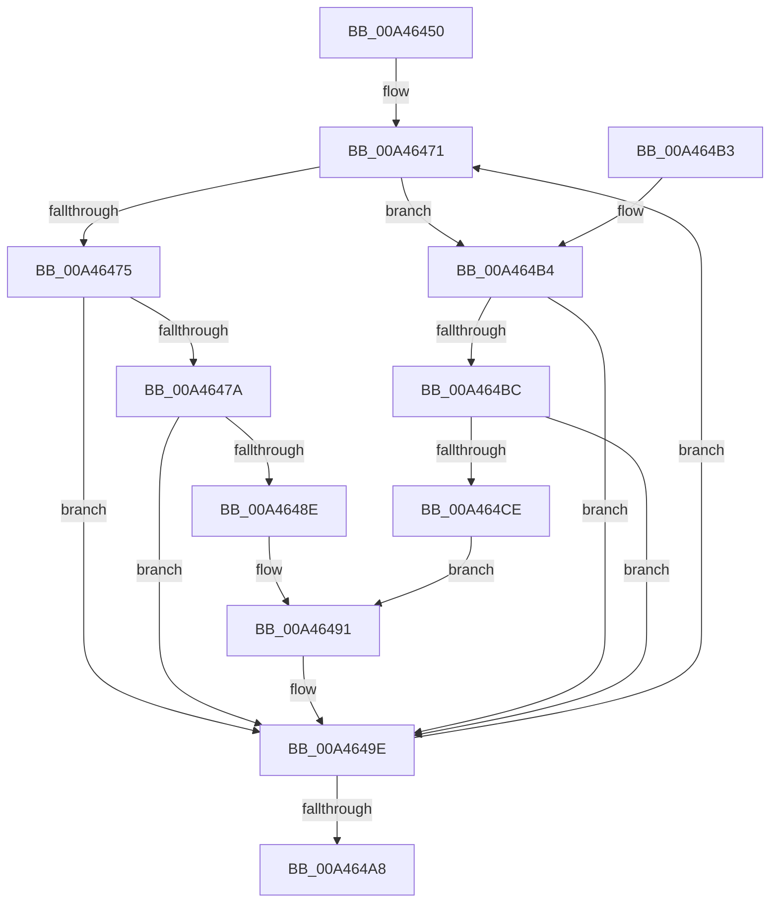

# EtwpMapEnableFlags

- RVA: `0x00A46450`–`0x00A464D4` (길이 `132` bytes)
- VA: `0x0000000140A46450`
- 실행 섹션: `PAGE`
- PDB 이름 있음: `예`; PDB Function 태그: `아니요`
- unwind 정보 RVA: `0x0009CEFC`
- 디코드: `41`개 명령, `132/132` bytes 표시
- 미해석 바이트: `0` (있으면 어셈블리에 `.byte`로 보존)

> 이 문서는 커널 이미지의 기계어와 PDB 기호를 분석해 생성했습니다. 4번과 5번은 함수 원형과 자료형을 바이너리 사용 방식에서 추정한 C 해석이며 원본 소스 복구 결과는 아닙니다.

## 1. Dependencies

- 직접 호출 지점: **0**; 고유 호출 대상: **0**
- 직접 호출자로 확인된 함수: **2**
- RIP 상대 이미지 참조: **1**

### Outgoing calls
- 직접 디코드된 call 명령이 없습니다.

### Direct callers
- [EtwQueryPerformanceTraceInformation](../AF/EtwQueryPerformanceTraceInformation_function_00AF28A4.md) at `0x00AF2B27`
- [EtwpInitialize](../../init/C4/EtwpInitialize_function_00C4DBCC.md) at `0x00C4DE6F`

### Static image references
- `0x00A4645C` → RVA `0x00B4D4C0` (`EtwpEnableFlagMap`; read)

## 2. Other-region calls and transfers

- 다른 실행 섹션으로 향하는 call: **0**
- 별도 외부 분기/꼬리 이동을 확인하지 못했습니다.

## 3. Assembly (complete function range)

```asm
00A46450  48 89 5C 24 08                  mov qword ptr [rsp + 8], rbx
00A46455  48 89 7C 24 10                  mov qword ptr [rsp + 0x10], rdi
00A4645A  8A DA                           mov bl, dl
00A4645C  4C 8D 0D 5D 70 10 00            lea r9, [rip + 0x10705d]
00A46463  4C 8B C1                        mov r8, rcx
00A46466  BF FF FF FF 1F                  mov edi, 0x1fffffff
00A4646B  41 BB 08 00 00 00               mov r11d, 8
00A46471  84 DB                           test bl, bl
00A46473  75 3F                           jne 0x140a464b4
00A46475  4D 85 C0                        test r8, r8
00A46478  74 24                           je 0x140a4649e
00A4647A  41 8B 51 04                     mov edx, dword ptr [r9 + 4]
00A4647E  8B C2                           mov eax, edx
00A46480  48 C1 E8 1D                     shr rax, 0x1d
00A46484  41 8B 0C 80                     mov ecx, dword ptr [r8 + rax*4]
00A46488  23 CA                           and ecx, edx
00A4648A  85 CF                           test edi, ecx
00A4648C  74 10                           je 0x140a4649e
00A4648E  41 8B 09                        mov ecx, dword ptr [r9]
00A46491  48 8B C1                        mov rax, rcx
00A46494  23 CF                           and ecx, edi
00A46496  48 C1 E8 1D                     shr rax, 0x1d
00A4649A  41 09 0C 80                     or dword ptr [r8 + rax*4], ecx
00A4649E  49 83 C1 08                     add r9, 8
00A464A2  49 83 EB 01                     sub r11, 1
00A464A6  75 C9                           jne 0x140a46471
00A464A8  48 8B 5C 24 08                  mov rbx, qword ptr [rsp + 8]
00A464AD  48 8B 7C 24 10                  mov rdi, qword ptr [rsp + 0x10]
00A464B2  C3                              ret
00A464B3  CC                              int3
00A464B4  45 8B 11                        mov r10d, dword ptr [r9]
00A464B7  4D 85 C0                        test r8, r8
00A464BA  74 E2                           je 0x140a4649e
00A464BC  41 8B C2                        mov eax, r10d
00A464BF  48 C1 E8 1D                     shr rax, 0x1d
00A464C3  41 8B 0C 80                     mov ecx, dword ptr [r8 + rax*4]
00A464C7  41 23 CA                        and ecx, r10d
00A464CA  85 CF                           test edi, ecx
00A464CC  74 D0                           je 0x140a4649e
00A464CE  41 8B 49 04                     mov ecx, dword ptr [r9 + 4]
00A464D2  EB BD                           jmp 0x140a46491
```

## 4. C-style interpretation (structured pseudocode)

```c
__int64 __fastcall EtwpMapEnableFlags(__int64 a1, unsigned __int8 a2)
{
    __int64 result;
    __int64 v_r11;
    unsigned __int64 v_stack_p10;
    unsigned __int64 v_stack_p8;

    v_stack_p8 = v_rbx;
    v_stack_p10 = v_rdi;
loc_00A46471:
    if (a2 != 0) goto loc_00A464B4;
    if (a1 == 0) goto loc_00A4649E;
    result = ((unsigned int)((unsigned int)((unsigned int)(*(unsigned int *)(v_rip + 1077341 + 4))))) >> (29);
    a1 = (unsigned int)(((unsigned int)(*(unsigned int *)(a1 + result * 4))) & ((unsigned int)((unsigned int)(*(unsigned int *)(v_rip + 1077341 + 4)))));
    if ((((unsigned int)((unsigned int)(0x1FFFFFFFULL))) & ((unsigned int)(a1))) == 0) goto loc_00A4649E;
loc_00A46491:
    a1 = (unsigned int)(((unsigned int)(*(unsigned int *)(v_rip + 1077341))) & ((unsigned int)((unsigned int)(0x1FFFFFFFULL))));
    result = ((unsigned int)(*(unsigned int *)(v_rip + 1077341))) >> (29);
loc_00A4649E:
    a4 = (v_rip + 1077341) + (8);
    v_r11 = (8) - (1);
    if (condition_is_not_equal) goto loc_00A46471;
    return result;
loc_00A464B4:
    if (a1 == 0) goto loc_00A4649E;
    result = ((unsigned int)((unsigned int)((unsigned int)(*(unsigned int *)(a4))))) >> (29);
    a1 = (unsigned int)(((unsigned int)(*(unsigned int *)(a1 + result * 4))) & ((unsigned int)((unsigned int)(*(unsigned int *)(a4)))));
    if ((((unsigned int)(v_stack_p10)) & ((unsigned int)(a1))) == 0) goto loc_00A4649E;
    goto loc_00A46491;
}
```

## 5. (Beta) C Style

```c
int64_t EtwpMapEnableFlags(int64_t Arg1, uint8_t Arg2)
{
    int64_t result;
    int64_t local_r11;
    uint64_t v_stack_p10;
    uint64_t v_stack_p8;

    v_stack_p8 = local_rbx;
    v_stack_p10 = local_rdi;
loc_00A46471:
    if (Arg2 != 0) goto loc_00A464B4;
    if (Arg1 == 0) goto loc_00A4649E;
    result = ((uint32_t)((uint32_t)((uint32_t)(*(uint32_t *)(v_rip + 0x10705D + 0x4))))) >> (29);
    Arg1 = (uint32_t)(((uint32_t)(*(uint32_t *)(Arg1 + result * 4))) & ((uint32_t)((uint32_t)(*(uint32_t *)(v_rip + 0x10705D + 0x4)))));
    if ((((uint32_t)((uint32_t)(0x1FFFFFFFULL))) & ((uint32_t)(Arg1))) == 0) goto loc_00A4649E;
loc_00A46491:
    Arg1 = (uint32_t)(((uint32_t)(*(uint32_t *)(v_rip + 0x10705D))) & ((uint32_t)((uint32_t)(0x1FFFFFFFULL))));
    result = ((uint32_t)(*(uint32_t *)(v_rip + 0x10705D))) >> (29);
loc_00A4649E:
    a4 = (v_rip + 1077341) + (8);
    local_r11 = (8) - (1);
    if (condition_is_not_equal) goto loc_00A46471;
    return result;
loc_00A464B4:
    if (Arg1 == 0) goto loc_00A4649E;
    result = ((uint32_t)((uint32_t)((uint32_t)(*(uint32_t *)(a4))))) >> (29);
    Arg1 = (uint32_t)(((uint32_t)(*(uint32_t *)(Arg1 + result * 4))) & ((uint32_t)((uint32_t)(*(uint32_t *)(a4)))));
    if ((((uint32_t)(v_stack_p10)) & ((uint32_t)(Arg1))) == 0) goto loc_00A4649E;
    goto loc_00A46491;
}
```

## 6. Execution-region graph

[열기: 2D/3D 그래프와 함수 탐색 컨트롤 패널](../../../control-panel.html?section=page&rva=0x00A46450&view=graph)

- 2D 그래프는 위에서 아래로 흐르고, 3D 그래프는 빈 공간을 드래그해 회전합니다. Shift+드래그는 이동, 휠은 확대·축소, 함수 노드 선택은 대상 보고서 이동입니다.

### Static fallback


