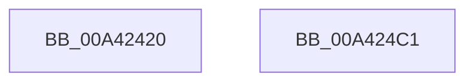

# EtwpSystemImageEnumCallback

- RVA: `0x00A42420`–`0x00A424C2` (길이 `162` bytes)
- VA: `0x0000000140A42420`
- 실행 섹션: `PAGE`
- PDB 이름 있음: `예`; PDB Function 태그: `아니요`
- unwind 정보 RVA: `0x0005D2F4`
- 디코드: `43`개 명령, `162/162` bytes 표시
- 미해석 바이트: `0` (있으면 어셈블리에 `.byte`로 보존)

> 이 문서는 커널 이미지의 기계어와 PDB 기호를 분석해 생성했습니다. 4번과 5번은 함수 원형과 자료형을 바이너리 사용 방식에서 추정한 C 해석이며 원본 소스 복구 결과는 아닙니다.

## 1. Dependencies

- 직접 호출 지점: **1**; 고유 호출 대상: **1**
- 직접 호출자로 확인된 함수: **0**
- RIP 상대 이미지 참조: **0**

### Outgoing calls
- `0x00A424B5` → [EtwpLogKernelEvent](../../text/25/EtwpLogKernelEvent_function_0025CC00.md) (function, `0x0025CC00`)

### Direct callers
- 이 함수 시작 RVA로 연결되는 직접 call은 확인되지 않았습니다. 간접 호출은 완전히 역산할 수 없습니다.

### Static image references
- 디코드된 RIP-relative 메모리 참조가 없습니다.

## 2. Other-region calls and transfers

- 다른 실행 섹션으로 향하는 call: **1**
  - `0x00A424B5` → [EtwpLogKernelEvent](../../text/25/EtwpLogKernelEvent_function_0025CC00.md) (`PAGE` → `.text`)
- 별도 외부 분기/꼬리 이동을 확인하지 못했습니다.

## 3. Assembly (complete function range)

```asm
00A42420  48 83 EC 38                     sub rsp, 0x38
00A42424  4C 8B 02                        mov r8, qword ptr [rdx]
00A42427  4C 8B D2                        mov r10, rdx
00A4242A  4C 8B 5A 08                     mov r11, qword ptr [rdx + 8]
00A4242E  4C 8B C9                        mov r9, rcx
00A42431  48 8B 41 30                     mov rax, qword ptr [rcx + 0x30]
00A42435  C7 44 24 28 03 19 50 00         mov dword ptr [rsp + 0x28], 0x501903
00A4243D  49 89 00                        mov qword ptr [r8], rax
00A42440  48 8B 02                        mov rax, qword ptr [rdx]
00A42443  44 8B 41 40                     mov r8d, dword ptr [rcx + 0x40]
00A42447  4C 89 40 08                     mov qword ptr [rax + 8], r8
00A4244B  4C 8B 02                        mov r8, qword ptr [rdx]
00A4244E  8B 41 78                        mov eax, dword ptr [rcx + 0x78]
00A42451  41 89 40 14                     mov dword ptr [r8 + 0x14], eax
00A42455  4C 8B 02                        mov r8, qword ptr [rdx]
00A42458  8B 81 9C 00 00 00               mov eax, dword ptr [rcx + 0x9c]
00A4245E  41 89 40 18                     mov dword ptr [r8 + 0x18], eax
00A42462  48 8B 02                        mov rax, qword ptr [rdx]
00A42465  8A 49 6E                        mov cl, byte ptr [rcx + 0x6e]
00A42468  80 E1 0F                        and cl, 0xf
00A4246B  88 48 1C                        mov byte ptr [rax + 0x1c], cl
00A4246E  49 8B CB                        mov rcx, r11
00A42471  41 8A 51 6E                     mov dl, byte ptr [r9 + 0x6e]
00A42475  49 8B 02                        mov rax, qword ptr [r10]
00A42478  C0 EA 04                        shr dl, 4
00A4247B  80 E2 07                        and dl, 7
00A4247E  88 50 1D                        mov byte ptr [rax + 0x1d], dl
00A42481  41 0F B7 51 48                  movzx edx, word ptr [r9 + 0x48]
00A42486  49 8B 41 50                     mov rax, qword ptr [r9 + 0x50]
00A4248A  41 B9 03 00 00 00               mov r9d, 3
00A42490  41 83 63 1C 00                  and dword ptr [r11 + 0x1c], 0
00A42495  49 89 43 10                     mov qword ptr [r11 + 0x10], rax
00A42499  41 89 53 18                     mov dword ptr [r11 + 0x18], edx
00A4249D  49 8B 52 10                     mov rdx, qword ptr [r10 + 0x10]
00A424A1  41 0F B7 42 18                  movzx eax, word ptr [r10 + 0x18]
00A424A6  66 89 44 24 20                  mov word ptr [rsp + 0x20], ax
00A424AB  44 8B 02                        mov r8d, dword ptr [rdx]
00A424AE  48 8B 92 50 05 00 00            mov rdx, qword ptr [rdx + 0x550]
00A424B5  E8 46 A7 81 FF                  call 0x14025cc00
00A424BA  33 C0                           xor eax, eax
00A424BC  48 83 C4 38                     add rsp, 0x38
00A424C0  C3                              ret
00A424C1  CC                              int3
```

## 4. C-style interpretation (structured pseudocode)

```c
__int64 __fastcall EtwpSystemImageEnumCallback(__int64 a1, __int64 a2)
{
    __int64 result;
    __int64 v_rsp;
    unsigned int v_stack_m10;
    unsigned __int16 v_stack_m18;

    v_rsp = (v_rsp) - (56);
    v_stack_m10 = 0x501903ULL;
    *(unsigned __int64 *)(*(unsigned __int64 *)(a2)) = *(unsigned __int64 *)(a1 + 48);
    *(unsigned __int64 *)(*(unsigned __int64 *)(a2) + 8) = (unsigned int)(*(unsigned int *)(a1 + 64));
    *(unsigned int *)(*(unsigned __int64 *)(a2) + 20) = (unsigned int)((unsigned int)(*(unsigned int *)(a1 + 120)));
    *(unsigned int *)(*(unsigned __int64 *)(a2) + 24) = (unsigned int)((unsigned int)(*(unsigned int *)(a1 + 156)));
    a1 = (unsigned __int8)((*(unsigned __int8 *)(a1 + 110)) & (15));
    *(unsigned __int8 *)(*(unsigned __int64 *)(a2) + 28) = (unsigned __int8)(a1);
    a2 = (unsigned __int8)((*(unsigned __int8 *)(a1 + 110)) >> (4));
    a2 = (unsigned __int8)((a2) & (7));
    *(unsigned __int8 *)(*(unsigned __int64 *)(a2) + 29) = (unsigned __int8)(a2);
    *(unsigned __int64 *)(*(unsigned __int64 *)(a2 + 8) + 16) = *(unsigned __int64 *)(a1 + 80);
    *(unsigned int *)(*(unsigned __int64 *)(a2 + 8) + 24) = (unsigned int)(*(unsigned __int16 *)(a1 + 72));
    v_stack_m18 = (unsigned __int16)(*(unsigned __int16 *)(a2 + 24));
    result = EtwpLogKernelEvent(*(unsigned __int64 *)(a2 + 8), *(unsigned __int64 *)(*(unsigned __int64 *)(a2 + 16) + 1360), (unsigned int)(*(unsigned int *)(*(unsigned __int64 *)(a2 + 16))), 3);
    result = 0;
    v_rsp = (v_rsp) + (56);
    return result;
}
```

## 5. (Beta) C Style

```c
int64_t EtwpSystemImageEnumCallback(void *Arg1, void *Arg2)
{
    uint8_t *arg1 = (uint8_t *)Arg1;
    uint8_t *arg2 = (uint8_t *)Arg2;

    int64_t result;
    int64_t local_rsp;
    uint32_t v_stack_m10;
    uint16_t v_stack_m18;

    local_rsp = (local_rsp) - (56);
    v_stack_m10 = 0x501903ULL;
    *(uint64_t *)(*(uint64_t *)(arg2)) = *(uint64_t *)(arg1 + 0x30);
    *(uint64_t *)(*(uint64_t *)(arg2) + 0x8) = (uint32_t)(*(uint32_t *)(arg1 + 0x40));
    *(uint32_t *)(*(uint64_t *)(arg2) + 0x14) = (uint32_t)((uint32_t)(*(uint32_t *)(arg1 + 0x78)));
    *(uint32_t *)(*(uint64_t *)(arg2) + 0x18) = (uint32_t)((uint32_t)(*(uint32_t *)(arg1 + 0x9C)));
    Arg1 = (uint8_t)((*(uint8_t *)(arg1 + 0x6E)) & (15));
    *(uint8_t *)(*(uint64_t *)(arg2) + 0x1C) = (uint8_t)(Arg1);
    Arg2 = (uint8_t)((*(uint8_t *)(arg1 + 0x6E)) >> (4));
    Arg2 = (uint8_t)((Arg2) & (7));
    *(uint8_t *)(*(uint64_t *)(arg2) + 0x1D) = (uint8_t)(Arg2);
    *(uint64_t *)(*(uint64_t *)(arg2 + 0x8) + 0x10) = *(uint64_t *)(arg1 + 0x50);
    *(uint32_t *)(*(uint64_t *)(arg2 + 0x8) + 0x18) = (uint32_t)(*(uint16_t *)(arg1 + 0x48));
    v_stack_m18 = (uint16_t)(*(uint16_t *)(arg2 + 0x18));
    result = EtwpLogKernelEvent(*(uint64_t *)(arg2 + 0x8), *(uint64_t *)(*(uint64_t *)(arg2 + 0x10) + 0x550), (uint32_t)(*(uint32_t *)(*(uint64_t *)(arg2 + 0x10))), 3);
    result = 0;
    local_rsp = (local_rsp) + (56);
    return result;
}
```

### 관측된 메모리 오프셋

구조체 형식이 확인되지 않은 접근은 인자 기준의 오프셋으로만 기록했습니다.

| 기준 인자 | 오프셋 표현 | 폭 (bit) | 접근 |
|---|---:|---:|---|
| `Arg1` | `+ 0x30` | `64` | `R` |
| `Arg1` | `+ 0x40` | `32` | `R` |
| `Arg1` | `+ 0x48` | `16` | `R` |
| `Arg1` | `+ 0x50` | `64` | `R` |
| `Arg1` | `+ 0x6E` | `8` | `R` |
| `Arg1` | `+ 0x78` | `32` | `R` |
| `Arg1` | `+ 0x9C` | `32` | `R` |
| `Arg2` | `+ 0x0` | `64` | `R` |
| `Arg2` | `+ 0x8` | `64` | `R` |
| `Arg2` | `+ 0x10` | `64` | `R` |
| `Arg2` | `+ 0x18` | `16` | `R` |

## 6. Execution-region graph

[열기: 2D/3D 그래프와 함수 탐색 컨트롤 패널](../../../control-panel.html?section=page&rva=0x00A42420&view=graph)

- 2D 그래프는 위에서 아래로 흐르고, 3D 그래프는 빈 공간을 드래그해 회전합니다. Shift+드래그는 이동, 휠은 확대·축소, 함수 노드 선택은 대상 보고서 이동입니다.

### Static fallback


