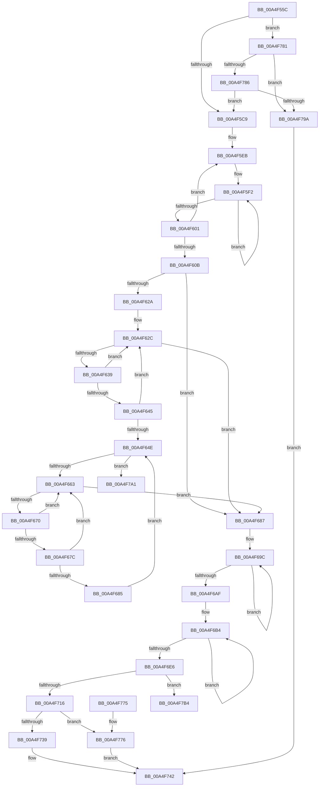

# EtwpUpdateGlobalGroupMasks

- RVA: `0x00A4F55C`–`0x00A4F7CF` (길이 `627` bytes)
- VA: `0x0000000140A4F55C`
- 실행 섹션: `PAGE`
- PDB 이름 있음: `예`; PDB Function 태그: `예`
- unwind 정보 RVA: `0x000B0918`
- 디코드: `161`개 명령, `627/627` bytes 표시
- 미해석 바이트: `0` (있으면 어셈블리에 `.byte`로 보존)

> 이 문서는 커널 이미지의 기계어와 PDB 기호를 분석해 생성했습니다. 4번과 5번은 함수 원형과 자료형을 바이너리 사용 방식에서 추정한 C 해석이며 원본 소스 복구 결과는 아닙니다.

## 1. Dependencies

- 직접 호출 지점: **10**; 고유 호출 대상: **8**
- 직접 호출자로 확인된 함수: **6**
- RIP 상대 이미지 참조: **8**

### Outgoing calls
- `0x00A4F5B5` → [KeWaitForSingleObject](../../text/20/KeWaitForSingleObject_function_0020E6B0.md) (function, `0x0020E6B0`)
- `0x00A4F62C` → [PspGetNextJob](../91/PspGetNextJob_function_0091A0A0.md) (function, `0x0091A0A0`)
- `0x00A4F645` → [PsIsServerSilo](../../text/22/PsIsServerSilo_function_00225828.md) (function, `0x00225828`)
- `0x00A4F64E` → [PsGetServerSiloGlobals](../../text/22/PsGetServerSiloGlobals_function_002250A0.md) (function, `0x002250A0`)
- `0x00A4F663` → [PspGetNextJob](../91/PspGetNextJob_function_0091A0A0.md) (function, `0x0091A0A0`)
- `0x00A4F67C` → [PsIsServerSilo](../../text/22/PsIsServerSilo_function_00225828.md) (function, `0x00225828`)
- `0x00A4F6F4` → [EtwpDisableKernelTrace](EtwpDisableKernelTrace_function_00A4F7D8.md) (function, `0x00A4F7D8`)
- `0x00A4F707` → [EtwpEnableKernelTrace](EtwpEnableKernelTrace_function_00A4FBCC.md) (function, `0x00A4FBCC`)
- `0x00A4F74B` → [KeReleaseMutex](../../text/39/KeReleaseMutex_function_00396810.md) (function, `0x00396810`)
- `0x00A4F759` → [_security_check_cookie](../../text/6A/_security_check_cookie_function_006AC640.md) (function, `0x006AC640`)

### Direct callers
- [EtwpUpdateSelectedGroupMasks](../../text/49/EtwpUpdateSelectedGroupMasks_function_0049B114.md) at `0x0049B345`
- [EtwDereferenceSpinLockCounters](../7B/EtwDereferenceSpinLockCounters_function_007BC2E8.md) at `0x007BC324`
- [EtwReferenceSpinLockCounters](../7B/EtwReferenceSpinLockCounters_function_007BC344.md) at `0x007BC38A`
- [EtwpCoverageSamplerStart](../7C/EtwpCoverageSamplerStart_function_007C2248.md) at `0x007C24A1`
- [EtwpCoverageSamplerStop](../7C/EtwpCoverageSamplerStop_function_007C2564.md) at `0x007C272C`
- [EtwpUpdateKernelGroupsWork](EtwpUpdateKernelGroupsWork_function_00A4F530.md) at `0x00A4F548`

### Static image references
- `0x00A4F574` → RVA `0x00E0A740` (`.data`; read)
- `0x00A4F599` → RVA `0x00EFF7A0` (`.data`; read)
- `0x00A4F60B` → RVA `0x00EFF284` (`.data`; read)
- `0x00A4F687` → RVA `0x00FC6AA8` (`ALMOSTRO`; read)
- `0x00A4F6B4` → RVA `0x00FC6B00` (`ALMOSTRO`; read)
- `0x00A4F723` → RVA `0x00FC6B00` (`ALMOSTRO`; write)
- `0x00A4F72E` → RVA `0x00FC6B10` (`ALMOSTRO`; write)
- `0x00A4F739` → RVA `0x00F475C0` (`.data`; read/write)

## 2. Other-region calls and transfers

- 다른 실행 섹션으로 향하는 call: **6**
  - `0x00A4F5B5` → [KeWaitForSingleObject](../../text/20/KeWaitForSingleObject_function_0020E6B0.md) (`PAGE` → `.text`)
  - `0x00A4F645` → [PsIsServerSilo](../../text/22/PsIsServerSilo_function_00225828.md) (`PAGE` → `.text`)
  - `0x00A4F64E` → [PsGetServerSiloGlobals](../../text/22/PsGetServerSiloGlobals_function_002250A0.md) (`PAGE` → `.text`)
  - `0x00A4F67C` → [PsIsServerSilo](../../text/22/PsIsServerSilo_function_00225828.md) (`PAGE` → `.text`)
  - `0x00A4F74B` → [KeReleaseMutex](../../text/39/KeReleaseMutex_function_00396810.md) (`PAGE` → `.text`)
  - `0x00A4F759` → [_security_check_cookie](../../text/6A/_security_check_cookie_function_006AC640.md) (`PAGE` → `.text`)
- call이 아닌 외부 분기/꼬리 이동: **2**
  - `0x00A4F7AF` → [sub_00B3C544](../B3/Unknown_function_00B3C544.md) (`tail-transfer`)
  - `0x00A4F7CA` → [sub_00B3C544 + 0x19](../B3/Unknown_function_00B3C544.md) (`tail-transfer`)

## 3. Assembly (complete function range)

```asm
00A4F55C  48 89 5C 24 20                  mov qword ptr [rsp + 0x20], rbx
00A4F561  55                              push rbp
00A4F562  56                              push rsi
00A4F563  57                              push rdi
00A4F564  41 56                           push r14
00A4F566  41 57                           push r15
00A4F568  48 8D 6C 24 C9                  lea rbp, [rsp - 0x37]
00A4F56D  48 81 EC A0 00 00 00            sub rsp, 0xa0
00A4F574  48 8B 05 C5 B1 3B 00            mov rax, qword ptr [rip + 0x3bb1c5]
00A4F57B  48 33 C4                        xor rax, rsp
00A4F57E  48 89 45 27                     mov qword ptr [rbp + 0x27], rax
00A4F582  48 83 64 24 20 00               and qword ptr [rsp + 0x20], 0
00A4F588  0F 57 C0                        xorps xmm0, xmm0
00A4F58B  0F 57 C9                        xorps xmm1, xmm1
00A4F58E  45 8B F8                        mov r15d, r8d
00A4F591  8B F2                           mov esi, edx
00A4F593  48 8B F9                        mov rdi, rcx
00A4F596  45 33 C0                        xor r8d, r8d
00A4F599  48 8D 0D 00 02 4B 00            lea rcx, [rip + 0x4b0200]
00A4F5A0  33 D2                           xor edx, edx
00A4F5A2  45 33 C9                        xor r9d, r9d
00A4F5A5  0F 11 45 E7                     movups xmmword ptr [rbp - 0x19], xmm0
00A4F5A9  0F 11 45 F7                     movups xmmword ptr [rbp - 9], xmm0
00A4F5AD  0F 11 4D 07                     movups xmmword ptr [rbp + 7], xmm1
00A4F5B1  0F 11 4D 17                     movups xmmword ptr [rbp + 0x17], xmm1
00A4F5B5  E8 F6 F0 7B FF                  call 0x14020e6b0
00A4F5BA  41 BE 08 00 00 00               mov r14d, 8
00A4F5C0  45 3B FE                        cmp r15d, r14d
00A4F5C3  0F 82 B8 01 00 00               jb 0x140a4f781
00A4F5C9  0F 57 C0                        xorps xmm0, xmm0
00A4F5CC  48 8D 45 C7                     lea rax, [rbp - 0x39]
00A4F5D0  48 8B CF                        mov rcx, rdi
00A4F5D3  41 B8 0A 00 00 00               mov r8d, 0xa
00A4F5D9  48 2B C8                        sub rcx, rax
00A4F5DC  48 81 C1 CC 11 00 00            add rcx, 0x11cc
00A4F5E3  0F 11 45 C7                     movups xmmword ptr [rbp - 0x39], xmm0
00A4F5E7  0F 11 45 D7                     movups xmmword ptr [rbp - 0x29], xmm0
00A4F5EB  48 8D 55 C7                     lea rdx, [rbp - 0x39]
00A4F5EF  4D 8B CE                        mov r9, r14
00A4F5F2  8B 04 11                        mov eax, dword ptr [rcx + rdx]
00A4F5F5  09 02                           or dword ptr [rdx], eax
00A4F5F7  48 8D 52 04                     lea rdx, [rdx + 4]
00A4F5FB  49 83 E9 01                     sub r9, 1
00A4F5FF  75 F1                           jne 0x140a4f5f2
00A4F601  48 83 C1 20                     add rcx, 0x20
00A4F605  49 83 E8 01                     sub r8, 1
00A4F609  75 E0                           jne 0x140a4f5eb
00A4F60B  44 38 05 72 FC 4A 00            cmp byte ptr [rip + 0x4afc72], r8b
00A4F612  48 8D 9F AC 11 00 00            lea rbx, [rdi + 0x11ac]
00A4F619  0F 10 45 C7                     movups xmm0, xmmword ptr [rbp - 0x39]
00A4F61D  0F 10 4D D7                     movups xmm1, xmmword ptr [rbp - 0x29]
00A4F621  0F 11 03                        movups xmmword ptr [rbx], xmm0
00A4F624  0F 11 4B 10                     movups xmmword ptr [rbx + 0x10], xmm1
00A4F628  74 5D                           je 0x140a4f687
00A4F62A  33 C9                           xor ecx, ecx
00A4F62C  E8 6F AA EC FF                  call 0x14091a0a0
00A4F631  48 8B C8                        mov rcx, rax
00A4F634  48 85 C0                        test rax, rax
00A4F637  74 4E                           je 0x140a4f687
00A4F639  F7 80 10 06 00 00 00 00 00 40   test dword ptr [rax + 0x610], 0x40000000
00A4F643  74 E7                           je 0x140a4f62c
00A4F645  E8 DE 61 7D FF                  call 0x140225828
00A4F64A  84 C0                           test al, al
00A4F64C  74 DE                           je 0x140a4f62c
00A4F64E  E8 4D 5A 7D FF                  call 0x1402250a0
00A4F653  4C 8B 80 40 03 00 00            mov r8, qword ptr [rax + 0x340]
00A4F65A  4D 85 C0                        test r8, r8
00A4F65D  0F 85 3E 01 00 00               jne 0x140a4f7a1
00A4F663  E8 38 AA EC FF                  call 0x14091a0a0
00A4F668  48 8B C8                        mov rcx, rax
00A4F66B  48 85 C0                        test rax, rax
00A4F66E  74 17                           je 0x140a4f687
00A4F670  F7 80 10 06 00 00 00 00 00 40   test dword ptr [rax + 0x610], 0x40000000
00A4F67A  74 E7                           je 0x140a4f663
00A4F67C  E8 A7 61 7D FF                  call 0x140225828
00A4F681  84 C0                           test al, al
00A4F683  74 DE                           je 0x140a4f663
00A4F685  EB C7                           jmp 0x140a4f64e
00A4F687  48 8B 15 1A 74 57 00            mov rdx, qword ptr [rip + 0x57741a]
00A4F68E  48 8D 45 C7                     lea rax, [rbp - 0x39]
00A4F692  48 2B D0                        sub rdx, rax
00A4F695  48 8D 4D C7                     lea rcx, [rbp - 0x39]
00A4F699  4D 8B C6                        mov r8, r14
00A4F69C  8B 84 0A AC 11 00 00            mov eax, dword ptr [rdx + rcx + 0x11ac]
00A4F6A3  09 01                           or dword ptr [rcx], eax
00A4F6A5  48 8D 49 04                     lea rcx, [rcx + 4]
00A4F6A9  49 83 E8 01                     sub r8, 1
00A4F6AD  75 ED                           jne 0x140a4f69c
00A4F6AF  33 C0                           xor eax, eax
00A4F6B1  8D 48 02                        lea ecx, [rax + 2]
00A4F6B4  48 8D 15 45 74 57 00            lea rdx, [rip + 0x577445]
00A4F6BB  F3 0F 6F 0C 10                  movdqu xmm1, xmmword ptr [rax + rdx]
00A4F6C0  F3 0F 6F 54 05 C7               movdqu xmm2, xmmword ptr [rbp + rax - 0x39]
00A4F6C6  48 8D 40 10                     lea rax, [rax + 0x10]
00A4F6CA  66 0F 6F C1                     movdqa xmm0, xmm1
00A4F6CE  0F 55 C2                        andnps xmm0, xmm2
00A4F6D1  0F 55 D1                        andnps xmm2, xmm1
00A4F6D4  F3 0F 7F 54 05 F7               movdqu xmmword ptr [rbp + rax - 9], xmm2
00A4F6DA  F3 0F 7F 44 05 D7               movdqu xmmword ptr [rbp + rax - 0x29], xmm0
00A4F6E0  48 83 E9 01                     sub rcx, 1
00A4F6E4  75 CE                           jne 0x140a4f6b4
00A4F6E6  44 8B CE                        mov r9d, esi
00A4F6E9  48 8D 55 07                     lea rdx, [rbp + 7]
00A4F6ED  4C 8B C7                        mov r8, rdi
00A4F6F0  48 8D 4D C7                     lea rcx, [rbp - 0x39]
00A4F6F4  E8 DF 00 00 00                  call 0x140a4f7d8
00A4F6F9  44 8B CE                        mov r9d, esi
00A4F6FC  48 8D 55 E7                     lea rdx, [rbp - 0x19]
00A4F700  4C 8B C7                        mov r8, rdi
00A4F703  48 8D 4D C7                     lea rcx, [rbp - 0x39]
00A4F707  E8 C0 04 00 00                  call 0x140a4fbcc
00A4F70C  8B F0                           mov esi, eax
00A4F70E  85 C0                           test eax, eax
00A4F710  0F 88 9E 00 00 00               js 0x140a4f7b4
00A4F716  0F 10 4D C7                     movups xmm1, xmmword ptr [rbp - 0x39]
00A4F71A  0F 10 45 D7                     movups xmm0, xmmword ptr [rbp - 0x29]
00A4F71E  66 48 0F 7E C8                  movq rax, xmm1
00A4F723  0F 29 0D D6 73 57 00            movaps xmmword ptr [rip + 0x5773d6], xmm1
00A4F72A  48 C1 E8 20                     shr rax, 0x20
00A4F72E  0F 29 05 DB 73 57 00            movaps xmmword ptr [rip + 0x5773db], xmm0
00A4F735  A8 04                           test al, 4
00A4F737  74 3D                           je 0x140a4f776
00A4F739  F0 0F BA 2D 7E 7E 4F 00 00      lock bts dword ptr [rip + 0x4f7e7e], 0
00A4F742  33 D2                           xor edx, edx
00A4F744  48 8D 0D 55 00 4B 00            lea rcx, [rip + 0x4b0055]
00A4F74B  E8 C0 70 94 FF                  call 0x140396810
00A4F750  8B C6                           mov eax, esi
00A4F752  48 8B 4D 27                     mov rcx, qword ptr [rbp + 0x27]
00A4F756  48 33 CC                        xor rcx, rsp
00A4F759  E8 E2 CE C5 FF                  call 0x1406ac640
00A4F75E  48 8B 9C 24 E8 00 00 00         mov rbx, qword ptr [rsp + 0xe8]
00A4F766  48 81 C4 A0 00 00 00            add rsp, 0xa0
00A4F76D  41 5F                           pop r15
00A4F76F  41 5E                           pop r14
00A4F771  5F                              pop rdi
00A4F772  5E                              pop rsi
00A4F773  5D                              pop rbp
00A4F774  C3                              ret
00A4F775  CC                              int3
00A4F776  F0 0F BA 35 41 7E 4F 00 00      lock btr dword ptr [rip + 0x4f7e41], 0
00A4F77F  EB C1                           jmp 0x140a4f742
00A4F781  3B 77 10                        cmp esi, dword ptr [rdi + 0x10]
00A4F784  73 14                           jae 0x140a4f79a
00A4F786  48 8B 87 C8 02 00 00            mov rax, qword ptr [rdi + 0x2c8]
00A4F78D  48 8B 14 F0                     mov rdx, qword ptr [rax + rsi*8]
00A4F791  F6 C2 01                        test dl, 1
00A4F794  0F 84 2F FE FF FF               je 0x140a4f5c9
00A4F79A  BE 25 00 00 80                  mov esi, 0x80000025
00A4F79F  EB A1                           jmp 0x140a4f742
00A4F7A1  48 8D 45 C7                     lea rax, [rbp - 0x39]
00A4F7A5  4D 8B CE                        mov r9, r14
00A4F7A8  4C 2B C0                        sub r8, rax
00A4F7AB  48 8D 55 C7                     lea rdx, [rbp - 0x39]
00A4F7AF  E9 90 CD 0E 00                  jmp 0x140b3c544
00A4F7B4  49 8D 4F 01                     lea rcx, [r15 + 1]
00A4F7B8  4C 8D 45 E7                     lea r8, [rbp - 0x19]
00A4F7BC  48 C1 E1 05                     shl rcx, 5
00A4F7C0  4C 2B C7                        sub r8, rdi
00A4F7C3  48 8D 55 C7                     lea rdx, [rbp - 0x39]
00A4F7C7  48 2B D7                        sub rdx, rdi
00A4F7CA  E9 8E CD 0E 00                  jmp 0x140b3c55d
```

## 4. C-style interpretation (structured pseudocode)

```c
__int64 __fastcall EtwpUpdateGlobalGroupMasks(__int64 a1, int a2, int a3, int a4)
{
    __int64 result;
    __int64 v_rsp;
    unsigned __int64 v_stack_m38;
    unsigned __int64 v_stack_m48;
    unsigned __int64 v_stack_m58;
    unsigned __int64 v_stack_m5F;
    unsigned __int64 v_stack_m68;
    unsigned __int64 v_stack_m78;
    unsigned __int64 v_stack_m88;
    unsigned __int64 v_stack_m98;
    unsigned __int64 v_stack_mA8;
    unsigned __int64 v_stack_p20;

    v_stack_p20 = v_rbx;
    v_rsp = (v_rsp) - (160);
    result = (*(unsigned __int64 *)(v_rip + 3912133)) ^ (v_rsp);
    v_stack_m38 = result;
    a3 = 0;
    a2 = 0;
    a4 = 0;
    v_stack_m78 = v_xmm0;
    v_stack_m68 = v_xmm0;
    v_stack_m58 = v_xmm1;
    v_stack_m48 = v_xmm1;
    result = KeWaitForSingleObject(v_rip + 4915712, a2, a3, a4);
    if (((unsigned int)((unsigned int)(a3))) < 8) goto loc_00A4F781;
loc_00A4F5C9:
    a1 = (a1) - (v_stack_m98);
    a1 = (a1) + (0x11CCULL);
    v_stack_m98 = v_xmm0;
    v_stack_m88 = v_xmm0;
loc_00A4F5EB:
loc_00A4F5F2:
    a4 = (8) - (1);
    if (condition_is_not_equal) goto loc_00A4F5F2;
    a1 = (a1) + (32);
    a3 = (10) - (1);
    if (condition_is_not_equal) goto loc_00A4F5EB;
    *(unsigned __int64 *)(a1 + 4524) = v_xmm0;
    *(unsigned __int64 *)(a1 + 4524 + 16) = v_xmm1;
    if ((*(unsigned __int8 *)(v_rip + 4914290)) == ((unsigned __int8)(a3))) goto loc_00A4F687;
    a1 = 0;
loc_00A4F62C:
    result = PspGetNextJob(a1, v_stack_m98 + 4, a3, a4);
    if (result == 0) goto loc_00A4F687;
    if (((*(unsigned int *)(result + 1552)) & (0x40000000ULL)) == 0) goto loc_00A4F62C;
    result = PsIsServerSilo(result, v_stack_m98 + 4, a3, a4);
    if ((unsigned __int8)(result) == 0) goto loc_00A4F62C;
loc_00A4F64E:
    result = PsGetServerSiloGlobals(result, v_stack_m98 + 4, a3, a4);
    if (*(unsigned __int64 *)(result + 832) != 0) goto loc_00A4F7A1;
loc_00A4F663:
    result = PspGetNextJob(result, v_stack_m98 + 4, *(unsigned __int64 *)(result + 832), a4);
    if (result == 0) goto loc_00A4F687;
    if (((*(unsigned int *)(result + 1552)) & (0x40000000ULL)) == 0) goto loc_00A4F663;
    result = PsIsServerSilo(result, v_stack_m98 + 4, *(unsigned __int64 *)(result + 832), a4);
    if ((unsigned __int8)(result) == 0) goto loc_00A4F663;
    goto loc_00A4F64E;
loc_00A4F687:
    a2 = (*(unsigned __int64 *)(v_rip + 5731354)) - (v_stack_m98);
loc_00A4F69C:
    a3 = (8) - (1);
    if (condition_is_not_equal) goto loc_00A4F69C;
    result = 0;
loc_00A4F6B4:
    *(unsigned __int64 *)(v_stack_m5F + result + 16 * 1 - 9) = v_xmm2;
    *(unsigned __int64 *)(v_stack_m5F + result + 16 * 1 - 41) = v_xmm0;
    a1 = (result + 2) - (1);
    if (condition_is_not_equal) goto loc_00A4F6B4;
    result = EtwpDisableKernelTrace(v_stack_m98, v_stack_m58, a1, (unsigned int)((unsigned int)((unsigned int)(a2))));
    result = EtwpEnableKernelTrace(v_stack_m98, v_stack_m78, a1, (unsigned int)((unsigned int)((unsigned int)(a2))));
    if (sign_flag) goto loc_00A4F7B4;
    *(unsigned __int64 *)(v_rip + 5731286) = v_xmm1;
    result = (result) >> (32);
    *(unsigned __int64 *)(v_rip + 5731291) = v_xmm0;
    if ((((unsigned __int8)(result)) & (4)) == 0) goto loc_00A4F776;
loc_00A4F742:
    a2 = 0;
    result = KeReleaseMutex(v_rip + 4915285, a2, a1, (unsigned int)((unsigned int)((unsigned int)(a2))));
    a1 = (v_stack_m38) ^ (v_rsp);
    result = _security_check_cookie(a1, a2, a1, (unsigned int)((unsigned int)((unsigned int)(a2))));
    v_rsp = (v_rsp) + (160);
    return result;
loc_00A4F776:
    goto loc_00A4F742;
loc_00A4F781:
    if (((unsigned int)((unsigned int)((unsigned int)(result)))) >= (*(unsigned int *)(a1 + 16))) goto loc_00A4F79A;
    if ((((unsigned __int8)(*(unsigned __int64 *)(*(unsigned __int64 *)(a1 + 712) + (unsigned int)((unsigned int)(result)) * 8))) & (1)) == 0) goto loc_00A4F5C9;
loc_00A4F79A:
    goto loc_00A4F742;
loc_00A4F7A1:
    a3 = (a1) - (v_stack_m98);
loc_00A4F7B4:
    a1 = ((unsigned int)(a3) + 1) << (5);
    a3 = (v_stack_m78) - (a1);
    a2 = (v_stack_m98) - (a1);
}
```

## 5. (Beta) C Style

```c
int64_t EtwpUpdateGlobalGroupMasks(void *Arg1, int32_t Arg2, int32_t Arg3, int32_t Arg4)
{
    uint8_t *arg1 = (uint8_t *)Arg1;

    int64_t result;
    int64_t local_rsp;
    uint64_t v_stack_m38;
    uint64_t v_stack_m48;
    uint64_t v_stack_m58;
    uint64_t v_stack_m5F;
    uint64_t v_stack_m68;
    uint64_t v_stack_m78;
    uint64_t v_stack_m88;
    uint64_t v_stack_m98;
    uint64_t v_stack_mA8;
    uint64_t v_stack_p20;

    v_stack_p20 = local_rbx;
    local_rsp = (local_rsp) - (160);
    result = (*(uint64_t *)(v_rip + 0x3BB1C5)) ^ (local_rsp);
    v_stack_m38 = result;
    Arg3 = 0;
    Arg2 = 0;
    Arg4 = 0;
    v_stack_m78 = v_xmm0;
    v_stack_m68 = v_xmm0;
    v_stack_m58 = v_xmm1;
    v_stack_m48 = v_xmm1;
    result = KeWaitForSingleObject(v_rip + 4915712, Arg2, Arg3, Arg4);
    if (((uint32_t)((uint32_t)(Arg3))) < 8) goto loc_00A4F781;
loc_00A4F5C9:
    Arg1 = (Arg1) - (v_stack_m98);
    Arg1 = (Arg1) + (0x11CCULL);
    v_stack_m98 = v_xmm0;
    v_stack_m88 = v_xmm0;
loc_00A4F5EB:
loc_00A4F5F2:
    Arg4 = (8) - (1);
    if (condition_is_not_equal) goto loc_00A4F5F2;
    Arg1 = (Arg1) + (32);
    Arg3 = (10) - (1);
    if (condition_is_not_equal) goto loc_00A4F5EB;
    *(uint64_t *)(arg1 + 0x11AC) = v_xmm0;
    *(uint64_t *)(arg1 + 0x11AC + 0x10) = v_xmm1;
    if ((*(uint8_t *)(v_rip + 0x4AFC72)) == ((uint8_t)(Arg3))) goto loc_00A4F687;
    Arg1 = 0;
loc_00A4F62C:
    result = PspGetNextJob(Arg1, v_stack_m98 + 4, Arg3, Arg4);
    if (result == 0) goto loc_00A4F687;
    if (((*(uint32_t *)(result + 0x610)) & (0x40000000ULL)) == 0) goto loc_00A4F62C;
    result = PsIsServerSilo(result, v_stack_m98 + 4, Arg3, Arg4);
    if ((uint8_t)(result) == 0) goto loc_00A4F62C;
loc_00A4F64E:
    result = PsGetServerSiloGlobals(result, v_stack_m98 + 4, Arg3, Arg4);
    if (*(uint64_t *)(result + 0x340) != 0) goto loc_00A4F7A1;
loc_00A4F663:
    result = PspGetNextJob(result, v_stack_m98 + 4, *(uint64_t *)(result + 0x340), Arg4);
    if (result == 0) goto loc_00A4F687;
    if (((*(uint32_t *)(result + 0x610)) & (0x40000000ULL)) == 0) goto loc_00A4F663;
    result = PsIsServerSilo(result, v_stack_m98 + 4, *(uint64_t *)(result + 0x340), Arg4);
    if ((uint8_t)(result) == 0) goto loc_00A4F663;
    goto loc_00A4F64E;
loc_00A4F687:
    Arg2 = (*(uint64_t *)(v_rip + 0x57741A)) - (v_stack_m98);
loc_00A4F69C:
    Arg3 = (8) - (1);
    if (condition_is_not_equal) goto loc_00A4F69C;
    result = 0;
loc_00A4F6B4:
    *(uint64_t *)(v_stack_m5F + result + 0x10 * 1 - 0x9) = v_xmm2;
    *(uint64_t *)(v_stack_m5F + result + 0x10 * 1 - 0x29) = v_xmm0;
    Arg1 = (result + 2) - (1);
    if (condition_is_not_equal) goto loc_00A4F6B4;
    result = EtwpDisableKernelTrace(v_stack_m98, v_stack_m58, Arg1, (uint32_t)((uint32_t)((uint32_t)(Arg2))));
    result = EtwpEnableKernelTrace(v_stack_m98, v_stack_m78, Arg1, (uint32_t)((uint32_t)((uint32_t)(Arg2))));
    if (sign_flag) goto loc_00A4F7B4;
    *(uint64_t *)(v_rip + 0x5773D6) = v_xmm1;
    result = (result) >> (32);
    *(uint64_t *)(v_rip + 0x5773DB) = v_xmm0;
    if ((((uint8_t)(result)) & (4)) == 0) goto loc_00A4F776;
loc_00A4F742:
    Arg2 = 0;
    result = KeReleaseMutex(v_rip + 4915285, Arg2, Arg1, (uint32_t)((uint32_t)((uint32_t)(Arg2))));
    Arg1 = (v_stack_m38) ^ (local_rsp);
    result = _security_check_cookie(Arg1, Arg2, Arg1, (uint32_t)((uint32_t)((uint32_t)(Arg2))));
    local_rsp = (local_rsp) + (160);
    return result;
loc_00A4F776:
    goto loc_00A4F742;
loc_00A4F781:
    if (((uint32_t)((uint32_t)((uint32_t)(result)))) >= (*(uint32_t *)(arg1 + 0x10))) goto loc_00A4F79A;
    if ((((uint8_t)(*(uint64_t *)(*(uint64_t *)(arg1 + 0x2C8) + (uint32_t)((uint32_t)(result)) * 8))) & (1)) == 0) goto loc_00A4F5C9;
loc_00A4F79A:
    goto loc_00A4F742;
loc_00A4F7A1:
    Arg3 = (Arg1) - (v_stack_m98);
loc_00A4F7B4:
    Arg1 = ((uint32_t)(Arg3) + 1) << (5);
    Arg3 = (v_stack_m78) - (Arg1);
    Arg2 = (v_stack_m98) - (Arg1);
}
```

### 관측된 메모리 오프셋

구조체 형식이 확인되지 않은 접근은 인자 기준의 오프셋으로만 기록했습니다.

| 기준 인자 | 오프셋 표현 | 폭 (bit) | 접근 |
|---|---:|---:|---|
| `Arg1` | `+ 0x0` | `128` | `R` |
| `Arg1` | `+ 0x0 + rdx*1` | `32` | `R` |
| `Arg1` | `+ 0x10` | `32` | `R` |
| `Arg1` | `+ 0x10` | `128` | `R` |
| `Arg1` | `+ 0x2C8` | `64` | `R` |
| `Arg1` | `+ 0x11AC` | `64` | `R` |

## 6. Execution-region graph

[열기: 2D/3D 그래프와 함수 탐색 컨트롤 패널](../../../control-panel.html?section=page&rva=0x00A4F55C&view=graph)

- 2D 그래프는 위에서 아래로 흐르고, 3D 그래프는 빈 공간을 드래그해 회전합니다. Shift+드래그는 이동, 휠은 확대·축소, 함수 노드 선택은 대상 보고서 이동입니다.

### Static fallback


