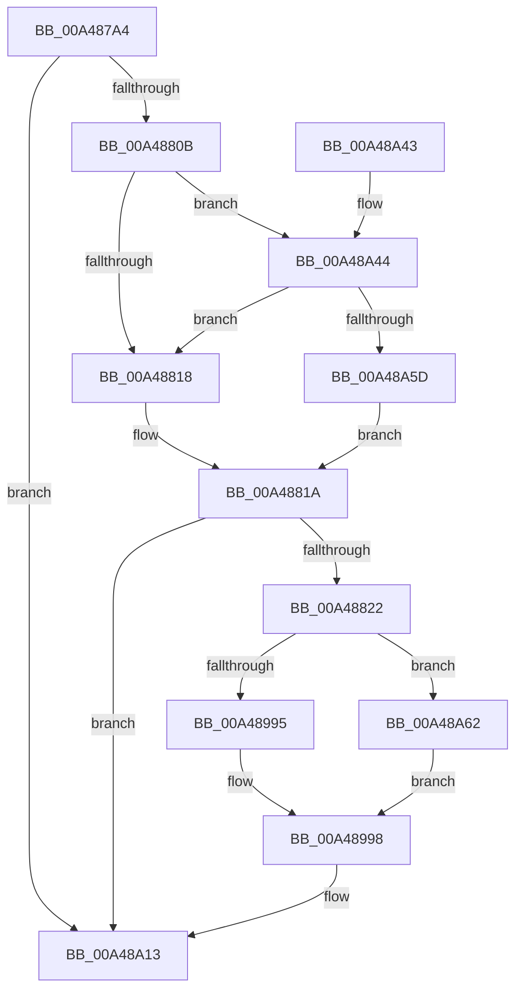

# EtwpWriteProcessStarted

- RVA: `0x00A487A4`–`0x00A48A6E` (길이 `714` bytes)
- VA: `0x0000000140A487A4`
- 실행 섹션: `PAGE`
- PDB 이름 있음: `예`; PDB Function 태그: `예`
- unwind 정보 RVA: `0x000AFA90`
- 디코드: `146`개 명령, `714/714` bytes 표시
- 미해석 바이트: `0` (있으면 어셈블리에 `.byte`로 보존)

> 이 문서는 커널 이미지의 기계어와 PDB 기호를 분석해 생성했습니다. 4번과 5번은 함수 원형과 자료형을 바이너리 사용 방식에서 추정한 C 해석이며 원본 소스 복구 결과는 아닙니다.

## 1. Dependencies

- 직접 호출 지점: **8**; 고유 호출 대상: **6**
- 직접 호출자로 확인된 함수: **1**
- RIP 상대 이미지 참조: **7**

### Outgoing calls
- `0x00A48875` → [PsGetProcessSessionId](../../text/22/PsGetProcessSessionId_function_002233A0.md) (function, `0x002233A0`)
- `0x00A488B7` → [EtwpGetProcessStartKey](../../text/45/EtwpGetProcessStartKey_function_00459180.md) (function, `0x00459180`)
- `0x00A4890C` → [PsGetSessionCreateTime](../8A/PsGetSessionCreateTime_function_008A4FF8.md) (function, `0x008A4FF8`)
- `0x00A48960` → [tlgCreate1Sz_wchar_t](../../text/42/tlgCreate1Sz_wchar_t_function_00426198.md) (function, `0x00426198`)
- `0x00A48970` → [tlgCreate1Sz_wchar_t](../../text/42/tlgCreate1Sz_wchar_t_function_00426198.md) (function, `0x00426198`)
- `0x00A48980` → [tlgCreate1Sz_wchar_t](../../text/42/tlgCreate1Sz_wchar_t_function_00426198.md) (function, `0x00426198`)
- `0x00A48A0E` → [tlgWriteTransfer_EtwWriteTransfer](../../text/42/tlgWriteTransfer_EtwWriteTransfer_function_004260E0.md) (function, `0x004260E0`)
- `0x00A48A1D` → [_security_check_cookie](../../text/6A/_security_check_cookie_function_006AC640.md) (function, `0x006AC640`)

### Direct callers
- [EtwTraceProcess](../8A/EtwTraceProcess_function_008A4004.md) at `0x008A40E5`

### Static image references
- `0x00A487CA` → RVA `0x00E0A740` (`.data`; read)
- `0x00A487E2` → RVA `0x00002F28` (`.rdata`; read)
- `0x00A487FE` → RVA `0x00E091A0` (`.data`; read)
- `0x00A4880B` → RVA `0x00E091B0` (`.data`; read)
- `0x00A4899C` → RVA `0x00053E03` (`.rdata`; read)
- `0x00A48A44` → RVA `0x00E091B8` (`.data`; read)
- `0x00A48A62` → RVA `0x00FD9B78` (`PAGEDATA`; read)

## 2. Other-region calls and transfers

- 다른 실행 섹션으로 향하는 call: **7**
  - `0x00A48875` → [PsGetProcessSessionId](../../text/22/PsGetProcessSessionId_function_002233A0.md) (`PAGE` → `.text`)
  - `0x00A488B7` → [EtwpGetProcessStartKey](../../text/45/EtwpGetProcessStartKey_function_00459180.md) (`PAGE` → `.text`)
  - `0x00A48960` → [tlgCreate1Sz_wchar_t](../../text/42/tlgCreate1Sz_wchar_t_function_00426198.md) (`PAGE` → `.text`)
  - `0x00A48970` → [tlgCreate1Sz_wchar_t](../../text/42/tlgCreate1Sz_wchar_t_function_00426198.md) (`PAGE` → `.text`)
  - `0x00A48980` → [tlgCreate1Sz_wchar_t](../../text/42/tlgCreate1Sz_wchar_t_function_00426198.md) (`PAGE` → `.text`)
  - `0x00A48A0E` → [tlgWriteTransfer_EtwWriteTransfer](../../text/42/tlgWriteTransfer_EtwWriteTransfer_function_004260E0.md) (`PAGE` → `.text`)
  - `0x00A48A1D` → [_security_check_cookie](../../text/6A/_security_check_cookie_function_006AC640.md) (`PAGE` → `.text`)
- 별도 외부 분기/꼬리 이동을 확인하지 못했습니다.

## 3. Assembly (complete function range)

```asm
00A487A4  48 8B C4                        mov rax, rsp
00A487A7  48 89 58 08                     mov qword ptr [rax + 8], rbx
00A487AB  48 89 70 10                     mov qword ptr [rax + 0x10], rsi
00A487AF  48 89 78 20                     mov qword ptr [rax + 0x20], rdi
00A487B3  55                              push rbp
00A487B4  41 54                           push r12
00A487B6  41 55                           push r13
00A487B8  41 56                           push r14
00A487BA  41 57                           push r15
00A487BC  48 8D A8 18 FF FF FF            lea rbp, [rax - 0xe8]
00A487C3  48 81 EC C0 01 00 00            sub rsp, 0x1c0
00A487CA  48 8B 05 6F 1F 3C 00            mov rax, qword ptr [rip + 0x3c1f6f]
00A487D1  48 33 C4                        xor rax, rsp
00A487D4  48 89 85 B0 00 00 00            mov qword ptr [rbp + 0xb0], rax
00A487DB  48 8B 81 50 03 00 00            mov rax, qword ptr [rcx + 0x350]
00A487E2  48 8D 1D 3F A7 5B FF            lea rbx, [rip - 0xa458c1]
00A487E9  4C 8B FA                        mov r15, rdx
00A487EC  49 8B F1                        mov rsi, r9
00A487EF  33 D2                           xor edx, edx
00A487F1  4D 8B F0                        mov r14, r8
00A487F4  48 85 C0                        test rax, rax
00A487F7  48 8B F9                        mov rdi, rcx
00A487FA  48 0F 45 D8                     cmovne rbx, rax
00A487FE  83 3D 9B 09 3C 00 05            cmp dword ptr [rip + 0x3c099b], 5
00A48805  0F 86 08 02 00 00               jbe 0x140a48a13
00A4880B  F6 05 9E 09 3C 00 03            test byte ptr [rip + 0x3c099e], 3
00A48812  0F 85 2C 02 00 00               jne 0x140a48a44
00A48818  8A C2                           mov al, dl
00A4881A  84 C0                           test al, al
00A4881C  0F 84 F1 01 00 00               je 0x140a48a13
00A48822  48 8B 81 F8 01 00 00            mov rax, qword ptr [rcx + 0x1f8]
00A48829  48 89 44 24 48                  mov qword ptr [rsp + 0x48], rax
00A4882E  48 8D 44 24 48                  lea rax, [rsp + 0x48]
00A48833  48 89 45 90                     mov qword ptr [rbp - 0x70], rax
00A48837  8B 81 D0 01 00 00               mov eax, dword ptr [rcx + 0x1d0]
00A4883D  89 44 24 30                     mov dword ptr [rsp + 0x30], eax
00A48841  48 8D 44 24 30                  lea rax, [rsp + 0x30]
00A48846  48 89 45 A0                     mov qword ptr [rbp - 0x60], rax
00A4884A  8B 81 D0 02 00 00               mov eax, dword ptr [rcx + 0x2d0]
00A48850  89 44 24 34                     mov dword ptr [rsp + 0x34], eax
00A48854  48 8D 44 24 34                  lea rax, [rsp + 0x34]
00A48859  48 89 45 B0                     mov qword ptr [rbp - 0x50], rax
00A4885D  48 C7 45 98 08 00 00 00         mov qword ptr [rbp - 0x68], 8
00A48865  48 C7 45 A8 04 00 00 00         mov qword ptr [rbp - 0x58], 4
00A4886D  48 C7 45 B8 04 00 00 00         mov qword ptr [rbp - 0x48], 4
00A48875  E8 26 AB 7D FF                  call 0x1402233a0
00A4887A  89 44 24 38                     mov dword ptr [rsp + 0x38], eax
00A4887E  45 33 C9                        xor r9d, r9d
00A48881  48 8D 44 24 38                  lea rax, [rsp + 0x38]
00A48886  48 C7 45 C8 04 00 00 00         mov qword ptr [rbp - 0x38], 4
00A4888E  48 89 45 C0                     mov qword ptr [rbp - 0x40], rax
00A48892  48 8B CF                        mov rcx, rdi
00A48895  48 8D 45 E8                     lea rax, [rbp - 0x18]
00A48899  48 C7 45 D8 02 00 00 00         mov qword ptr [rbp - 0x28], 2
00A488A1  48 89 45 D0                     mov qword ptr [rbp - 0x30], rax
00A488A5  48 8B 43 08                     mov rax, qword ptr [rbx + 8]
00A488A9  48 89 45 E0                     mov qword ptr [rbp - 0x20], rax
00A488AD  0F B7 03                        movzx eax, word ptr [rbx]
00A488B0  89 45 E8                        mov dword ptr [rbp - 0x18], eax
00A488B3  44 89 4D EC                     mov dword ptr [rbp - 0x14], r9d
00A488B7  E8 C4 08 A1 FF                  call 0x140459180
00A488BC  48 89 44 24 50                  mov qword ptr [rsp + 0x50], rax
00A488C1  48 8D 44 24 50                  lea rax, [rsp + 0x50]
00A488C6  48 89 45 F0                     mov qword ptr [rbp - 0x10], rax
00A488CA  48 8B 87 78 06 00 00            mov rax, qword ptr [rdi + 0x678]
00A488D1  48 89 44 24 58                  mov qword ptr [rsp + 0x58], rax
00A488D6  48 8D 44 24 58                  lea rax, [rsp + 0x58]
00A488DB  48 89 45 00                     mov qword ptr [rbp], rax
00A488DF  48 8B 87 80 06 00 00            mov rax, qword ptr [rdi + 0x680]
00A488E6  48 89 44 24 60                  mov qword ptr [rsp + 0x60], rax
00A488EB  48 8D 44 24 60                  lea rax, [rsp + 0x60]
00A488F0  48 89 45 10                     mov qword ptr [rbp + 0x10], rax
00A488F4  48 C7 45 F8 08 00 00 00         mov qword ptr [rbp - 8], 8
00A488FC  48 C7 45 08 08 00 00 00         mov qword ptr [rbp + 8], 8
00A48904  48 C7 45 18 08 00 00 00         mov qword ptr [rbp + 0x18], 8
00A4890C  E8 E7 C6 E5 FF                  call 0x1408a4ff8
00A48911  48 89 44 24 68                  mov qword ptr [rsp + 0x68], rax
00A48916  49 8D 56 18                     lea rdx, [r14 + 0x18]
00A4891A  48 8D 44 24 68                  lea rax, [rsp + 0x68]
00A4891F  48 C7 45 28 08 00 00 00         mov qword ptr [rbp + 0x28], 8
00A48927  48 89 45 20                     mov qword ptr [rbp + 0x20], rax
00A4892B  48 8D 4D 50                     lea rcx, [rbp + 0x50]
00A4892F  41 8B 07                        mov eax, dword ptr [r15]
00A48932  89 44 24 3C                     mov dword ptr [rsp + 0x3c], eax
00A48936  48 8D 44 24 3C                  lea rax, [rsp + 0x3c]
00A4893B  48 89 45 30                     mov qword ptr [rbp + 0x30], rax
00A4893F  41 8B 47 04                     mov eax, dword ptr [r15 + 4]
00A48943  89 44 24 40                     mov dword ptr [rsp + 0x40], eax
00A48947  48 8D 44 24 40                  lea rax, [rsp + 0x40]
00A4894C  48 89 45 40                     mov qword ptr [rbp + 0x40], rax
00A48950  48 C7 45 38 04 00 00 00         mov qword ptr [rbp + 0x38], 4
00A48958  48 C7 45 48 04 00 00 00         mov qword ptr [rbp + 0x48], 4
00A48960  E8 33 D8 9D FF                  call 0x140426198
00A48965  49 8D 96 18 01 00 00            lea rdx, [r14 + 0x118]
00A4896C  48 8D 4D 60                     lea rcx, [rbp + 0x60]
00A48970  E8 23 D8 9D FF                  call 0x140426198
00A48975  49 8D 96 9A 01 00 00            lea rdx, [r14 + 0x19a]
00A4897C  48 8D 4D 70                     lea rcx, [rbp + 0x70]
00A48980  E8 13 D8 9D FF                  call 0x140426198
00A48985  48 8B 8D 10 01 00 00            mov rcx, qword ptr [rbp + 0x110]
00A4898C  48 85 C9                        test rcx, rcx
00A4898F  0F 84 CD 00 00 00               je 0x140a48a62
00A48995  48 8B 09                        mov rcx, qword ptr [rcx]
00A48998  0F B6 41 01                     movzx eax, byte ptr [rcx + 1]
00A4899C  48 8D 15 60 B4 60 FF            lea rdx, [rip - 0x9f4ba0]
00A489A3  48 89 8D 80 00 00 00            mov qword ptr [rbp + 0x80], rcx
00A489AA  45 33 C0                        xor r8d, r8d
00A489AD  48 8D 0D EC 07 3C 00            lea rcx, [rip + 0x3c07ec]
00A489B4  44 89 8D 8C 00 00 00            mov dword ptr [rbp + 0x8c], r9d
00A489BB  48 C7 85 98 00 00 00 02 00 00 00  mov qword ptr [rbp + 0x98], 2
00A489C6  8D 04 85 08 00 00 00            lea eax, [rax*4 + 8]
00A489CD  44 89 8D AC 00 00 00            mov dword ptr [rbp + 0xac], r9d
00A489D4  89 85 88 00 00 00               mov dword ptr [rbp + 0x88], eax
00A489DA  48 8D 85 A8 00 00 00            lea rax, [rbp + 0xa8]
00A489E1  48 89 85 90 00 00 00            mov qword ptr [rbp + 0x90], rax
00A489E8  48 8B 46 08                     mov rax, qword ptr [rsi + 8]
00A489EC  48 89 85 A0 00 00 00            mov qword ptr [rbp + 0xa0], rax
00A489F3  0F B7 06                        movzx eax, word ptr [rsi]
00A489F6  89 85 A8 00 00 00               mov dword ptr [rbp + 0xa8], eax
00A489FC  48 8D 44 24 70                  lea rax, [rsp + 0x70]
00A48A01  48 89 44 24 28                  mov qword ptr [rsp + 0x28], rax
00A48A06  C7 44 24 20 14 00 00 00         mov dword ptr [rsp + 0x20], 0x14
00A48A0E  E8 CD D6 9D FF                  call 0x1404260e0
00A48A13  48 8B 8D B0 00 00 00            mov rcx, qword ptr [rbp + 0xb0]
00A48A1A  48 33 CC                        xor rcx, rsp
00A48A1D  E8 1E 3C C6 FF                  call 0x1406ac640
00A48A22  4C 8D 9C 24 C0 01 00 00         lea r11, [rsp + 0x1c0]
00A48A2A  49 8B 5B 30                     mov rbx, qword ptr [r11 + 0x30]
00A48A2E  49 8B 73 38                     mov rsi, qword ptr [r11 + 0x38]
00A48A32  49 8B 7B 48                     mov rdi, qword ptr [r11 + 0x48]
00A48A36  49 8B E3                        mov rsp, r11
00A48A39  41 5F                           pop r15
00A48A3B  41 5E                           pop r14
00A48A3D  41 5D                           pop r13
00A48A3F  41 5C                           pop r12
00A48A41  5D                              pop rbp
00A48A42  C3                              ret
00A48A43  CC                              int3
00A48A44  48 8B 05 6D 07 3C 00            mov rax, qword ptr [rip + 0x3c076d]
00A48A4B  83 E0 03                        and eax, 3
00A48A4E  48 3B 05 63 07 3C 00            cmp rax, qword ptr [rip + 0x3c0763]
00A48A55  B0 01                           mov al, 1
00A48A57  0F 85 BB FD FF FF               jne 0x140a48818
00A48A5D  E9 B8 FD FF FF                  jmp 0x140a4881a
00A48A62  48 8B 0D 0F 11 59 00            mov rcx, qword ptr [rip + 0x59110f]
00A48A69  E9 2A FF FF FF                  jmp 0x140a48998
```

## 4. C-style interpretation (structured pseudocode)

```c
__int64 __fastcall EtwpWriteProcessStarted(__int64 a1, __int64 a2, __int64 a3, __int64 a4)
{
    __int64 result;
    __int64 v_rbx;
    __int64 v_rsp;
    unsigned __int64 v_stack_m178;
    unsigned __int64 v_stack_m180;
    unsigned __int64 v_stack_m188;
    unsigned __int64 v_stack_m190;
    unsigned __int64 v_stack_m198;
    unsigned __int64 v_stack_m1A0;
    unsigned int v_stack_m1A8;
    unsigned int v_stack_m1AC;
    unsigned int v_stack_m1B0;
    unsigned int v_stack_m1B4;
    unsigned int v_stack_m1B8;
    unsigned __int64 v_stack_m1C0;
    unsigned int v_stack_m1C8;
    unsigned __int64 v_stack_m28;

    *(unsigned __int64 *)(v_rsp + 8) = v_rbx;
    *(unsigned __int64 *)(v_rsp + 16) = v_rsi;
    *(unsigned __int64 *)(v_rsp + 32) = v_rdi;
    v_rsp = (v_rsp) - (448);
    result = (*(unsigned __int64 *)(v_rip + 3940207)) ^ (v_rsp);
    *(unsigned __int64 *)(v_rsp - 232 + 176) = result;
    a2 = 0;
    v_rbx = v_rip - 10770625;
    if (*(unsigned __int64 *)(a1 + 848) != 0) { v_rbx = *(unsigned __int64 *)(a1 + 848); }
    if ((*(unsigned int *)(v_rip + 3934619)) <= 5) goto loc_00A48A13;
    if (((*(unsigned __int8 *)(v_rip + 3934622)) & (3)) != 0) goto loc_00A48A44;
loc_00A48818:
loc_00A4881A:
    if (0 == 0) goto loc_00A48A13;
    v_stack_m1A0 = *(unsigned __int64 *)(a1 + 504);
    *(unsigned __int64 *)(v_rsp - 232 - 112) = v_stack_m1A0;
    v_stack_m1B8 = (unsigned int)((unsigned int)(*(unsigned int *)(a1 + 464)));
    *(unsigned __int64 *)(v_rsp - 232 - 96) = v_stack_m1B8;
    v_stack_m1B4 = (unsigned int)((unsigned int)(*(unsigned int *)(a1 + 720)));
    *(unsigned __int64 *)(v_rsp - 232 - 80) = v_stack_m1B4;
    *(unsigned __int64 *)(v_rsp - 232 - 104) = 8;
    *(unsigned __int64 *)(v_rsp - 232 - 88) = 4;
    *(unsigned __int64 *)(v_rsp - 232 - 72) = 4;
    result = PsGetProcessSessionId(a1, a2, a3, a4);
    v_stack_m1B0 = (unsigned int)(result);
    a4 = 0;
    *(unsigned __int64 *)(v_rsp - 232 - 56) = 4;
    *(unsigned __int64 *)(v_rsp - 232 - 64) = v_stack_m1B0;
    *(unsigned __int64 *)(v_rsp - 232 - 40) = 2;
    *(unsigned __int64 *)(v_rsp - 232 - 48) = v_rsp - 232 - 24;
    *(unsigned __int64 *)(v_rsp - 232 - 32) = *(unsigned __int64 *)(v_rbx + 8);
    *(unsigned int *)(v_rsp - 232 - 24) = (unsigned int)(*(unsigned __int16 *)(v_rbx));
    *(unsigned int *)(v_rsp - 232 - 20) = 0;
    result = EtwpGetProcessStartKey(a1, a2, a3, a4);
    v_stack_m198 = result;
    *(unsigned __int64 *)(v_rsp - 232 - 16) = v_stack_m198;
    v_stack_m190 = *(unsigned __int64 *)(a1 + 1656);
    *(unsigned __int64 *)(v_rsp - 232) = v_stack_m190;
    v_stack_m188 = *(unsigned __int64 *)(a1 + 1664);
    *(unsigned __int64 *)(v_rsp - 232 + 16) = v_stack_m188;
    *(unsigned __int64 *)(v_rsp - 232 - 8) = 8;
    *(unsigned __int64 *)(v_rsp - 232 + 8) = 8;
    *(unsigned __int64 *)(v_rsp - 232 + 24) = 8;
    result = PsGetSessionCreateTime(a1, a2, a3, a4);
    v_stack_m180 = result;
    *(unsigned __int64 *)(v_rsp - 232 + 40) = 8;
    *(unsigned __int64 *)(v_rsp - 232 + 32) = v_stack_m180;
    v_stack_m1AC = (unsigned int)((unsigned int)(*(unsigned int *)(a2)));
    *(unsigned __int64 *)(v_rsp - 232 + 48) = v_stack_m1AC;
    v_stack_m1A8 = (unsigned int)((unsigned int)(*(unsigned int *)(a2 + 4)));
    *(unsigned __int64 *)(v_rsp - 232 + 64) = v_stack_m1A8;
    *(unsigned __int64 *)(v_rsp - 232 + 56) = 4;
    *(unsigned __int64 *)(v_rsp - 232 + 72) = 4;
    result = tlgCreate1Sz_wchar_t(v_rsp - 232 + 80, a3 + 24, a3, a4);
    result = tlgCreate1Sz_wchar_t(v_rsp - 232 + 96, a3 + 280, a3, a4);
    result = tlgCreate1Sz_wchar_t(v_rsp - 232 + 112, a3 + 410, a3, a4);
    if (*(unsigned __int64 *)(v_rsp - 232 + 272) == 0) goto loc_00A48A62;
loc_00A48998:
    *(unsigned __int64 *)(v_rsp - 232 + 128) = *(unsigned __int64 *)(*(unsigned __int64 *)(v_rsp - 232 + 272));
    a3 = 0;
    *(unsigned int *)(v_rsp - 232 + 140) = 0;
    *(unsigned __int64 *)(v_rsp - 232 + 152) = 2;
    *(unsigned int *)(v_rsp - 232 + 172) = 0;
    *(unsigned int *)(v_rsp - 232 + 136) = (unsigned int)(*(unsigned __int8 *)(*(unsigned __int64 *)(*(unsigned __int64 *)(v_rsp - 232 + 272)) + 1) * 4 + 8);
    *(unsigned __int64 *)(v_rsp - 232 + 144) = v_rsp - 232 + 168;
    *(unsigned __int64 *)(v_rsp - 232 + 160) = *(unsigned __int64 *)(a4 + 8);
    *(unsigned int *)(v_rsp - 232 + 168) = (unsigned int)(*(unsigned __int16 *)(a4));
    v_stack_m1C0 = v_stack_m178;
    v_stack_m1C8 = 20;
    result = tlgWriteTransfer_EtwWriteTransfer(v_rip + 3934188, v_rip - 10439584, a3, a4);
loc_00A48A13:
    a1 = (*(unsigned __int64 *)(v_rsp - 232 + 176)) ^ (v_rsp);
    result = _security_check_cookie(a1, v_rip - 10439584, a3, a4);
    return result;
loc_00A48A44:
    result = (unsigned int)((*(unsigned __int64 *)(v_rip + 3934061)) & (3));
    if (result != (*(unsigned __int64 *)(v_rip + 3934051))) goto loc_00A48818;
    goto loc_00A4881A;
loc_00A48A62:
    goto loc_00A48998;
}
```

## 5. (Beta) C Style

```c
int64_t EtwpWriteProcessStarted(void *Arg1, void *Arg2, void *Arg3, void *Arg4)
{
    uint8_t *arg1 = (uint8_t *)Arg1;
    uint8_t *arg2 = (uint8_t *)Arg2;
    uint8_t *arg3 = (uint8_t *)Arg3;
    uint8_t *arg4 = (uint8_t *)Arg4;

    int64_t result;
    int64_t local_rbx;
    int64_t local_rsp;
    uint64_t v_stack_m178;
    uint64_t v_stack_m180;
    uint64_t v_stack_m188;
    uint64_t v_stack_m190;
    uint64_t v_stack_m198;
    uint64_t v_stack_m1A0;
    uint32_t v_stack_m1A8;
    uint32_t v_stack_m1AC;
    uint32_t v_stack_m1B0;
    uint32_t v_stack_m1B4;
    uint32_t v_stack_m1B8;
    uint64_t v_stack_m1C0;
    uint32_t v_stack_m1C8;
    uint64_t v_stack_m28;

    *(uint64_t *)(local_rsp + 0x8) = local_rbx;
    *(uint64_t *)(local_rsp + 0x10) = local_rsi;
    *(uint64_t *)(local_rsp + 0x20) = local_rdi;
    local_rsp = (local_rsp) - (448);
    result = (*(uint64_t *)(v_rip + 0x3C1F6F)) ^ (local_rsp);
    *(uint64_t *)(local_rsp - 0xE8 + 0xB0) = result;
    Arg2 = 0;
    local_rbx = v_rip - 10770625;
    if (*(uint64_t *)(arg1 + 0x350) != 0) { local_rbx = *(uint64_t *)(arg1 + 0x350); }
    if ((*(uint32_t *)(v_rip + 0x3C099B)) <= 5) goto loc_00A48A13;
    if (((*(uint8_t *)(v_rip + 0x3C099E)) & (3)) != 0) goto loc_00A48A44;
loc_00A48818:
loc_00A4881A:
    if (0 == 0) goto loc_00A48A13;
    v_stack_m1A0 = *(uint64_t *)(arg1 + 0x1F8);
    *(uint64_t *)(local_rsp - 0xE8 - 0x70) = v_stack_m1A0;
    v_stack_m1B8 = (uint32_t)((uint32_t)(*(uint32_t *)(arg1 + 0x1D0)));
    *(uint64_t *)(local_rsp - 0xE8 - 0x60) = v_stack_m1B8;
    v_stack_m1B4 = (uint32_t)((uint32_t)(*(uint32_t *)(arg1 + 0x2D0)));
    *(uint64_t *)(local_rsp - 0xE8 - 0x50) = v_stack_m1B4;
    *(uint64_t *)(local_rsp - 0xE8 - 0x68) = 8;
    *(uint64_t *)(local_rsp - 0xE8 - 0x58) = 4;
    *(uint64_t *)(local_rsp - 0xE8 - 0x48) = 4;
    result = PsGetProcessSessionId(Arg1, Arg2, Arg3, Arg4);
    v_stack_m1B0 = (uint32_t)(result);
    Arg4 = 0;
    *(uint64_t *)(local_rsp - 0xE8 - 0x38) = 4;
    *(uint64_t *)(local_rsp - 0xE8 - 0x40) = v_stack_m1B0;
    *(uint64_t *)(local_rsp - 0xE8 - 0x28) = 2;
    *(uint64_t *)(local_rsp - 0xE8 - 0x30) = local_rsp - 232 - 24;
    *(uint64_t *)(local_rsp - 0xE8 - 0x20) = *(uint64_t *)(local_rbx + 0x8);
    *(uint32_t *)(local_rsp - 0xE8 - 0x18) = (uint32_t)(*(uint16_t *)(local_rbx));
    *(uint32_t *)(local_rsp - 0xE8 - 0x14) = 0;
    result = EtwpGetProcessStartKey(Arg1, Arg2, Arg3, Arg4);
    v_stack_m198 = result;
    *(uint64_t *)(local_rsp - 0xE8 - 0x10) = v_stack_m198;
    v_stack_m190 = *(uint64_t *)(arg1 + 0x678);
    *(uint64_t *)(local_rsp - 0xE8) = v_stack_m190;
    v_stack_m188 = *(uint64_t *)(arg1 + 0x680);
    *(uint64_t *)(local_rsp - 0xE8 + 0x10) = v_stack_m188;
    *(uint64_t *)(local_rsp - 0xE8 - 0x8) = 8;
    *(uint64_t *)(local_rsp - 0xE8 + 0x8) = 8;
    *(uint64_t *)(local_rsp - 0xE8 + 0x18) = 8;
    result = PsGetSessionCreateTime(Arg1, Arg2, Arg3, Arg4);
    v_stack_m180 = result;
    *(uint64_t *)(local_rsp - 0xE8 + 0x28) = 8;
    *(uint64_t *)(local_rsp - 0xE8 + 0x20) = v_stack_m180;
    v_stack_m1AC = (uint32_t)((uint32_t)(*(uint32_t *)(arg2)));
    *(uint64_t *)(local_rsp - 0xE8 + 0x30) = v_stack_m1AC;
    v_stack_m1A8 = (uint32_t)((uint32_t)(*(uint32_t *)(arg2 + 0x4)));
    *(uint64_t *)(local_rsp - 0xE8 + 0x40) = v_stack_m1A8;
    *(uint64_t *)(local_rsp - 0xE8 + 0x38) = 4;
    *(uint64_t *)(local_rsp - 0xE8 + 0x48) = 4;
    result = tlgCreate1Sz_wchar_t(local_rsp - 232 + 80, Arg3 + 24, Arg3, Arg4);
    result = tlgCreate1Sz_wchar_t(local_rsp - 232 + 96, Arg3 + 280, Arg3, Arg4);
    result = tlgCreate1Sz_wchar_t(local_rsp - 232 + 112, Arg3 + 410, Arg3, Arg4);
    if (*(uint64_t *)(local_rsp - 0xE8 + 0x110) == 0) goto loc_00A48A62;
loc_00A48998:
    *(uint64_t *)(local_rsp - 0xE8 + 0x80) = *(uint64_t *)(*(uint64_t *)(local_rsp - 0xE8 + 0x110));
    Arg3 = 0;
    *(uint32_t *)(local_rsp - 0xE8 + 0x8C) = 0;
    *(uint64_t *)(local_rsp - 0xE8 + 0x98) = 2;
    *(uint32_t *)(local_rsp - 0xE8 + 0xAC) = 0;
    *(uint32_t *)(local_rsp - 0xE8 + 0x88) = (uint32_t)(*(uint8_t *)(*(uint64_t *)(*(uint64_t *)(local_rsp - 0xE8 + 0x110)) + 0x1) * 4 + 8);
    *(uint64_t *)(local_rsp - 0xE8 + 0x90) = local_rsp - 232 + 168;
    *(uint64_t *)(local_rsp - 0xE8 + 0xA0) = *(uint64_t *)(arg4 + 0x8);
    *(uint32_t *)(local_rsp - 0xE8 + 0xA8) = (uint32_t)(*(uint16_t *)(arg4));
    v_stack_m1C0 = v_stack_m178;
    v_stack_m1C8 = 20;
    result = tlgWriteTransfer_EtwWriteTransfer(v_rip + 3934188, v_rip - 10439584, Arg3, Arg4);
loc_00A48A13:
    Arg1 = (*(uint64_t *)(local_rsp - 0xE8 + 0xB0)) ^ (local_rsp);
    result = _security_check_cookie(Arg1, v_rip - 10439584, Arg3, Arg4);
    return result;
loc_00A48A44:
    result = (uint32_t)((*(uint64_t *)(v_rip + 0x3C076D)) & (3));
    if (result != (*(uint64_t *)(v_rip + 0x3C0763))) goto loc_00A48818;
    goto loc_00A4881A;
loc_00A48A62:
    goto loc_00A48998;
}
```

### 관측된 메모리 오프셋

구조체 형식이 확인되지 않은 접근은 인자 기준의 오프셋으로만 기록했습니다.

| 기준 인자 | 오프셋 표현 | 폭 (bit) | 접근 |
|---|---:|---:|---|
| `Arg1` | `+ 0x1D0` | `32` | `R` |
| `Arg1` | `+ 0x1F8` | `64` | `R` |
| `Arg1` | `+ 0x2D0` | `32` | `R` |
| `Arg1` | `+ 0x350` | `64` | `R` |
| `Arg1` | `+ 0x678` | `64` | `R` |
| `Arg1` | `+ 0x680` | `64` | `R` |
| `Arg2` | `+ 0x0` | `32` | `R` |
| `Arg2` | `+ 0x4` | `32` | `R` |
| `Arg3` | `+ 0x18` | `64` | `R` |
| `Arg3` | `+ 0x118` | `64` | `R` |
| `Arg3` | `+ 0x19A` | `64` | `R` |
| `Arg4` | `+ 0x0` | `16` | `R` |
| `Arg4` | `+ 0x8` | `64` | `R` |

## 6. Execution-region graph

[열기: 2D/3D 그래프와 함수 탐색 컨트롤 패널](../../../control-panel.html?section=page&rva=0x00A487A4&view=graph)

- 2D 그래프는 위에서 아래로 흐르고, 3D 그래프는 빈 공간을 드래그해 회전합니다. Shift+드래그는 이동, 휠은 확대·축소, 함수 노드 선택은 대상 보고서 이동입니다.

### Static fallback


