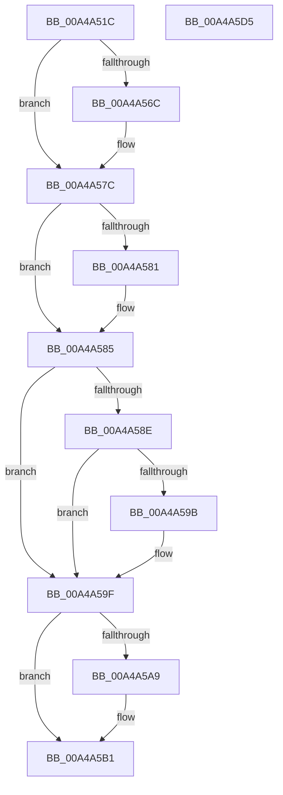

# ExpWnfAcquireSubscriptionNameInstance

- RVA: `0x00A4A51C`–`0x00A4A5D6` (길이 `186` bytes)
- VA: `0x0000000140A4A51C`
- 실행 섹션: `PAGE`
- PDB 이름 있음: `예`; PDB Function 태그: `아니요`
- unwind 정보 RVA: `0x0006B074`
- 디코드: `55`개 명령, `186/186` bytes 표시
- 미해석 바이트: `0` (있으면 어셈블리에 `.byte`로 보존)

> 이 문서는 커널 이미지의 기계어와 PDB 기호를 분석해 생성했습니다. 4번과 5번은 함수 원형과 자료형을 바이너리 사용 방식에서 추정한 C 해석이며 원본 소스 복구 결과는 아닙니다.

## 1. Dependencies

- 직접 호출 지점: **5**; 고유 호출 대상: **5**
- 직접 호출자로 확인된 함수: **8**
- RIP 상대 이미지 참조: **1**

### Outgoing calls
- `0x00A4A557` → [KeAbPreAcquire](../../text/21/KeAbPreAcquire_function_00210230.md) (function, `0x00210230`)
- `0x00A4A577` → [ExfAcquirePushLockSharedEx](../../text/21/ExfAcquirePushLockSharedEx_function_0021044C.md) (function, `0x0021044C`)
- `0x00A4A592` → [ExAcquireRundownProtection](../../text/21/ExAcquireRundownProtection_function_00216620.md) (function, `0x00216620`)
- `0x00A4A5AC` → [ExfReleasePushLockShared](../../text/26/ExfReleasePushLockShared_function_00263440.md) (function, `0x00263440`)
- `0x00A4A5B4` → [KeAbPostRelease](../../text/2E/KeAbPostRelease_function_002E1600.md) (function, `0x002E1600`)

### Direct callers
- [PopWnfSprActiveSessionChangeCallback](../90/PopWnfSprActiveSessionChangeCallback_function_0090C930.md) at `0x0090C973`
- [VslpConnectedStandbyWnfCallback](VslpConnectedStandbyWnfCallback_function_00A49D90.md) at `0x00A49DE8`
- [PopWnfFullscreenVideoCallback](PopWnfFullscreenVideoCallback_function_00A49EB0.md) at `0x00A49EE5`
- [PopNetWnfLowPowerEpochCallback](PopNetWnfLowPowerEpochCallback_function_00A49FB0.md) at `0x00A49FE5`
- [PopWnfAudioCallback](PopWnfAudioCallback_function_00A4A0E0.md) at `0x00A4A115`
- [PopEsInStandbyEvaluate](PopEsInStandbyEvaluate_function_00A4A260.md) at `0x00A4A2F2`
- [PopEsWnfSubscriptionOverrideCallback](PopEsWnfSubscriptionOverrideCallback_function_00A4A3C0.md) at `0x00A4A3E3`
- [ExQueryWnfStateData](ExQueryWnfStateData_function_00A4A480.md) at `0x00A4A4B6`

### Static image references
- `0x00A4A534` → RVA `0x00FC6AB0` (`ALMOSTRO`; read)

## 2. Other-region calls and transfers

- 다른 실행 섹션으로 향하는 call: **5**
  - `0x00A4A557` → [KeAbPreAcquire](../../text/21/KeAbPreAcquire_function_00210230.md) (`PAGE` → `.text`)
  - `0x00A4A577` → [ExfAcquirePushLockSharedEx](../../text/21/ExfAcquirePushLockSharedEx_function_0021044C.md) (`PAGE` → `.text`)
  - `0x00A4A592` → [ExAcquireRundownProtection](../../text/21/ExAcquireRundownProtection_function_00216620.md) (`PAGE` → `.text`)
  - `0x00A4A5AC` → [ExfReleasePushLockShared](../../text/26/ExfReleasePushLockShared_function_00263440.md) (`PAGE` → `.text`)
  - `0x00A4A5B4` → [KeAbPostRelease](../../text/2E/KeAbPostRelease_function_002E1600.md) (`PAGE` → `.text`)
- 별도 외부 분기/꼬리 이동을 확인하지 못했습니다.

## 3. Assembly (complete function range)

```asm
00A4A51C  48 89 5C 24 10                  mov qword ptr [rsp + 0x10], rbx
00A4A521  48 89 6C 24 18                  mov qword ptr [rsp + 0x18], rbp
00A4A526  48 89 74 24 20                  mov qword ptr [rsp + 0x20], rsi
00A4A52B  57                              push rdi
00A4A52C  41 56                           push r14
00A4A52E  41 57                           push r15
00A4A530  48 83 EC 20                     sub rsp, 0x20
00A4A534  48 8B 05 75 C5 57 00            mov rax, qword ptr [rip + 0x57c575]
00A4A53B  48 8B EA                        mov rbp, rdx
00A4A53E  45 33 F6                        xor r14d, r14d
00A4A541  45 33 C0                        xor r8d, r8d
00A4A544  33 D2                           xor edx, edx
00A4A546  41 8B F6                        mov esi, r14d
00A4A549  48 8B 98 E8 05 00 00            mov rbx, qword ptr [rax + 0x5e8]
00A4A550  48 83 C3 50                     add rbx, 0x50
00A4A554  48 8B CB                        mov rcx, rbx
00A4A557  E8 D4 5C 7C FF                  call 0x140210230
00A4A55C  48 8B F8                        mov rdi, rax
00A4A55F  45 8D 7E 11                     lea r15d, [r14 + 0x11]
00A4A563  33 C0                           xor eax, eax
00A4A565  F0 4C 0F B1 3B                  lock cmpxchg qword ptr [rbx], r15
00A4A56A  74 10                           je 0x140a4a57c
00A4A56C  4C 8B CB                        mov r9, rbx
00A4A56F  4C 8B C7                        mov r8, rdi
00A4A572  33 D2                           xor edx, edx
00A4A574  48 8B CB                        mov rcx, rbx
00A4A577  E8 D0 5E 7C FF                  call 0x14021044c
00A4A57C  48 85 FF                        test rdi, rdi
00A4A57F  74 04                           je 0x140a4a585
00A4A581  C6 47 0A 01                     mov byte ptr [rdi + 0xa], 1
00A4A585  48 8B 4D 30                     mov rcx, qword ptr [rbp + 0x30]
00A4A589  48 85 C9                        test rcx, rcx
00A4A58C  74 11                           je 0x140a4a59f
00A4A58E  48 83 C1 08                     add rcx, 8
00A4A592  E8 89 C0 7C FF                  call 0x140216620
00A4A597  84 C0                           test al, al
00A4A599  74 04                           je 0x140a4a59f
00A4A59B  48 8B 75 30                     mov rsi, qword ptr [rbp + 0x30]
00A4A59F  49 8B C7                        mov rax, r15
00A4A5A2  F0 4C 0F B1 33                  lock cmpxchg qword ptr [rbx], r14
00A4A5A7  74 08                           je 0x140a4a5b1
00A4A5A9  48 8B CB                        mov rcx, rbx
00A4A5AC  E8 8F 8E 81 FF                  call 0x140263440
00A4A5B1  48 8B CB                        mov rcx, rbx
00A4A5B4  E8 47 70 89 FF                  call 0x1402e1600
00A4A5B9  48 8B 5C 24 48                  mov rbx, qword ptr [rsp + 0x48]
00A4A5BE  48 8B C6                        mov rax, rsi
00A4A5C1  48 8B 74 24 58                  mov rsi, qword ptr [rsp + 0x58]
00A4A5C6  48 8B 6C 24 50                  mov rbp, qword ptr [rsp + 0x50]
00A4A5CB  48 83 C4 20                     add rsp, 0x20
00A4A5CF  41 5F                           pop r15
00A4A5D1  41 5E                           pop r14
00A4A5D3  5F                              pop rdi
00A4A5D4  C3                              ret
00A4A5D5  CC                              int3
```

## 4. C-style interpretation (structured pseudocode)

```c
__int64 __fastcall ExpWnfAcquireSubscriptionNameInstance(__int64 a1, __int64 a2, int a3)
{
    __int64 result;
    __int64 v_r14;
    __int64 v_rbx;
    __int64 v_rsi;
    __int64 v_rsp;
    unsigned __int64 v_stack_p10;
    unsigned __int64 v_stack_p18;
    unsigned __int64 v_stack_p20;

    v_stack_p10 = v_rbx;
    v_stack_p18 = v_rbp;
    v_stack_p20 = v_rsi;
    v_rsp = (v_rsp) - (32);
    v_r14 = 0;
    a3 = 0;
    a2 = 0;
    v_rbx = (*(unsigned __int64 *)(*(unsigned __int64 *)(v_rip + 5752181) + 1512)) + (80);
    result = KeAbPreAcquire(v_rbx, a2, a3, a4);
    result = 0;
    if (!(condition_is_equal)) {
        a4 = v_rbx;
        a3 = 0;
        a2 = 0;
        a1 = v_rbx;
        result = ExfAcquirePushLockSharedEx(a1, a2, a3, a4);
    }
    if (result != 0) {
        *(unsigned __int8 *)(result + 10) = 1;
    }
    if (*(unsigned __int64 *)(a2 + 48) == 0) goto loc_00A4A59F;
    a1 = (*(unsigned __int64 *)(a2 + 48)) + (8);
    result = ExAcquireRundownProtection(a1, a2, a3, a4);
    v_rsi = 0;
    if ((unsigned __int8)(result) != 0) {
        v_rsi = *(unsigned __int64 *)(a2 + 48);
    }
    result = v_r14 + 17;
    if ((unsigned __int8)(result) != 0) {
        a1 = v_rbx;
        result = ExfReleasePushLockShared(a1, a2, a3, a4);
    }
    result = KeAbPostRelease(v_rbx, a2, a3, a4);
    v_rsp = (v_rsp) + (32);
    return v_rsi;
}
```

## 5. (Beta) C Style

```c
int64_t ExpWnfAcquireSubscriptionNameInstance(int64_t Arg1, void *Arg2, int32_t Arg3)
{
    uint8_t *arg2 = (uint8_t *)Arg2;

    int64_t result;
    int64_t local_r14;
    int64_t local_rbx;
    int64_t local_rsi;
    int64_t local_rsp;
    uint64_t v_stack_p10;
    uint64_t v_stack_p18;
    uint64_t v_stack_p20;

    v_stack_p10 = local_rbx;
    v_stack_p18 = local_rbp;
    v_stack_p20 = local_rsi;
    local_rsp = (local_rsp) - (32);
    local_r14 = 0;
    Arg3 = 0;
    Arg2 = 0;
    local_rbx = (*(uint64_t *)(*(uint64_t *)(v_rip + 0x57C575) + 0x5E8)) + (80);
    result = KeAbPreAcquire(local_rbx, Arg2, Arg3, a4);
    result = 0;
    if (!(condition_is_equal)) {
        a4 = local_rbx;
        Arg3 = 0;
        Arg2 = 0;
        Arg1 = local_rbx;
        result = ExfAcquirePushLockSharedEx(Arg1, Arg2, Arg3, a4);
    }
    if (result != 0) {
        *(uint8_t *)(result + 0xA) = 1;
    }
    if (*(uint64_t *)(arg2 + 0x30) == 0) goto loc_00A4A59F;
    Arg1 = (*(uint64_t *)(arg2 + 0x30)) + (8);
    result = ExAcquireRundownProtection(Arg1, Arg2, Arg3, a4);
    local_rsi = 0;
    if ((uint8_t)(result) != 0) {
        local_rsi = *(uint64_t *)(arg2 + 0x30);
    }
    result = local_r14 + 17;
    if ((uint8_t)(result) != 0) {
        Arg1 = local_rbx;
        result = ExfReleasePushLockShared(Arg1, Arg2, Arg3, a4);
    }
    result = KeAbPostRelease(local_rbx, Arg2, Arg3, a4);
    local_rsp = (local_rsp) + (32);
    return local_rsi;
}
```

### 관측된 메모리 오프셋

구조체 형식이 확인되지 않은 접근은 인자 기준의 오프셋으로만 기록했습니다.

| 기준 인자 | 오프셋 표현 | 폭 (bit) | 접근 |
|---|---:|---:|---|
| `Arg2` | `+ 0x30` | `64` | `R` |

## 6. Execution-region graph

[열기: 2D/3D 그래프와 함수 탐색 컨트롤 패널](../../../control-panel.html?section=page&rva=0x00A4A51C&view=graph)

- 2D 그래프는 위에서 아래로 흐르고, 3D 그래프는 빈 공간을 드래그해 회전합니다. Shift+드래그는 이동, 휠은 확대·축소, 함수 노드 선택은 대상 보고서 이동입니다.

### Static fallback


