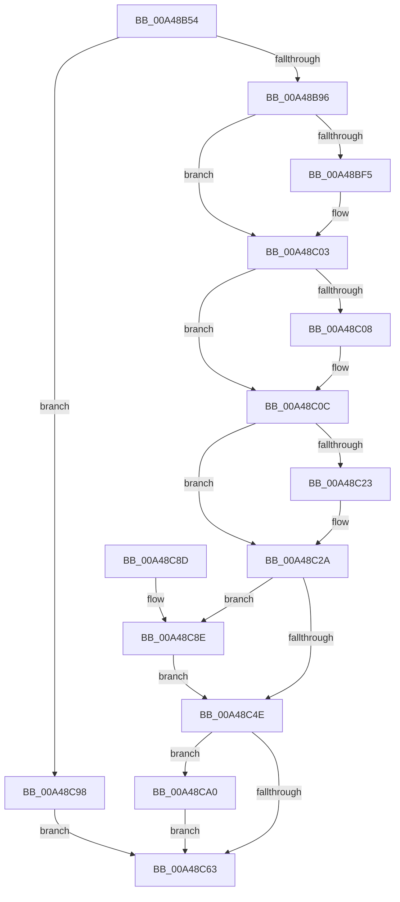

# ExpWnfCreateProcessContext

- RVA: `0x00A48B54`–`0x00A48CAF` (길이 `347` bytes)
- VA: `0x0000000140A48B54`
- 실행 섹션: `PAGE`
- PDB 이름 있음: `예`; PDB Function 태그: `아니요`
- unwind 정보 RVA: `0x000AFAD0`
- 디코드: `96`개 명령, `347/347` bytes 표시
- 미해석 바이트: `0` (있으면 어셈블리에 `.byte`로 보존)

> 이 문서는 커널 이미지의 기계어와 PDB 기호를 분석해 생성했습니다. 4번과 5번은 함수 원형과 자료형을 바이너리 사용 방식에서 추정한 C 해석이며 원본 소스 복구 결과는 아닙니다.

## 1. Dependencies

- 직접 호출 지점: **7**; 고유 호출 대상: **7**
- 직접 호출자로 확인된 함수: **2**
- RIP 상대 이미지 참조: **5**

### Outgoing calls
- `0x00A48B85` → [ExAllocatePool2](../../poolcode/B8/ExAllocatePool2_function_00B820F0.md) (function, `0x00B820F0`)
- `0x00A48B9E` → [memset](../../text/6C/memset_function_006C6C40.md) (function, `0x006C6C40`)
- `0x00A48BE4` → [KeAbPreAcquire](../../text/21/KeAbPreAcquire_function_00210230.md) (function, `0x00210230`)
- `0x00A48BFE` → [ExfAcquirePushLockExclusiveEx](../../text/20/ExfAcquirePushLockExclusiveEx_function_0020FC90.md) (function, `0x0020FC90`)
- `0x00A48C51` → [KeAbPostRelease](../../text/2E/KeAbPostRelease_function_002E1600.md) (function, `0x002E1600`)
- `0x00A48C91` → [ExfTryToWakePushLock](../../text/26/ExfTryToWakePushLock_function_00265DD0.md) (function, `0x00265DD0`)
- `0x00A48CA8` → [ExpWnfDeleteProcessContext](../90/ExpWnfDeleteProcessContext_function_00908270.md) (function, `0x00908270`)

### Direct callers
- [sub_0090B43E](../90/Unknown_function_0090B43E.md) at `0x0090B6EA`
- [NtSetWnfProcessNotificationEvent](NtSetWnfProcessNotificationEvent_function_00A48A80.md) at `0x00A48B28`

### Static image references
- `0x00A48BB1` → RVA `0x00FD9E40` (`PAGEDATA`; read)
- `0x00A48C0C` → RVA `0x00FD85F0` (`PAGEDATA`; read)
- `0x00A48C13` → RVA `0x00FD85E8` (`PAGEDATA`; read)
- `0x00A48C34` → RVA `0x00FD85F0` (`PAGEDATA`; write)
- `0x00A48C3F` → RVA `0x00FD9E40` (`PAGEDATA`; read/write)

## 2. Other-region calls and transfers

- 다른 실행 섹션으로 향하는 call: **6**
  - `0x00A48B85` → [ExAllocatePool2](../../poolcode/B8/ExAllocatePool2_function_00B820F0.md) (`PAGE` → `POOLCODE`)
  - `0x00A48B9E` → [memset](../../text/6C/memset_function_006C6C40.md) (`PAGE` → `.text`)
  - `0x00A48BE4` → [KeAbPreAcquire](../../text/21/KeAbPreAcquire_function_00210230.md) (`PAGE` → `.text`)
  - `0x00A48BFE` → [ExfAcquirePushLockExclusiveEx](../../text/20/ExfAcquirePushLockExclusiveEx_function_0020FC90.md) (`PAGE` → `.text`)
  - `0x00A48C51` → [KeAbPostRelease](../../text/2E/KeAbPostRelease_function_002E1600.md) (`PAGE` → `.text`)
  - `0x00A48C91` → [ExfTryToWakePushLock](../../text/26/ExfTryToWakePushLock_function_00265DD0.md) (`PAGE` → `.text`)
- 별도 외부 분기/꼬리 이동을 확인하지 못했습니다.

## 3. Assembly (complete function range)

```asm
00A48B54  48 89 5C 24 08                  mov qword ptr [rsp + 8], rbx
00A48B59  48 89 6C 24 10                  mov qword ptr [rsp + 0x10], rbp
00A48B5E  56                              push rsi
00A48B5F  57                              push rdi
00A48B60  41 54                           push r12
00A48B62  41 56                           push r14
00A48B64  41 57                           push r15
00A48B66  48 83 EC 20                     sub rsp, 0x20
00A48B6A  BD 88 00 00 00                  mov ebp, 0x88
00A48B6F  4C 8B FA                        mov r15, rdx
00A48B72  48 8B F1                        mov rsi, rcx
00A48B75  33 DB                           xor ebx, ebx
00A48B77  41 B8 57 6E 66 20               mov r8d, 0x20666e57
00A48B7D  8B D5                           mov edx, ebp
00A48B7F  44 8B F3                        mov r14d, ebx
00A48B82  8D 4D 78                        lea ecx, [rbp + 0x78]
00A48B85  E8 66 95 13 00                  call 0x140b820f0
00A48B8A  48 8B F8                        mov rdi, rax
00A48B8D  48 85 C0                        test rax, rax
00A48B90  0F 84 02 01 00 00               je 0x140a48c98
00A48B96  44 8B C5                        mov r8d, ebp
00A48B99  33 D2                           xor edx, edx
00A48B9B  48 8B C8                        mov rcx, rax
00A48B9E  E8 9D E0 C7 FF                  call 0x1406c6c40
00A48BA3  C7 07 06 09 88 00               mov dword ptr [rdi], 0x880906
00A48BA9  48 8D 47 40                     lea rax, [rdi + 0x40]
00A48BAD  48 89 40 08                     mov qword ptr [rax + 8], rax
00A48BB1  4C 8D 25 88 12 59 00            lea r12, [rip + 0x591288]
00A48BB8  48 89 00                        mov qword ptr [rax], rax
00A48BBB  45 33 C0                        xor r8d, r8d
00A48BBE  48 8D 47 58                     lea rax, [rdi + 0x58]
00A48BC2  33 D2                           xor edx, edx
00A48BC4  48 89 40 08                     mov qword ptr [rax + 8], rax
00A48BC8  49 8B CC                        mov rcx, r12
00A48BCB  48 89 00                        mov qword ptr [rax], rax
00A48BCE  48 8D 47 70                     lea rax, [rdi + 0x70]
00A48BD2  48 89 40 08                     mov qword ptr [rax + 8], rax
00A48BD6  48 89 00                        mov qword ptr [rax], rax
00A48BD9  48 89 9F 80 00 00 00            mov qword ptr [rdi + 0x80], rbx
00A48BE0  48 89 77 08                     mov qword ptr [rdi + 8], rsi
00A48BE4  E8 47 76 7C FF                  call 0x140210230
00A48BE9  F0 49 0F BA 2C 24 00            lock bts qword ptr [r12], 0
00A48BF0  48 8B E8                        mov rbp, rax
00A48BF3  73 0E                           jae 0x140a48c03
00A48BF5  4D 8B C4                        mov r8, r12
00A48BF8  48 8B D0                        mov rdx, rax
00A48BFB  49 8B CC                        mov rcx, r12
00A48BFE  E8 8D 70 7C FF                  call 0x14020fc90
00A48C03  48 85 ED                        test rbp, rbp
00A48C06  74 04                           je 0x140a48c0c
00A48C08  C6 45 0A 01                     mov byte ptr [rbp + 0xa], 1
00A48C0C  48 8B 0D DD F9 58 00            mov rcx, qword ptr [rip + 0x58f9dd]
00A48C13  48 8D 15 CE F9 58 00            lea rdx, [rip + 0x58f9ce]
00A48C1A  48 8D 47 10                     lea rax, [rdi + 0x10]
00A48C1E  48 39 11                        cmp qword ptr [rcx], rdx
00A48C21  74 07                           je 0x140a48c2a
00A48C23  B9 03 00 00 00                  mov ecx, 3
00A48C28  CD 29                           int 0x29
00A48C2A  48 89 10                        mov qword ptr [rax], rdx
00A48C2D  48 89 48 08                     mov qword ptr [rax + 8], rcx
00A48C31  48 89 01                        mov qword ptr [rcx], rax
00A48C34  48 89 05 B5 F9 58 00            mov qword ptr [rip + 0x58f9b5], rax
00A48C3B  48 83 C8 FF                     or rax, 0xffffffffffffffff
00A48C3F  F0 48 0F C1 05 F8 11 59 00      lock xadd qword ptr [rip + 0x5911f8], rax
00A48C48  24 06                           and al, 6
00A48C4A  3C 02                           cmp al, 2
00A48C4C  74 40                           je 0x140a48c8e
00A48C4E  49 8B CC                        mov rcx, r12
00A48C51  E8 AA 89 89 FF                  call 0x1402e1600
00A48C56  33 C0                           xor eax, eax
00A48C58  F0 48 0F B1 BE E8 05 00 00      lock cmpxchg qword ptr [rsi + 0x5e8], rdi
00A48C61  75 3D                           jne 0x140a48ca0
00A48C63  48 8B 8E E8 05 00 00            mov rcx, qword ptr [rsi + 0x5e8]
00A48C6A  48 8B 6C 24 58                  mov rbp, qword ptr [rsp + 0x58]
00A48C6F  48 85 C9                        test rcx, rcx
00A48C72  49 89 0F                        mov qword ptr [r15], rcx
00A48C75  41 0F 44 DE                     cmove ebx, r14d
00A48C79  8B C3                           mov eax, ebx
00A48C7B  48 8B 5C 24 50                  mov rbx, qword ptr [rsp + 0x50]
00A48C80  48 83 C4 20                     add rsp, 0x20
00A48C84  41 5F                           pop r15
00A48C86  41 5E                           pop r14
00A48C88  41 5C                           pop r12
00A48C8A  5F                              pop rdi
00A48C8B  5E                              pop rsi
00A48C8C  C3                              ret
00A48C8D  CC                              int3
00A48C8E  49 8B CC                        mov rcx, r12
00A48C91  E8 3A D1 81 FF                  call 0x140265dd0
00A48C96  EB B6                           jmp 0x140a48c4e
00A48C98  41 BE 9A 00 00 C0               mov r14d, 0xc000009a
00A48C9E  EB C3                           jmp 0x140a48c63
00A48CA0  BA 01 00 00 00                  mov edx, 1
00A48CA5  48 8B CF                        mov rcx, rdi
00A48CA8  E8 C3 F5 EB FF                  call 0x140908270
00A48CAD  EB B4                           jmp 0x140a48c63
```

## 4. C-style interpretation (structured pseudocode)

```c
__int64 __fastcall ExpWnfCreateProcessContext(__int64 a1, __int64 a2)
{
    __int64 result;
    __int64 v_rbx;
    __int64 v_rsp;
    unsigned __int64 v_stack_p10;
    unsigned __int64 v_stack_p8;

    v_stack_p8 = v_rbx;
    v_stack_p10 = v_rbp;
    v_rsp = (v_rsp) - (32);
    v_rbx = 0;
    result = ExAllocatePool2(136 + 120, 136, (unsigned int)(0x20666E57ULL), a4);
    if (result == 0) goto loc_00A48C98;
    a2 = 0;
    result = memset(result, a2, 136, a4);
    *(unsigned int *)(result) = 0x880906ULL;
    *(unsigned __int64 *)(result + 64 + 8) = result + 64;
    *(unsigned __int64 *)(result + 64) = result + 64;
    a3 = 0;
    a2 = 0;
    *(unsigned __int64 *)(result + 88 + 8) = result + 88;
    *(unsigned __int64 *)(result + 88) = result + 88;
    *(unsigned __int64 *)(result + 112 + 8) = result + 112;
    *(unsigned __int64 *)(result + 112) = result + 112;
    *(unsigned __int64 *)(result + 128) = 0;
    *(unsigned __int64 *)(result + 8) = a1;
    result = KeAbPreAcquire(v_rip + 5837448, a2, a3, a4);
    if (!(condition_is_above_or_equal)) {
        a3 = v_rip + 5837448;
        a2 = result;
        a1 = v_rip + 5837448;
        result = ExfAcquirePushLockExclusiveEx(a1, a2, a3, a4);
    }
    if (result != 0) {
        *(unsigned __int8 *)(result + 10) = 1;
    }
    if ((*(unsigned __int64 *)(*(unsigned __int64 *)(v_rip + 5831133))) != (v_rip + 5831118)) {
        a1 = 3;
    }
    *(unsigned __int64 *)(result + 16) = v_rip + 5831118;
    *(unsigned __int64 *)(result + 16 + 8) = a1;
    *(unsigned __int64 *)(a1) = result + 16;
    *(unsigned __int64 *)(v_rip + 5831093) = result + 16;
    result = (result + 16) | (-1);
    result = (unsigned __int8)((result) & (6));
    if (((unsigned __int8)(result)) == 2) goto loc_00A48C8E;
loc_00A48C4E:
    result = KeAbPostRelease(v_rip + 5837448, v_rip + 5831118, a3, a4);
    result = 0;
    if (condition_is_not_equal) goto loc_00A48CA0;
loc_00A48C63:
    *(unsigned __int64 *)(a2) = *(unsigned __int64 *)(a1 + 1512);
    if (*(unsigned __int64 *)(a1 + 1512) == 0) { v_rbx = 0; }
    v_rsp = (v_rsp) + (32);
    return (unsigned int)((unsigned int)(v_rbx));
loc_00A48C8E:
    result = ExfTryToWakePushLock(v_rip + 5837448, v_rip + 5831118, a3, a4);
    goto loc_00A48C4E;
loc_00A48C98:
    goto loc_00A48C63;
loc_00A48CA0:
    result = ExpWnfDeleteProcessContext(result, 1, a3, a4);
    goto loc_00A48C63;
}
```

## 5. (Beta) C Style

```c
int64_t ExpWnfCreateProcessContext(void *Arg1, void *Arg2)
{
    uint8_t *arg1 = (uint8_t *)Arg1;
    uint8_t *arg2 = (uint8_t *)Arg2;

    int64_t result;
    int64_t local_rbx;
    int64_t local_rsp;
    uint64_t v_stack_p10;
    uint64_t v_stack_p8;

    v_stack_p8 = local_rbx;
    v_stack_p10 = local_rbp;
    local_rsp = (local_rsp) - (32);
    local_rbx = 0;
    result = ExAllocatePool2(136 + 120, 136, (uint32_t)(0x20666E57ULL), a4);
    if (result == 0) goto loc_00A48C98;
    Arg2 = 0;
    result = memset(result, Arg2, 136, a4);
    *(uint32_t *)(result) = 0x880906ULL;
    *(uint64_t *)(result + 0x40 + 0x8) = result + 64;
    *(uint64_t *)(result + 0x40) = result + 64;
    a3 = 0;
    Arg2 = 0;
    *(uint64_t *)(result + 0x58 + 0x8) = result + 88;
    *(uint64_t *)(result + 0x58) = result + 88;
    *(uint64_t *)(result + 0x70 + 0x8) = result + 112;
    *(uint64_t *)(result + 0x70) = result + 112;
    *(uint64_t *)(result + 0x80) = 0;
    *(void **)(result + 0x8) = Arg1;
    result = KeAbPreAcquire(v_rip + 5837448, Arg2, a3, a4);
    if (!(condition_is_above_or_equal)) {
        a3 = v_rip + 5837448;
        Arg2 = result;
        Arg1 = v_rip + 5837448;
        result = ExfAcquirePushLockExclusiveEx(Arg1, Arg2, a3, a4);
    }
    if (result != 0) {
        *(uint8_t *)(result + 0xA) = 1;
    }
    if ((*(uint64_t *)(*(uint64_t *)(v_rip + 0x58F9DD))) != (v_rip + 5831118)) {
        Arg1 = 3;
    }
    *(uint64_t *)(result + 0x10) = v_rip + 5831118;
    *(void **)(result + 0x10 + 0x8) = Arg1;
    *(uint64_t *)(arg1) = result + 16;
    *(uint64_t *)(v_rip + 0x58F9B5) = result + 16;
    result = (result + 16) | (-1);
    result = (uint8_t)((result) & (6));
    if (((uint8_t)(result)) == 2) goto loc_00A48C8E;
loc_00A48C4E:
    result = KeAbPostRelease(v_rip + 5837448, v_rip + 5831118, a3, a4);
    result = 0;
    if (condition_is_not_equal) goto loc_00A48CA0;
loc_00A48C63:
    *(uint64_t *)(arg2) = *(uint64_t *)(arg1 + 0x5E8);
    if (*(uint64_t *)(arg1 + 0x5E8) == 0) { local_rbx = 0; }
    local_rsp = (local_rsp) + (32);
    return (uint32_t)((uint32_t)(local_rbx));
loc_00A48C8E:
    result = ExfTryToWakePushLock(v_rip + 5837448, v_rip + 5831118, a3, a4);
    goto loc_00A48C4E;
loc_00A48C98:
    goto loc_00A48C63;
loc_00A48CA0:
    result = ExpWnfDeleteProcessContext(result, 1, a3, a4);
    goto loc_00A48C63;
}
```

### 관측된 메모리 오프셋

구조체 형식이 확인되지 않은 접근은 인자 기준의 오프셋으로만 기록했습니다.

| 기준 인자 | 오프셋 표현 | 폭 (bit) | 접근 |
|---|---:|---:|---|
| `Arg1` | `+ 0x5E8` | `64` | `R` |
| `Arg2` | `+ 0x0` | `64` | `W` |

## 6. Execution-region graph

[열기: 2D/3D 그래프와 함수 탐색 컨트롤 패널](../../../control-panel.html?section=page&rva=0x00A48B54&view=graph)

- 2D 그래프는 위에서 아래로 흐르고, 3D 그래프는 빈 공간을 드래그해 회전합니다. Shift+드래그는 이동, 휠은 확대·축소, 함수 노드 선택은 대상 보고서 이동입니다.

### Static fallback


