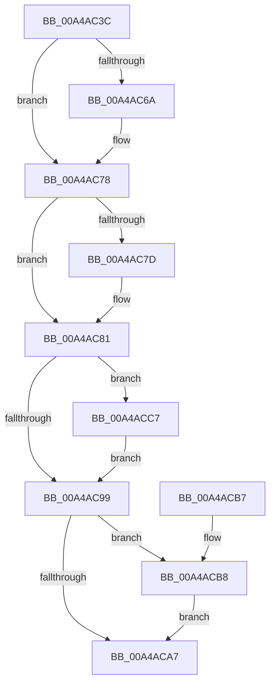

# ExpWnfDeleteStateData

- RVA: `0x00A4AC3C`–`0x00A4ACD1` (길이 `149` bytes)
- VA: `0x0000000140A4AC3C`
- 실행 섹션: `PAGE`
- PDB 이름 있음: `예`; PDB Function 태그: `아니요`
- unwind 정보 RVA: `0x000A1AC0`
- 디코드: `44`개 명령, `149/149` bytes 표시
- 미해석 바이트: `0` (있으면 어셈블리에 `.byte`로 보존)

> 이 문서는 커널 이미지의 기계어와 PDB 기호를 분석해 생성했습니다. 4번과 5번은 함수 원형과 자료형을 바이너리 사용 방식에서 추정한 C 해석이며 원본 소스 복구 결과는 아닙니다.

## 1. Dependencies

- 직접 호출 지점: **5**; 고유 호출 대상: **5**
- 직접 호출자로 확인된 함수: **2**
- RIP 상대 이미지 참조: **0**

### Outgoing calls
- `0x00A4AC5A` → [KeAbPreAcquire](../../text/21/KeAbPreAcquire_function_00210230.md) (function, `0x00210230`)
- `0x00A4AC73` → [ExfAcquirePushLockExclusiveEx](../../text/20/ExfAcquirePushLockExclusiveEx_function_0020FC90.md) (function, `0x0020FC90`)
- `0x00A4AC9C` → [KeAbPostRelease](../../text/2E/KeAbPostRelease_function_002E1600.md) (function, `0x002E1600`)
- `0x00A4ACC0` → [ExFreePoolWithTag](../../poolcode/B8/ExFreePoolWithTag_function_00B82870.md) (function, `0x00B82870`)
- `0x00A4ACCA` → [ExfTryToWakePushLock](../../text/26/ExfTryToWakePushLock_function_00265DD0.md) (function, `0x00265DD0`)

### Direct callers
- [ExpNtDeleteWnfStateData](../7C/ExpNtDeleteWnfStateData_function_007CF1A8.md) at `0x007CF49A`
- [ExpWnfDeleteNameInstance](../90/ExpWnfDeleteNameInstance_function_009088C8.md) at `0x00908B8C`

### Static image references
- 디코드된 RIP-relative 메모리 참조가 없습니다.

## 2. Other-region calls and transfers

- 다른 실행 섹션으로 향하는 call: **5**
  - `0x00A4AC5A` → [KeAbPreAcquire](../../text/21/KeAbPreAcquire_function_00210230.md) (`PAGE` → `.text`)
  - `0x00A4AC73` → [ExfAcquirePushLockExclusiveEx](../../text/20/ExfAcquirePushLockExclusiveEx_function_0020FC90.md) (`PAGE` → `.text`)
  - `0x00A4AC9C` → [KeAbPostRelease](../../text/2E/KeAbPostRelease_function_002E1600.md) (`PAGE` → `.text`)
  - `0x00A4ACC0` → [ExFreePoolWithTag](../../poolcode/B8/ExFreePoolWithTag_function_00B82870.md) (`PAGE` → `POOLCODE`)
  - `0x00A4ACCA` → [ExfTryToWakePushLock](../../text/26/ExfTryToWakePushLock_function_00265DD0.md) (`PAGE` → `.text`)
- 별도 외부 분기/꼬리 이동을 확인하지 못했습니다.

## 3. Assembly (complete function range)

```asm
00A4AC3C  48 89 5C 24 08                  mov qword ptr [rsp + 8], rbx
00A4AC41  48 89 74 24 10                  mov qword ptr [rsp + 0x10], rsi
00A4AC46  57                              push rdi
00A4AC47  48 83 EC 20                     sub rsp, 0x20
00A4AC4B  48 8D 59 50                     lea rbx, [rcx + 0x50]
00A4AC4F  48 8B F1                        mov rsi, rcx
00A4AC52  48 8B CB                        mov rcx, rbx
00A4AC55  45 33 C0                        xor r8d, r8d
00A4AC58  33 D2                           xor edx, edx
00A4AC5A  E8 D1 55 7C FF                  call 0x140210230
00A4AC5F  F0 48 0F BA 2B 00               lock bts qword ptr [rbx], 0
00A4AC65  48 8B F8                        mov rdi, rax
00A4AC68  73 0E                           jae 0x140a4ac78
00A4AC6A  4C 8B C3                        mov r8, rbx
00A4AC6D  48 8B D0                        mov rdx, rax
00A4AC70  48 8B CB                        mov rcx, rbx
00A4AC73  E8 18 50 7C FF                  call 0x14020fc90
00A4AC78  48 85 FF                        test rdi, rdi
00A4AC7B  74 04                           je 0x140a4ac81
00A4AC7D  C6 47 0A 01                     mov byte ptr [rdi + 0xa], 1
00A4AC81  48 8B 7E 58                     mov rdi, qword ptr [rsi + 0x58]
00A4AC85  48 83 66 58 00                  and qword ptr [rsi + 0x58], 0
00A4AC8A  48 83 C8 FF                     or rax, 0xffffffffffffffff
00A4AC8E  F0 48 0F C1 03                  lock xadd qword ptr [rbx], rax
00A4AC93  24 06                           and al, 6
00A4AC95  3C 02                           cmp al, 2
00A4AC97  74 2E                           je 0x140a4acc7
00A4AC99  48 8B CB                        mov rcx, rbx
00A4AC9C  E8 5F 69 89 FF                  call 0x1402e1600
00A4ACA1  48 83 FF 02                     cmp rdi, 2
00A4ACA5  73 11                           jae 0x140a4acb8
00A4ACA7  48 8B 5C 24 30                  mov rbx, qword ptr [rsp + 0x30]
00A4ACAC  48 8B 74 24 38                  mov rsi, qword ptr [rsp + 0x38]
00A4ACB1  48 83 C4 20                     add rsp, 0x20
00A4ACB5  5F                              pop rdi
00A4ACB6  C3                              ret
00A4ACB7  CC                              int3
00A4ACB8  BA 57 6E 66 20                  mov edx, 0x20666e57
00A4ACBD  48 8B CF                        mov rcx, rdi
00A4ACC0  E8 AB 7B 13 00                  call 0x140b82870
00A4ACC5  EB E0                           jmp 0x140a4aca7
00A4ACC7  48 8B CB                        mov rcx, rbx
00A4ACCA  E8 01 B1 81 FF                  call 0x140265dd0
00A4ACCF  EB C8                           jmp 0x140a4ac99
```

## 4. C-style interpretation (structured pseudocode)

```c
__int64 __fastcall ExpWnfDeleteStateData(__int64 a1, int a2, int a3)
{
    __int64 result;
    __int64 v_rsp;
    unsigned __int64 v_stack_p10;
    unsigned __int64 v_stack_p8;

    v_stack_p8 = v_rbx;
    v_stack_p10 = v_rsi;
    v_rsp = (v_rsp) - (32);
    a3 = 0;
    a2 = 0;
    result = KeAbPreAcquire(a1 + 80, a2, a3, a4);
    if (!(condition_is_above_or_equal)) {
        a3 = a1 + 80;
        a2 = result;
        a1 = a1 + 80;
        result = ExfAcquirePushLockExclusiveEx(a1, a2, a3, a4);
    }
    if (result != 0) {
        *(unsigned __int8 *)(result + 10) = 1;
    }
    result = (result) | (-1);
    result = (unsigned __int8)((result) & (6));
    if (((unsigned __int8)(result)) == 2) goto loc_00A4ACC7;
loc_00A4AC99:
    result = KeAbPostRelease(a1 + 80, a2, a3, a4);
    if ((*(unsigned __int64 *)(a1 + 88)) >= 2) goto loc_00A4ACB8;
loc_00A4ACA7:
    v_rsp = (v_rsp) + (32);
    return result;
loc_00A4ACB8:
    result = ExFreePoolWithTag(*(unsigned __int64 *)(a1 + 88), (unsigned int)(0x20666E57ULL), a3, a4);
    goto loc_00A4ACA7;
loc_00A4ACC7:
    result = ExfTryToWakePushLock(v_stack_p8, (unsigned int)(0x20666E57ULL), a3, a4);
    goto loc_00A4AC99;
}
```

## 5. (Beta) C Style

```c
int64_t ExpWnfDeleteStateData(void *Arg1, int32_t Arg2, int32_t Arg3)
{
    uint8_t *arg1 = (uint8_t *)Arg1;

    int64_t result;
    int64_t local_rsp;
    uint64_t v_stack_p10;
    uint64_t v_stack_p8;

    v_stack_p8 = local_rbx;
    v_stack_p10 = local_rsi;
    local_rsp = (local_rsp) - (32);
    Arg3 = 0;
    Arg2 = 0;
    result = KeAbPreAcquire(Arg1 + 80, Arg2, Arg3, a4);
    if (!(condition_is_above_or_equal)) {
        Arg3 = Arg1 + 80;
        Arg2 = result;
        Arg1 = Arg1 + 80;
        result = ExfAcquirePushLockExclusiveEx(Arg1, Arg2, Arg3, a4);
    }
    if (result != 0) {
        *(uint8_t *)(result + 0xA) = 1;
    }
    result = (result) | (-1);
    result = (uint8_t)((result) & (6));
    if (((uint8_t)(result)) == 2) goto loc_00A4ACC7;
loc_00A4AC99:
    result = KeAbPostRelease(Arg1 + 80, Arg2, Arg3, a4);
    if ((*(uint64_t *)(arg1 + 0x58)) >= 2) goto loc_00A4ACB8;
loc_00A4ACA7:
    local_rsp = (local_rsp) + (32);
    return result;
loc_00A4ACB8:
    result = ExFreePoolWithTag(*(uint64_t *)(arg1 + 0x58), (uint32_t)(0x20666E57ULL), Arg3, a4);
    goto loc_00A4ACA7;
loc_00A4ACC7:
    result = ExfTryToWakePushLock(v_stack_p8, (uint32_t)(0x20666E57ULL), Arg3, a4);
    goto loc_00A4AC99;
}
```

### 관측된 메모리 오프셋

구조체 형식이 확인되지 않은 접근은 인자 기준의 오프셋으로만 기록했습니다.

| 기준 인자 | 오프셋 표현 | 폭 (bit) | 접근 |
|---|---:|---:|---|
| `Arg1` | `+ 0x0` | `64` | `R/W` |
| `Arg1` | `+ 0x50` | `64` | `R` |
| `Arg1` | `+ 0x58` | `64` | `R` |
| `Arg1` | `+ 0x58` | `64` | `R/W` |

## 6. Execution-region graph

[열기: 2D/3D 그래프와 함수 탐색 컨트롤 패널](../../../control-panel.html?section=page&rva=0x00A4AC3C&view=graph)

- 2D 그래프는 위에서 아래로 흐르고, 3D 그래프는 빈 공간을 드래그해 회전합니다. Shift+드래그는 이동, 휠은 확대·축소, 함수 노드 선택은 대상 보고서 이동입니다.

### Static fallback


