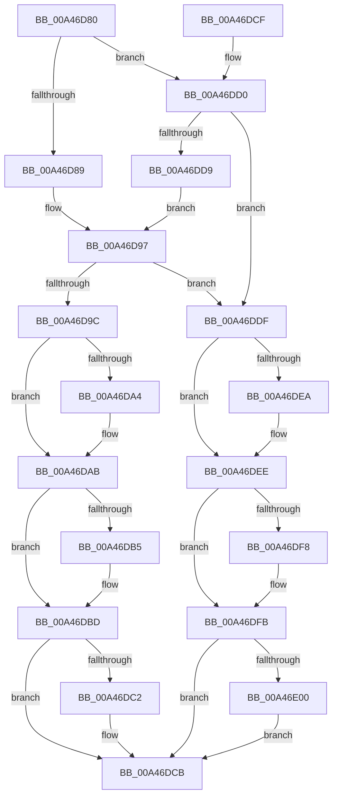

# FsRtlGetNextExtraCreateParameter

- RVA: `0x00A46D80`–`0x00A46E09` (길이 `137` bytes)
- VA: `0x0000000140A46D80`
- 실행 섹션: `PAGE`
- PDB 이름 있음: `예`; PDB Function 태그: `아니요`
- unwind 정보 RVA: `0x000DB714`
- 디코드: `45`개 명령, `137/137` bytes 표시
- 미해석 바이트: `0` (있으면 어셈블리에 `.byte`로 보존)

> 이 문서는 커널 이미지의 기계어와 PDB 기호를 분석해 생성했습니다. 4번과 5번은 함수 원형과 자료형을 바이너리 사용 방식에서 추정한 C 해석이며 원본 소스 복구 결과는 아닙니다.

## 1. Dependencies

- 직접 호출 지점: **0**; 고유 호출 대상: **0**
- 직접 호출자로 확인된 함수: **0**
- RIP 상대 이미지 참조: **0**

### Outgoing calls
- 직접 디코드된 call 명령이 없습니다.

### Direct callers
- 이 함수 시작 RVA로 연결되는 직접 call은 확인되지 않았습니다. 간접 호출은 완전히 역산할 수 없습니다.

### Static image references
- 디코드된 RIP-relative 메모리 참조가 없습니다.

## 2. Other-region calls and transfers

- 다른 실행 섹션으로 향하는 call: **0**
- 별도 외부 분기/꼬리 이동을 확인하지 못했습니다.

## 3. Assembly (complete function range)

```asm
00A46D80  4C 8D 51 08                     lea r10, [rcx + 8]
00A46D84  48 85 D2                        test rdx, rdx
00A46D87  75 47                           jne 0x140a46dd0
00A46D89  49 8B 0A                        mov rcx, qword ptr [r10]
00A46D8C  49 3B CA                        cmp rcx, r10
00A46D8F  48 8D 41 F8                     lea rax, [rcx - 8]
00A46D93  48 0F 45 D0                     cmovne rdx, rax
00A46D97  48 85 D2                        test rdx, rdx
00A46D9A  74 43                           je 0x140a46ddf
00A46D9C  45 33 D2                        xor r10d, r10d
00A46D9F  4D 85 C9                        test r9, r9
00A46DA2  74 07                           je 0x140a46dab
00A46DA4  48 8D 42 48                     lea rax, [rdx + 0x48]
00A46DA8  49 89 01                        mov qword ptr [r9], rax
00A46DAB  48 8B 4C 24 28                  mov rcx, qword ptr [rsp + 0x28]
00A46DB0  48 85 C9                        test rcx, rcx
00A46DB3  74 08                           je 0x140a46dbd
00A46DB5  8B 42 34                        mov eax, dword ptr [rdx + 0x34]
00A46DB8  83 E8 48                        sub eax, 0x48
00A46DBB  89 01                           mov dword ptr [rcx], eax
00A46DBD  4D 85 C0                        test r8, r8
00A46DC0  74 09                           je 0x140a46dcb
00A46DC2  0F 10 42 18                     movups xmm0, xmmword ptr [rdx + 0x18]
00A46DC6  F3 41 0F 7F 00                  movdqu xmmword ptr [r8], xmm0
00A46DCB  41 8B C2                        mov eax, r10d
00A46DCE  C3                              ret
00A46DCF  CC                              int3
00A46DD0  48 8B 52 C0                     mov rdx, qword ptr [rdx - 0x40]
00A46DD4  49 3B D2                        cmp rdx, r10
00A46DD7  74 06                           je 0x140a46ddf
00A46DD9  48 83 C2 F8                     add rdx, -8
00A46DDD  EB B8                           jmp 0x140a46d97
00A46DDF  41 BA 25 02 00 C0               mov r10d, 0xc0000225
00A46DE5  4D 85 C9                        test r9, r9
00A46DE8  74 04                           je 0x140a46dee
00A46DEA  49 83 21 00                     and qword ptr [r9], 0
00A46DEE  48 8B 4C 24 28                  mov rcx, qword ptr [rsp + 0x28]
00A46DF3  48 85 C9                        test rcx, rcx
00A46DF6  74 03                           je 0x140a46dfb
00A46DF8  83 21 00                        and dword ptr [rcx], 0
00A46DFB  4D 85 C0                        test r8, r8
00A46DFE  74 CB                           je 0x140a46dcb
00A46E00  0F 57 C0                        xorps xmm0, xmm0
00A46E03  41 0F 11 00                     movups xmmword ptr [r8], xmm0
00A46E07  EB C2                           jmp 0x140a46dcb
```

## 4. C-style interpretation (structured pseudocode)

```c
__int64 __fastcall FsRtlGetNextExtraCreateParameter(__int64 a1, __int64 a2, __int64 a3, __int64 a4, __int64 a5)
{
    __int64 result;
    __int64 v_r10;

    if (a2 != 0) goto loc_00A46DD0;
    if ((*(unsigned __int64 *)(a1 + 8)) != (a1 + 8)) { a2 = *(unsigned __int64 *)(a1 + 8) - 8; }
loc_00A46D97:
    if (a2 == 0) goto loc_00A46DDF;
    v_r10 = 0;
    result = *(unsigned __int64 *)(a1 + 8) - 8;
    if (a4 != 0) {
        result = a2 + 72;
        *(unsigned __int64 *)(a4) = result;
    }
    if (a5 != 0) {
        result = *(unsigned int *)(a2 + 52);
        result = (unsigned int)((result) - (72));
        *(unsigned int *)(a5) = (unsigned int)(result);
    }
    if (a3 != 0) {
        *(unsigned __int64 *)(a3) = v_xmm0;
    }
    return 0;
loc_00A46DD0:
    if ((*(unsigned __int64 *)(a2 - 64)) == 0) goto loc_00A46DDF;
    a2 = (*(unsigned __int64 *)(a2 - 64)) + (-8);
    goto loc_00A46D97;
loc_00A46DDF:
    if (a4 != 0) {
    }
    if (a5 != 0) {
    }
    if (a3 == 0) goto loc_00A46DCB;
    *(unsigned __int64 *)(a3) = v_xmm0;
    goto loc_00A46DCB;
}
```

## 5. (Beta) C Style

```c
int64_t FsRtlGetNextExtraCreateParameter(void *Arg1, int64_t Arg2, int64_t Arg3, int64_t Arg4, int64_t Arg5)
{
    uint8_t *arg1 = (uint8_t *)Arg1;

    int64_t result;
    int64_t local_r10;

    if (Arg2 != 0) goto loc_00A46DD0;
    if ((*(uint64_t *)(arg1 + 0x8)) != (Arg1 + 8)) { Arg2 = *(uint64_t *)(arg1 + 0x8) - 8; }
loc_00A46D97:
    if (Arg2 == 0) goto loc_00A46DDF;
    local_r10 = 0;
    result = *(uint64_t *)(arg1 + 0x8) - 8;
    if (Arg4 != 0) {
        result = Arg2 + 72;
        *(uint64_t *)(Arg4) = result;
    }
    if (Arg5 != 0) {
        result = *(uint32_t *)(Arg2 + 0x34);
        result = (uint32_t)((result) - (72));
        *(uint32_t *)(Arg5) = (uint32_t)(result);
    }
    if (Arg3 != 0) {
        *(uint64_t *)(Arg3) = v_xmm0;
    }
    return 0;
loc_00A46DD0:
    if ((*(uint64_t *)(Arg2 - 0x40)) == 0) goto loc_00A46DDF;
    Arg2 = (*(uint64_t *)(Arg2 - 0x40)) + (-8);
    goto loc_00A46D97;
loc_00A46DDF:
    if (Arg4 != 0) {
    }
    if (Arg5 != 0) {
    }
    if (Arg3 == 0) goto loc_00A46DCB;
    *(uint64_t *)(Arg3) = v_xmm0;
    goto loc_00A46DCB;
}
```

### 관측된 메모리 오프셋

구조체 형식이 확인되지 않은 접근은 인자 기준의 오프셋으로만 기록했습니다.

| 기준 인자 | 오프셋 표현 | 폭 (bit) | 접근 |
|---|---:|---:|---|
| `Arg1` | `+ 0x0` | `64` | `R` |
| `Arg1` | `+ 0x8` | `64` | `R` |

## 6. Execution-region graph

[열기: 2D/3D 그래프와 함수 탐색 컨트롤 패널](../../../control-panel.html?section=page&rva=0x00A46D80&view=graph)

- 2D 그래프는 위에서 아래로 흐르고, 3D 그래프는 빈 공간을 드래그해 회전합니다. Shift+드래그는 이동, 휠은 확대·축소, 함수 노드 선택은 대상 보고서 이동입니다.

### Static fallback


