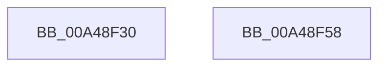

# FsRtlIsMobileOS

- RVA: `0x00A48F30`–`0x00A48F59` (길이 `41` bytes)
- VA: `0x0000000140A48F30`
- 실행 섹션: `PAGE`
- PDB 이름 있음: `예`; PDB Function 태그: `아니요`
- unwind 정보 RVA: `0x0005C788`
- 디코드: `10`개 명령, `41/41` bytes 표시
- 미해석 바이트: `0` (있으면 어셈블리에 `.byte`로 보존)

> 이 문서는 커널 이미지의 기계어와 PDB 기호를 분석해 생성했습니다. 4번과 5번은 함수 원형과 자료형을 바이너리 사용 방식에서 추정한 C 해석이며 원본 소스 복구 결과는 아닙니다.

## 1. Dependencies

- 직접 호출 지점: **1**; 고유 호출 대상: **1**
- 직접 호출자로 확인된 함수: **1**
- RIP 상대 이미지 참조: **1**

### Outgoing calls
- `0x00A48F3F` → `ext-ms-win-ntos-tm-l1-1-0.dll!TmCurrentTransaction` (import, 간접 대상; import `ext-ms-win-ntos-tm-l1-1-0.dll!TmCurrentTransaction`)

### Direct callers
- [CcInitializeCacheManager](../../init/BE/CcInitializeCacheManager_function_00BEE2E8.md) at `0x00BEE36A`
- [CcInitializeCacheManager](../../init/BE/CcInitializeCacheManager_function_00BEE2E8.md) at `0x00BEE383`

### Static image references
- `0x00A48F3F` → RVA `0x001513C0` (`ext-ms-win-ntos-tm-l1-1-0.dll!TmCurrentTransaction (IAT)`; read)

## 2. Other-region calls and transfers

- 다른 실행 섹션으로 향하는 call: **0**
- 별도 외부 분기/꼬리 이동을 확인하지 못했습니다.

## 3. Assembly (complete function range)

```asm
00A48F30  48 83 EC 28                     sub rsp, 0x28
00A48F34  48 83 64 24 30 00               and qword ptr [rsp + 0x30], 0
00A48F3A  48 8D 4C 24 30                  lea rcx, [rsp + 0x30]
00A48F3F  48 FF 15 7A 84 70 FF            call qword ptr [rip - 0x8f7b86]
00A48F46  0F 1F 44 00 00                  nop dword ptr [rax + rax]
00A48F4B  3D BB 00 00 C0                  cmp eax, 0xc00000bb
00A48F50  0F 94 C0                        sete al
00A48F53  48 83 C4 28                     add rsp, 0x28
00A48F57  C3                              ret
00A48F58  CC                              int3
```

## 4. C-style interpretation (structured pseudocode)

```c
__int64 __fastcall FsRtlIsMobileOS(void)
{
    __int64 result;
    __int64 v_rsp;
    unsigned __int64 v_stack_p8;

    v_rsp = (v_rsp) - (40);
    result = ext_ms_win_ntos_tm_l1_1_0_dll_TmCurrentTransaction(v_stack_p8, a2, a3, a4);
    result = (((unsigned int)(result)) == 0xC00000BBULL) ? 1 : 0;
    v_rsp = (v_rsp) + (40);
    return result;
}
```

## 5. (Beta) C Style

```c
void FsRtlIsMobileOS(void)
{
    int64_t result;
    int64_t local_rsp;
    uint64_t v_stack_p8;

    local_rsp = (local_rsp) - (40);
    result = kernel_indirect_call(v_stack_p8, a2, a3, a4);
    result = (((uint32_t)(result)) == 0xC00000BBULL) ? 1 : 0;
    local_rsp = (local_rsp) + (40);
    return result;
}
```

## 6. Execution-region graph

[열기: 2D/3D 그래프와 함수 탐색 컨트롤 패널](../../../control-panel.html?section=page&rva=0x00A48F30&view=graph)

- 2D 그래프는 위에서 아래로 흐르고, 3D 그래프는 빈 공간을 드래그해 회전합니다. Shift+드래그는 이동, 휠은 확대·축소, 함수 노드 선택은 대상 보고서 이동입니다.

### Static fallback


