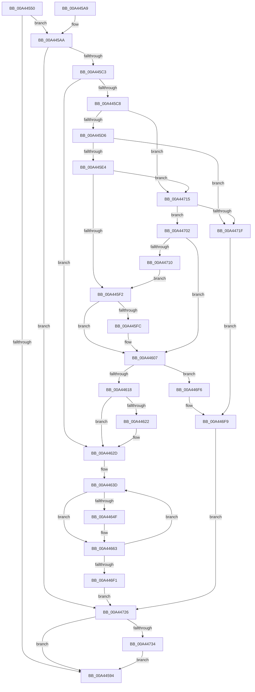

# FsRtlOplockBreakH2

- RVA: `0x00A44550`–`0x00A44745` (길이 `501` bytes)
- VA: `0x0000000140A44550`
- 실행 섹션: `PAGE`
- PDB 이름 있음: `예`; PDB Function 태그: `아니요`
- unwind 정보 RVA: `0x000AF120`
- 디코드: `109`개 명령, `501/501` bytes 표시
- 미해석 바이트: `0` (있으면 어셈블리에 `.byte`로 보존)

> 이 문서는 커널 이미지의 기계어와 PDB 기호를 분석해 생성했습니다. 4번과 5번은 함수 원형과 자료형을 바이너리 사용 방식에서 추정한 C 해석이며 원본 소스 복구 결과는 아닙니다.

## 1. Dependencies

- 직접 호출 지점: **4**; 고유 호출 대상: **4**
- 직접 호출자로 확인된 함수: **1**
- RIP 상대 이미지 참조: **0**

### Outgoing calls
- `0x00A445AD` → [FsRtlpAttachOplockKey](../../text/41/FsRtlpAttachOplockKey_function_0041DD70.md) (function, `0x0041DD70`)
- `0x00A44656` → [ExAcquireFastMutexUnsafe](../../text/3F/ExAcquireFastMutexUnsafe_function_003F3720.md) (function, `0x003F3720`)
- `0x00A446D5` → [FsRtlpOplockBreakByCacheFlags](../../text/4E/FsRtlpOplockBreakByCacheFlags_function_004E4990.md) (function, `0x004E4990`)
- `0x00A4473B` → [ExReleaseFastMutexUnsafe](../../text/25/ExReleaseFastMutexUnsafe_function_002503A0.md) (function, `0x002503A0`)

### Direct callers
- [FsRtlOplockBreakH](../71/FsRtlOplockBreakH_function_00714B00.md) at `0x00714B23`

### Static image references
- 디코드된 RIP-relative 메모리 참조가 없습니다.

## 2. Other-region calls and transfers

- 다른 실행 섹션으로 향하는 call: **4**
  - `0x00A445AD` → [FsRtlpAttachOplockKey](../../text/41/FsRtlpAttachOplockKey_function_0041DD70.md) (`PAGE` → `.text`)
  - `0x00A44656` → [ExAcquireFastMutexUnsafe](../../text/3F/ExAcquireFastMutexUnsafe_function_003F3720.md) (`PAGE` → `.text`)
  - `0x00A446D5` → [FsRtlpOplockBreakByCacheFlags](../../text/4E/FsRtlpOplockBreakByCacheFlags_function_004E4990.md) (`PAGE` → `.text`)
  - `0x00A4473B` → [ExReleaseFastMutexUnsafe](../../text/25/ExReleaseFastMutexUnsafe_function_002503A0.md) (`PAGE` → `.text`)
- 별도 외부 분기/꼬리 이동을 확인하지 못했습니다.

## 3. Assembly (complete function range)

```asm
00A44550  48 8B C4                        mov rax, rsp
00A44553  4C 89 48 20                     mov qword ptr [rax + 0x20], r9
00A44557  53                              push rbx
00A44558  56                              push rsi
00A44559  57                              push rdi
00A4455A  41 54                           push r12
00A4455C  41 55                           push r13
00A4455E  41 56                           push r14
00A44560  41 57                           push r15
00A44562  48 81 EC 90 00 00 00            sub rsp, 0x90
00A44569  41 8B F8                        mov edi, r8d
00A4456C  4C 8B FA                        mov r15, rdx
00A4456F  48 8B 31                        mov rsi, qword ptr [rcx]
00A44572  48 89 B4 24 88 00 00 00         mov qword ptr [rsp + 0x88], rsi
00A4457A  4C 8B B2 B8 00 00 00            mov r14, qword ptr [rdx + 0xb8]
00A44581  45 33 E4                        xor r12d, r12d
00A44584  44 88 60 08                     mov byte ptr [rax + 8], r12b
00A44588  41 8B DC                        mov ebx, r12d
00A4458B  44 88 60 10                     mov byte ptr [rax + 0x10], r12b
00A4458F  48 85 F6                        test rsi, rsi
00A44592  75 16                           jne 0x140a445aa
00A44594  8B C3                           mov eax, ebx
00A44596  48 81 C4 90 00 00 00            add rsp, 0x90
00A4459D  41 5F                           pop r15
00A4459F  41 5E                           pop r14
00A445A1  41 5D                           pop r13
00A445A3  41 5C                           pop r12
00A445A5  5F                              pop rdi
00A445A6  5E                              pop rsi
00A445A7  5B                              pop rbx
00A445A8  C3                              ret
00A445A9  CC                              int3
00A445AA  49 8B CF                        mov rcx, r15
00A445AD  E8 BE 97 9D FF                  call 0x14041dd70
00A445B2  8B D8                           mov ebx, eax
00A445B4  89 84 24 80 00 00 00            mov dword ptr [rsp + 0x80], eax
00A445BB  85 C0                           test eax, eax
00A445BD  0F 85 63 01 00 00               jne 0x140a44726
00A445C3  45 38 26                        cmp byte ptr [r14], r12b
00A445C6  75 65                           jne 0x140a4462d
00A445C8  4C 39 A4 24 00 01 00 00         cmp qword ptr [rsp + 0x100], r12
00A445D0  0F 84 3F 01 00 00               je 0x140a44715
00A445D6  4C 39 A4 24 08 01 00 00         cmp qword ptr [rsp + 0x108], r12
00A445DE  0F 84 3B 01 00 00               je 0x140a4471f
00A445E4  4C 39 A4 24 00 01 00 00         cmp qword ptr [rsp + 0x100], r12
00A445EC  0F 84 23 01 00 00               je 0x140a44715
00A445F2  4C 39 A4 24 08 01 00 00         cmp qword ptr [rsp + 0x108], r12
00A445FA  74 0B                           je 0x140a44607
00A445FC  0F BA EF 1E                     bts edi, 0x1e
00A44600  89 BC 24 E0 00 00 00            mov dword ptr [rsp + 0xe0], edi
00A44607  49 8B 46 08                     mov rax, qword ptr [r14 + 8]
00A4460B  F7 40 10 7F FE EF FF            test dword ptr [rax + 0x10], 0xffeffe7f
00A44612  0F 84 DE 00 00 00               je 0x140a446f6
00A44618  41 F7 46 10 00 00 01 00         test dword ptr [r14 + 0x10], 0x10000
00A44620  74 0B                           je 0x140a4462d
00A44622  0F BA EF 1C                     bts edi, 0x1c
00A44626  89 BC 24 E0 00 00 00            mov dword ptr [rsp + 0xe0], edi
00A4462D  4C 8B A4 24 F8 00 00 00         mov r12, qword ptr [rsp + 0xf8]
00A44635  4C 8B AC 24 F0 00 00 00         mov r13, qword ptr [rsp + 0xf0]
00A4463D  33 DB                           xor ebx, ebx
00A4463F  88 9C 24 D8 00 00 00            mov byte ptr [rsp + 0xd8], bl
00A44646  38 9C 24 D0 00 00 00            cmp byte ptr [rsp + 0xd0], bl
00A4464D  75 14                           jne 0x140a44663
00A4464F  48 8B 8E 98 00 00 00            mov rcx, qword ptr [rsi + 0x98]
00A44656  E8 C5 F0 9A FF                  call 0x1403f3720
00A4465B  C6 84 24 D0 00 00 00 01         mov byte ptr [rsp + 0xd0], 1
00A44663  48 8D 84 24 D8 00 00 00         lea rax, [rsp + 0xd8]
00A4466B  48 89 44 24 78                  mov qword ptr [rsp + 0x78], rax
00A44670  48 8D 84 24 D0 00 00 00         lea rax, [rsp + 0xd0]
00A44678  48 89 44 24 70                  mov qword ptr [rsp + 0x70], rax
00A4467D  48 89 5C 24 68                  mov qword ptr [rsp + 0x68], rbx
00A44682  48 89 5C 24 60                  mov qword ptr [rsp + 0x60], rbx
00A44687  48 89 5C 24 58                  mov qword ptr [rsp + 0x58], rbx
00A4468C  4C 89 64 24 50                  mov qword ptr [rsp + 0x50], r12
00A44691  4C 89 6C 24 48                  mov qword ptr [rsp + 0x48], r13
00A44696  48 8B 84 24 E8 00 00 00         mov rax, qword ptr [rsp + 0xe8]
00A4469E  48 89 44 24 40                  mov qword ptr [rsp + 0x40], rax
00A446A3  48 8B 84 24 08 01 00 00         mov rax, qword ptr [rsp + 0x108]
00A446AB  48 89 44 24 38                  mov qword ptr [rsp + 0x38], rax
00A446B0  48 8B 84 24 00 01 00 00         mov rax, qword ptr [rsp + 0x100]
00A446B8  48 89 44 24 30                  mov qword ptr [rsp + 0x30], rax
00A446BD  C7 44 24 28 00 20 00 00         mov dword ptr [rsp + 0x28], 0x2000
00A446C5  89 5C 24 20                     mov dword ptr [rsp + 0x20], ebx
00A446C9  44 8B CF                        mov r9d, edi
00A446CC  4D 8B C7                        mov r8, r15
00A446CF  49 8B D6                        mov rdx, r14
00A446D2  48 8B CE                        mov rcx, rsi
00A446D5  E8 B6 02 AA FF                  call 0x1404e4990
00A446DA  8B D8                           mov ebx, eax
00A446DC  89 84 24 80 00 00 00            mov dword ptr [rsp + 0x80], eax
00A446E3  80 BC 24 D8 00 00 00 00         cmp byte ptr [rsp + 0xd8], 0
00A446EB  0F 85 4C FF FF FF               jne 0x140a4463d
00A446F1  45 33 E4                        xor r12d, r12d
00A446F4  EB 30                           jmp 0x140a44726
00A446F6  41 8B DC                        mov ebx, r12d
00A446F9  89 9C 24 80 00 00 00            mov dword ptr [rsp + 0x80], ebx
00A44700  EB 24                           jmp 0x140a44726
00A44702  4C 39 A4 24 00 01 00 00         cmp qword ptr [rsp + 0x100], r12
00A4470A  0F 84 F7 FE FF FF               je 0x140a44607
00A44710  E9 DD FE FF FF                  jmp 0x140a445f2
00A44715  4C 39 A4 24 08 01 00 00         cmp qword ptr [rsp + 0x108], r12
00A4471D  74 E3                           je 0x140a44702
00A4471F  BB 0D 00 00 C0                  mov ebx, 0xc000000d
00A44724  EB D3                           jmp 0x140a446f9
00A44726  44 38 A4 24 D0 00 00 00         cmp byte ptr [rsp + 0xd0], r12b
00A4472E  0F 84 60 FE FF FF               je 0x140a44594
00A44734  48 8B 8E 98 00 00 00            mov rcx, qword ptr [rsi + 0x98]
00A4473B  E8 60 BC 80 FF                  call 0x1402503a0
00A44740  E9 4F FE FF FF                  jmp 0x140a44594
```

## 4. C-style interpretation (structured pseudocode)

```c
__int64 __fastcall FsRtlOplockBreakH2(__int64 a1, __int64 a2, int a3, __int64 a4, __int64 a5, __int64 a6, __int64 a7, __int64 a8)
{
    __int64 result;
    __int64 v_r12;
    __int64 v_rbx;
    __int64 v_rsp;
    unsigned __int64 v_stack_m40;
    unsigned int v_stack_p20;
    unsigned int v_stack_p28;
    unsigned __int64 v_stack_p30;
    unsigned __int64 v_stack_p38;
    unsigned __int64 v_stack_p40;
    unsigned __int64 v_stack_p48;
    unsigned __int64 v_stack_p50;
    unsigned __int64 v_stack_p58;
    unsigned __int64 v_stack_p60;
    unsigned __int64 v_stack_p68;
    unsigned __int64 v_stack_p70;
    unsigned __int64 v_stack_p78;
    unsigned int v_stack_p80;
    unsigned __int8 v_stack_pD0;
    unsigned __int8 v_stack_pD8;
    unsigned int v_stack_pE0;
    unsigned __int64 v_stack_pE8;

    *(unsigned __int64 *)(v_rsp + 32) = a4;
    v_rsp = (v_rsp) - (144);
    v_stack_m40 = *(unsigned __int64 *)(a1);
    v_r12 = 0;
    *(unsigned __int8 *)(v_rsp + 8) = 0;
    *(unsigned __int8 *)(v_rsp + 16) = 0;
    if (*(unsigned __int64 *)(a1) != 0) goto loc_00A445AA;
loc_00A44594:
    v_rsp = (v_rsp) + (144);
    return 0;
loc_00A445AA:
    result = FsRtlpAttachOplockKey(a2, a2, a3, a4);
    v_stack_p80 = (unsigned int)(result);
    if ((unsigned int)(result) != 0) goto loc_00A44726;
    if ((*(unsigned __int8 *)(*(unsigned __int64 *)(a2 + 184))) != 0) goto loc_00A4462D;
    if (a7 == 0) goto loc_00A44715;
    if (a8 == 0) goto loc_00A4471F;
    if (a7 == 0) goto loc_00A44715;
loc_00A445F2:
    if (a8 != 0) {
        v_stack_pE0 = (unsigned int)((unsigned int)(a3));
    }
    if (((*(unsigned int *)(*(unsigned __int64 *)(*(unsigned __int64 *)(a2 + 184) + 8) + 16)) & (0xFFEFFE7FULL)) == 0) goto loc_00A446F6;
    if (((*(unsigned int *)(*(unsigned __int64 *)(a2 + 184) + 16)) & (0x10000ULL)) != 0) {
        v_stack_pE0 = (unsigned int)((unsigned int)(a3));
    }
loc_00A4463D:
    v_rbx = 0;
    v_stack_pD8 = 0;
    result = *(unsigned __int64 *)(*(unsigned __int64 *)(a2 + 184) + 8);
    if (v_stack_pD0 == 0) {
        a1 = *(unsigned __int64 *)(*(unsigned __int64 *)(a1) + 152);
        result = ExAcquireFastMutexUnsafe(a1, a2, a3, a4);
        v_stack_pD0 = 1;
    }
    v_stack_p78 = v_stack_pD8;
    v_stack_p70 = v_stack_pD0;
    v_stack_p68 = 0;
    v_stack_p60 = 0;
    v_stack_p58 = 0;
    v_stack_p50 = a6;
    v_stack_p48 = a5;
    v_stack_p40 = v_stack_pE8;
    v_stack_p38 = a8;
    v_stack_p30 = a7;
    v_stack_p28 = 0x2000ULL;
    v_stack_p20 = 0;
    result = FsRtlpOplockBreakByCacheFlags(*(unsigned __int64 *)(a1), *(unsigned __int64 *)(a2 + 184), a2, (unsigned int)((unsigned int)((unsigned int)(a3))));
    v_stack_p80 = (unsigned int)(result);
    if (v_stack_pD8 != 0) goto loc_00A4463D;
    v_r12 = 0;
    goto loc_00A44726;
loc_00A446F6:
loc_00A446F9:
    v_stack_p80 = 0;
    goto loc_00A44726;
loc_00A44702:
    if (a7 == 0) goto loc_00A44607;
    goto loc_00A445F2;
loc_00A44715:
    if (a8 == 0) goto loc_00A44702;
loc_00A4471F:
    goto loc_00A446F9;
loc_00A44726:
    if (v_stack_pD0 == 0) goto loc_00A44594;
    result = ExReleaseFastMutexUnsafe(*(unsigned __int64 *)(*(unsigned __int64 *)(a1) + 152), *(unsigned __int64 *)(a2 + 184), a2, (unsigned int)((unsigned int)((unsigned int)(a3))));
    goto loc_00A44594;
}
```

## 5. (Beta) C Style

```c
int64_t FsRtlOplockBreakH2(void *Arg1, void *Arg2, int32_t Arg3, int64_t Arg4, int64_t Arg5, int64_t Arg6, int64_t Arg7, int64_t Arg8)
{
    uint8_t *arg1 = (uint8_t *)Arg1;
    uint8_t *arg2 = (uint8_t *)Arg2;

    int64_t result;
    int64_t local_r12;
    int64_t local_rbx;
    int64_t local_rsp;
    uint64_t v_stack_m40;
    uint32_t v_stack_p20;
    uint32_t v_stack_p28;
    uint64_t v_stack_p30;
    uint64_t v_stack_p38;
    uint64_t v_stack_p40;
    uint64_t v_stack_p48;
    uint64_t v_stack_p50;
    uint64_t v_stack_p58;
    uint64_t v_stack_p60;
    uint64_t v_stack_p68;
    uint64_t v_stack_p70;
    uint64_t v_stack_p78;
    uint32_t v_stack_p80;
    uint8_t v_stack_pD0;
    uint8_t v_stack_pD8;
    uint32_t v_stack_pE0;
    uint64_t v_stack_pE8;

    *(uint64_t *)(local_rsp + 0x20) = Arg4;
    local_rsp = (local_rsp) - (144);
    v_stack_m40 = *(uint64_t *)(arg1);
    local_r12 = 0;
    *(uint8_t *)(local_rsp + 0x8) = 0;
    *(uint8_t *)(local_rsp + 0x10) = 0;
    if (*(uint64_t *)(arg1) != 0) goto loc_00A445AA;
loc_00A44594:
    local_rsp = (local_rsp) + (144);
    return 0;
loc_00A445AA:
    result = FsRtlpAttachOplockKey(Arg2, Arg2, Arg3, Arg4);
    v_stack_p80 = (uint32_t)(result);
    if ((uint32_t)(result) != 0) goto loc_00A44726;
    if ((*(uint8_t *)(*(uint64_t *)(arg2 + 0xB8))) != 0) goto loc_00A4462D;
    if (Arg7 == 0) goto loc_00A44715;
    if (Arg8 == 0) goto loc_00A4471F;
    if (Arg7 == 0) goto loc_00A44715;
loc_00A445F2:
    if (Arg8 != 0) {
        v_stack_pE0 = (uint32_t)((uint32_t)(Arg3));
    }
    if (((*(uint32_t *)(*(uint64_t *)(*(uint64_t *)(arg2 + 0xB8) + 0x8) + 0x10)) & (0xFFEFFE7FULL)) == 0) goto loc_00A446F6;
    if (((*(uint32_t *)(*(uint64_t *)(arg2 + 0xB8) + 0x10)) & (0x10000ULL)) != 0) {
        v_stack_pE0 = (uint32_t)((uint32_t)(Arg3));
    }
loc_00A4463D:
    local_rbx = 0;
    v_stack_pD8 = 0;
    result = *(uint64_t *)(*(uint64_t *)(arg2 + 0xB8) + 0x8);
    if (v_stack_pD0 == 0) {
        Arg1 = *(uint64_t *)(*(uint64_t *)(arg1) + 0x98);
        result = ExAcquireFastMutexUnsafe(Arg1, Arg2, Arg3, Arg4);
        v_stack_pD0 = 1;
    }
    v_stack_p78 = v_stack_pD8;
    v_stack_p70 = v_stack_pD0;
    v_stack_p68 = 0;
    v_stack_p60 = 0;
    v_stack_p58 = 0;
    v_stack_p50 = Arg6;
    v_stack_p48 = Arg5;
    v_stack_p40 = v_stack_pE8;
    v_stack_p38 = Arg8;
    v_stack_p30 = Arg7;
    v_stack_p28 = 0x2000ULL;
    v_stack_p20 = 0;
    result = FsRtlpOplockBreakByCacheFlags(*(uint64_t *)(arg1), *(uint64_t *)(arg2 + 0xB8), Arg2, (uint32_t)((uint32_t)((uint32_t)(Arg3))));
    v_stack_p80 = (uint32_t)(result);
    if (v_stack_pD8 != 0) goto loc_00A4463D;
    local_r12 = 0;
    goto loc_00A44726;
loc_00A446F6:
loc_00A446F9:
    v_stack_p80 = 0;
    goto loc_00A44726;
loc_00A44702:
    if (Arg7 == 0) goto loc_00A44607;
    goto loc_00A445F2;
loc_00A44715:
    if (Arg8 == 0) goto loc_00A44702;
loc_00A4471F:
    goto loc_00A446F9;
loc_00A44726:
    if (v_stack_pD0 == 0) goto loc_00A44594;
    result = ExReleaseFastMutexUnsafe(*(uint64_t *)(*(uint64_t *)(arg1) + 0x98), *(uint64_t *)(arg2 + 0xB8), Arg2, (uint32_t)((uint32_t)((uint32_t)(Arg3))));
    goto loc_00A44594;
}
```

### 관측된 메모리 오프셋

구조체 형식이 확인되지 않은 접근은 인자 기준의 오프셋으로만 기록했습니다.

| 기준 인자 | 오프셋 표현 | 폭 (bit) | 접근 |
|---|---:|---:|---|
| `Arg1` | `+ 0x0` | `64` | `R` |
| `Arg2` | `+ 0xB8` | `64` | `R` |

## 6. Execution-region graph

[열기: 2D/3D 그래프와 함수 탐색 컨트롤 패널](../../../control-panel.html?section=page&rva=0x00A44550&view=graph)

- 2D 그래프는 위에서 아래로 흐르고, 3D 그래프는 빈 공간을 드래그해 회전합니다. Shift+드래그는 이동, 휠은 확대·축소, 함수 노드 선택은 대상 보고서 이동입니다.

### Static fallback


