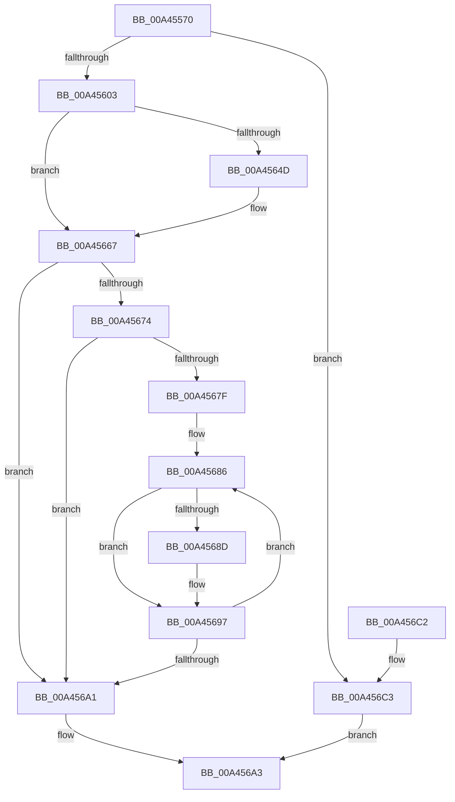

# FsRtlQueryCachedVdl

- RVA: `0x00A45570`–`0x00A456CA` (길이 `346` bytes)
- VA: `0x0000000140A45570`
- 실행 섹션: `PAGE`
- PDB 이름 있음: `예`; PDB Function 태그: `아니요`
- unwind 정보 RVA: `0x000AF40C`
- 디코드: `93`개 명령, `346/346` bytes 표시
- 미해석 바이트: `0` (있으면 어셈블리에 `.byte`로 보존)

> 이 문서는 커널 이미지의 기계어와 PDB 기호를 분석해 생성했습니다. 4번과 5번은 함수 원형과 자료형을 바이너리 사용 방식에서 추정한 C 해석이며 원본 소스 복구 결과는 아닙니다.

## 1. Dependencies

- 직접 호출 지점: **6**; 고유 호출 대상: **6**
- 직접 호출자로 확인된 함수: **0**
- RIP 상대 이미지 참조: **2**

### Outgoing calls
- `0x00A455B2` → [KeInitializeEvent](../../text/40/KeInitializeEvent_function_0040DD10.md) (function, `0x0040DD10`)
- `0x00A455BA` → [IoGetRelatedDeviceObject](../../text/29/IoGetRelatedDeviceObject_function_0029B120.md) (function, `0x0029B120`)
- `0x00A455F2` → [IoBuildDeviceIoControlRequest](../../text/20/IoBuildDeviceIoControlRequest_function_00204FD0.md) (function, `0x00204FD0`)
- `0x00A4563F` → [IofCallDriver](../../text/29/IofCallDriver_function_0029B4B0.md) (function, `0x0029B4B0`)
- `0x00A4565F` → [KeWaitForSingleObject](../../text/20/KeWaitForSingleObject_function_0020E6B0.md) (function, `0x0020E6B0`)
- `0x00A456AA` → [_security_check_cookie](../../text/6A/_security_check_cookie_function_006AC640.md) (function, `0x006AC640`)

### Direct callers
- 이 함수 시작 RVA로 연결되는 직접 call은 확인되지 않았습니다. 간접 호출은 완전히 역산할 수 없습니다.

### Static image references
- `0x00A45584` → RVA `0x00E0A740` (`.data`; read)
- `0x00A45603` → RVA `0x0001A560` (`.rdata`; read)

## 2. Other-region calls and transfers

- 다른 실행 섹션으로 향하는 call: **6**
  - `0x00A455B2` → [KeInitializeEvent](../../text/40/KeInitializeEvent_function_0040DD10.md) (`PAGE` → `.text`)
  - `0x00A455BA` → [IoGetRelatedDeviceObject](../../text/29/IoGetRelatedDeviceObject_function_0029B120.md) (`PAGE` → `.text`)
  - `0x00A455F2` → [IoBuildDeviceIoControlRequest](../../text/20/IoBuildDeviceIoControlRequest_function_00204FD0.md) (`PAGE` → `.text`)
  - `0x00A4563F` → [IofCallDriver](../../text/29/IofCallDriver_function_0029B4B0.md) (`PAGE` → `.text`)
  - `0x00A4565F` → [KeWaitForSingleObject](../../text/20/KeWaitForSingleObject_function_0020E6B0.md) (`PAGE` → `.text`)
  - `0x00A456AA` → [_security_check_cookie](../../text/6A/_security_check_cookie_function_006AC640.md) (`PAGE` → `.text`)
- 별도 외부 분기/꼬리 이동을 확인하지 못했습니다.

## 3. Assembly (complete function range)

```asm
00A45570  48 89 5C 24 18                  mov qword ptr [rsp + 0x18], rbx
00A45575  55                              push rbp
00A45576  56                              push rsi
00A45577  57                              push rdi
00A45578  48 8D 6C 24 B9                  lea rbp, [rsp - 0x47]
00A4557D  48 81 EC D0 00 00 00            sub rsp, 0xd0
00A45584  48 8B 05 B5 51 3C 00            mov rax, qword ptr [rip + 0x3c51b5]
00A4558B  48 33 C4                        xor rax, rsp
00A4558E  48 89 45 37                     mov qword ptr [rbp + 0x37], rax
00A45592  0F 57 C0                        xorps xmm0, xmm0
00A45595  48 8B DA                        mov rbx, rdx
00A45598  48 8B F9                        mov rdi, rcx
00A4559B  33 C0                           xor eax, eax
00A4559D  33 D2                           xor edx, edx
00A4559F  48 89 45 D7                     mov qword ptr [rbp - 0x29], rax
00A455A3  48 8D 4D C7                     lea rcx, [rbp - 0x39]
00A455A7  45 33 C0                        xor r8d, r8d
00A455AA  0F 11 45 C7                     movups xmmword ptr [rbp - 0x39], xmm0
00A455AE  0F 11 45 DF                     movups xmmword ptr [rbp - 0x21], xmm0
00A455B2  E8 59 87 9C FF                  call 0x14040dd10
00A455B7  48 8B CF                        mov rcx, rdi
00A455BA  E8 61 5B 85 FF                  call 0x14029b120
00A455BF  48 8B F0                        mov rsi, rax
00A455C2  45 33 C9                        xor r9d, r9d
00A455C5  48 8D 45 DF                     lea rax, [rbp - 0x21]
00A455C9  45 33 C0                        xor r8d, r8d
00A455CC  48 89 44 24 40                  mov qword ptr [rsp + 0x40], rax
00A455D1  48 8B D6                        mov rdx, rsi
00A455D4  48 8D 45 C7                     lea rax, [rbp - 0x39]
00A455D8  B9 84 02 09 00                  mov ecx, 0x90284
00A455DD  48 89 44 24 38                  mov qword ptr [rsp + 0x38], rax
00A455E2  C6 44 24 30 00                  mov byte ptr [rsp + 0x30], 0
00A455E7  83 64 24 28 00                  and dword ptr [rsp + 0x28], 0
00A455EC  48 83 64 24 20 00               and qword ptr [rsp + 0x20], 0
00A455F2  E8 D9 F9 7B FF                  call 0x140204fd0
00A455F7  48 8B D0                        mov rdx, rax
00A455FA  48 85 C0                        test rax, rax
00A455FD  0F 84 C0 00 00 00               je 0x140a456c3
00A45603  66 0F 6F 05 55 4F 5D FF         movdqa xmm0, xmmword ptr [rip - 0xa2b0ab]
00A4560B  48 8D 45 F7                     lea rax, [rbp - 9]
00A4560F  66 0F 7F 45 F7                  movdqa xmmword ptr [rbp - 9], xmm0
00A45614  48 8B CE                        mov rcx, rsi
00A45617  C7 45 07 01 00 00 00            mov dword ptr [rbp + 7], 1
00A4561E  48 89 42 18                     mov qword ptr [rdx + 0x18], rax
00A45622  48 8B 82 B8 00 00 00            mov rax, qword ptr [rdx + 0xb8]
00A45629  48 89 78 E8                     mov qword ptr [rax - 0x18], rdi
00A4562D  C6 40 B8 0D                     mov byte ptr [rax - 0x48], 0xd
00A45631  C7 40 C8 18 00 00 00            mov dword ptr [rax - 0x38], 0x18
00A45638  C7 40 C0 40 00 00 00            mov dword ptr [rax - 0x40], 0x40
00A4563F  E8 6C 5E 85 FF                  call 0x14029b4b0
00A45644  8B D0                           mov edx, eax
00A45646  3D 03 01 00 00                  cmp eax, 0x103
00A4564B  75 1A                           jne 0x140a45667
00A4564D  48 83 64 24 20 00               and qword ptr [rsp + 0x20], 0
00A45653  48 8D 4D C7                     lea rcx, [rbp - 0x39]
00A45657  45 33 C9                        xor r9d, r9d
00A4565A  45 33 C0                        xor r8d, r8d
00A4565D  33 D2                           xor edx, edx
00A4565F  E8 4C 90 7C FF                  call 0x14020e6b0
00A45664  8B 55 DF                        mov edx, dword ptr [rbp - 0x21]
00A45667  B9 00 00 00 C0                  mov ecx, 0xc0000000
00A4566C  8B C2                           mov eax, edx
00A4566E  23 C1                           and eax, ecx
00A45670  3B C1                           cmp eax, ecx
00A45672  74 2D                           je 0x140a456a1
00A45674  48 83 23 00                     and qword ptr [rbx], 0
00A45678  8B 45 FF                        mov eax, dword ptr [rbp - 1]
00A4567B  85 C0                           test eax, eax
00A4567D  74 22                           je 0x140a456a1
00A4567F  48 8D 4D 07                     lea rcx, [rbp + 7]
00A45683  44 8B C0                        mov r8d, eax
00A45686  8B 41 10                        mov eax, dword ptr [rcx + 0x10]
00A45689  A8 01                           test al, 1
00A4568B  74 0A                           je 0x140a45697
00A4568D  48 8B 41 08                     mov rax, qword ptr [rcx + 8]
00A45691  48 03 01                        add rax, qword ptr [rcx]
00A45694  48 89 03                        mov qword ptr [rbx], rax
00A45697  48 83 C1 18                     add rcx, 0x18
00A4569B  49 83 E8 01                     sub r8, 1
00A4569F  75 E5                           jne 0x140a45686
00A456A1  8B C2                           mov eax, edx
00A456A3  48 8B 4D 37                     mov rcx, qword ptr [rbp + 0x37]
00A456A7  48 33 CC                        xor rcx, rsp
00A456AA  E8 91 6F C6 FF                  call 0x1406ac640
00A456AF  48 8B 9C 24 00 01 00 00         mov rbx, qword ptr [rsp + 0x100]
00A456B7  48 81 C4 D0 00 00 00            add rsp, 0xd0
00A456BE  5F                              pop rdi
00A456BF  5E                              pop rsi
00A456C0  5D                              pop rbp
00A456C1  C3                              ret
00A456C2  CC                              int3
00A456C3  B8 9A 00 00 C0                  mov eax, 0xc000009a
00A456C8  EB D9                           jmp 0x140a456a3
```

## 4. C-style interpretation (structured pseudocode)

```c
__int64 __fastcall FsRtlQueryCachedVdl(__int64 a1, __int64 a2, int a3, int a4)
{
    __int64 result;
    __int64 v_rsp;
    unsigned __int64 v_stack_m28;
    unsigned int v_stack_m58;
    unsigned __int64 v_stack_m5F;
    unsigned int v_stack_m60;
    unsigned __int64 v_stack_m68;
    unsigned __int64 v_stack_m80;
    unsigned __int64 v_stack_m88;
    unsigned __int64 v_stack_m98;
    unsigned __int64 v_stack_mA8;
    unsigned __int64 v_stack_mB0;
    unsigned __int8 v_stack_mB8;
    unsigned int v_stack_mC0;
    unsigned __int64 v_stack_mC8;
    unsigned __int64 v_stack_p18;

    v_stack_p18 = v_rbx;
    v_rsp = (v_rsp) - (208);
    result = (*(unsigned __int64 *)(v_rip + 3953077)) ^ (v_rsp);
    v_stack_m28 = result;
    result = 0;
    a2 = 0;
    v_stack_m88 = 0;
    a3 = 0;
    v_stack_m98 = v_xmm0;
    v_stack_m80 = v_xmm0;
    result = KeInitializeEvent(v_stack_m98, a2, a3, a4);
    result = IoGetRelatedDeviceObject(a1, a2, a3, a4);
    a4 = 0;
    a3 = 0;
    v_stack_mA8 = v_stack_m80;
    v_stack_mB0 = v_stack_m98;
    v_stack_mB8 = 0;
    result = IoBuildDeviceIoControlRequest((unsigned int)(0x90284ULL), result, a3, a4);
    if (result == 0) goto loc_00A456C3;
    v_stack_m68 = v_xmm0;
    v_stack_m58 = 1;
    *(unsigned __int64 *)(result + 24) = v_stack_m68;
    *(unsigned __int64 *)(*(unsigned __int64 *)(result + 184) - 24) = a1;
    *(unsigned __int8 *)(*(unsigned __int64 *)(result + 184) - 72) = 13;
    *(unsigned int *)(*(unsigned __int64 *)(result + 184) - 56) = 24;
    *(unsigned int *)(*(unsigned __int64 *)(result + 184) - 64) = 64;
    result = IofCallDriver(result, result, a3, a4);
    if (((unsigned int)(result)) == 259) {
        a1 = v_stack_m98;
        a4 = 0;
        a3 = 0;
        a2 = 0;
        result = KeWaitForSingleObject(a1, a2, a3, a4);
        a2 = v_stack_m80;
    }
    result = (unsigned int)(((unsigned int)((unsigned int)(a2))) & ((unsigned int)((unsigned int)(0xC0000000ULL))));
    if (((unsigned int)(result)) == ((unsigned int)((unsigned int)(0xC0000000ULL)))) goto loc_00A456A1;
    if ((unsigned int)((unsigned int)(v_stack_m60)) == 0) goto loc_00A456A1;
loc_00A45686:
    result = (unsigned int)(*(unsigned int *)(v_stack_m58 + 16));
    if ((((unsigned __int8)((unsigned int)(*(unsigned int *)(v_stack_m58 + 16)))) & (1)) != 0) {
        result = *(unsigned __int64 *)(v_stack_m58 + 8);
        result = (result) + (*(unsigned __int64 *)(v_stack_m58));
        *(unsigned __int64 *)(a2) = result;
    }
    a1 = (v_stack_m58) + (24);
    a3 = ((unsigned int)((unsigned int)((unsigned int)(v_stack_m60)))) - (1);
    if (condition_is_not_equal) goto loc_00A45686;
loc_00A456A1:
loc_00A456A3:
    a1 = (v_stack_m28) ^ (v_rsp);
    result = _security_check_cookie(a1, a2, a3, a4);
    v_rsp = (v_rsp) + (208);
    return result;
loc_00A456C3:
    goto loc_00A456A3;
}
```

## 5. (Beta) C Style

```c
int64_t FsRtlQueryCachedVdl(int64_t Arg1, void *Arg2, int32_t Arg3, int32_t Arg4)
{
    uint8_t *arg2 = (uint8_t *)Arg2;

    int64_t result;
    int64_t local_rsp;
    uint64_t v_stack_m28;
    uint32_t v_stack_m58;
    uint64_t v_stack_m5F;
    uint32_t v_stack_m60;
    uint64_t v_stack_m68;
    uint64_t v_stack_m80;
    uint64_t v_stack_m88;
    uint64_t v_stack_m98;
    uint64_t v_stack_mA8;
    uint64_t v_stack_mB0;
    uint8_t v_stack_mB8;
    uint32_t v_stack_mC0;
    uint64_t v_stack_mC8;
    uint64_t v_stack_p18;

    v_stack_p18 = local_rbx;
    local_rsp = (local_rsp) - (208);
    result = (*(uint64_t *)(v_rip + 0x3C51B5)) ^ (local_rsp);
    v_stack_m28 = result;
    result = 0;
    Arg2 = 0;
    v_stack_m88 = 0;
    Arg3 = 0;
    v_stack_m98 = v_xmm0;
    v_stack_m80 = v_xmm0;
    result = KeInitializeEvent(v_stack_m98, Arg2, Arg3, Arg4);
    result = IoGetRelatedDeviceObject(Arg1, Arg2, Arg3, Arg4);
    Arg4 = 0;
    Arg3 = 0;
    v_stack_mA8 = v_stack_m80;
    v_stack_mB0 = v_stack_m98;
    v_stack_mB8 = 0;
    result = IoBuildDeviceIoControlRequest((uint32_t)(0x90284ULL), result, Arg3, Arg4);
    if (result == 0) goto loc_00A456C3;
    v_stack_m68 = v_xmm0;
    v_stack_m58 = 1;
    *(uint64_t *)(result + 0x18) = v_stack_m68;
    *(uint64_t *)(*(uint64_t *)(result + 0xB8) - 0x18) = Arg1;
    *(uint8_t *)(*(uint64_t *)(result + 0xB8) - 0x48) = 13;
    *(uint32_t *)(*(uint64_t *)(result + 0xB8) - 0x38) = 24;
    *(uint32_t *)(*(uint64_t *)(result + 0xB8) - 0x40) = 64;
    result = IofCallDriver(result, result, Arg3, Arg4);
    if (((uint32_t)(result)) == 259) {
        Arg1 = v_stack_m98;
        Arg4 = 0;
        Arg3 = 0;
        Arg2 = 0;
        result = KeWaitForSingleObject(Arg1, Arg2, Arg3, Arg4);
        Arg2 = v_stack_m80;
    }
    result = (uint32_t)(((uint32_t)((uint32_t)(Arg2))) & ((uint32_t)((uint32_t)(0xC0000000ULL))));
    if (((uint32_t)(result)) == ((uint32_t)((uint32_t)(0xC0000000ULL)))) goto loc_00A456A1;
    if ((uint32_t)((uint32_t)(v_stack_m60)) == 0) goto loc_00A456A1;
loc_00A45686:
    result = (uint32_t)(*(uint32_t *)(v_stack_m58 + 0x10));
    if ((((uint8_t)((uint32_t)(*(uint32_t *)(v_stack_m58 + 0x10)))) & (1)) != 0) {
        result = *(uint64_t *)(v_stack_m58 + 0x8);
        result = (result) + (*(uint64_t *)(v_stack_m58));
        *(uint64_t *)(arg2) = result;
    }
    Arg1 = (v_stack_m58) + (24);
    Arg3 = ((uint32_t)((uint32_t)((uint32_t)(v_stack_m60)))) - (1);
    if (condition_is_not_equal) goto loc_00A45686;
loc_00A456A1:
loc_00A456A3:
    Arg1 = (v_stack_m28) ^ (local_rsp);
    result = _security_check_cookie(Arg1, Arg2, Arg3, Arg4);
    local_rsp = (local_rsp) + (208);
    return result;
loc_00A456C3:
    goto loc_00A456A3;
}
```

### 관측된 메모리 오프셋

구조체 형식이 확인되지 않은 접근은 인자 기준의 오프셋으로만 기록했습니다.

| 기준 인자 | 오프셋 표현 | 폭 (bit) | 접근 |
|---|---:|---:|---|
| `Arg2` | `+ 0x0` | `64` | `R/W` |
| `Arg2` | `+ 0x0` | `64` | `W` |

## 6. Execution-region graph

[열기: 2D/3D 그래프와 함수 탐색 컨트롤 패널](../../../control-panel.html?section=page&rva=0x00A45570&view=graph)

- 2D 그래프는 위에서 아래로 흐르고, 3D 그래프는 빈 공간을 드래그해 회전합니다. Shift+드래그는 이동, 휠은 확대·축소, 함수 노드 선택은 대상 보고서 이동입니다.

### Static fallback


