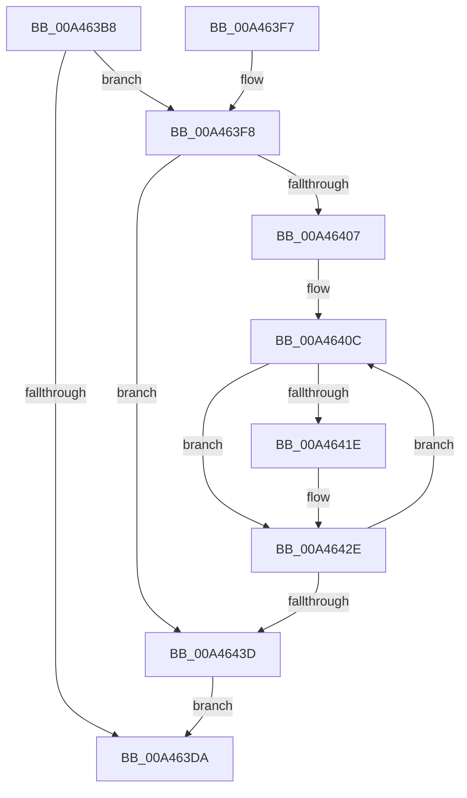

# HvFoldBackDirtyData

- RVA: `0x00A463B8`–`0x00A46447` (길이 `143` bytes)
- VA: `0x0000000140A463B8`
- 실행 섹션: `PAGE`
- PDB 이름 있음: `예`; PDB Function 태그: `아니요`
- unwind 정보 RVA: `0x0006E40C`
- 디코드: `39`개 명령, `143/143` bytes 표시
- 미해석 바이트: `0` (있으면 어셈블리에 `.byte`로 보존)

> 이 문서는 커널 이미지의 기계어와 PDB 기호를 분석해 생성했습니다. 4번과 5번은 함수 원형과 자료형을 바이너리 사용 방식에서 추정한 C 해석이며 원본 소스 복구 결과는 아닙니다.

## 1. Dependencies

- 직접 호출 지점: **4**; 고유 호출 대상: **4**
- 직접 호출자로 확인된 함수: **1**
- RIP 상대 이미지 참조: **0**

### Outgoing calls
- `0x00A463DD` → [HvFreeDirtyData](../9B/HvFreeDirtyData_function_009B2678.md) (function, `0x009B2678`)
- `0x00A463FE` → [HvLockHiveWriter](../85/HvLockHiveWriter_function_00859894.md) (function, `0x00859894`)
- `0x00A46429` → [HvMarkDirtyForFlush](../../text/49/HvMarkDirtyForFlush_function_00494CA4.md) (function, `0x00494CA4`)
- `0x00A46440` → [HvUnlockHiveWriter](../85/HvUnlockHiveWriter_function_008598E4.md) (function, `0x008598E4`)

### Direct callers
- [CmpFlushHive](../9B/CmpFlushHive_function_009B3DC0.md) at `0x009B4874`

### Static image references
- 디코드된 RIP-relative 메모리 참조가 없습니다.

## 2. Other-region calls and transfers

- 다른 실행 섹션으로 향하는 call: **1**
  - `0x00A46429` → [HvMarkDirtyForFlush](../../text/49/HvMarkDirtyForFlush_function_00494CA4.md) (`PAGE` → `.text`)
- 별도 외부 분기/꼬리 이동을 확인하지 못했습니다.

## 3. Assembly (complete function range)

```asm
00A463B8  48 89 5C 24 08                  mov qword ptr [rsp + 8], rbx
00A463BD  48 89 6C 24 10                  mov qword ptr [rsp + 0x10], rbp
00A463C2  48 89 74 24 18                  mov qword ptr [rsp + 0x18], rsi
00A463C7  57                              push rdi
00A463C8  48 83 EC 20                     sub rsp, 0x20
00A463CC  33 FF                           xor edi, edi
00A463CE  48 8B D9                        mov rbx, rcx
00A463D1  48 39 B9 A0 06 00 00            cmp qword ptr [rcx + 0x6a0], rdi
00A463D8  75 1E                           jne 0x140a463f8
00A463DA  48 8B CB                        mov rcx, rbx
00A463DD  E8 96 C2 F6 FF                  call 0x1409b2678
00A463E2  48 8B 5C 24 30                  mov rbx, qword ptr [rsp + 0x30]
00A463E7  48 8B 6C 24 38                  mov rbp, qword ptr [rsp + 0x38]
00A463EC  48 8B 74 24 40                  mov rsi, qword ptr [rsp + 0x40]
00A463F1  48 83 C4 20                     add rsp, 0x20
00A463F5  5F                              pop rdi
00A463F6  C3                              ret
00A463F7  CC                              int3
00A463F8  8B A9 98 06 00 00               mov ebp, dword ptr [rcx + 0x698]
00A463FE  E8 91 34 E1 FF                  call 0x140859894
00A46403  85 ED                           test ebp, ebp
00A46405  74 36                           je 0x140a4643d
00A46407  BE 08 00 00 00                  mov esi, 8
00A4640C  48 8B 83 A0 06 00 00            mov rax, qword ptr [rbx + 0x6a0]
00A46413  48 0F A3 38                     bt qword ptr [rax], rdi
00A46417  0F 92 C0                        setb al
00A4641A  3C 01                           cmp al, 1
00A4641C  75 10                           jne 0x140a4642e
00A4641E  41 B8 01 00 00 00               mov r8d, 1
00A46424  8B D6                           mov edx, esi
00A46426  48 8B CB                        mov rcx, rbx
00A46429  E8 76 E8 A4 FF                  call 0x140494ca4
00A4642E  48 FF C7                        inc rdi
00A46431  81 C6 00 02 00 00               add esi, 0x200
00A46437  48 83 ED 01                     sub rbp, 1
00A4643B  75 CF                           jne 0x140a4640c
00A4643D  48 8B CB                        mov rcx, rbx
00A46440  E8 9F 34 E1 FF                  call 0x1408598e4
00A46445  EB 93                           jmp 0x140a463da
```

## 4. C-style interpretation (structured pseudocode)

```c
__int64 __fastcall HvFoldBackDirtyData(__int64 a1)
{
    __int64 result;
    __int64 v_rbp;
    __int64 v_rdi;
    __int64 v_rsi;
    __int64 v_rsp;
    unsigned __int64 v_stack_p10;
    unsigned __int64 v_stack_p18;
    unsigned __int64 v_stack_p8;

    v_stack_p8 = v_rbx;
    v_stack_p10 = v_rbp;
    v_stack_p18 = v_rsi;
    v_rsp = (v_rsp) - (32);
    v_rdi = 0;
    if ((*(unsigned __int64 *)(a1 + 1696)) != 0) goto loc_00A463F8;
loc_00A463DA:
    result = HvFreeDirtyData(a1, a2, a3, a4);
    v_rsp = (v_rsp) + (32);
    return result;
loc_00A463F8:
    result = HvLockHiveWriter(a1, a2, a3, a4);
    if ((unsigned int)((unsigned int)(*(unsigned int *)(a1 + 1688))) == 0) goto loc_00A4643D;
loc_00A4640C:
    result = (condition_is_below) ? 1 : 0;
    if (((unsigned __int8)(result)) == 1) {
        a3 = 1;
        a2 = 8;
        a1 = v_stack_p8;
        result = HvMarkDirtyForFlush(a1, a2, a3, a4);
    }
    v_rdi = (v_rdi) + 1;
    v_rsi = (unsigned int)((8) + (512));
    v_rbp = ((unsigned int)(*(unsigned int *)(a1 + 1688))) - (1);
    if (condition_is_not_equal) goto loc_00A4640C;
loc_00A4643D:
    result = HvUnlockHiveWriter(v_stack_p8, a2, a3, a4);
    goto loc_00A463DA;
}
```

## 5. (Beta) C Style

```c
int64_t HvFoldBackDirtyData(void *Arg1)
{
    uint8_t *arg1 = (uint8_t *)Arg1;

    int64_t result;
    int64_t local_rbp;
    int64_t local_rdi;
    int64_t local_rsi;
    int64_t local_rsp;
    uint64_t v_stack_p10;
    uint64_t v_stack_p18;
    uint64_t v_stack_p8;

    v_stack_p8 = local_rbx;
    v_stack_p10 = local_rbp;
    v_stack_p18 = local_rsi;
    local_rsp = (local_rsp) - (32);
    local_rdi = 0;
    if ((*(uint64_t *)(arg1 + 0x6A0)) != 0) goto loc_00A463F8;
loc_00A463DA:
    result = HvFreeDirtyData(Arg1, a2, a3, a4);
    local_rsp = (local_rsp) + (32);
    return result;
loc_00A463F8:
    result = HvLockHiveWriter(Arg1, a2, a3, a4);
    if ((uint32_t)((uint32_t)(*(uint32_t *)(arg1 + 0x698))) == 0) goto loc_00A4643D;
loc_00A4640C:
    result = (condition_is_below) ? 1 : 0;
    if (((uint8_t)(result)) == 1) {
        a3 = 1;
        a2 = 8;
        Arg1 = v_stack_p8;
        result = HvMarkDirtyForFlush(Arg1, a2, a3, a4);
    }
    local_rdi = (local_rdi) + 1;
    local_rsi = (uint32_t)((8) + (512));
    local_rbp = ((uint32_t)(*(uint32_t *)(arg1 + 0x698))) - (1);
    if (condition_is_not_equal) goto loc_00A4640C;
loc_00A4643D:
    result = HvUnlockHiveWriter(v_stack_p8, a2, a3, a4);
    goto loc_00A463DA;
}
```

### 관측된 메모리 오프셋

구조체 형식이 확인되지 않은 접근은 인자 기준의 오프셋으로만 기록했습니다.

| 기준 인자 | 오프셋 표현 | 폭 (bit) | 접근 |
|---|---:|---:|---|
| `Arg1` | `+ 0x698` | `32` | `R` |
| `Arg1` | `+ 0x6A0` | `64` | `R` |

## 6. Execution-region graph

[열기: 2D/3D 그래프와 함수 탐색 컨트롤 패널](../../../control-panel.html?section=page&rva=0x00A463B8&view=graph)

- 2D 그래프는 위에서 아래로 흐르고, 3D 그래프는 빈 공간을 드래그해 회전합니다. Shift+드래그는 이동, 휠은 확대·축소, 함수 노드 선택은 대상 보고서 이동입니다.

### Static fallback


