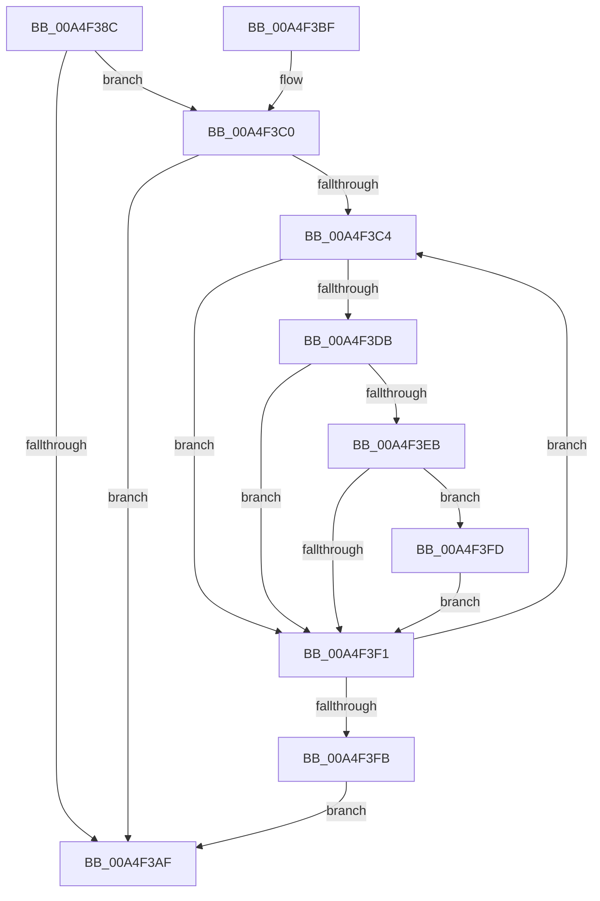

# HvTrimHive

- RVA: `0x00A4F38C`–`0x00A4F426` (길이 `154` bytes)
- VA: `0x0000000140A4F38C`
- 실행 섹션: `PAGE`
- PDB 이름 있음: `예`; PDB Function 태그: `아니요`
- unwind 정보 RVA: `0x00060CCC`
- 디코드: `45`개 명령, `154/154` bytes 표시
- 미해석 바이트: `0` (있으면 어셈블리에 `.byte`로 보존)

> 이 문서는 커널 이미지의 기계어와 PDB 기호를 분석해 생성했습니다. 4번과 5번은 함수 원형과 자료형을 바이너리 사용 방식에서 추정한 C 해석이며 원본 소스 복구 결과는 아닙니다.

## 1. Dependencies

- 직접 호출 지점: **3**; 고유 호출 대상: **3**
- 직접 호출자로 확인된 함수: **1**
- RIP 상대 이미지 참조: **0**

### Outgoing calls
- `0x00A4F3C9` → [HvpGetCellMap](../../pagecmrc/BC/HvpGetCellMap_function_00BC9710.md) (function, `0x00BC9710`)
- `0x00A4F402` → [MiGetAnyMultiplexedVm](../../text/44/MiGetAnyMultiplexedVm_function_00448BD0.md) (function, `0x00448BD0`)
- `0x00A4F41F` → [MiDeprioritizeVirtualAddresses](../../text/42/MiDeprioritizeVirtualAddresses_function_0042AD1C.md) (function, `0x0042AD1C`)

### Direct callers
- [CmpTrimHive](CmpTrimHive_function_00A4F2FC.md) at `0x00A4F358`

### Static image references
- 디코드된 RIP-relative 메모리 참조가 없습니다.

## 2. Other-region calls and transfers

- 다른 실행 섹션으로 향하는 call: **3**
  - `0x00A4F3C9` → [HvpGetCellMap](../../pagecmrc/BC/HvpGetCellMap_function_00BC9710.md) (`PAGE` → `PAGECMRC`)
  - `0x00A4F402` → [MiGetAnyMultiplexedVm](../../text/44/MiGetAnyMultiplexedVm_function_00448BD0.md) (`PAGE` → `.text`)
  - `0x00A4F41F` → [MiDeprioritizeVirtualAddresses](../../text/42/MiDeprioritizeVirtualAddresses_function_0042AD1C.md) (`PAGE` → `.text`)
- 별도 외부 분기/꼬리 이동을 확인하지 못했습니다.

## 3. Assembly (complete function range)

```asm
00A4F38C  48 89 5C 24 08                  mov qword ptr [rsp + 8], rbx
00A4F391  48 89 74 24 10                  mov qword ptr [rsp + 0x10], rsi
00A4F396  57                              push rdi
00A4F397  48 83 EC 20                     sub rsp, 0x20
00A4F39B  F7 81 A0 00 00 00 00 00 00 02   test dword ptr [rcx + 0xa0], 0x2000000
00A4F3A5  41 8B F8                        mov edi, r8d
00A4F3A8  8B DA                           mov ebx, edx
00A4F3AA  48 8B F1                        mov rsi, rcx
00A4F3AD  74 11                           je 0x140a4f3c0
00A4F3AF  48 8B 5C 24 30                  mov rbx, qword ptr [rsp + 0x30]
00A4F3B4  48 8B 74 24 38                  mov rsi, qword ptr [rsp + 0x38]
00A4F3B9  48 83 C4 20                     add rsp, 0x20
00A4F3BD  5F                              pop rdi
00A4F3BE  C3                              ret
00A4F3BF  CC                              int3
00A4F3C0  3B D7                           cmp edx, edi
00A4F3C2  73 EB                           jae 0x140a4f3af
00A4F3C4  8B D3                           mov edx, ebx
00A4F3C6  48 8B CE                        mov rcx, rsi
00A4F3C9  E8 42 A3 17 00                  call 0x140bc9710
00A4F3CE  4C 8B D8                        mov r11, rax
00A4F3D1  4C 8B 50 08                     mov r10, qword ptr [rax + 8]
00A4F3D5  41 F6 C2 02                     test r10b, 2
00A4F3D9  75 16                           jne 0x140a4f3f1
00A4F3DB  49 8B CA                        mov rcx, r10
00A4F3DE  48 83 C9 04                     or rcx, 4
00A4F3E2  48 89 48 08                     mov qword ptr [rax + 8], rcx
00A4F3E6  F6 C1 01                        test cl, 1
00A4F3E9  74 06                           je 0x140a4f3f1
00A4F3EB  41 F6 C2 08                     test r10b, 8
00A4F3EF  75 0C                           jne 0x140a4f3fd
00A4F3F1  81 C3 00 10 00 00               add ebx, 0x1000
00A4F3F7  3B DF                           cmp ebx, edi
00A4F3F9  72 C9                           jb 0x140a4f3c4
00A4F3FB  EB B2                           jmp 0x140a4f3af
00A4F3FD  B9 03 00 00 00                  mov ecx, 3
00A4F402  E8 C9 97 9F FF                  call 0x140448bd0
00A4F407  41 8B 53 10                     mov edx, dword ptr [r11 + 0x10]
00A4F40B  49 83 E2 F0                     and r10, 0xfffffffffffffff0
00A4F40F  48 C1 EA 0C                     shr rdx, 0xc
00A4F413  49 8B CA                        mov rcx, r10
00A4F416  4C 8B C0                        mov r8, rax
00A4F419  41 B9 18 00 00 00               mov r9d, 0x18
00A4F41F  E8 F8 B8 9D FF                  call 0x14042ad1c
00A4F424  EB CB                           jmp 0x140a4f3f1
```

## 4. C-style interpretation (structured pseudocode)

```c
__int64 __fastcall HvTrimHive(__int64 a1, int a2, int a3)
{
    __int64 result;
    __int64 v_r10;
    __int64 v_rbx;
    __int64 v_rsp;
    unsigned __int64 v_stack_p10;
    unsigned __int64 v_stack_p8;

    v_stack_p8 = v_rbx;
    v_stack_p10 = v_rsi;
    v_rsp = (v_rsp) - (32);
    if (((*(unsigned int *)(a1 + 160)) & (0x2000000ULL)) == 0) goto loc_00A4F3C0;
loc_00A4F3AF:
    v_rsp = (v_rsp) + (32);
    return result;
loc_00A4F3C0:
    if (a2 >= ((unsigned int)((unsigned int)(a3)))) goto loc_00A4F3AF;
loc_00A4F3C4:
    result = HvpGetCellMap(v_stack_p10, (unsigned int)((unsigned int)(v_stack_p8)), a3, a4);
    if ((((unsigned __int8)(*(unsigned __int64 *)(result + 8))) & (2)) != 0) goto loc_00A4F3F1;
    a1 = (*(unsigned __int64 *)(result + 8)) | (4);
    *(unsigned __int64 *)(result + 8) = a1;
    if ((((unsigned __int8)(a1)) & (1)) == 0) goto loc_00A4F3F1;
    if ((((unsigned __int8)(*(unsigned __int64 *)(result + 8))) & (8)) != 0) goto loc_00A4F3FD;
loc_00A4F3F1:
    v_rbx = (unsigned int)((v_stack_p8) + (0x1000ULL));
    if (((unsigned int)(v_rbx)) < ((unsigned int)((unsigned int)(a3)))) goto loc_00A4F3C4;
    goto loc_00A4F3AF;
loc_00A4F3FD:
    result = MiGetAnyMultiplexedVm(3, (unsigned int)((unsigned int)(v_stack_p8)), a3, a4);
    v_r10 = (*(unsigned __int64 *)(result + 8)) & (-16);
    a2 = ((unsigned int)(*(unsigned int *)(result + 16))) >> (12);
    result = MiDeprioritizeVirtualAddresses(v_r10, a2, result, 24);
    goto loc_00A4F3F1;
}
```

## 5. (Beta) C Style

```c
int64_t HvTrimHive(void *Arg1, int32_t Arg2, int32_t Arg3)
{
    uint8_t *arg1 = (uint8_t *)Arg1;

    int64_t result;
    int64_t local_r10;
    int64_t local_rbx;
    int64_t local_rsp;
    uint64_t v_stack_p10;
    uint64_t v_stack_p8;

    v_stack_p8 = local_rbx;
    v_stack_p10 = local_rsi;
    local_rsp = (local_rsp) - (32);
    if (((*(uint32_t *)(arg1 + 0xA0)) & (0x2000000ULL)) == 0) goto loc_00A4F3C0;
loc_00A4F3AF:
    local_rsp = (local_rsp) + (32);
    return result;
loc_00A4F3C0:
    if (Arg2 >= ((uint32_t)((uint32_t)(Arg3)))) goto loc_00A4F3AF;
loc_00A4F3C4:
    result = HvpGetCellMap(v_stack_p10, (uint32_t)((uint32_t)(v_stack_p8)), Arg3, a4);
    if ((((uint8_t)(*(uint64_t *)(result + 0x8))) & (2)) != 0) goto loc_00A4F3F1;
    Arg1 = (*(uint64_t *)(result + 0x8)) | (4);
    *(void **)(result + 0x8) = Arg1;
    if ((((uint8_t)(Arg1)) & (1)) == 0) goto loc_00A4F3F1;
    if ((((uint8_t)(*(uint64_t *)(result + 0x8))) & (8)) != 0) goto loc_00A4F3FD;
loc_00A4F3F1:
    local_rbx = (uint32_t)((v_stack_p8) + (0x1000ULL));
    if (((uint32_t)(local_rbx)) < ((uint32_t)((uint32_t)(Arg3)))) goto loc_00A4F3C4;
    goto loc_00A4F3AF;
loc_00A4F3FD:
    result = MiGetAnyMultiplexedVm(3, (uint32_t)((uint32_t)(v_stack_p8)), Arg3, a4);
    local_r10 = (*(uint64_t *)(result + 0x8)) & (-16);
    Arg2 = ((uint32_t)(*(uint32_t *)(result + 0x10))) >> (12);
    result = MiDeprioritizeVirtualAddresses(local_r10, Arg2, result, 24);
    goto loc_00A4F3F1;
}
```

### 관측된 메모리 오프셋

구조체 형식이 확인되지 않은 접근은 인자 기준의 오프셋으로만 기록했습니다.

| 기준 인자 | 오프셋 표현 | 폭 (bit) | 접근 |
|---|---:|---:|---|
| `Arg1` | `+ 0xA0` | `32` | `R` |

## 6. Execution-region graph

[열기: 2D/3D 그래프와 함수 탐색 컨트롤 패널](../../../control-panel.html?section=page&rva=0x00A4F38C&view=graph)

- 2D 그래프는 위에서 아래로 흐르고, 3D 그래프는 빈 공간을 드래그해 회전합니다. Shift+드래그는 이동, 휠은 확대·축소, 함수 노드 선택은 대상 보고서 이동입니다.

### Static fallback


