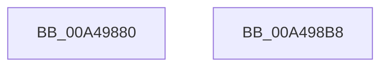

# IoBuildSynchronousFsdRequest

- RVA: `0x00A49880`–`0x00A498B9` (길이 `57` bytes)
- VA: `0x0000000140A49880`
- 실행 섹션: `PAGE`
- PDB 이름 있음: `예`; PDB Function 태그: `아니요`
- unwind 정보 RVA: `0x00082420`
- 디코드: `14`개 명령, `57/57` bytes 표시
- 미해석 바이트: `0` (있으면 어셈블리에 `.byte`로 보존)

> 이 문서는 커널 이미지의 기계어와 PDB 기호를 분석해 생성했습니다. 4번과 5번은 함수 원형과 자료형을 바이너리 사용 방식에서 추정한 C 해석이며 원본 소스 복구 결과는 아닙니다.

## 1. Dependencies

- 직접 호출 지점: **1**; 고유 호출 대상: **1**
- 직접 호출자로 확인된 함수: **6**
- RIP 상대 이미지 참조: **0**

### Outgoing calls
- `0x00A498AE` → [IopBuildSynchronousFsdRequest](IopBuildSynchronousFsdRequest_function_00A498C0.md) (function, `0x00A498C0`)

### Direct callers
- [HalpQueryPccInterface](../70/HalpQueryPccInterface_function_0070D79C.md) at `0x0070D834`
- [RawQueryFileSystemInformation](../78/RawQueryFileSystemInformation_function_0078A350.md) at `0x0078A4AA`
- [ExpQueryPrmInterface](../7C/ExpQueryPrmInterface_function_007CF018.md) at `0x007CF0A4`
- [IoShutdownSystem](../../pagelk/B6/IoShutdownSystem_function_00B63B8C.md) at `0x00B63C5A`
- [IoShutdownSystem](../../pagelk/B6/IoShutdownSystem_function_00B63B8C.md) at `0x00B63D85`
- [IopShutdownBaseFileSystems](../../pagelk/B6/IopShutdownBaseFileSystems_function_00B63E10.md) at `0x00B63EC5`
- [IopCreateArcNamesCd](../../init/C2/IopCreateArcNamesCd_function_00C2C060.md) at `0x00C2C3A4`

### Static image references
- 디코드된 RIP-relative 메모리 참조가 없습니다.

## 2. Other-region calls and transfers

- 다른 실행 섹션으로 향하는 call: **0**
- 별도 외부 분기/꼬리 이동을 확인하지 못했습니다.

## 3. Assembly (complete function range)

```asm
00A49880  4C 8B DC                        mov r11, rsp
00A49883  48 83 EC 48                     sub rsp, 0x48
00A49887  48 8B 44 24 48                  mov rax, qword ptr [rsp + 0x48]
00A4988C  49 89 43 F0                     mov qword ptr [r11 - 0x10], rax
00A49890  48 8B 84 24 80 00 00 00         mov rax, qword ptr [rsp + 0x80]
00A49898  49 89 43 E8                     mov qword ptr [r11 - 0x18], rax
00A4989C  48 8B 44 24 78                  mov rax, qword ptr [rsp + 0x78]
00A498A1  49 89 43 E0                     mov qword ptr [r11 - 0x20], rax
00A498A5  48 8B 44 24 70                  mov rax, qword ptr [rsp + 0x70]
00A498AA  49 89 43 D8                     mov qword ptr [r11 - 0x28], rax
00A498AE  E8 0D 00 00 00                  call 0x140a498c0
00A498B3  48 83 C4 48                     add rsp, 0x48
00A498B7  C3                              ret
00A498B8  CC                              int3
```

## 4. C-style interpretation (structured pseudocode)

```c
__int64 __fastcall IoBuildSynchronousFsdRequest(__int64 a1, __int64 a2, __int64 a3, __int64 a4, __int64 a5, __int64 a6, __int64 a7)
{
    __int64 result;
    __int64 v_rsp;
    unsigned __int64 v_stack_p0;

    v_rsp = (v_rsp) - (72);
    *(unsigned __int64 *)(v_rsp - 16) = v_stack_p0;
    *(unsigned __int64 *)(v_rsp - 24) = a7;
    *(unsigned __int64 *)(v_rsp - 32) = a6;
    *(unsigned __int64 *)(v_rsp - 40) = a5;
    result = IopBuildSynchronousFsdRequest(a1, a2, a3, a4);
    v_rsp = (v_rsp) + (72);
    return result;
}
```

## 5. (Beta) C Style

```c
int64_t IoBuildSynchronousFsdRequest(int64_t Arg1, int64_t Arg2, int64_t Arg3, int64_t Arg4, int64_t Arg5, int64_t Arg6, int64_t Arg7)
{
    int64_t result;
    int64_t local_rsp;
    uint64_t v_stack_p0;

    local_rsp = (local_rsp) - (72);
    *(uint64_t *)(local_rsp - 0x10) = v_stack_p0;
    *(uint64_t *)(local_rsp - 0x18) = Arg7;
    *(uint64_t *)(local_rsp - 0x20) = Arg6;
    *(uint64_t *)(local_rsp - 0x28) = Arg5;
    result = IopBuildSynchronousFsdRequest(Arg1, Arg2, Arg3, Arg4);
    local_rsp = (local_rsp) + (72);
    return result;
}
```

## 6. Execution-region graph

[열기: 2D/3D 그래프와 함수 탐색 컨트롤 패널](../../../control-panel.html?section=page&rva=0x00A49880&view=graph)

- 2D 그래프는 위에서 아래로 흐르고, 3D 그래프는 빈 공간을 드래그해 회전합니다. Shift+드래그는 이동, 휠은 확대·축소, 함수 노드 선택은 대상 보고서 이동입니다.

### Static fallback


