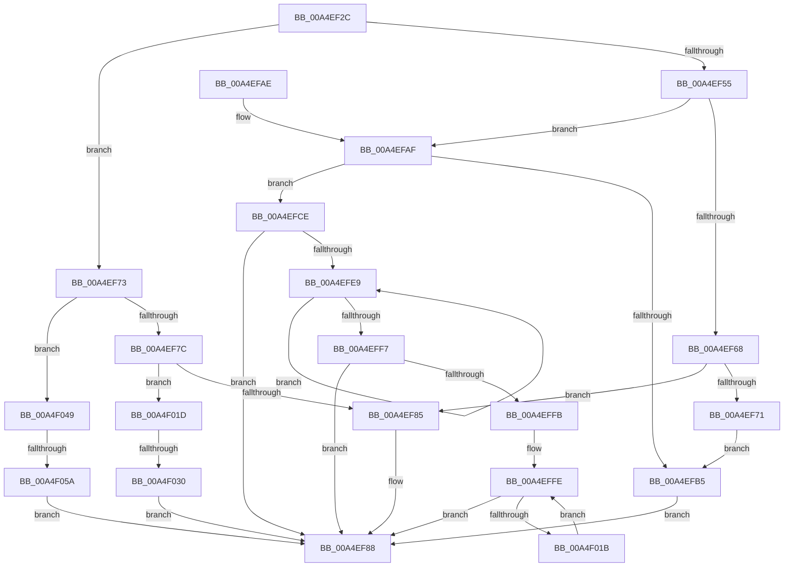

# IoWMICompleteRequest

- RVA: `0x00A4EF2C`–`0x00A4F070` (길이 `324` bytes)
- VA: `0x0000000140A4EF2C`
- 실행 섹션: `PAGE`
- PDB 이름 있음: `예`; PDB Function 태그: `예`
- unwind 정보 RVA: `0x000B072C`
- 디코드: `87`개 명령, `324/324` bytes 표시
- 미해석 바이트: `0` (있으면 어셈블리에 `.byte`로 보존)

> 이 문서는 커널 이미지의 기계어와 PDB 기호를 분석해 생성했습니다. 4번과 5번은 함수 원형과 자료형을 바이너리 사용 방식에서 추정한 C 해석이며 원본 소스 복구 결과는 아닙니다.

## 1. Dependencies

- 직접 호출 지점: **1**; 고유 호출 대상: **1**
- 직접 호출자로 확인된 함수: **2**
- RIP 상대 이미지 참조: **0**

### Outgoing calls
- `0x00A4EF97` → [IofCompleteRequest](../../text/29/IofCompleteRequest_function_0029B5C0.md) (function, `0x0029B5C0`)

### Direct callers
- [IoWMISystemControl](IoWMISystemControl_function_00A4EB04.md) at `0x00A4ED28`
- [WmipQueryWmiDataBlock](WmipQueryWmiDataBlock_function_00A4EDA0.md) at `0x00A4EE4F`

### Static image references
- 디코드된 RIP-relative 메모리 참조가 없습니다.

## 2. Other-region calls and transfers

- 다른 실행 섹션으로 향하는 call: **1**
  - `0x00A4EF97` → [IofCompleteRequest](../../text/29/IofCompleteRequest_function_0029B5C0.md) (`PAGE` → `.text`)
- call이 아닌 외부 분기/꼬리 이동: **2**
  - `0x00A4F02A` → [sub_00B3C494](../B3/Unknown_function_00B3C494.md) (`tail-transfer`)
  - `0x00A4F054` → [sub_00B3C494](../B3/Unknown_function_00B3C494.md) (`tail-transfer`)

## 3. Assembly (complete function range)

```asm
00A4EF2C  48 89 5C 24 08                  mov qword ptr [rsp + 8], rbx
00A4EF31  48 89 74 24 10                  mov qword ptr [rsp + 0x10], rsi
00A4EF36  57                              push rdi
00A4EF37  48 83 EC 20                     sub rsp, 0x20
00A4EF3B  4D 8B 90 B8 00 00 00            mov r10, qword ptr [r8 + 0xb8]
00A4EF42  41 8B D9                        mov ebx, r9d
00A4EF45  49 8B F0                        mov rsi, r8
00A4EF48  41 0F B6 4A 01                  movzx ecx, byte ptr [r10 + 1]
00A4EF4D  49 8B 52 20                     mov rdx, qword ptr [r10 + 0x20]
00A4EF51  85 C9                           test ecx, ecx
00A4EF53  75 1E                           jne 0x140a4ef73
00A4EF55  44 8B 44 24 50                  mov r8d, dword ptr [rsp + 0x50]
00A4EF5A  44 8B 5A 30                     mov r11d, dword ptr [rdx + 0x30]
00A4EF5E  45 03 C3                        add r8d, r11d
00A4EF61  8B 7A 34                        mov edi, dword ptr [rdx + 0x34]
00A4EF64  85 DB                           test ebx, ebx
00A4EF66  79 47                           jns 0x140a4efaf
00A4EF68  41 81 F9 23 00 00 C0            cmp r9d, 0xc0000023
00A4EF6F  75 14                           jne 0x140a4ef85
00A4EF71  EB 42                           jmp 0x140a4efb5
00A4EF73  83 E9 01                        sub ecx, 1
00A4EF76  0F 84 CD 00 00 00               je 0x140a4f049
00A4EF7C  83 F9 08                        cmp ecx, 8
00A4EF7F  0F 84 98 00 00 00               je 0x140a4f01d
00A4EF85  45 33 C0                        xor r8d, r8d
00A4EF88  41 8B C0                        mov eax, r8d
00A4EF8B  33 D2                           xor edx, edx
00A4EF8D  48 8B CE                        mov rcx, rsi
00A4EF90  48 89 46 38                     mov qword ptr [rsi + 0x38], rax
00A4EF94  89 5E 30                        mov dword ptr [rsi + 0x30], ebx
00A4EF97  E8 24 C6 84 FF                  call 0x14029b5c0
00A4EF9C  48 8B 74 24 38                  mov rsi, qword ptr [rsp + 0x38]
00A4EFA1  8B C3                           mov eax, ebx
00A4EFA3  48 8B 5C 24 30                  mov rbx, qword ptr [rsp + 0x30]
00A4EFA8  48 83 C4 20                     add rsp, 0x20
00A4EFAC  5F                              pop rdi
00A4EFAD  C3                              ret
00A4EFAE  CC                              int3
00A4EFAF  45 3B 42 18                     cmp r8d, dword ptr [r10 + 0x18]
00A4EFB3  76 19                           jbe 0x140a4efce
00A4EFB5  B8 38 00 00 00                  mov eax, 0x38
00A4EFBA  44 89 42 30                     mov dword ptr [rdx + 0x30], r8d
00A4EFBE  89 02                           mov dword ptr [rdx], eax
00A4EFC0  44 8B C0                        mov r8d, eax
00A4EFC3  C7 42 2C 20 00 00 00            mov dword ptr [rdx + 0x2c], 0x20
00A4EFCA  33 DB                           xor ebx, ebx
00A4EFCC  EB BA                           jmp 0x140a4ef88
00A4EFCE  48 A1 14 00 00 00 80 F7 FF FF   movabs rax, qword ptr [0xfffff78000000014]
00A4EFD8  4C 8D 52 3C                     lea r10, [rdx + 0x3c]
00A4EFDC  48 89 42 10                     mov qword ptr [rdx + 0x10], rax
00A4EFE0  44 89 02                        mov dword ptr [rdx], r8d
00A4EFE3  8B D7                           mov edx, edi
00A4EFE5  85 FF                           test edi, edi
00A4EFE7  74 9F                           je 0x140a4ef88
00A4EFE9  83 EA 01                        sub edx, 1
00A4EFEC  41 8B 04 92                     mov eax, dword ptr [r10 + rdx*4]
00A4EFF0  41 89 44 D2 04                  mov dword ptr [r10 + rdx*8 + 4], eax
00A4EFF5  75 F2                           jne 0x140a4efe9
00A4EFF7  85 FF                           test edi, edi
00A4EFF9  74 8D                           je 0x140a4ef88
00A4EFFB  48 8B CF                        mov rcx, rdi
00A4EFFE  45 89 1A                        mov dword ptr [r10], r11d
00A4F001  41 83 C3 07                     add r11d, 7
00A4F005  45 03 5A 04                     add r11d, dword ptr [r10 + 4]
00A4F009  4D 8D 52 08                     lea r10, [r10 + 8]
00A4F00D  41 83 E3 F8                     and r11d, 0xfffffff8
00A4F011  48 83 E9 01                     sub rcx, 1
00A4F015  0F 84 6D FF FF FF               je 0x140a4ef88
00A4F01B  EB E1                           jmp 0x140a4effe
00A4F01D  44 8B 42 3C                     mov r8d, dword ptr [rdx + 0x3c]
00A4F021  8B 4C 24 50                     mov ecx, dword ptr [rsp + 0x50]
00A4F025  44 03 C1                        add r8d, ecx
00A4F028  85 DB                           test ebx, ebx
00A4F02A  0F 88 64 D4 0E 00               js 0x140b3c494
00A4F030  44 89 02                        mov dword ptr [rdx], r8d
00A4F033  48 A1 14 00 00 00 80 F7 FF FF   movabs rax, qword ptr [0xfffff78000000014]
00A4F03D  48 89 42 10                     mov qword ptr [rdx + 0x10], rax
00A4F041  89 4A 40                        mov dword ptr [rdx + 0x40], ecx
00A4F044  E9 3F FF FF FF                  jmp 0x140a4ef88
00A4F049  44 8B 44 24 50                  mov r8d, dword ptr [rsp + 0x50]
00A4F04E  44 03 42 38                     add r8d, dword ptr [rdx + 0x38]
00A4F052  85 DB                           test ebx, ebx
00A4F054  0F 88 3A D4 0E 00               js 0x140b3c494
00A4F05A  44 89 02                        mov dword ptr [rdx], r8d
00A4F05D  48 A1 14 00 00 00 80 F7 FF FF   movabs rax, qword ptr [0xfffff78000000014]
00A4F067  48 89 42 10                     mov qword ptr [rdx + 0x10], rax
00A4F06B  E9 18 FF FF FF                  jmp 0x140a4ef88
```

## 4. C-style interpretation (structured pseudocode)

```c
__int64 __fastcall IoWMICompleteRequest(__int64 a1, __int64 a2, __int64 a3, int a4, unsigned int a5)
{
    __int64 result;
    __int64 v_r11;
    __int64 v_rbx;
    __int64 v_rsp;
    unsigned __int64 v_stack_p10;
    unsigned __int64 v_stack_p8;

    v_stack_p8 = v_rbx;
    v_stack_p10 = v_rsi;
    v_rsp = (v_rsp) - (32);
    if ((unsigned int)(*(unsigned __int8 *)(*(unsigned __int64 *)(a3 + 184) + 1)) != 0) goto loc_00A4EF73;
    a3 = (unsigned int)(((unsigned int)(a5)) + ((unsigned int)((unsigned int)(*(unsigned int *)(*(unsigned __int64 *)(*(unsigned __int64 *)(a3 + 184) + 32) + 48)))));
    if (!sign_flag) goto loc_00A4EFAF;
    if (a4 != 0xC0000023ULL) goto loc_00A4EF85;
    goto loc_00A4EFB5;
loc_00A4EF73:
    a1 = (unsigned int)((*(unsigned __int8 *)(*(unsigned __int64 *)(a3 + 184) + 1)) - (1));
    if (condition_is_equal) goto loc_00A4F049;
    if (((unsigned int)(a1)) == 8) goto loc_00A4F01D;
loc_00A4EF85:
    a3 = 0;
loc_00A4EF88:
    a2 = 0;
    *(unsigned __int64 *)(a3 + 56) = 0;
    *(unsigned int *)(a3 + 48) = (unsigned int)((unsigned int)(a4));
    result = IofCompleteRequest(0, a2, a3, a4);
    v_rsp = (v_rsp) + (32);
    return (unsigned int)((unsigned int)((unsigned int)(a4)));
loc_00A4EFAF:
    if (0 <= (*(unsigned int *)(*(unsigned __int64 *)(a3 + 184) + 24))) goto loc_00A4EFCE;
loc_00A4EFB5:
    *(unsigned int *)(a2 + 48) = 0;
    *(unsigned int *)(a2) = 56;
    *(unsigned int *)(a2 + 44) = 32;
    v_rbx = 0;
    goto loc_00A4EF88;
loc_00A4EFCE:
    *(unsigned __int64 *)(a2 + 16) = 56;
    *(unsigned int *)(a2) = 56;
    if ((unsigned int)((unsigned int)(*(unsigned int *)(*(unsigned __int64 *)(*(unsigned __int64 *)(a3 + 184) + 32) + 52))) == 0) goto loc_00A4EF88;
loc_00A4EFE9:
    a2 = (unsigned int)(((unsigned int)((unsigned int)((unsigned int)(*(unsigned int *)(*(unsigned __int64 *)(*(unsigned __int64 *)(a3 + 184) + 32) + 52))))) - (1));
    *(unsigned int *)(a2 + 60 + a2 * 8 + 4) = (unsigned int)((unsigned int)(*(unsigned int *)(a2 + 60 + a2 * 4)));
    if (condition_is_not_equal) goto loc_00A4EFE9;
    if ((unsigned int)((unsigned int)(*(unsigned int *)(*(unsigned __int64 *)(*(unsigned __int64 *)(a3 + 184) + 32) + 52))) == 0) goto loc_00A4EF88;
loc_00A4EFFE:
    *(unsigned int *)(a2 + 60) = (unsigned int)((unsigned int)(*(unsigned int *)(*(unsigned __int64 *)(*(unsigned __int64 *)(a3 + 184) + 32) + 48)));
    v_r11 = (unsigned int)(((unsigned int)(*(unsigned int *)(*(unsigned __int64 *)(*(unsigned __int64 *)(a3 + 184) + 32) + 48))) + (7));
    v_r11 = (unsigned int)((v_r11) + (*(unsigned int *)(a2 + 60 + 4)));
    v_r11 = (unsigned int)((v_r11) & (0xFFFFFFF8ULL));
    a1 = ((unsigned int)(*(unsigned int *)(*(unsigned __int64 *)(*(unsigned __int64 *)(a3 + 184) + 32) + 52))) - (1);
    if (condition_is_equal) goto loc_00A4EF88;
    goto loc_00A4EFFE;
loc_00A4F01D:
    a3 = (unsigned int)(((unsigned int)(*(unsigned int *)(a2 + 60))) + ((unsigned int)((unsigned int)(a5))));
    *(unsigned int *)(a2) = (unsigned int)(a3);
    *(unsigned __int64 *)(a2 + 16) = (unsigned int)(*(unsigned int *)(a2 + 60 + a2 * 4));
    *(unsigned int *)(a2 + 64) = (unsigned int)((unsigned int)(a5));
    goto loc_00A4EF88;
loc_00A4F049:
    a3 = (unsigned int)(((unsigned int)(a5)) + (*(unsigned int *)(a2 + 56)));
    *(unsigned int *)(a2) = (unsigned int)(a3);
    *(unsigned __int64 *)(a2 + 16) = (unsigned int)(*(unsigned int *)(a2 + 60 + a2 * 4));
    goto loc_00A4EF88;
}
```

## 5. (Beta) C Style

```c
int64_t IoWMICompleteRequest(int64_t Arg1, int64_t Arg2, void *Arg3, int32_t Arg4, uint32_t Arg5)
{
    uint8_t *arg3 = (uint8_t *)Arg3;

    int64_t result;
    int64_t local_r11;
    int64_t local_rbx;
    int64_t local_rsp;
    uint64_t v_stack_p10;
    uint64_t v_stack_p8;

    v_stack_p8 = local_rbx;
    v_stack_p10 = local_rsi;
    local_rsp = (local_rsp) - (32);
    if ((uint32_t)(*(uint8_t *)(*(uint64_t *)(arg3 + 0xB8) + 0x1)) != 0) goto loc_00A4EF73;
    Arg3 = (uint32_t)(((uint32_t)(Arg5)) + ((uint32_t)((uint32_t)(*(uint32_t *)(*(uint64_t *)(*(uint64_t *)(arg3 + 0xB8) + 0x20) + 0x30)))));
    if (!sign_flag) goto loc_00A4EFAF;
    if (Arg4 != 0xC0000023ULL) goto loc_00A4EF85;
    goto loc_00A4EFB5;
loc_00A4EF73:
    Arg1 = (uint32_t)((*(uint8_t *)(*(uint64_t *)(arg3 + 0xB8) + 0x1)) - (1));
    if (condition_is_equal) goto loc_00A4F049;
    if (((uint32_t)(Arg1)) == 8) goto loc_00A4F01D;
loc_00A4EF85:
    Arg3 = 0;
loc_00A4EF88:
    Arg2 = 0;
    *(uint64_t *)(arg3 + 0x38) = 0;
    *(uint32_t *)(arg3 + 0x30) = (uint32_t)((uint32_t)(Arg4));
    result = IofCompleteRequest(0, Arg2, Arg3, Arg4);
    local_rsp = (local_rsp) + (32);
    return (uint32_t)((uint32_t)((uint32_t)(Arg4)));
loc_00A4EFAF:
    if (0 <= (*(uint32_t *)(*(uint64_t *)(arg3 + 0xB8) + 0x18))) goto loc_00A4EFCE;
loc_00A4EFB5:
    *(uint32_t *)(Arg2 + 0x30) = 0;
    *(uint32_t *)(Arg2) = 56;
    *(uint32_t *)(Arg2 + 0x2C) = 32;
    local_rbx = 0;
    goto loc_00A4EF88;
loc_00A4EFCE:
    *(uint64_t *)(Arg2 + 0x10) = 56;
    *(uint32_t *)(Arg2) = 56;
    if ((uint32_t)((uint32_t)(*(uint32_t *)(*(uint64_t *)(*(uint64_t *)(arg3 + 0xB8) + 0x20) + 0x34))) == 0) goto loc_00A4EF88;
loc_00A4EFE9:
    Arg2 = (uint32_t)(((uint32_t)((uint32_t)((uint32_t)(*(uint32_t *)(*(uint64_t *)(*(uint64_t *)(arg3 + 0xB8) + 0x20) + 0x34))))) - (1));
    *(uint32_t *)(Arg2 + 0x3C + Arg2 * 8 + 0x4) = (uint32_t)((uint32_t)(*(uint32_t *)(Arg2 + 0x3C + Arg2 * 4)));
    if (condition_is_not_equal) goto loc_00A4EFE9;
    if ((uint32_t)((uint32_t)(*(uint32_t *)(*(uint64_t *)(*(uint64_t *)(arg3 + 0xB8) + 0x20) + 0x34))) == 0) goto loc_00A4EF88;
loc_00A4EFFE:
    *(uint32_t *)(Arg2 + 0x3C) = (uint32_t)((uint32_t)(*(uint32_t *)(*(uint64_t *)(*(uint64_t *)(arg3 + 0xB8) + 0x20) + 0x30)));
    local_r11 = (uint32_t)(((uint32_t)(*(uint32_t *)(*(uint64_t *)(*(uint64_t *)(arg3 + 0xB8) + 0x20) + 0x30))) + (7));
    local_r11 = (uint32_t)((local_r11) + (*(uint32_t *)(Arg2 + 0x3C + 0x4)));
    local_r11 = (uint32_t)((local_r11) & (0xFFFFFFF8ULL));
    Arg1 = ((uint32_t)(*(uint32_t *)(*(uint64_t *)(*(uint64_t *)(arg3 + 0xB8) + 0x20) + 0x34))) - (1);
    if (condition_is_equal) goto loc_00A4EF88;
    goto loc_00A4EFFE;
loc_00A4F01D:
    Arg3 = (uint32_t)(((uint32_t)(*(uint32_t *)(Arg2 + 0x3C))) + ((uint32_t)((uint32_t)(Arg5))));
    *(uint32_t *)(Arg2) = (uint32_t)(Arg3);
    *(uint64_t *)(Arg2 + 0x10) = (uint32_t)(*(uint32_t *)(Arg2 + 0x3C + Arg2 * 4));
    *(uint32_t *)(Arg2 + 0x40) = (uint32_t)((uint32_t)(Arg5));
    goto loc_00A4EF88;
loc_00A4F049:
    Arg3 = (uint32_t)(((uint32_t)(Arg5)) + (*(uint32_t *)(Arg2 + 0x38)));
    *(uint32_t *)(Arg2) = (uint32_t)(Arg3);
    *(uint64_t *)(Arg2 + 0x10) = (uint32_t)(*(uint32_t *)(Arg2 + 0x3C + Arg2 * 4));
    goto loc_00A4EF88;
}
```

### 관측된 메모리 오프셋

구조체 형식이 확인되지 않은 접근은 인자 기준의 오프셋으로만 기록했습니다.

| 기준 인자 | 오프셋 표현 | 폭 (bit) | 접근 |
|---|---:|---:|---|
| `Arg3` | `+ 0x30` | `32` | `W` |
| `Arg3` | `+ 0x38` | `64` | `W` |
| `Arg3` | `+ 0xB8` | `64` | `R` |

## 6. Execution-region graph

[열기: 2D/3D 그래프와 함수 탐색 컨트롤 패널](../../../control-panel.html?section=page&rva=0x00A4EF2C&view=graph)

- 2D 그래프는 위에서 아래로 흐르고, 3D 그래프는 빈 공간을 드래그해 회전합니다. Shift+드래그는 이동, 휠은 확대·축소, 함수 노드 선택은 대상 보고서 이동입니다.

### Static fallback


