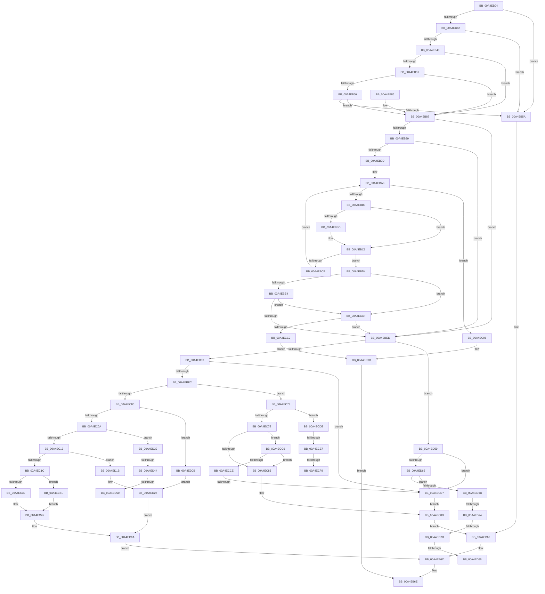

# IoWMISystemControl

- RVA: `0x00A4EB04`–`0x00A4ED8B` (길이 `647` bytes)
- VA: `0x0000000140A4EB04`
- 실행 섹션: `PAGE`
- PDB 이름 있음: `예`; PDB Function 태그: `예`
- unwind 정보 RVA: `0x000B06C8`
- 디코드: `180`개 명령, `647/647` bytes 표시
- 미해석 바이트: `0` (있으면 어셈블리에 `.byte`로 보존)

> 이 문서는 커널 이미지의 기계어와 PDB 기호를 분석해 생성했습니다. 4번과 5번은 함수 원형과 자료형을 바이너리 사용 방식에서 추정한 C 해석이며 원본 소스 복구 결과는 아닙니다.

## 1. Dependencies

- 직접 호출 지점: **7**; 고유 호출 대상: **5**
- 직접 호출자로 확인된 함수: **1**
- RIP 상대 이미지 참조: **1**

### Outgoing calls
- `0x00A4EB67` → [IofCompleteRequest](../../text/29/IofCompleteRequest_function_0029B5C0.md) (function, `0x0029B5C0`)
- `0x00A4EC65` → [WmipQueryWmiDataBlock](WmipQueryWmiDataBlock_function_00A4EDA0.md) (function, `0x00A4EDA0`)
- `0x00A4ECA3` → [IofCompleteRequest](../../text/29/IofCompleteRequest_function_0029B5C0.md) (function, `0x0029B5C0`)
- `0x00A4ECEB` → [WmipFindRegEntryByProviderId](../../text/38/WmipFindRegEntryByProviderId_function_00386908.md) (function, `0x00386908`)
- `0x00A4ED00` → [WmipUnreferenceRegEntry](../../text/47/WmipUnreferenceRegEntry_function_0047B6F0.md) (function, `0x0047B6F0`)
- `0x00A4ED28` → [IoWMICompleteRequest](IoWMICompleteRequest_function_00A4EF2C.md) (function, `0x00A4EF2C`)
- `0x00A4ED36` → [WmipFindRegEntryByProviderId](../../text/38/WmipFindRegEntryByProviderId_function_00386908.md) (function, `0x00386908`)

### Direct callers
- [WmipSystemControl](WmipSystemControl_function_00A4EAE0.md) at `0x00A4EAF1`

### Static image references
- `0x00A4EB48` → RVA `0x00B4CD28` (`PAGE`; read)

## 2. Other-region calls and transfers

- 다른 실행 섹션으로 향하는 call: **5**
  - `0x00A4EB67` → [IofCompleteRequest](../../text/29/IofCompleteRequest_function_0029B5C0.md) (`PAGE` → `.text`)
  - `0x00A4ECA3` → [IofCompleteRequest](../../text/29/IofCompleteRequest_function_0029B5C0.md) (`PAGE` → `.text`)
  - `0x00A4ECEB` → [WmipFindRegEntryByProviderId](../../text/38/WmipFindRegEntryByProviderId_function_00386908.md) (`PAGE` → `.text`)
  - `0x00A4ED00` → [WmipUnreferenceRegEntry](../../text/47/WmipUnreferenceRegEntry_function_0047B6F0.md) (`PAGE` → `.text`)
  - `0x00A4ED36` → [WmipFindRegEntryByProviderId](../../text/38/WmipFindRegEntryByProviderId_function_00386908.md) (`PAGE` → `.text`)
- call이 아닌 외부 분기/꼬리 이동: **11**
  - `0x00A4ECD1` → [sub_00B3C02C + 0x52](../B3/Unknown_function_00B3C02C.md) (`tail-transfer`)
  - `0x00A4ECE1` → [sub_00B3C02C](../B3/Unknown_function_00B3C02C.md) (`tail-transfer`)
  - `0x00A4ECF3` → [sub_00B3C02C + 0x2F](../B3/Unknown_function_00B3C02C.md) (`tail-transfer`)
  - `0x00A4ED06` → [sub_00B3C02C](../B3/Unknown_function_00B3C02C.md) (`tail-transfer`)
  - `0x00A4ED3E` → [sub_00B3C02C + 0x2F](../B3/Unknown_function_00B3C02C.md) (`tail-transfer`)
  - `0x00A4ED4A` → [sub_00B3C02C + 0x3E](../B3/Unknown_function_00B3C02C.md) (`tail-transfer`)
  - `0x00A4ED54` → [sub_00B3C02C + 0x44](../B3/Unknown_function_00B3C02C.md) (`tail-transfer`)
  - `0x00A4ED6E` → [sub_00B3C02C + 0x69](../B3/Unknown_function_00B3C02C.md) (`tail-transfer`)
  - `0x00A4ED77` → [sub_00B3C02C + 0x5C](../B3/Unknown_function_00B3C02C.md) (`tail-transfer`)
  - `0x00A4ED80` → [sub_00B3C02C + 0x52](../B3/Unknown_function_00B3C02C.md) (`tail-transfer`)
  - `0x00A4ED86` → [sub_00B3C02C + 0x69](../B3/Unknown_function_00B3C02C.md) (`tail-transfer`)

## 3. Assembly (complete function range)

```asm
00A4EB04  48 89 5C 24 10                  mov qword ptr [rsp + 0x10], rbx
00A4EB09  48 89 4C 24 08                  mov qword ptr [rsp + 8], rcx
00A4EB0E  55                              push rbp
00A4EB0F  56                              push rsi
00A4EB10  57                              push rdi
00A4EB11  41 54                           push r12
00A4EB13  41 55                           push r13
00A4EB15  41 56                           push r14
00A4EB17  41 57                           push r15
00A4EB19  48 8B EC                        mov rbp, rsp
00A4EB1C  48 83 EC 60                     sub rsp, 0x60
00A4EB20  33 DB                           xor ebx, ebx
00A4EB22  49 8B F8                        mov rdi, r8
00A4EB25  4D 8B 80 B8 00 00 00            mov r8, qword ptr [r8 + 0xb8]
00A4EB2C  4C 8B EA                        mov r13, rdx
00A4EB2F  B2 0B                           mov dl, 0xb
00A4EB31  89 5D 40                        mov dword ptr [rbp + 0x40], ebx
00A4EB34  8B F3                           mov esi, ebx
00A4EB36  44 8B FB                        mov r15d, ebx
00A4EB39  41 0F B6 48 01                  movzx ecx, byte ptr [r8 + 1]
00A4EB3E  3A CA                           cmp cl, dl
00A4EB40  77 18                           ja 0x140a4eb5a
00A4EB42  4D 39 68 08                     cmp qword ptr [r8 + 8], r13
00A4EB46  75 12                           jne 0x140a4eb5a
00A4EB48  48 39 1D D9 E1 0F 00            cmp qword ptr [rip + 0xfe1d9], rbx
00A4EB4F  75 36                           jne 0x140a4eb87
00A4EB51  80 F9 08                        cmp cl, 8
00A4EB54  74 31                           je 0x140a4eb87
00A4EB56  3A CA                           cmp cl, dl
00A4EB58  74 2D                           je 0x140a4eb87
00A4EB5A  BE 10 00 00 C0                  mov esi, 0xc0000010
00A4EB5F  89 77 30                        mov dword ptr [rdi + 0x30], esi
00A4EB62  33 D2                           xor edx, edx
00A4EB64  48 8B CF                        mov rcx, rdi
00A4EB67  E8 54 CA 84 FF                  call 0x14029b5c0
00A4EB6C  8B C6                           mov eax, esi
00A4EB6E  48 8B 9C 24 A8 00 00 00         mov rbx, qword ptr [rsp + 0xa8]
00A4EB76  48 83 C4 60                     add rsp, 0x60
00A4EB7A  41 5F                           pop r15
00A4EB7C  41 5E                           pop r14
00A4EB7E  41 5D                           pop r13
00A4EB80  41 5C                           pop r12
00A4EB82  5F                              pop rdi
00A4EB83  5E                              pop rsi
00A4EB84  5D                              pop rbp
00A4EB85  C3                              ret
00A4EB86  CC                              int3
00A4EB87  4D 8B 70 20                     mov r14, qword ptr [r8 + 0x20]
00A4EB8B  B8 07 00 00 00                  mov eax, 7
00A4EB90  45 8B 60 18                     mov r12d, dword ptr [r8 + 0x18]
00A4EB94  80 F9 08                        cmp cl, 8
00A4EB97  74 54                           je 0x140a4ebed
00A4EB99  3A CA                           cmp cl, dl
00A4EB9B  74 50                           je 0x140a4ebed
00A4EB9D  4D 8B 48 10                     mov r9, qword ptr [r8 + 0x10]
00A4EBA1  4C 8B 3D 80 E1 0F 00            mov r15, qword ptr [rip + 0xfe180]
00A4EBA8  3B F0                           cmp esi, eax
00A4EBAA  0F 83 E6 00 00 00               jae 0x140a4ec96
00A4EBB0  49 8B 11                        mov rdx, qword ptr [r9]
00A4EBB3  4C 8D 04 76                     lea r8, [rsi + rsi*2]
00A4EBB7  4B 2B 14 C7                     sub rdx, qword ptr [r15 + r8*8]
00A4EBBB  75 09                           jne 0x140a4ebc6
00A4EBBD  49 8B 51 08                     mov rdx, qword ptr [r9 + 8]
00A4EBC1  4B 2B 54 C7 08                  sub rdx, qword ptr [r15 + r8*8 + 8]
00A4EBC6  48 85 D2                        test rdx, rdx
00A4EBC9  74 09                           je 0x140a4ebd4
00A4EBCB  FF C6                           inc esi
00A4EBCD  B8 07 00 00 00                  mov eax, 7
00A4EBD2  EB D4                           jmp 0x140a4eba8
00A4EBD4  47 8B 7C C7 10                  mov r15d, dword ptr [r15 + r8*8 + 0x10]
00A4EBD9  8D 41 FF                        lea eax, [rcx - 1]
00A4EBDC  3C 02                           cmp al, 2
00A4EBDE  0F 86 CB 00 00 00               jbe 0x140a4ecaf
00A4EBE4  80 F9 09                        cmp cl, 9
00A4EBE7  0F 84 C2 00 00 00               je 0x140a4ecaf
00A4EBED  83 F9 05                        cmp ecx, 5
00A4EBF0  0F 87 63 01 00 00               ja 0x140a4ed59
00A4EBF6  0F 84 DB 00 00 00               je 0x140a4ecd7
00A4EBFC  85 C9                           test ecx, ecx
00A4EBFE  75 79                           jne 0x140a4ec79
00A4EC00  41 83 FC 3C                     cmp r12d, 0x3c
00A4EC04  0F 82 01 01 00 00               jb 0x140a4ed0b
00A4EC0A  83 FE 01                        cmp esi, 1
00A4EC0D  0F 86 1F 01 00 00               jbe 0x140a4ed32
00A4EC13  45 85 FF                        test r15d, r15d
00A4EC16  0F 84 FF 00 00 00               je 0x140a4ed1b
00A4EC1C  41 83 66 2C EF                  and dword ptr [r14 + 0x2c], 0xffffffef
00A4EC21  42 8D 04 FD 43 00 00 00         lea eax, [r15*8 + 0x43]
00A4EC29  83 E0 F8                        and eax, 0xfffffff8
00A4EC2C  45 89 7E 34                     mov dword ptr [r14 + 0x34], r15d
00A4EC30  41 89 46 30                     mov dword ptr [r14 + 0x30], eax
00A4EC34  41 3B C4                        cmp eax, r12d
00A4EC37  77 38                           ja 0x140a4ec71
00A4EC39  8B C8                           mov ecx, eax
00A4EC3B  49 8D 5E 3C                     lea rbx, [r14 + 0x3c]
00A4EC3F  49 03 CE                        add rcx, r14
00A4EC42  44 2B E0                        sub r12d, eax
00A4EC45  48 89 4C 24 38                  mov qword ptr [rsp + 0x38], rcx
00A4EC4A  45 33 C9                        xor r9d, r9d
00A4EC4D  44 89 64 24 30                  mov dword ptr [rsp + 0x30], r12d
00A4EC52  48 89 5C 24 28                  mov qword ptr [rsp + 0x28], rbx
00A4EC57  44 89 7C 24 20                  mov dword ptr [rsp + 0x20], r15d
00A4EC5C  44 8B C6                        mov r8d, esi
00A4EC5F  48 8B D7                        mov rdx, rdi
00A4EC62  49 8B CD                        mov rcx, r13
00A4EC65  E8 36 01 00 00                  call 0x140a4eda0
00A4EC6A  8B F0                           mov esi, eax
00A4EC6C  E9 FB FE FF FF                  jmp 0x140a4eb6c
00A4EC71  48 8B CB                        mov rcx, rbx
00A4EC74  44 8B E3                        mov r12d, ebx
00A4EC77  EB CC                           jmp 0x140a4ec45
00A4EC79  83 E9 01                        sub ecx, 1
00A4EC7C  74 60                           je 0x140a4ecde
00A4EC7E  83 E9 01                        sub ecx, 1
00A4EC81  75 46                           jne 0x140a4ecc9
00A4EC83  B8 C6 02 00 C0                  mov eax, 0xc00002c6
00A4EC88  8B F0                           mov esi, eax
00A4EC8A  89 47 30                        mov dword ptr [rdi + 0x30], eax
00A4EC8D  48 89 5F 38                     mov qword ptr [rdi + 0x38], rbx
00A4EC91  E9 CC FE FF FF                  jmp 0x140a4eb62
00A4EC96  BB 95 02 00 C0                  mov ebx, 0xc0000295
00A4EC9B  33 D2                           xor edx, edx
00A4EC9D  89 5F 30                        mov dword ptr [rdi + 0x30], ebx
00A4ECA0  48 8B CF                        mov rcx, rdi
00A4ECA3  E8 18 C9 84 FF                  call 0x14029b5c0
00A4ECA8  8B C3                           mov eax, ebx
00A4ECAA  E9 BF FE FF FF                  jmp 0x140a4eb6e
00A4ECAF  41 8B 46 34                     mov eax, dword ptr [r14 + 0x34]
00A4ECB3  89 45 40                        mov dword ptr [rbp + 0x40], eax
00A4ECB6  41 8B 46 2C                     mov eax, dword ptr [r14 + 0x2c]
00A4ECBA  84 C0                           test al, al
00A4ECBC  0F 88 2B FF FF FF               js 0x140a4ebed
00A4ECC2  BB 96 02 00 C0                  mov ebx, 0xc0000296
00A4ECC7  EB D2                           jmp 0x140a4ec9b
00A4ECC9  83 E9 01                        sub ecx, 1
00A4ECCC  74 B5                           je 0x140a4ec83
00A4ECCE  83 F9 01                        cmp ecx, 1
00A4ECD1  0F 85 A7 D3 0E 00               jne 0x140b3c07e
00A4ECD7  8B F3                           mov esi, ebx
00A4ECD9  89 5F 30                        mov dword ptr [rdi + 0x30], ebx
00A4ECDC  EB AF                           jmp 0x140a4ec8d
00A4ECDE  83 FE 01                        cmp esi, 1
00A4ECE1  0F 87 45 D3 0E 00               ja 0x140b3c02c
00A4ECE7  41 8B 4E 04                     mov ecx, dword ptr [r14 + 4]
00A4ECEB  E8 18 7C 93 FF                  call 0x140386908
00A4ECF0  48 85 C0                        test rax, rax
00A4ECF3  0F 84 62 D3 0E 00               je 0x140b3c05b
00A4ECF9  4C 8B 68 10                     mov r13, qword ptr [rax + 0x10]
00A4ECFD  48 8B C8                        mov rcx, rax
00A4ED00  E8 EB C9 A2 FF                  call 0x14047b6f0
00A4ED05  90                              nop
00A4ED06  E9 21 D3 0E 00                  jmp 0x140b3c02c
00A4ED0B  C7 44 24 20 3C 00 00 00         mov dword ptr [rsp + 0x20], 0x3c
00A4ED13  41 B9 23 00 00 C0               mov r9d, 0xc0000023
00A4ED19  EB 0A                           jmp 0x140a4ed25
00A4ED1B  89 5C 24 20                     mov dword ptr [rsp + 0x20], ebx
00A4ED1F  41 B9 96 02 00 C0               mov r9d, 0xc0000296
00A4ED25  4C 8B C7                        mov r8, rdi
00A4ED28  E8 FF 01 00 00                  call 0x140a4ef2c
00A4ED2D  E9 38 FF FF FF                  jmp 0x140a4ec6a
00A4ED32  41 8B 4E 04                     mov ecx, dword ptr [r14 + 4]
00A4ED36  E8 CD 7B 93 FF                  call 0x140386908
00A4ED3B  48 85 C0                        test rax, rax
00A4ED3E  0F 84 17 D3 0E 00               je 0x140b3c05b
00A4ED44  4C 8B 68 10                     mov r13, qword ptr [rax + 0x10]
00A4ED48  85 F6                           test esi, esi
00A4ED4A  0F 85 1A D3 0E 00               jne 0x140b3c06a
00A4ED50  44 8B 78 34                     mov r15d, dword ptr [rax + 0x34]
00A4ED54  E9 17 D3 0E 00                  jmp 0x140b3c070
00A4ED59  83 E9 06                        sub ecx, 6
00A4ED5C  0F 84 75 FF FF FF               je 0x140a4ecd7
00A4ED62  83 E9 01                        sub ecx, 1
00A4ED65  0F 84 6C FF FF FF               je 0x140a4ecd7
00A4ED6B  83 E9 01                        sub ecx, 1
00A4ED6E  0F 84 21 D3 0E 00               je 0x140b3c095
00A4ED74  83 E9 01                        sub ecx, 1
00A4ED77  0F 84 0B D3 0E 00               je 0x140b3c088
00A4ED7D  83 F9 02                        cmp ecx, 2
00A4ED80  0F 85 F8 D2 0E 00               jne 0x140b3c07e
00A4ED86  E9 0A D3 0E 00                  jmp 0x140b3c095
```

## 4. C-style interpretation (structured pseudocode)

```c
__int64 __fastcall IoWMISystemControl(__int64 a1, __int64 a2, __int64 a3)
{
    __int64 result;
    __int64 v_r12;
    __int64 v_rbx;
    __int64 v_rsi;
    __int64 v_rsp;
    unsigned __int64 v_stack_p10;
    unsigned int v_stack_p20;
    unsigned __int64 v_stack_p28;
    unsigned int v_stack_p30;
    unsigned __int64 v_stack_p38;
    unsigned __int64 v_stack_p8;

    v_stack_p10 = v_rbx;
    v_stack_p8 = a1;
    v_rsp = (v_rsp) - (96);
    v_rbx = 0;
    v_stack_p8 = 0;
    if (((unsigned __int8)(*(unsigned __int8 *)(*(unsigned __int64 *)(a3 + 184) + 1))) > 11) goto loc_00A4EB5A;
    if ((*(unsigned __int64 *)(*(unsigned __int64 *)(a3 + 184) + 8)) != a2) goto loc_00A4EB5A;
    if ((*(unsigned __int64 *)(v_rip + 1040857)) != 0) goto loc_00A4EB87;
    if (((unsigned __int8)(*(unsigned __int8 *)(*(unsigned __int64 *)(a3 + 184) + 1))) == 8) goto loc_00A4EB87;
    if (((unsigned __int8)(*(unsigned __int8 *)(*(unsigned __int64 *)(a3 + 184) + 1))) == 11) goto loc_00A4EB87;
loc_00A4EB5A:
    *(unsigned int *)(a3 + 48) = (unsigned int)((unsigned int)(0xC0000010ULL));
loc_00A4EB62:
    a2 = 0;
    result = IofCompleteRequest(a3, a2, *(unsigned __int64 *)(a3 + 184), a4);
loc_00A4EB6C:
loc_00A4EB6E:
    v_rsp = (v_rsp) + (96);
    return (unsigned int)((unsigned int)((unsigned int)(0xC0000010ULL)));
loc_00A4EB87:
    if (((unsigned __int8)(a3)) == 8) goto loc_00A4EBED;
    if (((unsigned __int8)(a3)) == 0) goto loc_00A4EBED;
loc_00A4EBA8:
    if (((unsigned int)((unsigned int)(0xC0000010ULL))) >= 7) goto loc_00A4EC96;
    a2 = (*(unsigned __int64 *)(*(unsigned __int64 *)(*(unsigned __int64 *)(a3 + 184) + 16))) - (*(unsigned __int64 *)(*(unsigned __int64 *)(v_rip + 1040768) + (unsigned int)(0xC0000010ULL) + (unsigned int)(0xC0000010ULL) * 2 * 8));
    if (!(condition_is_not_equal)) {
        a2 = *(unsigned __int64 *)(*(unsigned __int64 *)(*(unsigned __int64 *)(a3 + 184) + 16) + 8);
        a2 = (a2) - (*(unsigned __int64 *)(*(unsigned __int64 *)(v_rip + 1040768) + (unsigned int)(0xC0000010ULL) + (unsigned int)(0xC0000010ULL) * 2 * 8 + 8));
    }
    if (a2 == 0) goto loc_00A4EBD4;
    v_rsi = (unsigned int)(((unsigned int)(0xC0000010ULL)) + 1);
    goto loc_00A4EBA8;
loc_00A4EBD4:
    if (((unsigned __int8)(a3 - 1)) <= 2) goto loc_00A4ECAF;
    if (((unsigned __int8)(a3)) == 9) goto loc_00A4ECAF;
loc_00A4EBED:
    if (((unsigned int)(a3)) > 5) goto loc_00A4ED59;
    if (((unsigned int)(a3)) == 5) goto loc_00A4ECD7;
    if ((unsigned int)(a3) != 0) goto loc_00A4EC79;
    if (((unsigned int)((unsigned int)(*(unsigned int *)(*(unsigned __int64 *)(a3 + 184) + 24)))) < 60) goto loc_00A4ED0B;
    if (((unsigned int)(v_rsi)) <= 1) goto loc_00A4ED32;
    if ((unsigned int)((unsigned int)(*(unsigned int *)(*(unsigned __int64 *)(v_rip + 1040768) + (unsigned int)(0xC0000010ULL) + (unsigned int)(0xC0000010ULL) * 2 * 8 + 16))) == 0) goto loc_00A4ED1B;
    result = (unsigned int)(((unsigned int)(*(unsigned int *)(*(unsigned __int64 *)(v_rip + 1040768) + (unsigned int)(0xC0000010ULL) + (unsigned int)(0xC0000010ULL) * 2 * 8 + 16)) * 8 + 67) & (0xFFFFFFF8ULL));
    *(unsigned int *)(*(unsigned __int64 *)(*(unsigned __int64 *)(a3 + 184) + 32) + 52) = (unsigned int)((unsigned int)(*(unsigned int *)(*(unsigned __int64 *)(v_rip + 1040768) + (unsigned int)(0xC0000010ULL) + (unsigned int)(0xC0000010ULL) * 2 * 8 + 16)));
    *(unsigned int *)(*(unsigned __int64 *)(*(unsigned __int64 *)(a3 + 184) + 32) + 48) = (unsigned int)(result);
    if (((unsigned int)(result)) > ((unsigned int)((unsigned int)(*(unsigned int *)(*(unsigned __int64 *)(a3 + 184) + 24))))) goto loc_00A4EC71;
    a1 = ((unsigned int)((unsigned int)(result))) + (*(unsigned __int64 *)(*(unsigned __int64 *)(a3 + 184) + 32));
    v_r12 = (unsigned int)(((unsigned int)(*(unsigned int *)(*(unsigned __int64 *)(a3 + 184) + 24))) - ((unsigned int)(result)));
loc_00A4EC45:
    v_stack_p38 = a1;
    a4 = 0;
    v_stack_p30 = (unsigned int)(v_r12);
    v_stack_p28 = *(unsigned __int64 *)(*(unsigned __int64 *)(a3 + 184) + 32) + 60;
    v_stack_p20 = (unsigned int)((unsigned int)(*(unsigned int *)(*(unsigned __int64 *)(v_rip + 1040768) + (unsigned int)(0xC0000010ULL) + (unsigned int)(0xC0000010ULL) * 2 * 8 + 16)));
    result = WmipQueryWmiDataBlock(a2, a3, (unsigned int)((unsigned int)(v_rsi)), a4);
loc_00A4EC6A:
    goto loc_00A4EB6C;
loc_00A4EC71:
    goto loc_00A4EC45;
loc_00A4EC79:
    a1 = (unsigned int)((*(unsigned __int64 *)(*(unsigned __int64 *)(a3 + 184) + 32) + 60) - (1));
    if (condition_is_equal) goto loc_00A4ECDE;
    a1 = (unsigned int)((a1) - (1));
    if (condition_is_not_equal) goto loc_00A4ECC9;
loc_00A4EC83:
    *(unsigned int *)(a3 + 48) = (unsigned int)((unsigned int)(0xC00002C6ULL));
loc_00A4EC8D:
    *(unsigned __int64 *)(a3 + 56) = *(unsigned __int64 *)(*(unsigned __int64 *)(a3 + 184) + 32) + 60;
    goto loc_00A4EB62;
loc_00A4EC96:
loc_00A4EC9B:
    a2 = 0;
    *(unsigned int *)(a3 + 48) = (unsigned int)((unsigned int)(0xC0000295ULL));
    result = IofCompleteRequest(a3, a2, (unsigned int)((unsigned int)(v_rsi)), a4);
    goto loc_00A4EB6E;
loc_00A4ECAF:
    v_stack_p8 = (unsigned int)((unsigned int)(*(unsigned int *)(*(unsigned __int64 *)(*(unsigned __int64 *)(a3 + 184) + 32) + 52)));
    if (sign_flag) goto loc_00A4EBED;
    goto loc_00A4EC9B;
loc_00A4ECC9:
    a1 = (unsigned int)((a3) - (1));
    if (condition_is_equal) goto loc_00A4EC83;
loc_00A4ECD7:
    *(unsigned int *)(a3 + 48) = (unsigned int)((unsigned int)(0xC0000296ULL));
    goto loc_00A4EC8D;
loc_00A4ECDE:
    result = WmipFindRegEntryByProviderId((unsigned int)(*(unsigned int *)(*(unsigned __int64 *)(*(unsigned __int64 *)(a3 + 184) + 32) + 4)), a2, (unsigned int)((unsigned int)(v_rsi)), a4);
    result = WmipUnreferenceRegEntry(result, a2, (unsigned int)((unsigned int)(v_rsi)), a4);
loc_00A4ED0B:
    v_stack_p20 = 60;
    goto loc_00A4ED25;
loc_00A4ED1B:
    v_stack_p20 = (unsigned int)((unsigned int)(0xC0000296ULL));
loc_00A4ED25:
    result = IoWMICompleteRequest(result, a2, a3, (unsigned int)(0xC0000296ULL));
    goto loc_00A4EC6A;
loc_00A4ED32:
    result = WmipFindRegEntryByProviderId((unsigned int)(*(unsigned int *)(*(unsigned __int64 *)(*(unsigned __int64 *)(a3 + 184) + 32) + 4)), a2, a3, (unsigned int)(0xC0000296ULL));
loc_00A4ED59:
    a1 = (unsigned int)(((unsigned int)(*(unsigned int *)(*(unsigned __int64 *)(*(unsigned __int64 *)(a3 + 184) + 32) + 4))) - (6));
    if (condition_is_equal) goto loc_00A4ECD7;
    a1 = (unsigned int)((a1) - (1));
    if (condition_is_equal) goto loc_00A4ECD7;
    a1 = (unsigned int)((a1) - (1));
    a1 = (unsigned int)((a1) - (1));
}
```

## 5. (Beta) C Style

```c
int64_t IoWMISystemControl(int64_t Arg1, int64_t Arg2, void *Arg3)
{
    uint8_t *arg3 = (uint8_t *)Arg3;

    int64_t result;
    int64_t local_r12;
    int64_t local_rbx;
    int64_t local_rsi;
    int64_t local_rsp;
    uint64_t v_stack_p10;
    uint32_t v_stack_p20;
    uint64_t v_stack_p28;
    uint32_t v_stack_p30;
    uint64_t v_stack_p38;
    uint64_t v_stack_p8;

    v_stack_p10 = local_rbx;
    v_stack_p8 = Arg1;
    local_rsp = (local_rsp) - (96);
    local_rbx = 0;
    v_stack_p8 = 0;
    if (((uint8_t)(*(uint8_t *)(*(uint64_t *)(arg3 + 0xB8) + 0x1))) > 11) goto loc_00A4EB5A;
    if ((*(uint64_t *)(*(uint64_t *)(arg3 + 0xB8) + 0x8)) != Arg2) goto loc_00A4EB5A;
    if ((*(uint64_t *)(v_rip + 0xFE1D9)) != 0) goto loc_00A4EB87;
    if (((uint8_t)(*(uint8_t *)(*(uint64_t *)(arg3 + 0xB8) + 0x1))) == 8) goto loc_00A4EB87;
    if (((uint8_t)(*(uint8_t *)(*(uint64_t *)(arg3 + 0xB8) + 0x1))) == 11) goto loc_00A4EB87;
loc_00A4EB5A:
    *(uint32_t *)(arg3 + 0x30) = (uint32_t)((uint32_t)(0xC0000010ULL));
loc_00A4EB62:
    Arg2 = 0;
    result = IofCompleteRequest(Arg3, Arg2, *(uint64_t *)(arg3 + 0xB8), a4);
loc_00A4EB6C:
loc_00A4EB6E:
    local_rsp = (local_rsp) + (96);
    return (uint32_t)((uint32_t)((uint32_t)(0xC0000010ULL)));
loc_00A4EB87:
    if (((uint8_t)(Arg3)) == 8) goto loc_00A4EBED;
    if (((uint8_t)(Arg3)) == 0) goto loc_00A4EBED;
loc_00A4EBA8:
    if (((uint32_t)((uint32_t)(0xC0000010ULL))) >= 7) goto loc_00A4EC96;
    Arg2 = (*(uint64_t *)(*(uint64_t *)(*(uint64_t *)(arg3 + 0xB8) + 0x10))) - (*(uint64_t *)(*(uint64_t *)(v_rip + 0xFE180) + (uint32_t)(0xC0000010ULL) + (uint32_t)(0xC0000010ULL) * 2 * 8));
    if (!(condition_is_not_equal)) {
        Arg2 = *(uint64_t *)(*(uint64_t *)(*(uint64_t *)(arg3 + 0xB8) + 0x10) + 0x8);
        Arg2 = (Arg2) - (*(uint64_t *)(*(uint64_t *)(v_rip + 0xFE180) + (uint32_t)(0xC0000010ULL) + (uint32_t)(0xC0000010ULL) * 2 * 8 + 0x8));
    }
    if (Arg2 == 0) goto loc_00A4EBD4;
    local_rsi = (uint32_t)(((uint32_t)(0xC0000010ULL)) + 1);
    goto loc_00A4EBA8;
loc_00A4EBD4:
    if (((uint8_t)(Arg3 - 1)) <= 2) goto loc_00A4ECAF;
    if (((uint8_t)(Arg3)) == 9) goto loc_00A4ECAF;
loc_00A4EBED:
    if (((uint32_t)(Arg3)) > 5) goto loc_00A4ED59;
    if (((uint32_t)(Arg3)) == 5) goto loc_00A4ECD7;
    if ((uint32_t)(Arg3) != 0) goto loc_00A4EC79;
    if (((uint32_t)((uint32_t)(*(uint32_t *)(*(uint64_t *)(arg3 + 0xB8) + 0x18)))) < 60) goto loc_00A4ED0B;
    if (((uint32_t)(local_rsi)) <= 1) goto loc_00A4ED32;
    if ((uint32_t)((uint32_t)(*(uint32_t *)(*(uint64_t *)(v_rip + 0xFE180) + (uint32_t)(0xC0000010ULL) + (uint32_t)(0xC0000010ULL) * 2 * 8 + 0x10))) == 0) goto loc_00A4ED1B;
    result = (uint32_t)(((uint32_t)(*(uint32_t *)(*(uint64_t *)(v_rip + 0xFE180) + (uint32_t)(0xC0000010ULL) + (uint32_t)(0xC0000010ULL) * 2 * 8 + 0x10)) * 8 + 67) & (0xFFFFFFF8ULL));
    *(uint32_t *)(*(uint64_t *)(*(uint64_t *)(arg3 + 0xB8) + 0x20) + 0x34) = (uint32_t)((uint32_t)(*(uint32_t *)(*(uint64_t *)(v_rip + 0xFE180) + (uint32_t)(0xC0000010ULL) + (uint32_t)(0xC0000010ULL) * 2 * 8 + 0x10)));
    *(uint32_t *)(*(uint64_t *)(*(uint64_t *)(arg3 + 0xB8) + 0x20) + 0x30) = (uint32_t)(result);
    if (((uint32_t)(result)) > ((uint32_t)((uint32_t)(*(uint32_t *)(*(uint64_t *)(arg3 + 0xB8) + 0x18))))) goto loc_00A4EC71;
    Arg1 = ((uint32_t)((uint32_t)(result))) + (*(uint64_t *)(*(uint64_t *)(arg3 + 0xB8) + 0x20));
    local_r12 = (uint32_t)(((uint32_t)(*(uint32_t *)(*(uint64_t *)(arg3 + 0xB8) + 0x18))) - ((uint32_t)(result)));
loc_00A4EC45:
    v_stack_p38 = Arg1;
    a4 = 0;
    v_stack_p30 = (uint32_t)(local_r12);
    v_stack_p28 = *(uint64_t *)(*(uint64_t *)(arg3 + 0xB8) + 0x20) + 60;
    v_stack_p20 = (uint32_t)((uint32_t)(*(uint32_t *)(*(uint64_t *)(v_rip + 0xFE180) + (uint32_t)(0xC0000010ULL) + (uint32_t)(0xC0000010ULL) * 2 * 8 + 0x10)));
    result = WmipQueryWmiDataBlock(Arg2, Arg3, (uint32_t)((uint32_t)(local_rsi)), a4);
loc_00A4EC6A:
    goto loc_00A4EB6C;
loc_00A4EC71:
    goto loc_00A4EC45;
loc_00A4EC79:
    Arg1 = (uint32_t)((*(uint64_t *)(*(uint64_t *)(arg3 + 0xB8) + 0x20) + 60) - (1));
    if (condition_is_equal) goto loc_00A4ECDE;
    Arg1 = (uint32_t)((Arg1) - (1));
    if (condition_is_not_equal) goto loc_00A4ECC9;
loc_00A4EC83:
    *(uint32_t *)(arg3 + 0x30) = (uint32_t)((uint32_t)(0xC00002C6ULL));
loc_00A4EC8D:
    *(uint64_t *)(arg3 + 0x38) = *(uint64_t *)(*(uint64_t *)(arg3 + 0xB8) + 0x20) + 60;
    goto loc_00A4EB62;
loc_00A4EC96:
loc_00A4EC9B:
    Arg2 = 0;
    *(uint32_t *)(arg3 + 0x30) = (uint32_t)((uint32_t)(0xC0000295ULL));
    result = IofCompleteRequest(Arg3, Arg2, (uint32_t)((uint32_t)(local_rsi)), a4);
    goto loc_00A4EB6E;
loc_00A4ECAF:
    v_stack_p8 = (uint32_t)((uint32_t)(*(uint32_t *)(*(uint64_t *)(*(uint64_t *)(arg3 + 0xB8) + 0x20) + 0x34)));
    if (sign_flag) goto loc_00A4EBED;
    goto loc_00A4EC9B;
loc_00A4ECC9:
    Arg1 = (uint32_t)((Arg3) - (1));
    if (condition_is_equal) goto loc_00A4EC83;
loc_00A4ECD7:
    *(uint32_t *)(arg3 + 0x30) = (uint32_t)((uint32_t)(0xC0000296ULL));
    goto loc_00A4EC8D;
loc_00A4ECDE:
    result = WmipFindRegEntryByProviderId((uint32_t)(*(uint32_t *)(*(uint64_t *)(*(uint64_t *)(arg3 + 0xB8) + 0x20) + 0x4)), Arg2, (uint32_t)((uint32_t)(local_rsi)), a4);
    result = WmipUnreferenceRegEntry(result, Arg2, (uint32_t)((uint32_t)(local_rsi)), a4);
loc_00A4ED0B:
    v_stack_p20 = 60;
    goto loc_00A4ED25;
loc_00A4ED1B:
    v_stack_p20 = (uint32_t)((uint32_t)(0xC0000296ULL));
loc_00A4ED25:
    result = IoWMICompleteRequest(result, Arg2, Arg3, (uint32_t)(0xC0000296ULL));
    goto loc_00A4EC6A;
loc_00A4ED32:
    result = WmipFindRegEntryByProviderId((uint32_t)(*(uint32_t *)(*(uint64_t *)(*(uint64_t *)(arg3 + 0xB8) + 0x20) + 0x4)), Arg2, Arg3, (uint32_t)(0xC0000296ULL));
loc_00A4ED59:
    Arg1 = (uint32_t)(((uint32_t)(*(uint32_t *)(*(uint64_t *)(*(uint64_t *)(arg3 + 0xB8) + 0x20) + 0x4))) - (6));
    if (condition_is_equal) goto loc_00A4ECD7;
    Arg1 = (uint32_t)((Arg1) - (1));
    if (condition_is_equal) goto loc_00A4ECD7;
    Arg1 = (uint32_t)((Arg1) - (1));
    Arg1 = (uint32_t)((Arg1) - (1));
}
```

### 관측된 메모리 오프셋

구조체 형식이 확인되지 않은 접근은 인자 기준의 오프셋으로만 기록했습니다.

| 기준 인자 | 오프셋 표현 | 폭 (bit) | 접근 |
|---|---:|---:|---|
| `Arg3` | `+ 0x30` | `32` | `W` |
| `Arg3` | `+ 0x38` | `64` | `W` |
| `Arg3` | `+ 0xB8` | `64` | `R` |

## 6. Execution-region graph

[열기: 2D/3D 그래프와 함수 탐색 컨트롤 패널](../../../control-panel.html?section=page&rva=0x00A4EB04&view=graph)

- 2D 그래프는 위에서 아래로 흐르고, 3D 그래프는 빈 공간을 드래그해 회전합니다. Shift+드래그는 이동, 휠은 확대·축소, 함수 노드 선택은 대상 보고서 이동입니다.

### Static fallback


