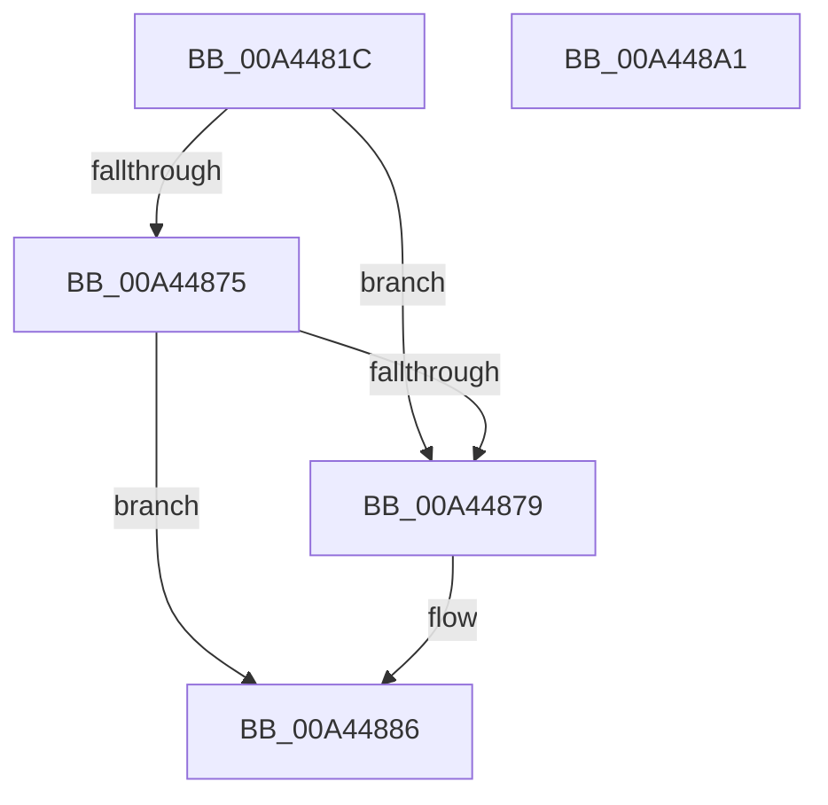

# IopCancelIoFile

- RVA: `0x00A4481C`–`0x00A448A2` (길이 `134` bytes)
- VA: `0x0000000140A4481C`
- 실행 섹션: `PAGE`
- PDB 이름 있음: `예`; PDB Function 태그: `아니요`
- unwind 정보 RVA: `0x000794E0`
- 디코드: `35`개 명령, `134/134` bytes 표시
- 미해석 바이트: `0` (있으면 어셈블리에 `.byte`로 보존)

> 이 문서는 커널 이미지의 기계어와 PDB 기호를 분석해 생성했습니다. 4번과 5번은 함수 원형과 자료형을 바이너리 사용 방식에서 추정한 C 해석이며 원본 소스 복구 결과는 아닙니다.

## 1. Dependencies

- 직접 호출 지점: **2**; 고유 호출 대상: **2**
- 직접 호출자로 확인된 함수: **2**
- RIP 상대 이미지 참조: **0**

### Outgoing calls
- `0x00A44869` → [IopCancelIrpsInFileObjectList](../../text/20/IopCancelIrpsInFileObjectList_function_00207110.md) (function, `0x00207110`)
- `0x00A4487F` → [IopCancelIrpsInThreadListForCurrentProcess](../8C/IopCancelIrpsInThreadListForCurrentProcess_function_008C9C18.md) (function, `0x008C9C18`)

### Direct callers
- [IopIoRingDispatchCancel](../71/IopIoRingDispatchCancel_function_0071F96C.md) at `0x0071F9E8`
- [NtCancelIoFileEx](NtCancelIoFileEx_function_00A44770.md) at `0x00A447DA`

### Static image references
- 디코드된 RIP-relative 메모리 참조가 없습니다.

## 2. Other-region calls and transfers

- 다른 실행 섹션으로 향하는 call: **1**
  - `0x00A44869` → [IopCancelIrpsInFileObjectList](../../text/20/IopCancelIrpsInFileObjectList_function_00207110.md) (`PAGE` → `.text`)
- 별도 외부 분기/꼬리 이동을 확인하지 못했습니다.

## 3. Assembly (complete function range)

```asm
00A4481C  48 89 5C 24 08                  mov qword ptr [rsp + 8], rbx
00A44821  48 89 74 24 10                  mov qword ptr [rsp + 0x10], rsi
00A44826  57                              push rdi
00A44827  48 83 EC 30                     sub rsp, 0x30
00A4482B  65 48 8B 04 25 88 01 00 00      mov rax, qword ptr gs:[0x188]
00A44834  48 8B FA                        mov rdi, rdx
00A44837  C6 44 24 28 00                  mov byte ptr [rsp + 0x28], 0
00A4483C  45 33 C9                        xor r9d, r9d
00A4483F  4C 8B C7                        mov r8, rdi
00A44842  C6 44 24 20 00                  mov byte ptr [rsp + 0x20], 0
00A44847  48 8B F1                        mov rsi, rcx
00A4484A  48 FF 80 90 03 00 00            inc qword ptr [rax + 0x390]
00A44851  65 FF 04 25 E4 2E 00 00         inc dword ptr gs:[0x2ee4]
00A44859  65 48 8B 04 25 88 01 00 00      mov rax, qword ptr gs:[0x188]
00A44862  48 8B 90 B8 00 00 00            mov rdx, qword ptr [rax + 0xb8]
00A44869  E8 A2 28 7C FF                  call 0x140207110
00A4486E  8B D8                           mov ebx, eax
00A44870  48 85 FF                        test rdi, rdi
00A44873  74 04                           je 0x140a44879
00A44875  85 C0                           test eax, eax
00A44877  75 0D                           jne 0x140a44886
00A44879  48 8B D7                        mov rdx, rdi
00A4487C  48 8B CE                        mov rcx, rsi
00A4487F  E8 94 53 E8 FF                  call 0x1408c9c18
00A44884  0B D8                           or ebx, eax
00A44886  48 8B 74 24 48                  mov rsi, qword ptr [rsp + 0x48]
00A4488B  F7 DB                           neg ebx
00A4488D  48 8B 5C 24 40                  mov rbx, qword ptr [rsp + 0x40]
00A44892  1B C0                           sbb eax, eax
00A44894  F7 D0                           not eax
00A44896  25 25 02 00 C0                  and eax, 0xc0000225
00A4489B  48 83 C4 30                     add rsp, 0x30
00A4489F  5F                              pop rdi
00A448A0  C3                              ret
00A448A1  CC                              int3
```

## 4. C-style interpretation (structured pseudocode)

```c
__int64 __fastcall IopCancelIoFile(__int64 a1, __int64 a2, __int64 a3, int a4)
{
    __int64 result;
    __int64 v_rbx;
    __int64 v_rsp;
    unsigned __int8 v_stack_m10;
    unsigned __int8 v_stack_m18;
    unsigned __int64 v_stack_p10;
    unsigned __int64 v_stack_p8;

    v_stack_p8 = v_rbx;
    v_stack_p10 = v_rsi;
    v_rsp = (v_rsp) - (48);
    v_stack_m10 = 0;
    a4 = 0;
    v_stack_m18 = 0;
    result = IopCancelIrpsInFileObjectList(a1, *(unsigned __int64 *)(*(unsigned __int64 *)(gs_base + (0 + 392)) + 184), a2, a4);
    if (a2 == 0) goto loc_00A44879;
    v_rbx = (unsigned int)((unsigned int)(result));
    if ((unsigned int)(result) == 0) {
        a2 = a2;
        a1 = a1;
        result = IopCancelIrpsInThreadListForCurrentProcess(a1, a2, a2, a4);
        v_rbx = (unsigned int)(((unsigned int)((unsigned int)(result))) | ((unsigned int)(result)));
    }
    v_rbx = (unsigned int)(-(v_rbx));
    result = (unsigned int)(~(result));
    result = (unsigned int)((result) & (0xC0000225ULL));
    v_rsp = (v_rsp) + (48);
    return result;
}
```

## 5. (Beta) C Style

```c
int64_t IopCancelIoFile(int64_t Arg1, int64_t Arg2, int64_t Arg3, int32_t Arg4)
{
    int64_t result;
    int64_t local_rbx;
    int64_t local_rsp;
    uint8_t v_stack_m10;
    uint8_t v_stack_m18;
    uint64_t v_stack_p10;
    uint64_t v_stack_p8;

    v_stack_p8 = local_rbx;
    v_stack_p10 = local_rsi;
    local_rsp = (local_rsp) - (48);
    v_stack_m10 = 0;
    Arg4 = 0;
    v_stack_m18 = 0;
    result = IopCancelIrpsInFileObjectList(Arg1, *(uint64_t *)(*(uint64_t *)(gs_base + (0 + 0x188)) + 0xB8), Arg2, Arg4);
    if (Arg2 == 0) goto loc_00A44879;
    local_rbx = (uint32_t)((uint32_t)(result));
    if ((uint32_t)(result) == 0) {
        Arg2 = Arg2;
        Arg1 = Arg1;
        result = IopCancelIrpsInThreadListForCurrentProcess(Arg1, Arg2, Arg2, Arg4);
        local_rbx = (uint32_t)(((uint32_t)((uint32_t)(result))) | ((uint32_t)(result)));
    }
    local_rbx = (uint32_t)(-(local_rbx));
    result = (uint32_t)(~(result));
    result = (uint32_t)((result) & (0xC0000225ULL));
    local_rsp = (local_rsp) + (48);
    return result;
}
```

## 6. Execution-region graph

[열기: 2D/3D 그래프와 함수 탐색 컨트롤 패널](../../../control-panel.html?section=page&rva=0x00A4481C&view=graph)

- 2D 그래프는 위에서 아래로 흐르고, 3D 그래프는 빈 공간을 드래그해 회전합니다. Shift+드래그는 이동, 휠은 확대·축소, 함수 노드 선택은 대상 보고서 이동입니다.

### Static fallback


